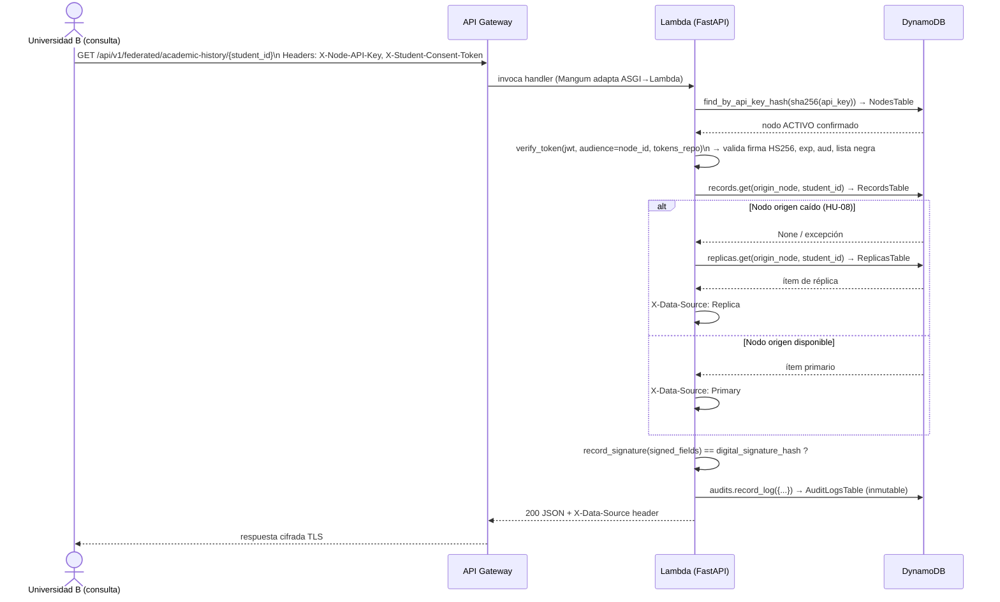
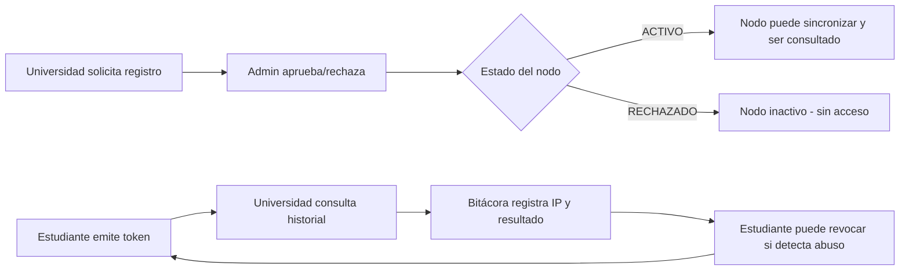

# RFHA-IES — Red Federada de Historiales Académicos

> Sistema distribuido de intercambio federado de historiales académicos interuniversitarios, desplegado como serverless en AWS.

**URL pública:** `https://ypybm0azfg.execute-api.us-east-2.amazonaws.com`  
**Rama activa:** `dev` → PR hacia `main`  
**Stack:** Python 3.12 · FastAPI · AWS Lambda + API Gateway · DynamoDB · Mangum

---

## Tabla de módulos

| Módulo web | URL | Descripción |
|------------|-----|-------------|
| Inicio | `/` | Menú principal |
| Registro de universidad | `/registro-nodo` | HU-01 |
| Administración | `/admin` | HU-02 |
| Panel del nodo | `/panel-nodo` | HU-03 |
| Portal del estudiante | `/portal-estudiante` | HU-04 / HU-05 |
| Consulta federada | `/consulta` | HU-06 / HU-07 / HU-08 |
| Bitácora de auditoría | `/auditoria` | HU-09 |
| Reportes ejecutivos | `/reportes` | PDF por tipo de reporte |

---

## 1. Arquitectura general

```mermaid
flowchart TD
    subgraph Nodos["Nodos IES (universidades)"]
        N1[Universidad A\nPanel del nodo]
        N2[Universidad B\nPanel del nodo]
    end

    subgraph Middleware["Middleware RFHA-IES\n(AWS Lambda + API Gateway)"]
        GW[API Gateway\nus-east-2]
        LM[AWS Lambda\nFastAPI + Mangum]
        DB[(DynamoDB\n5 tablas)]
    end

    subgraph Actores["Actores externos"]
        STU[Estudiante\nPortal web]
        ADM[Administrador\nPanel /admin]
    end

    N1 -->|POST /api/v1/node/sync-records\nX-Node-API-Key| GW
    N2 -->|GET /api/v1/federated/academic-history/{id}\nX-Student-Consent-Token| GW
    STU -->|POST /api/v1/students/token\nCredenciales + nodo destino| GW
    ADM -->|PATCH /api/v1/admin/nodes/{id}/approve\nX-Admin-Key| GW

    GW --> LM
    LM --> DB
```

### Flujo completo de una petición



---

## 2. Fundamentos teóricos aplicados al código

### 2.1 ¿Qué es el Middleware y por qué RFHA-IES lo es?

Un **middleware** es una capa de software que actúa como intermediario entre sistemas heterogéneos: recibe mensajes, los valida, transforma o enruta, y los entrega al destino correcto — sin que los extremos se conozcan directamente.

RFHA-IES cumple exactamente este rol:

| Función de middleware | Dónde ocurre en el código |
|-----------------------|---------------------------|
| **Interceptación** de cada petición | `src/app/security.py` → `require_node()` y `require_admin()` validan la identidad antes de que el router procese nada |
| **Transformación** de datos | `src/app/routers/federated.py` → `_plain()` convierte `Decimal` de DynamoDB a tipos JSON; `_summary()` agrega GPA y créditos |
| **Enrutamiento federado** | `federated.py` → decide entre `records` (primario) y `replicas` (réplica) según el estado del nodo origen |
| **Verificación de integridad** | `security.py` → `record_signature()` recalcula SHA-256 del JSON canónico y compara con `digital_signature_hash` |
| **Bitácora transversal** | `federated.py` → `_log()` escribe en `AuditLogsTable` en cada rama del flujo (éxito, denegado, error) |

### 2.2 Sistema distribuido vs. centralizado

RFHA-IES es un **sistema distribuido federado**, no un monolito, por las siguientes evidencias en el código:

| Propiedad SD | Evidencia en el código |
|---|---|
| **Nodos autónomos con identidad propia** | Cada universidad recibe una API Key única (`security.py → new_api_key()`) cuyo hash SHA-256 se guarda en `NodesTable`. El nodo **nunca** puede escribir datos de otro: `sync.py` L.40 → `"node_id": node["node_id"]` viene de la API Key autenticada, no del body. |
| **Particionamiento de datos** | `repositories.py → record_key()` L.152: `f"{node_id}#{student_id}"` — cada registro está segmentado por nodo. Un nodo no puede acceder a registros ajenos. |
| **Comunicación por red con protocolo** | Todo intercambio es HTTP REST con cabeceras de autenticación (`X-Node-API-Key`, `X-Student-Consent-Token`, `X-Admin-Key`). |
| **Ausencia de estado local compartido** | Lambda es stateless: cada invocación es independiente. El estado está exclusivamente en DynamoDB. |
| **Tolerancia a particiones (CAP)** | `federated.py` L.100-114: si el nodo origen falla, se activa failover automático a `ReplicasTable` (modelo AP). |
| **Service Registry** | `nodes.py → GET /api/v1/nodes/active`: devuelve los nodos disponibles — equivalente a Eureka/Consul. |
| **Autorización delegada** | El estudiante emite un JWT con `aud` = ID del nodo destino (`tokens.py`). Un token para Universidad A no sirve para Universidad B (`verify_token` lanza `InvalidAudienceError`). |

### 2.3 Teorema CAP

RFHA-IES es un sistema **AP** (Available + Partition-tolerant):

- **Disponibilidad:** ante fallo del nodo primario, la réplica responde (L.111-114 `federated.py`).
- **Tolerancia a particiones:** el middleware sigue operando aunque un nodo IES esté caído.
- **Consistencia eventual:** la réplica puede estar ligeramente detrás del primario; es la última versión sincronizada (`sync.py` L.57-58: `records.upsert()` → `replicas.upsert()` en el mismo request).

---

## 3. Infraestructura AWS — Mapeo código↔nube

| Servicio AWS | Rol | Configuración | Archivo relevante |
|---|---|---|---|
| **AWS Lambda** | Ejecuta la app FastAPI (serverless) | Runtime Python 3.12, timeout configurable en SAM template | `src/app/main.py` L.58 → `handler = Mangum(app, lifespan="off")` |
| **API Gateway (HTTP API)** | Punto de entrada único; enruta al Lambda | Integración proxy (`/{proxy+}`) | `template.yaml` (generado por `scripts/deploy_aws.py`) |
| **DynamoDB** | Persistencia NoSQL distribuida | 5 tablas, capacidad on-demand, AES-256 en reposo | `src/app/repositories.py` → clases `Dynamo*Repository` |
| **S3** | Almacenamiento del paquete Lambda antes del deploy | Bucket temporal durante `sam package` | `scripts/deploy_aws.py` |
| **CloudFormation / SAM** | IaC: define Lambda + API GW + permisos IAM | Stack `rfha-app` en `us-east-2` | `scripts/deploy_aws.py` |
| **IAM** | Rol de ejecución del Lambda con permisos DynamoDB | Generado automáticamente por SAM | `template.yaml` |

### ¿Por qué DynamoDB y no RDS/PostgreSQL?

| Criterio | DynamoDB | RDS |
|---|---|---|
| Escalado | Automático (on-demand), sin gestión de servidores | Requiere provisionar instancias |
| Latencia baja | Acceso por clave de partición en < 10 ms | Depende del tamaño de la query |
| TTL nativo | Elimina tokens vencidos automáticamente (`ttl` = exp del JWT) | Requiere job periódico |
| Modelo de acceso | Por clave (`node_id#student_id`), sin JOINs | Relacional, óptimo para JOINs |
| Sin estado de conexión | Perfecto para Lambda (no mantiene conexión persistente) | Connection pooling necesario |

El esquema de acceso del proyecto (siempre por `node_id` + `student_id`) es exactamente el caso de uso ideal de DynamoDB.

---

## 4. Persistencia y base de datos

### Tablas DynamoDB

| Tabla | Clave de partición | Propósito | Clase repositorio |
|---|---|---|---|
| `NodesTable` | `node_id` (IES-XXXXXXXX) | Nodos institucionales y hash de API Key | `DynamoNodeRepository` |
| `RecordsTable` | `record_key` (`node_id#student_id`) | Historiales académicos (primario) | `DynamoRecordRepository` |
| `ReplicasTable` | `record_key` | Copia de réplica para failover (HU-08) | `DynamoRecordRepository` (misma clase, tabla distinta) |
| `TokensTable` | `jti` (UUID hex) | Tokens activos del estudiante + lista negra | `DynamoTokenRepository` |
| `AuditLogsTable` | `log_id` (AUDIT-XXXXXXXXXXXX) | Bitácora inmutable (solo PutItem) | `DynamoAuditRepository` |

### Patrón de acceso clave

```python
# repositories.py L.152
def record_key(node_id: str, student_id: str) -> str:
    return f"{node_id}#{student_id}"
```

Esto garantiza que el Scan de DynamoDB por `document_number` (`find_by_document`) siempre opera dentro del espacio de claves de un nodo, y que el `upsert` por `record_key` sea idempotente (carga repetida = actualización).

### Neguentropía mediante TTL

```python
# repositories.py L.235 (DynamoTokenRepository)
# El atributo `ttl` (= exp del token) hace que DynamoDB borre el registro al vencer.
```

El atributo `ttl` = Unix timestamp de expiración del JWT. DynamoDB lo elimina automáticamente dentro de las 48 h posteriores al vencimiento, manteniendo la tabla limpia sin ningún job de limpieza — esto es **neguentropía aplicada** (el sistema expulsa "ruido" de forma autónoma).

---

## 5. Seguridad: cifrado y mecanismos de protección

### Capas de cifrado

| Capa | Mecanismo | Código |
|---|---|---|
| **En tránsito** | TLS 1.2+ forzado por API Gateway (AWS gestiona el certificado) | Transparente en infraestructura |
| **API Key del nodo** | SHA-256 (nunca se guarda en texto plano) | `security.py → hash_api_key()` L.23-24 |
| **Contraseña del estudiante** | PBKDF2-HMAC-SHA256, 100.000 iteraciones, sal de 16 bytes aleatoria | `security.py → hash_password()` L.29-32 |
| **Firma del historial** | SHA-256 del JSON canónico (sort_keys, sin espacios) | `security.py → record_signature()` L.55-57 |
| **Token de consentimiento** | JWT HS256 con `jti`, `aud`, `exp` y lista negra en DynamoDB | `tokens.py → issue_token()` / `verify_token()` |
| **En reposo (DynamoDB)** | AES-256 gestionado por AWS KMS (activado por defecto) | Configuración de infraestructura AWS |
| **Timing-safe comparisons** | `hmac.compare_digest()` para Admin Key y contraseñas | `security.py` L.44-47, L.65 |

### CSP (Content Security Policy)

```python
# main.py L.12-18
PAGE_HEADERS = {
    "Content-Security-Policy": (
        "default-src 'self'; img-src 'self'; style-src 'self'; script-src 'self'; "
        "base-uri 'none'; form-action 'self'; frame-ancestors 'none'"
    ),
    ...
}
```

Todos los scripts son externos (`type="module"`) para cumplir con `script-src 'self'`. No hay inline scripts ni inline styles.

---

## 6. Alta disponibilidad y tolerancia a fallos

### ¿Por qué el sistema no se cae?

| Mecanismo | Detalle |
|---|---|
| **Escalado automático de Lambda** | AWS instancia múltiples ejecuciones concurrentes en milisegundos ante picos de carga. No hay servidor que administrar. SLA: 99.95%. |
| **Failover a réplica (HU-08)** | `federated.py` L.100-114: si `records.get()` retorna `None` o lanza excepción, se consulta `ReplicasTable` automáticamente. La cabecera `X-Data-Source: Replica` lo evidencia. |
| **Simulación de caída** | La cabecera `X-Simulate-Down: true` (o la variable `SIMULATE_NODE_DOWN` en `.env`) fuerza el failover sin necesidad de apagar nada. |
| **Idempotencia del upsert** | Si una sincronización falla a mitad, se puede re-ejecutar sin duplicar datos: `put_item` sobreescribe por `record_key`. |
| **Tokens con expiración** | TTL de 24 h evita acumulación de tokens activos. La lista negra permite revocación inmediata. |
| **Bitácora inmutable** | `AuditLogsTable` solo recibe `PutItem` (nunca `UpdateItem` ni `DeleteItem`). Cualquier operación queda trazada con IP, resultado y fuente de datos. |

---

## 7. Ejecución local

```bash
# 1. Crear entorno y arrancar
python scripts/run_demo.py --app --port 8001

# 2. Tests completos
.venv/Scripts/pytest -q

# 3. Deploy a AWS
python scripts/deploy_aws.py app --profile rfha --region us-east-2
```

### Variables de entorno (`.env`)

| Variable | Descripción | Default |
|---|---|---|
| `REPOSITORY_BACKEND` | `memory` (local) o `dynamodb` (AWS) | `memory` |
| `ADMIN_KEY` | Clave del administrador general | — |
| `JWT_SECRET` | Secreto de firma de tokens | valor de desarrollo |
| `SIMULATE_NODE_DOWN` | `node_id` de nodo a simular caído | — |
| `NODES_TABLE` | Nombre de la tabla DynamoDB | `NodesTable` |
| `RECORDS_TABLE` | — | `RecordsTable` |
| `REPLICAS_TABLE` | — | `ReplicasTable` |
| `TOKENS_TABLE` | — | `TokensTable` |
| `AUDIT_TABLE` | — | `AuditLogsTable` |

---

## 8. Historias de usuario implementadas

| HU | Descripción | Router / archivo principal |
|----|-------------|---------------------------|
| HU-01 | Registro de universidad como nodo | `routers/nodes.py → POST /api/v1/nodes/register` |
| HU-02 | Aprobación de nodo por administrador | `routers/admin.py → POST /api/v1/admin/nodes/{id}/approve` |
| HU-03 | Sincronización de historiales | `routers/sync.py → POST /api/v1/node/sync-records` |
| HU-04 | Emisión de token de consentimiento | `routers/students.py → POST /api/v1/students/token` |
| HU-05 | Revocación de token | `routers/students.py → DELETE /api/v1/students/token/{jti}` |
| HU-06 | Consulta federada con token | `routers/federated.py → GET /api/v1/federated/academic-history/{id}` |
| HU-07 | Bloqueo por token inválido / revocado | mismo endpoint, control L.86-94 |
| HU-08 | Tolerancia a fallos + conmutación a réplica | mismo endpoint, control L.100-114 |
| HU-09 | Bitácora inmutable de auditoría + filtro `since` | `routers/audit.py` + `_log()` en `federated.py` |
| HU-10 | Interfaz web completa | `main.py PAGES` + `static/` |
| SD-01 | Control de concurrencia optimista (ConditionExpression) | `repositories.py → DynamoRecordRepository.upsert()` |
| SD-04 | Estado de salud de nodos (ACTIVO/DEGRADADO) | `routers/admin.py → PATCH /api/v1/admin/nodes/{id}/status` |

---

## 9. Bucles de retroalimentación (TGS)



Los tres loops de feedback del sistema:
1. **Aprobación:** Solicitud → Revisión admin → Estado nodo → Capacidad de operación.
2. **Consentimiento:** Emisión de token → Consulta → Auditoría → Revocación si necesario.
3. **Integridad:** Sincronización firma SHA-256 → Consulta verifica firma → Error 500 si no coincide → Nodo debe re-sincronizar.

---

## 10. Estructura del repositorio

```
src/
├── app/
│   ├── config.py          # Variables de entorno
│   ├── main.py            # FastAPI app + páginas HTML + handler Lambda
│   ├── models.py          # Pydantic models (validación de entrada)
│   ├── repositories.py    # Acceso a DynamoDB (Protocol + In-Memory + Dynamo)
│   │                        # → DynamoRecordRepository.upsert: ConditionExpression SD-01
│   ├── security.py        # SHA-256, PBKDF2, firma, control de acceso
│   ├── tokens.py          # JWT HS256: emisión y verificación
│   ├── reports.py         # Generación de PDF con ReportLab
│   ├── routers/
│   │   ├── admin.py       # HU-02 + PATCH /nodes/{id}/status (SD-04)
│   │   ├── audit.py       # HU-09: bitácora + ?since (B5) + no-cache
│   │   ├── federated.py   # HU-06/07/08: consulta federada
│   │   ├── nodes.py       # HU-01: registro
│   │   ├── students.py    # HU-04/05: tokens
│   │   └── sync.py        # HU-03: sincronización + manejo 409 SD-01
│   └── static/            # HTML + CSS + JS (sin framework de build)
scripts/
├── deploy_aws.py          # SAM build + package + deploy
└── run_demo.py            # Entorno local con venv automático
tests/                     # suite pytest
```

---

## 11. Diagramas TGS — DFD Nivel 0 y Nivel 1 (TGS-01)

### DFD Nivel 0 — Vista del sistema completo


### DFD Nivel 1 — Procesos internos del Middleware


---

## 12. Sistema abierto y propiedades TGS (TGS-02)

| Propiedad TGS | Implementación en RFHA-IES |
|---|---|
| **Sistema abierto** | Interactúa con el entorno (universidades, estudiantes, admin) a través de API REST (frontera definida: HTTP + TLS) |
| **Subsistemas** | Nodo de registro (`nodes.py`), gestión admin (`admin.py`), historial (`sync.py`), autenticación (`students.py`), auditoría (`audit.py`), consulta federada (`federated.py`) |
| **Equifinalidad** | Múltiples rutas al mismo resultado: consulta exitosa vía nodo primario (`RecordsTable`) o vía réplica (`ReplicasTable`) — mismo JSON de respuesta, distinto `X-Data-Source` |
| **Homeostasis** | El sistema mantiene consistencia ante fallos gracias al failover automático (`federated.py` L.100-114) y la lista negra de tokens (`TokensTable.revoked=True`) |
| **Neguentropía** | (1) Firmas SHA-256 detectan corrupción → `record_signature()`. (2) Bitácora inmutable preserva historia → solo `PutItem` en `AuditLogsTable`. (3) TTL automático en `TokensTable` elimina tokens vencidos. (4) `ConditionExpression` en `DynamoRecordRepository.upsert()` evita escrituras conflictivas. |
| **Retroalimentación** | Loop de aprobación, loop de consentimiento/revocación, loop de integridad (ver §9) |
| **Bucles de feedback** | Ver §9 — cada loop tiene evidencia directa en el código con archivo y línea |

---

## 13. Decisiones Arquitectónicas y Trade-offs

| Decisión | Alternativa | Justificación técnica |
|---|---|---|
| **DynamoDB on-demand** | RDS PostgreSQL | Sin gestión de servidores; TTL nativo para tokens; latencia < 10 ms por clave; ideal para Lambda stateless |
| **JWT HS256 (simétrico)** | RS256 (asimétrico) | Menor overhead computacional; en este modelo el middleware es la única parte que emite y verifica tokens. RS256 sería necesario si los nodos verificaran tokens directamente. |
| **Replicación síncrona** | DynamoDB Streams + SQS | Simple y verificable. La desventaja: si `replicas.upsert()` falla, la réplica queda desactualizada silenciosamente. Para producción: DynamoDB Streams desacoplaría la replicación sin riesgo de fallo síncrono. |
| **API Key en header** | OAuth2 Client Credentials | Más simple de implementar y demostrar; OAuth2 agrega un Authorization Server que escapa al alcance del proyecto académico. |
| **ADMIN_KEY estática** | AWS Secrets Manager | Rotación manual. Para producción se usaría Secrets Manager con rotación automática y Lambda extension para cachear la clave sin consultar el API en cada request. |
| **Cifrado de campo** | AES-256 en reposo (AWS KMS, default) | El campo `doc` (cédula) viaja en el payload JWT sin cifrar (solo firmado). En producción se reemplazaría por JWE (JSON Web Encryption) o se usaría un hash del documento como identificador público. |
| **Concurrencia optimista** | Bloqueo pesimista (mutex) | Lambda es stateless — no puede mantener bloqueos entre invocaciones. `ConditionExpression` en DynamoDB es el mecanismo nativo para control de concurrencia sin locks distribuidos. |
