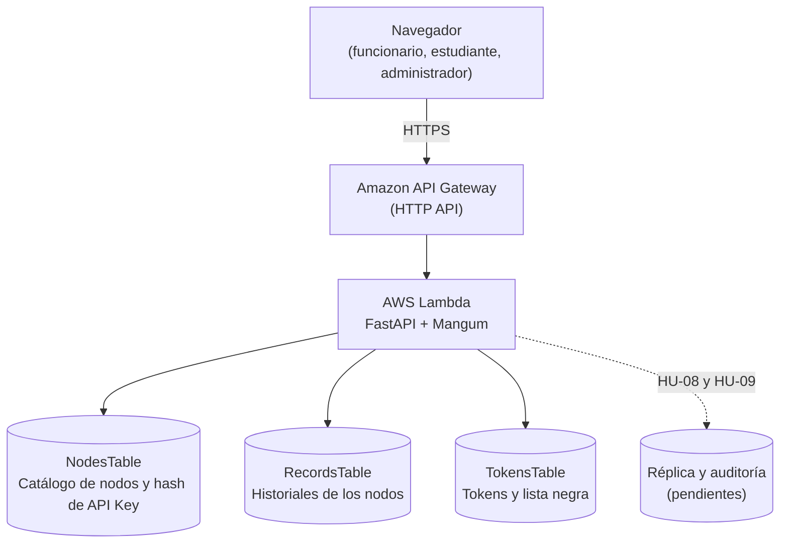

# RFHA-IES — Red Federada de Historiales Académicos de Instituciones de Educación Superior


Sistema distribuido y descentralizado que conecta a las universidades en una red interoperable. Un funcionario de una universidad puede consultar, en segundos, el historial académico de un estudiante de **otra** universidad, **siempre que el estudiante lo autorice** con un token de consentimiento digital. Los datos permanecen en el nodo de origen de cada institución.

## Pruébalo ahora (en AWS)

| | Dirección |
|---|---|
| **Demo del middleware** (consulta de un historial con permiso del estudiante) | https://qotg90dhje.execute-api.us-east-2.amazonaws.com |
| **App final: menú de inicio** (explica el proyecto y lleva a cada módulo) | https://ypybm0azfg.execute-api.us-east-2.amazonaws.com |
| App final: registro de universidad (HU-01) | https://ypybm0azfg.execute-api.us-east-2.amazonaws.com/registro-nodo |
| App final: administración (HU-02) | https://ypybm0azfg.execute-api.us-east-2.amazonaws.com/admin |
| App final: panel del nodo (HU-03) | https://ypybm0azfg.execute-api.us-east-2.amazonaws.com/panel-nodo |
| App final: portal del estudiante (HU-04 y HU-05) | https://ypybm0azfg.execute-api.us-east-2.amazonaws.com/portal-estudiante |

- La primera visita puede tardar unos segundos (arranque en frío de AWS Lambda); después responde en menos de un segundo.
- Todos los datos son **ficticios**. La demo está en modo demostración (botones que simulan al estudiante) y se apagará después de la exposición.
- Para entrar a `/admin` hace falta la clave de administrador, que **no** está en este repositorio; el equipo la tiene.
- Cómo usar la demo: `docs/DEMO.md`. Cómo usar la app final, y cómo se conecta el código con AWS: `docs/APP_FINAL.md`.

## Contenido

1. [Ficha del proyecto](#1-ficha-del-proyecto)
2. [Resumen y problema que resuelve](#2-resumen-y-problema-que-resuelve)
3. [Alcance y actores](#3-alcance-y-actores)
4. [Requerimientos funcionales](#4-requerimientos-funcionales)
5. [Requerimientos no funcionales](#5-requerimientos-no-funcionales)
6. [Historias de usuario](#6-historias-de-usuario)
7. [Arquitectura, stack y modelo de datos](#7-arquitectura-stack-y-modelo-de-datos)
8. [Mapeo con Sistemas Distribuidos y Teoría General de Sistemas](#8-mapeo-con-sistemas-distribuidos-y-teoría-general-de-sistemas)
9. [Lo que se ha hecho (estado del proyecto)](#9-lo-que-se-ha-hecho-estado-del-proyecto)
10. [Cómo ejecutarlo desde la terminal de VS Code](#10-cómo-ejecutarlo-desde-la-terminal-de-vs-code)
11. [Pruebas, CI y CD](#11-pruebas-ci-y-cd)
12. [Estructura del repositorio](#12-estructura-del-repositorio)
13. [Documentación](#13-documentación)
14. [Cronograma y riesgos](#14-cronograma-y-riesgos)
15. [Flujo de trabajo en Git](#15-flujo-de-trabajo-en-git)

---

## 1. Ficha del proyecto

| | |
|---|---|
| **Proyecto** | Red Federada de Historiales Académicos de Instituciones de Educación Superior (RFHA-IES) |
| **Asignaturas** | Sistemas Distribuidos (165-301) y Teoría General de Sistemas (TGS) |
| **Docentes** | Ismael Antonio Ardila Sánchez · Miguel Ángel Leguizamón Páez |
| **Institución** | Universidad Distrital Francisco José de Caldas, Facultad Tecnológica |
| **Programa** | Ingeniería en Telemática (Grupo 1) |
| **Autores** | Santiago Alfonso Prieto · Brayan Acosta Parrado · Malfaida Nicol Salazar Cruz · Cristian Darío Prieto Avella · Felipe Andrés Rojas González |
| **Versión del levantamiento** | 2.0.0, noviembre de 2026 (con la adenda de frontend, 2.1) |
---

## 2. Resumen y problema que resuelve

Hoy las instituciones de educación superior (IES) operan como islas de información. El historial académico (notas, asignaturas, créditos, títulos) está fragmentado en bases de datos heterogéneas. Para una homologación, una beca interinstitucional o la validación de un título, el estudiante gestiona certificados firmados a mano. El trámite toma entre **15 y 45 días hábiles**, cuesta dinero y se puede falsificar.

**Por qué no una base de datos nacional única:** sería un punto único de falla y un riesgo de filtración masiva. Por eso los datos **se quedan en el nodo de cada universidad** y la red solo los consulta con consentimiento.

**Beneficios**
- **Para las IES:** homologaciones de semanas a segundos, menos papeleo y documentos íntegros.
- **Para los estudiantes:** control total de sus datos mediante un token de consentimiento temporal que pueden revocar.
- **Para los entes reguladores:** un entorno tolerante a fallos y auditable que dificulta alterar historiales.

**Restricción inviolable:** todo el diseño debe caber en el **AWS Free Tier** (costo cero).

---

## 3. Alcance y actores

### Incluido
- Ciclo de vida completo: registro de una universidad como nodo, emisión de claves de API, gestión de usuarios y consulta de expedientes.
- Microservicios serverless en AWS: Lambda, API Gateway (HTTP API) y DynamoDB.
- Middleware de Web Services REST con mensajes JSON entre nodos.
- Autenticación de nodos con API Key y consentimiento del estudiante con token JWT (`student_auth_token`).
- Tolerancia a fallos: si un nodo no responde, la consulta se atiende desde una réplica autorizada.
- Modelado sistémico (diagramas causal y de Forrester) para Teoría General de Sistemas.
- Aplicación web responsiva (HTML, CSS y JavaScript nativos servidos por la misma Lambda).

### Excluido
- Integración directa con motores SQL reales de universidades (se simulan con DynamoDB por nodo).
- Aplicaciones móviles nativas.
- Infraestructura de pago en AWS.

### Actores

| Actor | Responsabilidad |
|---|---|
| **Administrador general de la red** | Valida a las IES, aprueba nodos y emite sus credenciales. |
| **Administrador institucional (IES)** | Configura su nodo, gestiona funcionarios e integra su base de datos. |
| **Funcionario de registro y admisiones** | Consulta el historial de un estudiante de otra universidad para homologar. |
| **Estudiante (titular del dato)** | Genera, ve y revoca tokens de consentimiento temporales. |
| **Nodo institucional (IES origen)** | Custodia los datos originales y responde a la red tras validar el consentimiento. |
| **Evaluador académico** | Docentes de Sistemas Distribuidos y TGS. |

---

## 4. Requerimientos funcionales

Estado: **Hecho** (completo), **Demo** (solo en la demo del middleware), **Parcial** o **Pendiente**.

| ID | Requerimiento | Prioridad | Estado |
|---|---|---|---|
| **RF-01** | Solicitud de registro de un nodo IES (queda en `PENDIENTE_APROBACION`). | Alta | **Hecho** (HU-01: API y formulario web) |
| **RF-02** | Aprobación del nodo y emisión de `API_KEY` y `NODE_ID`. | Alta | **Hecho** (HU-02: API, pantalla `/admin`, solo se guarda el hash SHA-256) |
| **RF-03** | Carga y sincronización del historial académico del nodo. | Alta | **Hecho** (HU-03: `POST /api/v1/node/sync-records`, pantalla `/panel-nodo`) |
| **RF-04** | Generación del token de consentimiento por el estudiante (JWT de 24 h). | Alta | **Hecho** (HU-04: portal del estudiante). La demo lo simula con botones. |
| **RF-05** | Consulta transparente a través del middleware en menos de 1,5 s. | Alta | Parcial: **Demo** |
| **RF-06** | Rechazo `403` sin token o con token expirado. | Alta | **Demo** (falta en la app final) |
| **RF-07** | Visualización del historial para homologación. | Media | **Demo** (materias, créditos, notas y panel de homologación) |
| **RF-08** | Auditoría y trazabilidad de consultas. | Alta | Pendiente (HU-09) |
| **RF-09** | Tolerancia a fallos: desvío a una réplica tras 2000 ms. | Alta | Pendiente (HU-08) |
| **RF-10** | Revocación de consentimiento. | Media | **Hecho** (HU-05: lista negra en `TokensTable`). Falta que la consulta federada (HU-06/07) la aplique. |

**Requerimientos de la interfaz web** (adenda de frontend):

| ID | Requerimiento | Estado |
|---|---|---|
| **RF-11** | Consulta visual del historial. | **Demo** |
| **RF-12** | Visualización de la validación del middleware (4 controles). | **Demo** |
| **RF-13** | Registro de universidad desde la web. | **Hecho** (HU-01) |
| **RF-14** | Panel del administrador general. | **Hecho** (HU-02, `/admin`); pulido en HU-10 |
| **RF-15** | Panel del nodo (carga de historiales). | **Hecho** (HU-03, `/panel-nodo`); pulido en HU-10 |
| **RF-16** | Portal del estudiante (generar, ver y revocar tokens). | **Hecho** (HU-04 y HU-05, `/portal-estudiante`); pulido en HU-10 |
| **RF-17** | Indicador de fuente de datos (`X-Data-Source`). | Pendiente (HU-10) |
| **RF-18** | Consulta de auditoría. | Pendiente (HU-10) |
| **RF-19** | Modo demostración (simula al estudiante). | **Demo** |

---

## 5. Requerimientos no funcionales

| Categoría | Requerimiento | Estado |
|---|---|---|
| **Rendimiento** | Tiempo de respuesta total menor a 2000 ms (meta de consulta normal 1,5 s). | Por medir en AWS |
| **Seguridad y privacidad** | Comunicación por HTTPS (TLS) y datos cifrados en reposo. | HTTPS por defecto en API Gateway; el cifrado por defecto de DynamoDB se usa en lugar de una clave KMS propia (cuesta) |
| **Disponibilidad** | 99,9 % con el despliegue multi-zona nativo de API Gateway y Lambda. | Diseño serverless aplicado |
| **Escalabilidad** | De 0 a 1000 solicitudes por minuto sin intervención manual. | Diseño serverless aplicado |
| **Costo** | 100 % dentro del AWS Free Tier. | Aplicado en el diseño; el costo real se verifica al desplegar |
| **Accesibilidad (frontend)** | WCAG 2.2 AA, adaptable a celular, modo claro/oscuro, CSP estricta, sin dependencias. | Aplicado en la demo y el formulario de HU-01 |

---

## 6. Historias de usuario

| ID | Historia | Talla | Cobertura | Estado |
|---|---|---|---|---|
| **HU-01** | Registro e inscripción de un nuevo nodo institucional (IES) | 3 · S | RF-01, RF-13 | **Terminada** y desplegada en AWS |
| **HU-02** | Aprobación de nodo y expedición de la API Key (se guarda solo el hash SHA-256) | 5 · M | RF-02, RF-14 | **Terminada** y desplegada en AWS |
| **HU-03** | Carga masiva y sincronización de expedientes (`POST /api/v1/node/sync-records`) | 5 · M | RF-03, RF-15 | **Terminada** y desplegada en AWS |
| **HU-04** | Autenticación del estudiante y generación del token de consentimiento | 5 · M | RF-04, RF-16 | **Terminada** y desplegada en AWS |
| **HU-05** | Revocación manual de consentimiento (lista negra) | 3 · S | RF-10, RF-16 | **Terminada** y desplegada en AWS |
| **HU-06** | Consulta federada interinstitucional de historial | 8 · L | RF-05, RF-07 | **Terminada** (`/consulta`, `GET /api/v1/federated/academic-history/{id}`); falta medir el tiempo en AWS |
| **HU-07** | Bloqueo de consultas no autorizadas | 3 · S | RF-06 | **Terminada** (6 controles con 403: API Key, token, vigencia, destino, lista negra y titular) |
| **HU-08** | Conmutación por error a una réplica (`X-Data-Source`) | 8 · L | RF-09 | Pendiente |
| **HU-09** | Trazabilidad e inmutabilidad de la bitácora de consultas | 5 · M | RF-08 | Pendiente |
| **HU-10** | Interfaz web de la app final (adenda de frontend) | 13 · XL | RF-11 a RF-19 | Pendiente (el formulario de HU-01 ya existe) |

**Criterios de aceptación de HU-01** (Given / When / Then): *dado* que el representante ingresa al formulario `/registro-nodo`, *cuando* envía NIT, nombre institucional, dominio web y correo de contacto, *entonces* el sistema crea el nodo en estado `PENDIENTE_APROBACION` y genera un ID. Detalle, casos de prueba y matriz de criterios en `docs/historias/HU-01.md`.

**Criterios de HU-02 a HU-05:** en `docs/historias/HU-02.md` a `HU-05.md`, cada uno con su matriz criterio → prueba automática.

**Orden de desarrollo:** una historia a la vez, en el orden de la tabla. El equipo autorizó avanzar de corrido de HU-01 a HU-05. Desde HU-06 se vuelve a pedir el «aprobado» historia por historia.

---

## 7. Arquitectura, stack y modelo de datos

### Arquitectura



En la **demo** los datos están en el código (no usa base de datos). La app final usa hoy tres tablas de DynamoDB (HU-01 a HU-05); la réplica y la auditoría llegan con HU-08 y HU-09. La interfaz web se sirve desde la misma Lambda, sin S3 ni CloudFront. Cómo se comunica el código con AWS: `docs/DEMO.md` (sección 4.11) y `docs/APP_FINAL.md` (secciones 2 y 3).

### Servicios y stack

| Capa | Tecnología | Por qué |
|---|---|---|
| Entrada y transporte | **Amazon API Gateway** (HTTP API) | Punto único de entrada y HTTPS nativo. Dentro del Free Tier según el plan de la cuenta (ver `docs/BRECHAS.md`). |
| Lógica | **AWS Lambda** (Python 3.12) con **FastAPI + Mangum** | Sin servidores; FastAPI genera el contrato OpenAPI y Mangum lo adapta a Lambda. |
| Datos | **Amazon DynamoDB** (NoSQL) | Esquema flexible para datos académicos heterogéneos; 25 GB gratuitos. |
| Seguridad | **PyJWT** (HS256), claves de API con hash SHA-256, claves de estudiante con PBKDF2 | Tokens firmados con expiración; nunca se guardan claves en claro. |
| Validación | **Pydantic** | Validación estricta de entradas y salidas. |
| Acceso a AWS | **boto3** | SDK oficial. |
| Despliegue | **CloudFormation** con `scripts/deploy_aws.py` | Lambda + API Gateway + DynamoDB con un comando; plantillas con sintaxis corta de SAM, sin instalar SAM CLI. |
| Frontend | HTML, CSS y JavaScript nativos | Cero dependencias, accesible y rápido. |
| Pruebas | **pytest**, **moto** | `moto` simula DynamoDB sin tocar AWS. |

### Modelo de datos (DynamoDB)
- **Clave de partición (`PK`):** `INSTITUCION#ID_ESTUDIANTE` (por ejemplo `UDISTRITAL#20262678029`).
- **Clave de ordenamiento (`SK`):** `ACADEMIC_RECORD#SEMESTRE` (por ejemplo `ACADEMIC_RECORD#2026-1`).
- **Documento:** datos del estudiante (`student_info`), resumen académico (`academic_summary`: promedio, créditos, estado), lista de asignaturas (`courses`) y metadatos del nodo con el hash de integridad (`node_metadata`).
- **Tablas que existen hoy en la app final:**

| Tabla | Clave | Contenido |
|---|---|---|
| `NodesTable` | `node_id` | NIT, nombre, dominio, correo, estado y `api_key_hash` (SHA-256). |
| `RecordsTable` | `record_key` = `node_id#student_id` | Cédula, nombre, programa, asignaturas, `password_hash` (PBKDF2) y `digital_signature_hash` (SHA-256). |
| `TokensTable` | `jti` | Tokens emitidos, universidad destino, `revoked` (lista negra) y `ttl` (borrado automático al vencer). |

  El diseño de claves `PK`/`SK` de arriba es el objetivo para HU-06 en adelante; hoy `RecordsTable` usa una sola clave compuesta (`docs/historias/HU-03.md`).

### Contrato de la API (resumen)

| Método y ruta | Quién | Historia | Respuestas |
|---|---|---|---|
| `GET /api/v1/federated/academic-history/{student_id}` con `X-Student-Consent-Token` (demo) | Funcionario | HU-06/07 (demo) | 200, 403, 404 |
| `POST /api/v1/nodes/register` | Público | HU-01 | 201, 409, 422 |
| `GET /api/v1/nodes/active` | Público | HU-04 | 200 |
| `GET /api/v1/admin/nodes` y `POST /api/v1/admin/nodes/{node_id}/approve` con `X-Admin-Key` | Administrador | HU-02 | 200, 403, 404, 409 |
| `POST /api/v1/node/sync-records` con `X-Node-API-Key` | Nodo activo | HU-03 | 200, 403, 422 |
| `GET /api/v1/federated/academic-history/{student_id}` con `X-Node-API-Key` y `X-Student-Consent-Token` (app final) | Nodo activo | HU-06/07 | 200, 403, 404, 500 (firma alterada) |
| `POST /api/v1/student/auth-token` | Estudiante (cédula y clave) | HU-04 | 201, 401, 404, 422 |
| `POST /api/v1/student/tokens/list` y `POST /api/v1/student/tokens/{jti}/revoke` | Estudiante | HU-05 | 200, 401, 404 |

La documentación interactiva (Swagger) está en `/docs` de cada aplicación.

---

## 8. Mapeo con Sistemas Distribuidos y Teoría General de Sistemas

### Sistemas Distribuidos: las 8 transparencias

| Transparencia | Aplicación en RFHA-IES | Estado |
|---|---|---|
| **Acceso** | La misma interfaz REST/JSON sin importar cómo guarde cada nodo sus datos. | Demostrada en la demo |
| **Ubicación** | El cliente usa un único endpoint y no conoce dónde están los datos. | Demostrada en la demo |
| **Concurrencia** | Lambda y DynamoDB atienden peticiones simultáneas. | Por diseño |
| **Replicación** | DynamoDB replica en varias zonas de disponibilidad. | Por diseño |
| **Fallos** | Si un nodo no responde, se redirige a una réplica. | Pendiente (HU-08) |
| **Movilidad** | La dirección lógica del endpoint no cambia si una universidad migra de proveedor. | Por diseño |
| **Rendimiento** | API Gateway acelera y almacena en caché. | Por diseño |
| **Escalado** | De 1 a miles de nodos sin cambiar el código. | Por diseño |

### Teoría General de Sistemas
- **Sistema abierto y complejo,** formado por subsistemas (los nodos) que interactúan con su suprasistema, la educación superior colombiana.
- **Entradas:** petición de consulta, credenciales de la IES, token del estudiante y datos académicos.
- **Proceso:** autenticación, validación del token, enrutamiento federado y serialización a JSON.
- **Salidas:** expediente consolidado y registros de auditoría.
- **Retroalimentación:** los rechazos y los tiempos altos (más de 2000 ms) desvían el tráfico a réplicas (homeostasis).
- **Sinergia:** la red vale más que la suma de universidades aisladas.
- **Entropía:** se combate con JSON estandarizado y registros inmutables.
- **Diagramas causal y de Forrester:** definidos en el levantamiento de requerimientos; su elaboración final corresponde al Hito 4.

---

## 9. Lo que se ha hecho (estado del proyecto)

Detalle cronológico en `docs/BITACORA.md`.

| Área | Estado |
|---|---|
| **Análisis de brechas** | Hecho: `docs/BRECHAS.md` (inconsistencias del documento, Free Tier real, seguridad, entorno). |
| **Decisiones de diseño** | Hecho: `docs/DECISIONES.md` (D-01 a D-35). |
| **Esqueleto portable** | Hecho: configuración de VS Code, dependencias fijadas, `.env.example`, `.gitignore`, `.gitattributes`. |
| **Demo del middleware** | **Hecha** (etiqueta `demo-martes`): API con 403/200/404, 6 estudiantes ficticios en 4 universidades, interfaz web accesible con validación en 4 controles, panel de homologación y modo demostración. |
| **Guía de la demo y AWS** | Hecha: `docs/DEMO.md` (conceptos explicados, 15 escenas de prueba con clics que explican cómo actúa el middleware en cada caso, despliegue en AWS paso a paso). |
| **HU-01** | **Terminada:** `POST /api/v1/nodes/register` y formulario `/registro-nodo`; repositorio en memoria y DynamoDB. |
| **HU-02** | **Terminada:** aprobación de nodos en `/admin`; API Key única vez, solo se guarda su hash SHA-256. |
| **HU-03** | **Terminada:** `POST /api/v1/node/sync-records` y pantalla `/panel-nodo`; upsert, firma SHA-256 y clave del estudiante con PBKDF2. |
| **HU-04** | **Terminada:** portal `/portal-estudiante`; token JWT de 24 h dirigido a una universidad. |
| **HU-05** | **Terminada:** el estudiante ve y revoca sus autorizaciones; lista negra en `TokensTable`. |
| **CI/CD** | Hecho: GitHub Actions corre las pruebas y un job que levanta la demo y la app final. Despliegue a AWS manual y opcional. |
| **Pruebas** | 170 pruebas automáticas (39 de la demo y 131 de la app final), ejecutadas en GitHub. |
| **Prompt y planeación** | Hecho: `docs/PROMPT-AGENTE-RFHA-IES.md` (v2) y `docs/ADENDA_FRONTEND.md`. |
| **Despliegue en AWS** | **Hecho** en la región `us-east-2` con `scripts/deploy_aws.py`: stacks `rfha-demo` y `rfha-app` (Lambda, HTTP API y tres tablas de DynamoDB). Direcciones al inicio de este documento; configuración paso a paso en `docs/DEMO.md` (secciones 4.10 y 4.11) y `docs/APP_FINAL.md`. |
| **HU-06** | **Terminada:** consulta federada en `/consulta` con DynamoDB, firma verificada y fuente de datos `Primary`. |
| **HU-07** | **Terminada:** la consulta se bloquea con 403 sin API Key, sin token, vencido, revocado, para otra universidad o de otro estudiante. |
| **HU-08 a HU-10** | Pendientes. |

**Siguiente paso:** el «aprobado» de HU-07 y empezar HU-08 (réplica y `X-Data-Source`).

---

## 10. Cómo ejecutarlo desde la terminal de VS Code

### 10.1 Requisitos (una sola vez por computador)

| | Windows | macOS / Linux |
|---|---|---|
| **Python** | `winget install Python.Python.3.12` | Python 3.11 o 3.12 (`python3 --version`) |
| **Git** | `winget install Git.Git` | `git --version` |
| **VS Code** | https://code.visualstudio.com | https://code.visualstudio.com |

Python 3.14 o superior puede fallar al instalar las dependencias; usa 3.11 o 3.12. Cierra y abre la terminal después de instalar programas.

### 10.2 Descargar el proyecto y abrirlo

**Windows (PowerShell):**
```powershell
git clone https://github.com/BrayanBMC/RFHA-IES_SD_TGS.git
cd RFHA-IES_SD_TGS
code .
```

**macOS / Linux:**
```bash
git clone https://github.com/BrayanBMC/RFHA-IES_SD_TGS.git
cd RFHA-IES_SD_TGS
code .
```

> Mientras lo último esté en la rama `dev` y no en `main`, agrega `git checkout dev` después de `cd RFHA-IES_SD_TGS`.

Al abrir el proyecto, VS Code propone instalar las extensiones recomendadas (Python, Pylance y Thunder Client). Acepta.

### 10.3 Abrir la terminal integrada
En VS Code: menú **Terminal → New Terminal** o el atajo **`Ctrl + ñ`** (en teclados en inglés, `` Ctrl + ` ``). La terminal se abre ya en la carpeta del proyecto.

### 10.4 Levantar la demo (un solo comando)

El lanzador crea el entorno de Python, instala las dependencias, genera un `.env` con un secreto aleatorio, enciende la demo y prueba los tres escenarios básicos. **No hay que crear el entorno virtual ni instalar nada a mano.**

| | Comando |
|---|---|
| **Windows** | `.\run-demo.cmd` |
| **macOS / Linux** | `bash run-demo.sh` |
| **Cualquier sistema** | `python scripts/run_demo.py` |
| **Desde el menú de VS Code** | `Ctrl+Shift+P`, escribir *Tasks: Run Task* y elegir **Demo: levantar en local** |

Cuando salga `DEMO LISTA`, abre **http://127.0.0.1:8000** en el navegador. La primera vez tarda de 1 a 2 minutos. **No cierres la terminal** mientras uses la demo; para detenerla pulsa `Ctrl + C`.

Opciones: `--port 8010` (otro puerto), `--no-check` (omite la verificación inicial), `--once` (levanta, verifica y termina). En Windows: `.\run-demo.cmd -Port 8010`.

### 10.5 Levantar la app final (HU-01 a HU-05)

| | Comando |
|---|---|
| **Windows** | `.\run-app.cmd` |
| **macOS / Linux** | `bash run-demo.sh --app` |
| **Cualquier sistema** | `python scripts/run_demo.py --app` |

Al arrancar, la terminal muestra las cuatro pantallas (`/registro-nodo`, `/admin`, `/panel-nodo`, `/portal-estudiante`) y la **clave de administrador** (`ADMIN_KEY`, que el lanzador genera en tu `.env`). Los datos viven en memoria y se pierden al detener la app. El recorrido completo, con datos de ejemplo, está en `docs/APP_FINAL.md` (sección 7). Puedes tener la demo (puerto 8000) y la app (puerto 8001) a la vez, cada una en su propia terminal: usa el botón **+** del panel de terminal de VS Code para abrir otra.

### 10.6 Problemas frecuentes

| Problema | Solución |
|---|---|
| Windows: «la ejecución de scripts está deshabilitada» | Usa `.\run-demo.cmd` (o `.\run-app.cmd`), que ya evita el bloqueo. |
| «El puerto 8000 está ocupado» | `.\run-demo.cmd -Port 8010` (macOS/Linux: `bash run-demo.sh --port 8010`). |
| Falla la instalación de dependencias | Instala Python 3.12 y vuelve a ejecutar. |
| La terminal no encuentra `python` | Cierra y abre VS Code; en Windows, desactiva el alias de la Tienda de Microsoft en *Configuración → Aplicaciones → Alias de ejecución de aplicaciones*. |

### 10.7 Ejecutar las pruebas en tu computador (opcional)
Las pruebas oficiales corren en GitHub. Para correrlas localmente, crea el entorno una vez:

**Windows (PowerShell):**
```powershell
py -3.12 -m venv .venv
.\.venv\Scripts\python.exe -m pip install -r requirements.txt
.\.venv\Scripts\python.exe -m pytest
```

**macOS / Linux:**
```bash
python3 -m venv .venv
source .venv/bin/activate
pip install -r requirements.txt
pytest
```

Por partes: `pytest demo/tests` (demo) y `pytest tests` (app final).

### 10.8 Thunder Client (cliente de pruebas de la API)
Las colecciones están en `thunder-tests/` y se cargan solas al abrir el proyecto. Elige el entorno **Local** o **AWS** en el selector de entornos. Es un respaldo; las pruebas de la demo se hacen en la pantalla (ver `docs/DEMO.md`).

---

## 11. Pruebas, CI y CD

- **Pruebas:** `pytest` con 170 pruebas (demo: 39; app final: 131, de HU-01 a HU-07, API, pantallas y flujo completo). DynamoDB se prueba con `moto`, sin tocar AWS.
- **CI** (`.github/workflows/ci.yml`): en cada subida a `dev` y `main` corre `pytest` y el job `demo-runner`, que arranca la demo y la app final con el lanzador y verifica los escenarios.
- **CD** (`.github/workflows/cd-demo.yml`): despliegue manual de la demo a AWS. Nunca corre solo.
- **Regla:** las pruebas oficiales son las de GitHub Actions. Una historia no se da por terminada hasta que el CI esté en verde.

---

## 12. Estructura del repositorio

```
RFHA-IES_SD_TGS/
├── demo/                  # Demo del middleware (puerto 8000)
│   ├── main.py            # API, validación del token y servidor de la pantalla
│   ├── students.py        # 6 estudiantes ficticios (datos de prueba)
│   ├── static/            # Interfaz web: index.html, styles.css, app.js
│   ├── tests/             # Pruebas de la demo
│   └── template.yaml      # Receta AWS SAM del paquete rfha-demo
├── src/app/               # App final (puerto 8001)
│   ├── main.py            # Aplicación, pantallas, cabeceras de seguridad y entrada de Lambda
│   ├── models.py, config.py
│   ├── repositories.py    # Tablas: nodos, historiales y tokens (memoria y DynamoDB)
│   ├── security.py        # Hash de claves, firma de historiales, permisos de administrador y nodo
│   ├── tokens.py          # Emisión y verificación del token del estudiante (JWT)
│   ├── routers/           # nodes (HU-01), admin (HU-02), sync (HU-03), students (HU-04 y HU-05)
│   └── static/            # Pantallas: registro-nodo, admin, panel-nodo, portal-estudiante
├── template.yaml          # Receta AWS del paquete rfha-app (Lambda, API y tres tablas)
├── tests/                 # Pruebas de la app final (HU-01 a HU-05)
├── scripts/               # run_demo.py, deploy_aws.py, smoke_aws.py, clean_aws_data.py, ...
├── thunder-tests/         # Colecciones de Thunder Client (Demo y App final)
├── docs/                  # Documentación (ver sección 13)
├── .github/workflows/     # ci.yml y cd-demo.yml
├── .vscode/               # Extensiones, ajustes y tareas de VS Code
├── run-demo.cmd / run-demo.ps1 / run-app.cmd / run-demo.sh   # Lanzadores
├── requirements.txt       # Dependencias con versiones fijadas
└── .env.example           # Variables de entorno (sin valores reales)
```

`demo/` y `src/app/` **no se importan entre sí**; comparten solo las dependencias y las carpetas de configuración.

---

## 13. Documentación

| Documento | Contenido |
|---|---|
| `docs/CREDENCIALES_Y_GUIA_AWS.md` | **Credenciales, casos de prueba y guía de AWS:** Clave de admin, las 4 universidades activas con sus API Keys, los 6 estudiantes ficticios con claves y casos de prueba, y guía paso a paso para recorrer la consola web de AWS (DynamoDB, Lambda, API Gateway, CloudWatch, CloudFormation y Billing) con el profesor. |
| `docs/DEMO.md` | **Guía de la demo:** conceptos explicados, levantar en local y en AWS (con la configuración real y cómo se comunica el código con AWS), escenas de prueba con clics (con el funcionamiento del middleware en cada caso), lista de verificación y preguntas probables. |
| `docs/APP_FINAL.md` | **Guía de la app final:** direcciones, cómo se conecta todo, cómo se comunica el código con AWS, las tres tablas, seguridad, qué hace cada historia (HU-01 a HU-05) y 14 escenas de prueba en pantalla. |
| `docs/historias/HU-01.md` a `HU-05.md` | Una historia por archivo: qué se hizo, archivos, cómo probarla y matriz de criterios con su prueba automática. |
| `docs/BITACORA.md` | Bitácora de desarrollo: qué se hizo, commits, resultado del CI e incidencias. |
| `docs/DECISIONES.md` | Registro de decisiones (D-01 a D-35). |
| `docs/BRECHAS.md` | Faltantes, ambigüedades e inconsistencias del levantamiento. |
| `docs/AWS_PASO_A_PASO.md` | Guía de AWS para quien administra la cuenta. |
| `docs/ADENDA_FRONTEND.md` | Requerimientos de la interfaz web (RF-11 a RF-19, RNF-F1 a F9, HU-10). |
| `docs/DEMO_MARTES.md` | Lista de verificación y guion breve de la exposición. |
| `docs/PROMPT-AGENTE-RFHA-IES.md` | Prompt de trabajo del agente de IA (versión 2, con frontend). |

---

## 14. Cronograma y riesgos

### Hitos (noviembre de 2026)

| Hito | Entregable | Semana | Estado |
|---|---|---|---|
| **1. Requerimientos y middleware** | Exposición de Web Services y documento de requerimientos. | 1 | **Hecho:** demo, guías y documentación. |
| **2. Despliegue core en AWS** | API Gateway, Lambda y tablas DynamoDB en el Free Tier. | 2 | En curso: demo lista para desplegar; falta el despliegue y las tablas. |
| **3. Seguridad y tokens** | Validador JWT del `student_auth_token`. | 3 | Parcial: la demo valida el JWT; falta HU-04 y HU-05. |
| **4. Modelado TGS y pruebas** | Diagramas causal y de Forrester; pruebas de carga. | 3 | Pendiente. |
| **5. Sustentación final** | Informe en PDF (ICONTEC) y sustentación de 20 minutos. | 4 | Pendiente. |

### Riesgos y mitigación

| Riesgo | Mitigación |
|---|---|
| Superar la cuota gratuita de AWS. | Alerta de presupuesto de USD 0,01, plan *Free* de la cuenta, límite de peticiones por segundo y logs de 7 días. |
| Arranque en frío de Lambda. | Runtime liviano de Python 3.11 y una consulta de calentamiento antes de exponer. |
| Desconexión entre los entregables de TGS y de Sistemas Distribuidos. | Tabla de trazabilidad entre historias, requerimientos y código (`docs/historias/` y este README). |
| El Free Tier cambió para cuentas nuevas (plan de créditos de hasta 6 meses). | Documentado en `docs/BRECHAS.md`; se usa el plan *Free* y se borra todo con `sam delete` al terminar. |

---

## 15. Flujo de trabajo en Git

- **Rama de trabajo:** `dev`. Cada historia se sube a `dev` y el CI de GitHub corre las pruebas.
- **Integración:** pull request de `dev` a `main` abierto por el equipo.
- **Etiqueta `demo-martes`:** versión de la demo para la exposición.
- **Mensajes de commit:** Conventional Commits (por ejemplo `feat(hu-02): aprobar nodo y emitir api key`).
- **Seguridad:** nunca se suben `.env`, claves ni credenciales de AWS.
- **Bitácora:** todo desarrollo se registra en `docs/BITACORA.md` antes de cada commit.

---
