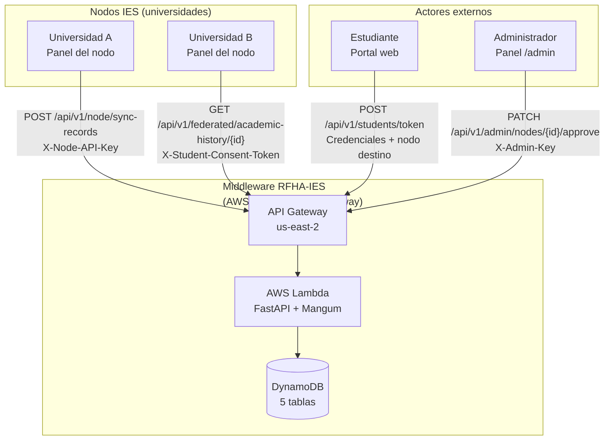
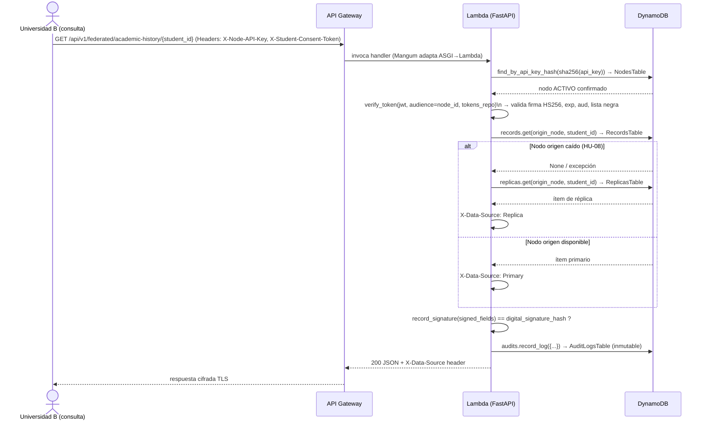
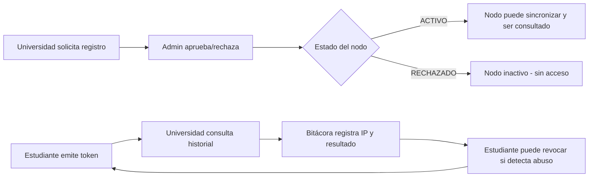
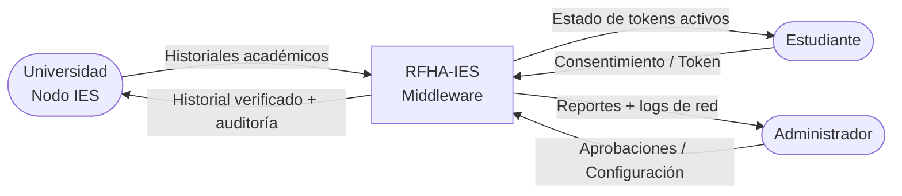
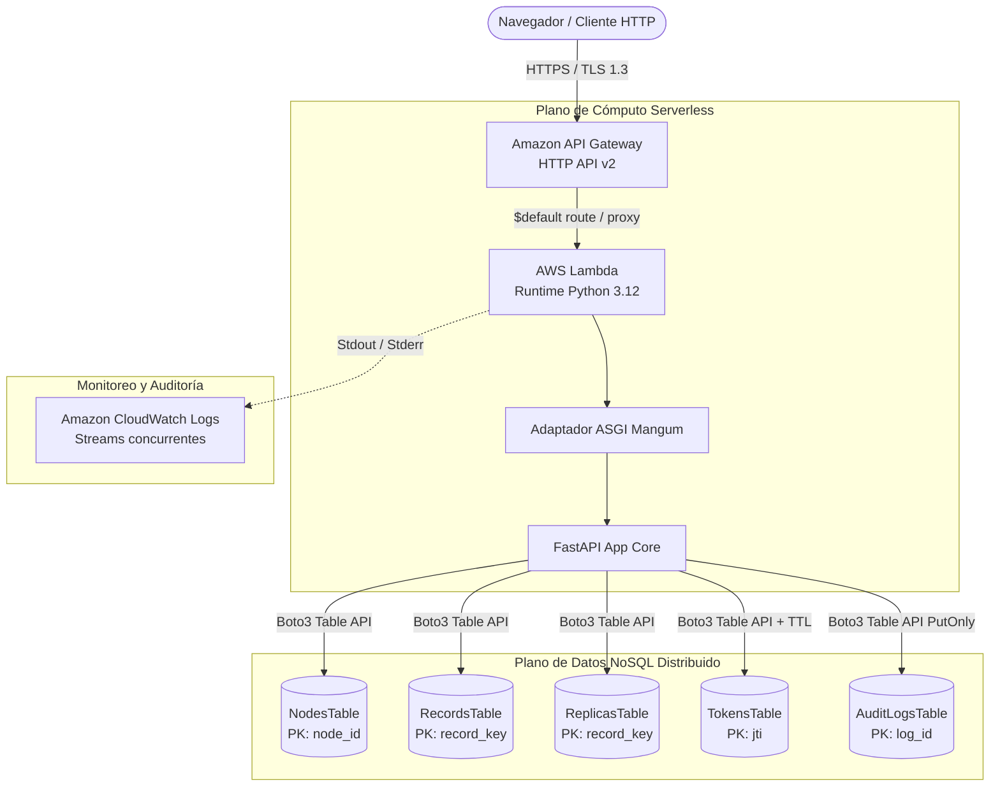
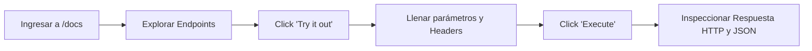
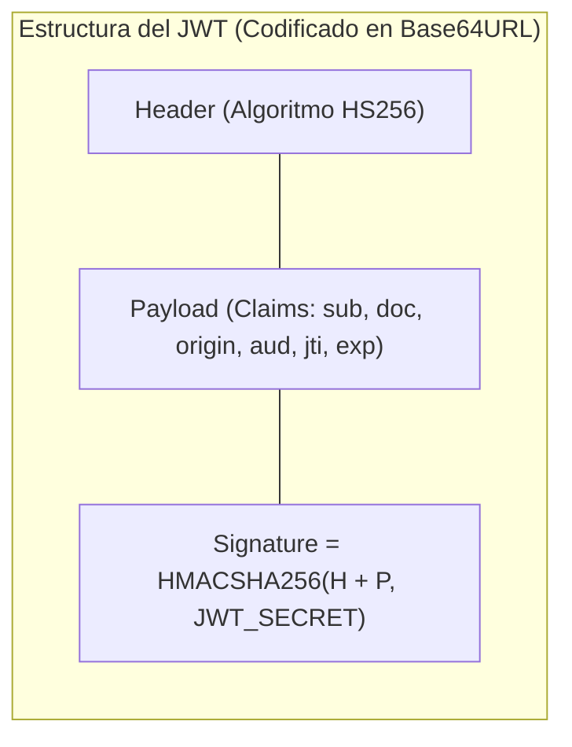
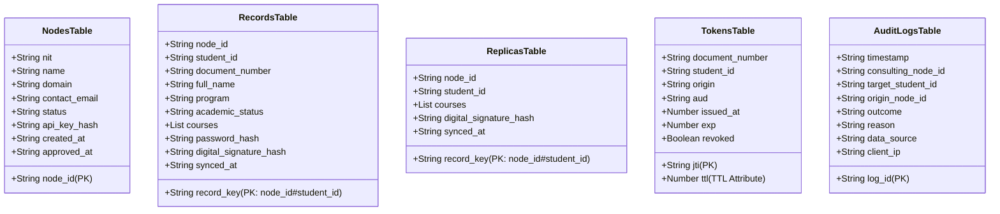
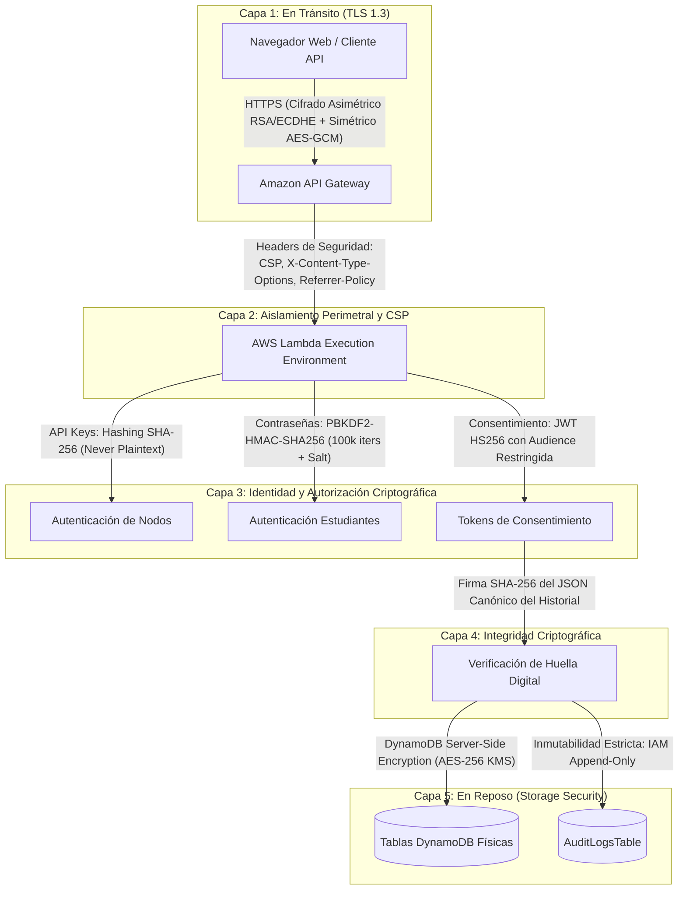
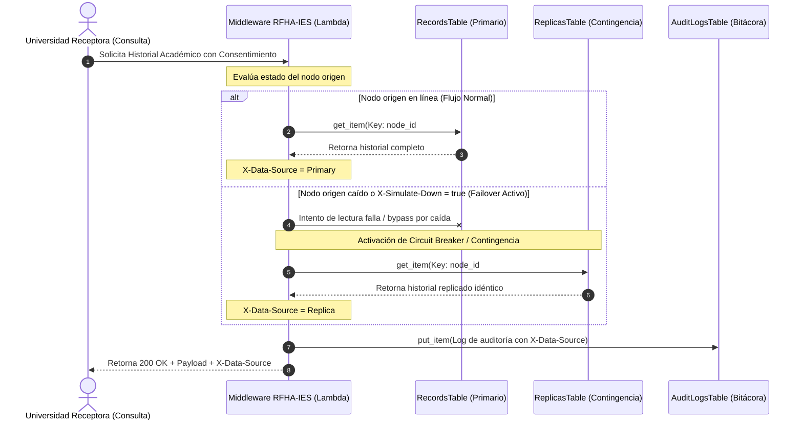

# RFHA-IES — Red Federada de Historiales Académicos

> Sistema distribuido de intercambio federado de historiales académicos interuniversitarios, desplegado como serverless en AWS.

**URL pública:** `https://ypybm0azfg.execute-api.us-east-2.amazonaws.com`  
**Rama activa:** `dev` → PR hacia `main`  
**Stack:** Python 3.12 · FastAPI · AWS Lambda + API Gateway · DynamoDB · Mangum

---

## Tabla de módulos

| Módulo web | URL | Descripción |
|------------|-----|-------------|
| Inicio | `/` | Menú principal |
| Registro de universidad | `/registro-nodo` | HU-01 |
| Administración | `/admin` | HU-02 |
| Panel del nodo | `/panel-nodo` | HU-03 |
| Portal del estudiante | `/portal-estudiante` | HU-04 / HU-05 |
| Consulta federada | `/consulta` | HU-06 / HU-07 / HU-08 |
| Bitácora de auditoría | `/auditoria` | HU-09 |
| Reportes ejecutivos | `/reportes` | PDF por tipo de reporte |

### Explicación detallada de la tabla de módulos
Esta tabla resume los puntos de entrada interactivos de la aplicación web que el usuario o evaluador puede abrir en su navegador:
* **Fila 1 (`/` - Inicio):** Presenta la vista principal (`inicio.html`), sirviendo como puerta de enlace ergonómica hacia todos los subsistemas de la red.
* **Fila 2 (`/registro-nodo` - Registro de universidad):** Implementa la Historia de Usuario HU-01. Permite a una institución educativa solicitar su afiliación formal a la red federada enviando NIT, nombre, dominio y correo institucional.
* **Fila 3 (`/admin` - Administración):** Implementa la Historia de Usuario HU-02. Consola restringida mediante la cabecera `X-Admin-Key` donde el administrador general revisa solicitudes pendientes, aprueba nodos y genera credenciales seguras.
* **Fila 4 (`/panel-nodo` - Panel del nodo):** Implementa la Historia de Usuario HU-03. Permite a las universidades sincronizar de forma masiva o individual los historiales académicos de sus alumnos, aplicando firma criptográfica SHA-256 e inyectando datos tanto en la base principal como en la réplica.
* **Fila 5 (`/portal-estudiante` - Portal del estudiante):** Implementa las Historias HU-04 y HU-05. Espacio soberano para el alumno donde se autentica con su cédula y contraseña, selecciona a qué universidad receptora autoriza, genera su token JWT temporal (`student_auth_token`) y revoca accesos previos en tiempo real.
* **Fila 6 (`/consulta` - Consulta federada):** Implementa las Historias HU-06, HU-07 y HU-08. Permite a una universidad receptora autenticada consultar el expediente de un aspirante usando el token de consentimiento, soportando conmutación automática por error a la réplica (`X-Data-Source: Replica`).
* **Fila 7 (`/auditoria` - Bitácora de auditoría):** Implementa la Historia HU-09. Provee visualización forense en tiempo real y no repudiable de cada intento de consulta, bloqueo o conmutación en la red, con soporte de filtrado temporal (`since`).
* **Fila 8 (`/reportes` - Reportes ejecutivos):** Permite generar y descargar documentos oficiales compilados dinámicamente en formato PDF con métricas del sistema, resiliencia y auditoría forense.

---

## 1. Arquitectura general



### Explicación detallada de la arquitectura general
El diagrama superior modela la topología global de **RFHA-IES** dividida en tres macro-capas:
1. **Nodos IES (Universidades Descentralizadas):** Representados por `N1` (Universidad emisora) y `N2` (Universidad receptora). Cada institución mantiene soberanía sobre su infraestructura, operando como clientes HTTP independientes que se autentican con su propia API Key criptográfica.
2. **Middleware RFHA-IES (Plano de Control en la Nube):**
   * **`GW` (Amazon API Gateway):** Punto de entrada único en la región `us-east-2`. Termina la conexión segura TLS 1.3, aplica enrutamiento proxy y entrega las peticiones a la función de cómputo.
   * **`LM` (AWS Lambda + FastAPI + Mangum):** Unidad de procesamiento serverless sin estado (*stateless*). Se escala automáticamente ante picos de demanda y ejecuta las reglas de validación criptográfica, mediación y auditoría.
   * **`DB` (Amazon DynamoDB):** Clúster de 5 tablas NoSQL distribuidas que gestionan nodos, historiales primarios, réplicas de contingencia, tokens de consentimiento y bitácoras inmutables.
3. **Actores Externos:**
   * **`STU` (Estudiante):** Dueño de sus datos. Accede al portal web para emitir o revocar tokens JWT de consentimiento.
   * **`ADM` (Administrador de la Red):** Ejerce gobernanza institucional validando solicitudes de registro mediante la consola administrativa protegida por `X-Admin-Key`.
4. **Flujo de Interconexión:** Las flechas detallan los endpoints específicos expuestos, los métodos HTTP y las cabeceras requeridas para cruzar la frontera de seguridad del middleware.

### Flujo completo de una petición



### Explicación detallada del flujo completo de una petición
El diagrama de secuencia describe el ciclo de vida síncrono de una consulta interuniversitaria ejecutada paso a paso:
1. **Paso 1 (Invocación Externa):** La Universidad B envía una petición `GET /api/v1/federated/academic-history/{student_id}` a través de Internet protegida con HTTPS hacia API Gateway, adjuntando su API Key institucional (`X-Node-API-Key`) y el token otorgado por el aspirante (`X-Student-Consent-Token`).
2. **Paso 2 (Adaptación ASGI):** API Gateway recibe el evento HTTP y despacha la invocación al micro-contenedor de AWS Lambda. El adaptador `Mangum` deserializa el payload JSON v2 transformándolo en un objeto ASGI que FastAPI procesa.
3. **Paso 3 (Autenticación del Nodo Consultante):** FastAPI ejecuta la dependencia `require_node`. Calcula el hash SHA-256 de la API Key y realiza un `find_by_api_key_hash` sobre `NodesTable`. Al verificar que existe y su estado es `ACTIVO`, autoriza la prosecución del flujo.
4. **Paso 4 (Verificación Criptográfica del Token):** La función `verify_token` valida: (a) la firma criptográfica simétrica con `JWT_SECRET`, (b) que la fecha actual no exceda el tiempo de expiración `exp`, (c) que el claim de audiencia `aud` coincida exactamente con el `node_id` de la Universidad B, y (d) consulta `TokensTable` por clave `jti` para certificar que el estudiante no haya revocado el token (`revoked == false`).
5. **Paso 5 (Bifurcación de Datos y Failover):**
   * **Rama Normal:** El middleware intenta leer el registro en `RecordsTable` mediante la clave `record_key(origin_node, student_id)`. Si el nodo primario responde, extrae los datos y setea el metadato interno `X-Data-Source: Primary`.
   * **Rama de Contingencia (HU-08):** Si la lectura primaria arroja excepción, retorna `None` o el cliente envió la cabecera de simulación `X-Simulate-Down: true`, el sistema conmuta instantáneamente a `ReplicasTable`, extrayendo la copia de seguridad sincronizada y fijando `X-Data-Source: Replica`.
6. **Paso 6 (Verificación de Integridad):** Se reconstruye el JSON canónico de las asignaturas y datos personales y se calcula `record_signature()`. Si el hash no coincide con `digital_signature_hash`, la petición aborta con HTTP 500 para evitar fugas de datos manipulados.
7. **Paso 7 (Registro Inmutable en Auditoría):** Sin importar si la consulta fue exitosa o denegada, se asienta de forma inmediata un nuevo ítem `AUDIT-XXXXXXXXXXXX` en `AuditLogsTable` con timestamp UTC, IPs, motivo y fuente de datos.
8. **Paso 8 (Retorno Seguro):** API Gateway devuelve la respuesta JSON formateada a la Universidad B acompañada de la cabecera `X-Data-Source`.

---

## 2. Fundamentos teóricos aplicados al código

### 2.1 ¿Qué es el Middleware y por qué RFHA-IES lo es?

Un **middleware** es una capa de software que actúa como intermediario entre sistemas heterogéneos: recibe mensajes, los valida, transforma o enruta, y los entrega al destino correcto — sin que los extremos se conozcan directamente.

RFHA-IES cumple exactamente este rol:

| Función de middleware | Dónde ocurre en el código |
|-----------------------|---------------------------|
| **Interceptación** de cada petición | `src/app/security.py` → `require_node()` y `require_admin()` validan la identidad antes de que el router procese nada |
| **Transformación** de datos | `src/app/routers/federated.py` → `_plain()` convierte `Decimal` de DynamoDB a tipos JSON; `_summary()` agrega GPA y créditos |
| **Enrutamiento federado** | `federated.py` → decide entre `records` (primario) y `replicas` (réplica) según el estado del nodo origen |
| **Verificación de integridad** | `security.py` → `record_signature()` recalcula SHA-256 del JSON canónico y compara con `digital_signature_hash` |
| **Bitácora transversal** | `federated.py` → `_log()` escribe en `AuditLogsTable` en cada rama del flujo (éxito, denegado, error) |

### 2.2 Sistema distribuido vs. centralizado

RFHA-IES es un **sistema distribuido federado**, no un monolito, por las siguientes evidencias en el código:

| Propiedad SD | Evidencia en el código |
|---|---|
| **Nodos autónomos con identidad propia** | Cada universidad recibe una API Key única (`security.py → new_api_key()`) cuyo hash SHA-256 se guarda en `NodesTable`. El nodo **nunca** puede escribir datos de otro: `sync.py` L.40 → `"node_id": node["node_id"]` viene de la API Key autenticada, no del body. |
| **Particionamiento de datos** | `repositories.py → record_key()` L.152: `f"{node_id}#{student_id}"` — cada registro está segmentado por nodo. Un nodo no puede acceder a registros ajenos. |
| **Comunicación por red con protocolo** | Todo intercambio es HTTP REST con cabeceras de autenticación (`X-Node-API-Key`, `X-Student-Consent-Token`, `X-Admin-Key`). |
| **Ausencia de estado local compartido** | Lambda es stateless: cada invocación es independiente. El estado está exclusivamente en DynamoDB. |
| **Tolerancia a particiones (CAP)** | `federated.py` L.100-114: si el nodo origen falla, se activa failover automático a `ReplicasTable` (modelo AP). |
| **Service Registry** | `nodes.py → GET /api/v1/nodes/active`: devuelve los nodos disponibles — equivalente a Eureka/Consul. |
| **Autorización delegada** | El estudiante emite un JWT con `aud` = ID del nodo destino (`tokens.py`). Un token para Universidad A no sirve para Universidad B (`verify_token` lanza `InvalidAudienceError`). |

### 2.3 Teorema CAP

RFHA-IES es un sistema **AP** (Available + Partition-tolerant):

- **Disponibilidad:** ante fallo del nodo primario, la réplica responde (L.111-114 `federated.py`).
- **Tolerancia a particiones:** el middleware sigue operando aunque un nodo IES esté caído.
- **Consistencia eventual:** la réplica puede estar ligeramente detrás del primario; es la última versión sincronizada (`sync.py` L.57-58: `records.upsert()` → `replicas.upsert()` en el mismo request).

---

## 3. Infraestructura AWS — Mapeo código↔nube

| Servicio AWS | Rol | Configuración | Archivo relevante |
|---|---|---|---|
| **AWS Lambda** | Ejecuta la app FastAPI (serverless) | Runtime Python 3.12, timeout configurable en SAM template | `src/app/main.py` L.58 → `handler = Mangum(app, lifespan="off")` |
| **API Gateway (HTTP API)** | Punto de entrada único; enruta al Lambda | Integración proxy (`/{proxy+}`) | `template.yaml` (generado por `scripts/deploy_aws.py`) |
| **DynamoDB** | Persistencia NoSQL distribuida | 5 tablas, capacidad on-demand, AES-256 en reposo | `src/app/repositories.py` → clases `Dynamo*Repository` |
| **S3** | Almacenamiento del paquete Lambda antes del deploy | Bucket temporal durante `sam package` | `scripts/deploy_aws.py` |
| **CloudFormation / SAM** | IaC: define Lambda + API GW + permisos IAM | Stack `rfha-app` en `us-east-2` | `scripts/deploy_aws.py` |
| **IAM** | Rol de ejecución del Lambda con permisos DynamoDB | Generado automáticamente por SAM | `template.yaml` |

### ¿Por qué DynamoDB y no RDS/PostgreSQL?

| Criterio | DynamoDB | RDS |
|---|---|---|
| Escalado | Automático (on-demand), sin gestión de servidores | Requiere provisionar instancias |
| Latencia baja | Acceso por clave de partición en < 10 ms | Depende del tamaño de la query |
| TTL nativo | Elimina tokens vencidos automáticamente (`ttl` = exp del JWT) | Requiere job periódico |
| Modelo de acceso | Por clave (`node_id#student_id`), sin JOINs | Relacional, óptimo para JOINs |
| Sin estado de conexión | Perfecto para Lambda (no mantiene conexión persistente) | Connection pooling necesario |

El esquema de acceso del proyecto (siempre por `node_id` + `student_id`) es exactamente el caso de uso ideal de DynamoDB.

---

## 4. Persistencia y base de datos

### Tablas DynamoDB

| Tabla | Clave de partición | Propósito | Clase repositorio |
|---|---|---|---|
| `NodesTable` | `node_id` (IES-XXXXXXXX) | Nodos institucionales y hash de API Key | `DynamoNodeRepository` |
| `RecordsTable` | `record_key` (`node_id#student_id`) | Historiales académicos (primario) | `DynamoRecordRepository` |
| `ReplicasTable` | `record_key` | Copia de réplica para failover (HU-08) | `DynamoRecordRepository` (misma clase, tabla distinta) |
| `TokensTable` | `jti` (UUID hex) | Tokens activos del estudiante + lista negra | `DynamoTokenRepository` |
| `AuditLogsTable` | `log_id` (AUDIT-XXXXXXXXXXXX) | Bitácora inmutable (solo PutItem) | `DynamoAuditRepository` |

### Patrón de acceso clave

```python
# repositories.py L.152
def record_key(node_id: str, student_id: str) -> str:
    return f"{node_id}#{student_id}"
```

Esto garantiza que el Scan de DynamoDB por `document_number` (`find_by_document`) siempre opera dentro del espacio de claves de un nodo, y que el `upsert` por `record_key` sea idempotente (carga repetida = actualización).

### Neguentropía mediante TTL

```python
# repositories.py L.235 (DynamoTokenRepository)
# El atributo `ttl` (= exp del token) hace que DynamoDB borre el registro al vencer.
```

El atributo `ttl` = Unix timestamp de expiración del JWT. DynamoDB lo elimina automáticamente dentro de las 48 h posteriores al vencimiento, manteniendo la tabla limpia sin ningún job de limpieza — esto es **neguentropía aplicada** (el sistema expulsa "ruido" de forma autónoma).

---

## 5. Seguridad: cifrado y mecanismos de protección

### Capas de cifrado

| Capa | Mecanismo | Código |
|---|---|---|
| **En tránsito** | TLS 1.2+ forzado por API Gateway (AWS gestiona el certificado) | Transparente en infraestructura |
| **API Key del nodo** | SHA-256 (nunca se guarda en texto plano) | `security.py → hash_api_key()` L.23-24 |
| **Contraseña del estudiante** | PBKDF2-HMAC-SHA256, 100.000 iteraciones, sal de 16 bytes aleatoria | `security.py → hash_password()` L.29-32 |
| **Firma del historial** | SHA-256 del JSON canónico (sort_keys, sin espacios) | `security.py → record_signature()` L.55-57 |
| **Token de consentimiento** | JWT HS256 con `jti`, `aud`, `exp` y lista negra en DynamoDB | `tokens.py → issue_token()` / `verify_token()` |
| **En reposo (DynamoDB)** | AES-256 gestionado por AWS KMS (activado por defecto) | Configuración de infraestructura AWS |
| **Timing-safe comparisons** | `hmac.compare_digest()` para Admin Key y contraseñas | `security.py` L.44-47, L.65 |

### CSP (Content Security Policy)

```python
# main.py L.12-18
PAGE_HEADERS = {
    "Content-Security-Policy": (
        "default-src 'self'; img-src 'self'; style-src 'self'; script-src 'self'; "
        "base-uri 'none'; form-action 'self'; frame-ancestors 'none'"
    ),
    ...
}
```

Todos los scripts son externos (`type="module"`) para cumplir con `script-src 'self'`. No hay inline scripts ni inline styles.

---

## 6. Alta disponibilidad y tolerancia a fallos

### ¿Por qué el sistema no se cae?

| Mecanismo | Detalle |
|---|---|
| **Escalado automático de Lambda** | AWS instancia múltiples ejecuciones concurrentes en milisegundos ante picos de carga. No hay servidor que administrar. SLA: 99.95%. |
| **Failover a réplica (HU-08)** | `federated.py` L.100-114: si `records.get()` retorna `None` o lanza excepción, se consulta `ReplicasTable` automáticamente. La cabecera `X-Data-Source: Replica` lo evidencia. |
| **Simulación de caída** | La cabecera `X-Simulate-Down: true` (o la variable `SIMULATE_NODE_DOWN` en `.env`) fuerza el failover sin necesidad de apagar nada. |
| **Idempotencia del upsert** | Si una sincronización falla a mitad, se puede re-ejecutar sin duplicar datos: `put_item` sobreescribe por `record_key`. |
| **Tokens con expiración** | TTL de 24 h evita acumulación de tokens activos. La lista negra permite revocación inmediata. |
| **Bitácora inmutable** | `AuditLogsTable` solo recibe `PutItem` (nunca `UpdateItem` ni `DeleteItem`). Cualquier operación queda trazada con IP, resultado y fuente de datos. |

---

## 7. Ejecución local

```bash
# 1. Crear entorno y arrancar
python scripts/run_demo.py --app --port 8001

# 2. Tests completos
.venv/Scripts/pytest -q

# 3. Deploy a AWS
python scripts/deploy_aws.py app --profile rfha --region us-east-2
```

### Variables de entorno (`.env`)

| Variable | Descripción | Default |
|---|---|---|
| `REPOSITORY_BACKEND` | `memory` (local) o `dynamodb` (AWS) | `memory` |
| `ADMIN_KEY` | Clave del administrador general | — |
| `JWT_SECRET` | Secreto de firma de tokens | valor de desarrollo |
| `SIMULATE_NODE_DOWN` | `node_id` de nodo a simular caído | — |
| `NODES_TABLE` | Nombre de la tabla DynamoDB | `NodesTable` |
| `RECORDS_TABLE` | — | `RecordsTable` |
| `REPLICAS_TABLE` | — | `ReplicasTable` |
| `TOKENS_TABLE` | — | `TokensTable` |
| `AUDIT_TABLE` | — | `AuditLogsTable` |

---

## 8. Historias de usuario implementadas

| HU | Descripción | Router / archivo principal |
|----|-------------|---------------------------|
| HU-01 | Registro de universidad como nodo | `routers/nodes.py → POST /api/v1/nodes/register` |
| HU-02 | Aprobación de nodo por administrador | `routers/admin.py → POST /api/v1/admin/nodes/{id}/approve` |
| HU-03 | Sincronización de historiales | `routers/sync.py → POST /api/v1/node/sync-records` |
| HU-04 | Emisión de token de consentimiento | `routers/students.py → POST /api/v1/students/token` |
| HU-05 | Revocación de token | `routers/students.py → DELETE /api/v1/students/token/{jti}` |
| HU-06 | Consulta federada con token | `routers/federated.py → GET /api/v1/federated/academic-history/{id}` |
| HU-07 | Bloqueo por token inválido / revocado | mismo endpoint, control L.86-94 |
| HU-08 | Tolerancia a fallos + conmutación a réplica | mismo endpoint, control L.100-114 |
| HU-09 | Bitácora inmutable de auditoría + filtro `since` | `routers/audit.py` + `_log()` en `federated.py` |
| HU-10 | Interfaz web completa | `main.py PAGES` + `static/` |
| SD-01 | Control de concurrencia optimista (ConditionExpression) | `repositories.py → DynamoRecordRepository.upsert()` |
| SD-04 | Estado de salud de nodos (ACTIVO/DEGRADADO) | `routers/admin.py → PATCH /api/v1/admin/nodes/{id}/status` |

---

## 9. Bucles de retroalimentación (TGS)



Los tres loops de feedback del sistema:
1. **Aprobación:** Solicitud → Revisión admin → Estado nodo → Capacidad de operación.
2. **Consentimiento:** Emisión de token → Consulta → Auditoría → Revocación si necesario.
3. **Integridad:** Sincronización firma SHA-256 → Consulta verifica firma → Error 500 si no coincide → Nodo debe re-sincronizar.

---

## 10. Estructura del repositorio

```
src/
├── app/
│   ├── config.py          # Variables de entorno
│   ├── main.py            # FastAPI app + páginas HTML + handler Lambda
│   ├── models.py          # Pydantic models (validación de entrada)
│   ├── repositories.py    # Acceso a DynamoDB (Protocol + In-Memory + Dynamo)
│   │                        # → DynamoRecordRepository.upsert: ConditionExpression SD-01
│   ├── security.py        # SHA-256, PBKDF2, firma, control de acceso
│   ├── tokens.py          # JWT HS256: emisión y verificación
│   ├── reports.py         # Generación de PDF con ReportLab
│   ├── routers/
│   │   ├── admin.py       # HU-02 + PATCH /nodes/{id}/status (SD-04)
│   │   ├── audit.py       # HU-09: bitácora + ?since (B5) + no-cache
│   │   ├── federated.py   # HU-06/07/08: consulta federada
│   │   ├── nodes.py       # HU-01: registro
│   │   ├── students.py    # HU-04/05: tokens
│   │   └── sync.py        # HU-03: sincronización + manejo 409 SD-01
│   └── static/            # HTML + CSS + JS (sin framework de build)
scripts/
├── deploy_aws.py          # SAM build + package + deploy
└── run_demo.py            # Entorno local con venv automático
tests/                     # suite pytest
```

---

## 11. Diagramas TGS — DFD Nivel 0 y Nivel 1 (TGS-01)

### DFD Nivel 0 — Vista del sistema completo



### DFD Nivel 1 — Procesos internos del Middleware


---

## 12. Sistema abierto y propiedades TGS (TGS-02)

| Propiedad TGS | Implementación en RFHA-IES |
|---|---|
| **Sistema abierto** | Interactúa con el entorno (universidades, estudiantes, admin) a través de API REST (frontera definida: HTTP + TLS) |
| **Subsistemas** | Nodo de registro (`nodes.py`), gestión admin (`admin.py`), historial (`sync.py`), autenticación (`students.py`), auditoría (`audit.py`), consulta federada (`federated.py`) |
| **Equifinalidad** | Múltiples rutas al mismo resultado: consulta exitosa vía nodo primario (`RecordsTable`) o vía réplica (`ReplicasTable`) — mismo JSON de respuesta, distinto `X-Data-Source` |
| **Homeostasis** | El sistema mantiene consistencia ante fallos gracias al failover automático (`federated.py` L.100-114) y la lista negra de tokens (`TokensTable.revoked=True`) |
| **Neguentropía** | (1) Firmas SHA-256 detectan corrupción → `record_signature()`. (2) Bitácora inmutable preserva historia → solo `PutItem` en `AuditLogsTable`. (3) TTL automático en `TokensTable` elimina tokens vencidos. (4) `ConditionExpression` en `DynamoRecordRepository.upsert()` evita escrituras conflictivas. |
| **Retroalimentación** | Loop de aprobación, loop de consentimiento/revocación, loop de integridad (ver §9) |
| **Bucles de feedback** | Ver §9 — cada loop tiene evidencia directa en el código con archivo y línea |

---

## 13. Decisiones Arquitectónicas y Trade-offs

| Decisión | Alternativa | Justificación técnica |
|---|---|---|
| **DynamoDB on-demand** | RDS PostgreSQL | Sin gestión de servidores; TTL nativo para tokens; latencia < 10 ms por clave; ideal para Lambda stateless |
| **JWT HS256 (simétrico)** | RS256 (asimétrico) | Menor overhead computacional; en este modelo el middleware es la única parte que emite y verifica tokens. RS256 sería necesario si los nodos verificaran tokens directamente. |
| **Replicación síncrona** | DynamoDB Streams + SQS | Simple y verificable. La desventaja: si `replicas.upsert()` falla, la réplica queda desactualizada silenciosamente. Para producción: DynamoDB Streams desacoplaría la replicación sin riesgo de fallo síncrono. |
| **API Key en header** | OAuth2 Client Credentials | Más simple de implementar y demostrar; OAuth2 agrega un Authorization Server que escapa al alcance del proyecto académico. |
| **ADMIN_KEY estática** | AWS Secrets Manager | Rotación manual. Para producción se usaría Secrets Manager con rotación automática y Lambda extension para cachear la clave sin consultar el API en cada request. |
| **Cifrado de campo** | AES-256 en reposo (AWS KMS, default) | El campo `doc` (cédula) viaja en el payload JWT sin cifrar (solo firmado). En producción se reemplazaría por JWE (JSON Web Encryption) o se usaría un hash del documento como identificador público. |
| **Concurrencia optimista** | Bloqueo pesimista (mutex) | Lambda es stateless — no puede mantener bloqueos entre invocaciones. `ConditionExpression` en DynamoDB es el mecanismo nativo para control de concurrencia sin locks distribuidos. |


---

## 14. Guía Detallada de Módulos (Backend y Frontend)

Esta sección desglosa minuciosamente cada uno de los componentes de software desarrollados en el proyecto, explicando su rol funcional, su procesamiento interno y sus contratos de entrada/salida.

### 14.1 Backend (`src/app/`)

#### 1. Configuración Global (`src/app/config.py`)
* **Ubicación exacta:** `src/app/config.py`
* **Propósito funcional:** Cargar y centralizar las variables de entorno operativas (credenciales maestras, nombres de tablas DynamoDB, secreto JWT y banderas de simulación de fallos).
* **Funcionamiento interno:** Dispone de la función `load_dotenv()` que lee el archivo `.env` en entorno local sin sobreescribir variables ya inyectadas por el entorno de AWS Lambda. Expone constantes como `REPOSITORY_BACKEND` (`memory` o `dynamodb`), `ADMIN_KEY`, `JWT_SECRET`, `TOKEN_TTL_SECONDS` y nombres de tablas.
* **Entradas y Salidas:** Entradas: variables del sistema o archivo `.env`. Salidas: constantes inmutables para el resto de la aplicación.

#### 2. Orquestador Principal y Enrutamiento Web (`src/app/main.py`)
* **Ubicación exacta:** `src/app/main.py`
* **Propósito funcional:** Instanciar la aplicación FastAPI, configurar las cabeceras de seguridad CSP (Content Security Policy), servir las páginas HTML estáticas y proporcionar el handler serverless compatible con AWS Lambda.
* **Funcionamiento interno:** 
  1. Instancia `app = FastAPI(...)`.
  2. Incluye los 6 routers modulares (`nodes`, `admin`, `sync`, `students`, `federated`, `audit`).
  3. Monta `/static` mediante `StaticFiles`.
  4. Mapea rutas GET de frontend (`/`, `/registro-nodo`, `/admin`, etc.) hacia archivos `.html` aplicando cabeceras estrictas `PAGE_HEADERS` (CSP sin scripts inline).
  5. Instancia `handler = Mangum(app, lifespan="off")` para adaptar eventos ASGI de API Gateway a Lambda.
* **Entradas y Salidas:** Entradas: eventos HTTP/API Gateway v2. Salidas: respuestas HTTP/JSON y streaming de archivos estáticos.

#### 3. Seguridad y Criptografía (`src/app/security.py`)
* **Ubicación exacta:** `src/app/security.py`
* **Propósito funcional:** Gestión criptográfica de API Keys de nodos, contraseñas de estudiantes, firmas de integridad de registros y dependencias de autorización para FastAPI.
* **Funcionamiento interno:**
  * `new_api_key()`: Genera llaves pseudoaleatorias criptográficamente seguras con prefijo `rfha_` usando `secrets.token_urlsafe(32)`.
  * `hash_api_key()`: Calcula hash SHA-256 para almacenamiento seguro de las API Keys.
  * `hash_password()` y `verify_password()`: Implementa PBKDF2-HMAC-SHA256 con 100,000 iteraciones y sal aleatoria de 16 bytes. Usa `DUMMY_HASH` para prevenir ataques de temporización (*timing attacks*) cuando un estudiante no existe.
  * `record_signature()`: Serializa el historial en JSON canónico ordenado (`sort_keys=True`, sin espacios) y genera hash SHA-256 inmutable.
  * `require_admin()` y `require_node()`: Callbacks inyectables en rutas (`Depends`) para validar cabeceras `X-Admin-Key` y `X-Node-API-Key`.
* **Entradas y Salidas:** Entradas: contraseñas, diccionarios de historiales, cabeceras HTTP. Salidas: hashes hexadecimales, booleano de verificación o el diccionario del nodo activo autenticado.

#### 4. Motor de Tokens y Consentimiento Delegado (`src/app/tokens.py`)
* **Ubicación exacta:** `src/app/tokens.py`
* **Propósito funcional:** Emisión y validación criptográfica de tokens JWT de consentimiento estudiantil (`student_auth_token`), control de vigencia y lista negra distribuida.
* **Funcionamiento interno:**
  * `issue_token()`: Construye claims (`sub`=estudiante, `doc`=cédula, `origin`=nodo emisor, `aud`=nodo autorizado, `jti`=identificador único, `iat`, `exp`). Firma con HMAC-SHA256 (`HS256`) y persiste el metadato en `TokensTable` con `revoked=False` y atributo `ttl`.
  * `verify_token()`: Decodifica y valida firma, expiración y audiencia requerida. Consulta `TokensTable` para verificar que `revoked` no sea `True`. Lanza `TokenError` descriptivo si falla alguna regla.
* **Entradas y Salidas:** Entradas: datos del estudiante, nodo destino, repositorio de tokens. Salidas: diccionario con el token JWT codificado, `jti` y timestamp de expiración.

#### 5. Repositorios de Persistencia (`src/app/repositories.py`)
* **Ubicación exacta:** `src/app/repositories.py`
* **Propósito funcional:** Abstracción de acceso a datos mediante patrón Repositorio y Protocolos tipados (`NodeRepository`, `RecordRepository`, `TokenRepository`, `AuditRepository`), con doble implementación en memoria y Amazon DynamoDB.
* **Funcionamiento interno:**
  * Conexión DynamoDB: `_dynamo_table()` inicializa tablas usando `boto3.resource("dynamodb")`.
  * `DynamoNodeRepository`: Métodos `create_node`, `get_node`, `list_nodes`, `update_node`, `find_by_api_key_hash`.
  * `DynamoRecordRepository`: Operaciones sobre `RecordsTable` y `ReplicasTable`. En `upsert()` implementa `ConditionExpression` para garantizar concurrencia optimista evitando que escrituras desfasadas sobreescriban datos nuevos.
  * `DynamoTokenRepository`: Inserción de tokens con TTL y actualización atómica `update_item` para revocación (`revoked = true`).
  * `DynamoAuditRepository`: Inserción de bitácora mediante `put_item` (inmutable, sin soporte de actualización ni borrado).
* **Entradas y Salidas:** Entradas: diccionarios tipados de dominio. Salidas: registros recuperados, entidades mapeadas o excepciones de integridad (`DuplicateNitError`, `ClientError`).

#### 6. Generador de Reportes PDF (`src/app/reports.py`)
* **Ubicación exacta:** `src/app/reports.py`
* **Propósito funcional:** Compilación dinámica en memoria de documentos ejecutivos y forenses en PDF para la administración de la red.
* **Funcionamiento interno:** Utiliza la librería `reportlab` (canvas, tablas, Flowables, estilos) para compilar en un buffer `io.BytesIO()` el reporte solicitado según 4 modalidades: General, Auditoría Forense, Resiliencia y Fallos, y Directorio de Nodos.
* **Entradas y Salidas:** Entradas: listas de nodos, listas de auditoría y tipo de reporte. Salidas: flujo binario `bytes` con el contenido del archivo PDF.

#### 7. Routers de la API (`src/app/routers/`)
* **`nodes.py` (`POST /api/v1/nodes/register`, `GET /api/v1/nodes/active`):** Registro abierto de solicitudes institucionales y directorio público de nodos autorizados (Service Registry).
* **`admin.py` (`GET /api/v1/admin/nodes`, `POST /api/v1/admin/nodes/{id}/approve`, `PATCH /api/v1/admin/nodes/{id}/status`, `GET /api/v1/admin/reports/network-summary`):** Gestión de ciclo de vida de nodos (aprobación, degradación de salud) y descarga de reportes PDF bajo protección de `X-Admin-Key`.
* **`sync.py` (`POST /api/v1/node/sync-records`):** Carga masiva o actualización de historiales académicos. Escribe simultáneamente en `RecordsTable` (primario) y `ReplicasTable` (réplica) validando la identidad del nodo emisor desde la API Key inyectada.
* **`students.py` (`POST /api/v1/students/token`, `GET /api/v1/students/tokens`, `DELETE /api/v1/students/token/{jti}`):** Autenticación de estudiantes con PBKDF2, emisión de tokens de consentimiento con audiencia específica y revocación instantánea.
* **`federated.py` (`GET /api/v1/federated/academic-history/{student_id}`):** Núcleo del middleware distribuido. Valida nodo consultante, valida JWT (`aud`, firma, vigencia, revocación), ejecuta conmutación a réplica ante caídas simuladas o reales, verifica firma SHA-256 de los datos y genera registro inmutable en auditoría.
* **`audit.py` (`GET /api/v1/audit/logs`):** Consulta filtrada de la bitácora inmutable con cabeceras `Cache-Control: no-store` y soporte de filtrado temporal por parámetro `since`.

---

### 14.2 Frontend Web (`src/app/static/`)

La interfaz de usuario está construida en HTML5 semántico, CSS moderno con variables y capas `@layer`, y JavaScript vanilla modular (ES Modules), sin dependencias externas ni compiladores (Webpack/Vite):

* **`styles.css`:** Sistema de diseño completo en modo dual (claro/oscuro automático con `light-dark()`), tipografía fluida con `clamp()`, grid responsivo y componentes accesibles (foco visible, contraste AA).
* **`common.js`:** Utilidades compartidas (`$`, `api`, `announce`, `setBusy`, `errorText`). Implementa wrapper seguro sobre `fetch` y soporte de accesibilidad para lectores de pantalla (`aria-live`).
* **`inicio.html` (`/`):** Portal de bienvenida y navegación centralizada a los módulos de la red.
* **`registro-nodo.html` y `registro.js` (`/registro-nodo`):** Formulario de registro para universidades con validación en tiempo real de NIT, dominio y correo institucional.
* **`admin.html` y `admin.js` (`/admin`):** Consola para administradores: listado de instituciones, aprobación con emisión visible única de API Key y filtros de estado.
* **`panel-nodo.html` y `panel-nodo.js` (`/panel-nodo`):** Panel para directores de registro. Incluye el generador dinámico de historiales aleatorios (`generateExample()`) para pruebas en vivo y sincronización hacia la nube.
* **`portal-estudiante.html` y `portal-estudiante.js` (`/portal-estudiante`):** Interfaz para que el alumno ingrese con su cédula y contraseña, consulte a qué universidades autorizar, genere su JWT y revoque consentimientos previos.
* **`consulta.html` y `consulta.js` (`/consulta`):** Interfaz de consulta interinstitucional. Permite ingresar el token de consentimiento, forzar simulación de fallo (`X-Simulate-Down`) y visualizar el historial académico junto a la procedencia (`Primary` vs `Replica`).
* **`auditoria.html` y `auditoria.js` (`/auditoria`):** Panel forense en tiempo real para visualizar eventos de acceso, denegaciones, IPs de origen y estados de seguridad con filtro temporal (`since`).
* **`reportes.html` y `reportes.js` (`/reportes`):** Centro de exportación ejecutiva para seleccionar el tipo de informe y descargar el documento PDF compilado en memoria.

---

## 15. Funcionamiento Profundo de Cada Componente en AWS

### 15.1 Desglose por Servicio AWS



#### 1. Amazon API Gateway (HTTP API v2)
* **Función:** Actúa como puerta de entrada segura y punto de terminación TLS. Recibe el tráfico en la URL pública, gestiona el protocolo HTTP/2 y redirige todas las rutas hacia la función Lambda mediante integración proxy `$default`.
* **Configuración:** Modo Payload Format Version 2.0, enrutamiento catch-all `/{proxy+}`.

#### 2. AWS Lambda
* **Función:** Ejecutor de cómputo elástico sin servidor. Cada petición que llega a API Gateway despierta o reutiliza un micro-contenedor de Lambda ejecutando el runtime optimizado `python3.12`.
* **Configuración:** Memoria asignada 512 MB, arquitectura x86_64, timeout de 15 segundos.
* **Mapeo en código:** `src/app/main.py` define `handler = Mangum(app, lifespan="off")`, el cual traduce los eventos del API Gateway v2 al protocolo ASGI estándar que FastAPI procesa.

#### 3. Amazon DynamoDB (Plano de Persistencia Distribuida)
Todas las tablas operan bajo la modalidad **On-Demand (Pay-per-request)** y cifrado en reposo con claves gestionadas por AWS KMS:
1. **`NodesTable`:**
   * **Clave de Partición (PK):** `node_id` (Cadena `IES-XXXXXXXX`).
   * **Contenido:** Razón social, NIT, dominio institucional, correo, estado (`PENDIENTE_APROBACION`, `ACTIVO`, `DEGRADADO`), hash SHA-256 de la API Key (`api_key_hash`).
   * **Mapeo:** Invocado en `src/app/repositories.py` (`DynamoNodeRepository`).
2. **`RecordsTable`:**
   * **Clave de Partición (PK):** `record_key` (Cadena compuesta `<node_id>#<student_id>`).
   * **Contenido:** Cédula, nombre completo, programa, materias cursadas con créditos y notas, hash de contraseña y `digital_signature_hash`.
   * **Mapeo:** Invocado en `DynamoRecordRepository` en `repositories.py`.
3. **`ReplicasTable`:**
   * **Clave de Partición (PK):** `record_key`.
   * **Contenido:** Réplica exacta de `RecordsTable` sincronizada en cada operación de carga.
   * **Mapeo:** Gestionada vía `get_replica_repository()` en `repositories.py`.
4. **`TokensTable`:**
   * **Clave de Partición (PK):** `jti` (UUID hexadecimal).
   * **Mecanismo Especial TTL:** Posee habilitado el mecanismo Time-To-Live sobre el atributo `ttl`. DynamoDB elimina de forma autónoma los tokens cuyo timestamp Unix haya caducado.
   * **Mapeo:** Invocado en `DynamoTokenRepository` en `repositories.py` y `tokens.py`.
5. **`AuditLogsTable`:**
   * **Clave de Partición (PK):** `log_id` (Cadena `AUDIT-XXXXXXXXXXXX`).
   * **Característica:** Inmutabilidad estricta. El rol IAM de Lambda solo tiene concedido `dynamodb:PutItem` y `dynamodb:Scan` sobre esta tabla; no existen permisos para `DeleteItem` ni `UpdateItem`.
   * **Mapeo:** Invocado en `DynamoAuditRepository` en `repositories.py`.

#### 4. Amazon CloudWatch Logs
* **Función:** Almacena la salida estándar (`stdout`/`stderr`), logs de excepciones y trazas de ejecución de cada contenedor Lambda.
* **Evidencia Distribuida:** Permite auditar en tiempo real los diferentes `RequestId` ejecutados concurrentemente por distintos hilos de ejecución en la nube.

---

### 15.2 Flujo de Ejecución Milisegundo a Milisegundo

Cuando un funcionario de admisiones pulsa "Consultar Historial" en el cliente web:

1. **ms 0 – ms 15 (Red y TLS):** La petición HTTP sale del navegador hacia `https://ypybm0azfg.execute-api.us-east-2.amazonaws.com`. API Gateway negocia el handshake TLS 1.3 y autentica el certificado wildcard de AWS.
2. **ms 15 – ms 20 (API Gateway Routing):** API Gateway valida la ruta `/api/v1/federated/academic-history/{id}`, empaqueta los encabezados (`X-Node-API-Key`, `X-Student-Consent-Token`), query params y cuerpo en un evento JSON v2 y efectúa la invocación sincrónica a Lambda.
3. **ms 20 – ms 30 (Lambda Initialization / Dispatch):**
   * *Warm Start:* Lambda recibe el evento en un micro-contenedor caliente y se lo entrega al handler de Mangum.
   * Mangum traduce el evento a un scope HTTP de ASGI y lo entrega a FastAPI.
4. **ms 30 – ms 45 (Inyección y Middleware de Seguridad):**
   * FastAPI ejecuta la dependencia `require_node`: calcula SHA-256 de la cabecera `X-Node-API-Key` y llama a `DynamoNodeRepository.find_by_api_key_hash`. DynamoDB retorna en ~6 ms el registro del nodo validando su estado `ACTIVO`.
   * El controlador ejecuta `verify_token`: decodifica el JWT mediante clave secreta simétrica, comprueba que `aud` coincida con el nodo consultante y consulta `TokensTable` por clave `jti` para certificar que `revoked` no sea `True`.
5. **ms 45 – ms 55 (Enrutamiento Federado y Failover):**
   * El sistema intenta leer el registro primario en `RecordsTable` mediante la clave `record_key(origin_node, student_id)`.
   * Si el nodo origen está marcado como caído o falla la lectura, conmuta instantáneamente a `ReplicasTable` extrayendo el historial de contingencia y seteando la cabecera `X-Data-Source: Replica`.
6. **ms 55 – ms 65 (Verificación Criptográfica y Auditoría Inmutable):**
   * Se reconstruye el payload canónico de materias y datos y se calcula `record_signature(signed)`. Se comprueba contra `digital_signature_hash`.
   * Se genera un ID de auditoría único y se efectúa `PutItem` en `AuditLogsTable` con el resultado (`SUCCESS`), IP de origen y fuente de datos.
7. **ms 65 – ms 75 (Respuesta):** Mangum empaqueta la respuesta JSON y los headers de respuesta, API Gateway los retorna sobre la conexión HTTPS abierta y el navegador del usuario renderiza la tabla de asignaturas y créditos completados.

---

## 16. Documentación Interactiva de la API (Swagger / OpenAPI)

### 16.1 ¿Qué es Swagger / OpenAPI y qué aporta al proyecto?
**OpenAPI** es el estándar internacional para describir formalmente APIs REST sin necesidad de inspeccionar el código fuente. **Swagger UI** es la interfaz gráfica generada a partir de dicho estándar que permite a evaluadores y desarrolladores externos:
* Conocer todos los contratos de datos, parámetros y cabeceras exigidas.
* Probar la API de forma interactiva directamente desde el navegador web, sin requerir herramientas de terceros como Postman o cURL.
* Validar en tiempo real los esquemas Pydantic y las respuestas HTTP documentadas.

### 16.2 Funcionamiento Interno en FastAPI
FastAPI inspecciona los modelos Pydantic (`src/app/models.py`), las dependencias de cabeceras (`src/app/security.py`) y las anotaciones de tipo de cada router. Con esto genera dinámicamente un esquema JSON OpenAPI en la ruta:
* **Especificación OpenAPI (JSON):** `/openapi.json`
* **Swagger UI interactivo:** `/docs`
* **Documentación ReDoc:** `/redoc`

Ambas interfaces se encuentran completamente habilitadas tanto en la ejecución local (`http://127.0.0.1:8001/docs`) como en el despliegue cloud de AWS (`https://ypybm0azfg.execute-api.us-east-2.amazonaws.com/docs`).

### 16.3 Guía Práctica de Uso Paso a Paso



1. **Acceso:** Abre en tu navegador `https://ypybm0azfg.execute-api.us-east-2.amazonaws.com/docs`.
2. **Autenticación en Swagger:**
   * La API protege sus rutas mediante cabeceras HTTP personalizadas (`X-Admin-Key`, `X-Node-API-Key`, `X-Student-Consent-Token`).
   * Para probar un endpoint restringido, despliega la caja del endpoint (ej. `GET /api/v1/admin/nodes`), haz clic en **Try it out** y rellena directamente el campo `X-Admin-Key` con la clave administrativa configurada.
3. **Ejecución Interactiva:**
   * Completa el cuerpo de la petición (JSON) si es un método POST/PATCH.
   * Pulsa el botón azul **Execute**.
   * Swagger enviará la petición HTTPS real a AWS Lambda y mostrará la URL ejecutada, el código de estado (`200 OK`, `403 Forbidden`, `409 Conflict`, etc.) y el cuerpo de respuesta con las cabeceras recibidas (incluyendo `x-data-source` y `cache-control`).

---

## 17. Conceptos de Sistemas Distribuidos Aplicados al Proyecto

A continuación se fundamentan los conceptos nodales de la disciplina de **Sistemas Distribuidos**, vinculando la teoría académica directamente con su manifestación tangible en el código fuente y los servicios de AWS:

| Concepto de Sistemas Distribuidos | Manifestación en RFHA-IES | Archivo y Función en Código | Recurso AWS |
|---|---|---|---|
| **Nodos Autónomos** | Cada universidad opera como una entidad descentralizada con API Key propia y almacén de datos segregado. No hay acceso cruzado directo entre universidades. | `src/app/security.py` (`new_api_key`, `require_node`) | `NodesTable` |
| **Middleware Federado** | Actúa como plano de control mediador: enruta peticiones, transforma formatos y valida identidades sin concentrar la propiedad de los datos. | `src/app/routers/federated.py` (`academic_history`) | AWS Lambda + API Gateway |
| **Tolerancia a Fallos y Failover** | Conmutación por error automática: si el nodo primario no responde, el sistema consulta de forma transparente el almacén réplica. | `src/app/routers/federated.py` (L.100-114) | `RecordsTable` → `ReplicasTable` |
| **Consistencia Eventual (AP)** | Sacrifica consistencia estricta por disponibilidad total. Replica registros en segundo plano; la réplica representa la versión más reciente sincronizada. | `src/app/routers/sync.py` (`sync_records`) | DynamoDB ReplicasTable |
| **Concurrencia Optimista** | Detección de colisiones mediante condición de escritura atómica para evitar que peticiones atrasadas sobreescriban datos nuevos. | `src/app/repositories.py` (`ConditionExpression` en `upsert`) | DynamoDB Conditional Writes |
| **Autorización Descentralizada** | Consentimiento de acceso gobernado por el usuario mediante tokens JWT de audiencia estricta (`aud`), impidiendo reutilización en nodos no autorizados. | `src/app/tokens.py` (`issue_token`, `verify_token`) | `TokensTable` (con TTL) |
| **Service Registry (Descubrimiento)** | Registro dinámico para que los nodos descubran qué universidades están operativas antes de solicitar o autorizar transferencias. | `src/app/routers/nodes.py` (`active_nodes`) | `NodesTable` (Filter `status=ACTIVO`) |
| **Bitácora Distribuida Inmutable** | Log de transacciones de solo inserción (Append-Only) para trazabilidad forense no repudiable de cada consulta y bloqueo. | `src/app/routers/audit.py` y `repositories.py` (`DynamoAuditRepository`) | `AuditLogsTable` (IAM PutOnly) |

---

## 18. Guía Práctica de Demostración en Vivo (Consola AWS + App)

Esta guía describe el procedimiento exacto para sustentar el proyecto en vivo frente a evaluadores, combinando la aplicación web con la consola de AWS.

### 18.1 Demostración en AWS CloudWatch Logs (Cómputo Concurrente y Stateless)
1. Inicia sesión en la **Consola de AWS** con el perfil correspondiente y navega a **CloudWatch** en la región `us-east-2`.
2. En el menú izquierdo, selecciona **Logs** → **Log groups** y haz clic en `/aws/lambda/rfha-app`.
3. Abre simultáneamente dos navegadores o una ventana en incógnito y realiza consultas en la web (`/consulta` o `/auditoria`).
4. En CloudWatch, abre los flujos de registro (*Log streams*) más recientes:
   * **Evidencia a señalar:** Muestra cómo existen diferentes `Log Streams` ejecutándose en paralelo.
   * Destaca los identificadores de petición únicos (`START RequestId: ...`) y (`REPORT RequestId: ... Duration: 12.4 ms Billed Duration: 13 ms Memory Size: 512 MB`). Explica al docente que esto certifica que el sistema es **completamente stateless y elástico**.

### 18.2 Demostración en Amazon DynamoDB (Particionamiento e Inmutabilidad)
1. En la consola de AWS, dirígete a **Amazon DynamoDB** → **Tables** (región `us-east-2`).
2. **Particionamiento y Réplicas:**
   * Entra a `RecordsTable` → botón **Explore table items**.
   * Muestra la estructura de la clave `record_key` con formato `<node_id>#<student_id>` (ej. `IES-A1B2C3D4#20262678029`).
   * Demuestra que en `ReplicasTable` existe exactamente el mismo registro replicado con su `digital_signature_hash`.
3. **Mecanismo TTL (TokensTable):**
   * Abre `TokensTable` → selecciona la pestaña **Additional settings**.
   * Muestra que el campo **Time to Live (TTL)** está en estado **ENABLED** sobre el atributo `ttl`. Explica cómo esto garantiza la neguentropía del sistema al purgar automáticamente tokens caducados sin consumir cómputo.
4. **Inmutabilidad (AuditLogsTable):**
   * Abre `AuditLogsTable` y muestra cómo cada consulta realizada en la plataforma genera un nuevo registro `AUDIT-XXXXXXXXXXXX` con `timestamp`, `client_ip`, `outcome` y `data_source`.

### 18.3 Demostración en Amazon API Gateway
1. Dirígete a **API Gateway** → selecciona la API `rfha-app`.
2. Muestra las rutas configuradas (`$default`) y en la pestaña de **Stages** (`$default`) evidencia la URL de invocación segura con certificado SSL/TLS gestionado.
3. Muestra las métricas integradas de CloudWatch: número de invocaciones, latencia de integración (< 50 ms) y cero errores 5XX.

### 18.4 Prueba de Fuego: Failover a Réplica y Revocación en Tiempo Real
1. **Sincronización:** En el panel del nodo (`/panel-nodo`), genera datos aleatorios con "Cargar ejemplo" e ingresa la API Key del nodo. Pulsa **Sincronizar historiales**.
2. **Consentimiento:** En el portal del estudiante (`/portal-estudiante`), inicia sesión con el documento y clave de uno de los estudiantes cargados. Autoriza a una universidad receptora y copia el token generado.
3. **Consulta Normal (Primaria):** Ve a `/consulta`, pega el token de autorización y pulsa **Consultar Historial**. Muestra la etiqueta verde de procedencia: **Fuente de datos: Primary**.
4. **Fallo Simulado (Failover Activo):**
   * En la misma pantalla `/consulta`, marca la casilla de verificación **"Simular falla de conectividad con el nodo de origen"** (`X-Simulate-Down: true`).
   * Pulsa nuevamente **Consultar Historial**.
   * **Resultado en vivo:** El sistema no falla; responde de inmediato mostrando la etiqueta ámbar **Fuente de datos: Replica**.
5. **Auditoría Forense Inmediata:**
   * Ve a `/auditoria`, ingresa la clave de administrador y carga la bitácora.
   * Muestra las dos entradas consecutivas: la primera con fuente `Primary` y la segunda con fuente `Replica`, demostrando la trazabilidad inmutable y el funcionamiento en tiempo real.


---

## 19. Fundamentos Básicos de Protocolos y Redes Aplicados al Proyecto

Para comprender a fondo la arquitectura de **RFHA-IES**, es indispensable analizar los protocolos de comunicación y mecanismos de red desde sus fundamentos más elementales hasta su aplicación práctica en el código.

### 19.1 Protocolo HTTP / HTTPS y Arquitectura Cliente-Servidor
El protocolo de transferencia de hipertexto (**HTTP - Hypertext Transfer Protocol**) es el estándar sin estado (*stateless*) mediante el cual dialogan clientes y servidores a través de mensajes de solicitud (**Request**) y respuesta (**Response**). En RFHA-IES, cada interacción se efectúa bajo **HTTPS** (HTTP sobre **TLS 1.3**), garantizando autenticidad y privacidad en el canal.

#### Métodos HTTP empleados en la red:
* **`GET`:** Consulta segura e idempotente que no altera el estado del servidor.
  * `GET /api/v1/nodes/active`: Consulta el catálogo de universidades autorizadas (`src/app/routers/nodes.py`).
  * `GET /api/v1/federated/academic-history/{student_id}`: Recupera el historial federado del estudiante validando previamente su token (`src/app/routers/federated.py`).
* **`POST`:** Creación de recursos o envío de datos confidenciales en el cuerpo.
  * `POST /api/v1/nodes/register`: Registra una nueva solicitud institucional en `NodesTable` (`src/app/routers/nodes.py`).
  * `POST /api/v1/node/sync-records`: Carga o actualiza lotes de historiales académicos (`src/app/routers/sync.py`).
  * `POST /api/v1/students/token`: Emisión del JWT de consentimiento estudiantil (`src/app/routers/students.py`).
* **`PATCH`:** Modificación parcial de un recurso existente.
  * `PATCH /api/v1/admin/nodes/{node_id}/status`: Actualiza manualmente el estado de salud de un nodo (`ACTIVO` o `DEGRADADO`) sin sobreescribir sus demás atributos institucionales (`src/app/routers/admin.py`).
* **`DELETE`:** Eliminación lógica o revocación de un recurso.
  * `DELETE /api/v1/students/token/{jti}`: Marca inmediatamente como revocado un token en `TokensTable` (`src/app/routers/students.py`).

#### Códigos de estado HTTP y su significado en el proyecto:
* **`200 OK`:** Petición procesada exitosamente con payload retornado.
* **`201 Created`:** Recurso institucional registrado exitosamente (`POST /api/v1/nodes/register`).
* **`403 Forbidden`:** Acceso denegado por credencial inválida, API Key errónea, token vencido o audiencia no autorizada (`src/app/security.py` y `tokens.py`).
* **`404 Not Found`:** Estudiante o nodo inexistente en las tablas de datos.
* **`409 Conflict`:** Conflicto de unicidad (NIT ya registrado en `NodesTable`) o choque de concurrencia optimista en DynamoDB.
* **`422 Unprocessable Entity`:** Fallo de validación semántica de Pydantic (ej. formato de correo o semestre inválido).
* **`500 Internal Server Error`:** Fallo de integridad criptográfica en los datos (la firma SHA-256 no coincide).

#### Cabeceras HTTP personalizadas utilizadas en el sistema:
* **`X-Admin-Key`:** Clave de administración general requerida en endpoints de `/api/v1/admin/*` y `/api/v1/audit/logs`.
* **`X-Node-API-Key`:** Llave de autenticación institucional asignada a cada nodo aprobado para firmar sus transacciones.
* **`X-Student-Consent-Token`:** Token JWT de autorización emitido por el estudiante para permitir la consulta de su historial.
* **`X-Data-Source`:** Cabecera de respuesta inyectada por el middleware (`Primary` o `Replica`) indicando si la información provino de la tabla principal o de contingencia.
* **`X-Simulate-Down`:** Cabecera de prueba que fuerza la conmutación a réplica sin necesidad de desconectar el nodo real.

---

### 19.2 Protocolo TLS (Transport Layer Security) y Cifrado en Tránsito
**TLS** es el protocolo criptográfico que cifra la sesión punto a punto entre el navegador del usuario y **AWS API Gateway**.
1. **Confidencialidad:** Impide que actores intermediarios en la red pública puedan leer en claro contraseñas, documentos de identidad o las API Keys enviadas en las cabeceras.
2. **Integridad del Transporte:** Protege los mensajes contra manipulaciones intermedias (*Man-in-the-Middle*).
3. **Autenticación del Servidor:** API Gateway certifica criptográficamente ante el cliente que está conectado al dominio legítimo de AWS bajo certificados gestionados por Amazon Trust Services.

---

### 19.3 Formato JSON y Paradigma REST
* **REST (Representational State Transfer):** La arquitectura desacopla completamente el cliente (frontend web HTML/CSS/JS estático) del servidor (FastAPI en AWS Lambda). Todas las operaciones se orientan a recursos identificados mediante URIs predecibles.
* **JSON (JavaScript Object Notation):** Es el lenguaje de intercambio común. En el cliente, JavaScript serializa objetos mediante `JSON.stringify()` y los envía; en el servidor, los modelos Pydantic (`src/app/models.py`) deserializan y validan estrictamente tipos de datos, rangos y expresiones regulares antes de tocar la base de datos.

---

### 19.4 Protocolo JWT (JSON Web Token) y Hashes Criptográficos SHA-256
Un **JSON Web Token** (RFC 7519) es un objeto JSON compacto y autónomo para transmitir de forma segura afirmaciones (*claims*) verificables entre partes.



#### Estructura en RFHA-IES (`src/app/tokens.py`):
1. **Header:** Define el algoritmo de firma simétrica (`{"alg": "HS256", "typ": "JWT"}`).
2. **Payload:** Contiene la autorización delegada por el estudiante:
   * `sub`: Identificador institucional del estudiante (`student_id`).
   * `doc`: Número de documento de identidad nacional.
   * `origin`: Nodo emisor propietario de la información (ej. `IES-1111AAAA`).
   * `aud`: Nodo destino estrictamente autorizado para consultar (ej. `IES-2222BBBB`). Si otra universidad intenta usar el token, `jwt.decode` rechaza la petición con `InvalidAudienceError`.
   * `jti`: Identificador único aleatorio de 128 bits (UUID4) que permite registrar el token en la lista negra para revocación instantánea.
   * `iat` y `exp`: Timestamps Unix de emisión y vencimiento (24 horas).
3. **Signature:** Firma criptográfica calculada con la clave secreta `JWT_SECRET`. Garantiza que ningún atacante pueda alterar la audiencia o el estudiante sin invalidar el token.

#### Hashes Criptográficos SHA-256 en el Código:
* **API Keys de Universidades:** `src/app/security.py` ejecuta `hash_api_key(api_key)`. En `NodesTable` **nunca se guarda la clave original**, únicamente su resumen SHA-256. Al recibir una petición, se calcula el hash y se busca por igualdad en DynamoDB.
* **Firma de Integridad del Historial:** `record_signature()` ordena las llaves alfabéticamente (`sort_keys=True`) para construir un JSON canónico y calcula su digest SHA-256. Cualquier alteración de una nota o crédito produce una firma totalmente distinta, detectando manipulación de datos.

---

## 20. Análisis Detallado de Cada Diagrama y Tabla Existente en el README

Para asegurar máxima claridad académica, esta sección analiza paso a paso cada uno de los elementos visuales y tabulares incluidos en el documento.

### 20.1 Diagrama de Arquitectura General (§1)
* **Bloque Nodos IES (`N1`, `N2`):** Representa las distintas universidades participantes. Cada una actúa como cliente independiente con credenciales propias.
* **Bloque Middleware RFHA-IES:** Agrupa la infraestructura de plano de control en AWS. La flecha hacia `GW` (API Gateway) centraliza la recepción; `LM` (AWS Lambda) ejecuta el procesamiento sin estado y se conecta bidireccionalmente a `DB` (Amazon DynamoDB).
* **Bloque Actores Externos:** Modela al `Estudiante` interactuando con el portal de consentimiento y al `Administrador` operando la consola central.
* **Flujos de Flechas:** Las etiquetas explicitan el verbo HTTP, la URI y las cabeceras de autorización necesarias para cruzar la frontera del sistema.

### 20.2 Diagrama de Secuencia del Flujo Completo (§1)
* **Líneas de Vida (`Lifelines`):** Universidad B, API Gateway, Lambda y DynamoDB.
* **Paso 1 (Invocación):** Petición GET con dos cabeceras simultáneas (`X-Node-API-Key` y `X-Student-Consent-Token`).
* **Paso 2 y 3 (Validación de Nodo y Token):** Verificación de identidad institucional contra `NodesTable` y posterior evaluación criptográfica del JWT (audiencia, expiración y estado en `TokensTable`).
* **Paso 4 (Bifurcación Alt/Else - Failover):**
  * Rama `Alt (Nodo caído)`: Si la consulta a `RecordsTable` falla o está simulada, Lambda conmuta a `ReplicasTable` y etiqueta `X-Data-Source: Replica`.
  * Rama `Else (Nodo activo)`: Recupera directamente de `RecordsTable` con etiqueta `X-Data-Source: Primary`.
* **Paso 5 (Integridad y Auditoría):** Validación de la firma SHA-256 del registro y persistencia no repudiable en `AuditLogsTable` antes de responder al cliente con HTTP 200.

### 20.3 Diagrama de Bucles de Retroalimentación TGS (§9)
* **Bucle 1 (Aprobación Institucional):** Flujo de control donde la entrada (solicitud de registro) produce una decisión administrativa que cambia el estado a `ACTIVO` o `RECHAZADO`, habilitando o bloqueando la capacidad operativa del nodo.
* **Bucle 2 (Consentimiento Estudiantil):** Ciclo donde el estudiante otorga el token; tras la consulta por parte de la universidad, el registro en auditoría permite al alumno supervisar el acceso y, en caso de detectar anomalías, disparar la revocación inmediata.

### 20.4 Diagramas DFD Nivel 0 y Nivel 1 (§11)
* **DFD Nivel 0 (Contexto):** Muestra los límites del sistema. Los tres entes externos (Universidad, Estudiante, Administrador) entregan flujos de datos y reciben productos transformados (historial validado, tokens activos, reportes consolidados).
* **DFD Nivel 1 (Descomposición Funcional):** Desglosa el procesamiento en 6 procesos atómicos (`P1` a `P6`), vinculando cada uno con su correspondiente almacén de datos DynamoDB (`DS1` a `DS5`) y su archivo ejecutable en el backend.

---

## 21. Análisis Exhaustivo de las 5 Tablas de Amazon DynamoDB

DynamoDB es una base de datos NoSQL totalmente administrada que almacena datos estructurados en formato documento/clave-valor con latencia consistente de un solo dígito de milisegundos. A continuación se desglosan las tablas oficiales de la red:



### 1. `NodesTable` (Catálogo Institucional y Credenciales)
* **Propósito:** Registro y control del ciclo de vida de las Instituciones de Educación Superior dentro de la red.
* **Clave de Partición (Partition Key):** `node_id` (Cadena con formato `IES-XXXXXXXX`).
* **Atributos Principales:** `nit`, `name`, `domain`, `contact_email`, `status` (`PENDIENTE_APROBACION`, `ACTIVO`, `DEGRADADO`), `api_key_hash` (digest SHA-256 de la API Key), `created_at`, `approved_at`.
* **Seguridad y Accesos:** Protegida con cifrado en reposo. Se interactúa mediante `DynamoNodeRepository` en `src/app/repositories.py` (`create_node`, `get_node`, `list_nodes`, `update_node`, `find_by_api_key_hash`).

### 2. `RecordsTable` (Historiales Académicos - Primario)
* **Propósito:** Almacén primario de historiales de estudiantes cargados por cada universidad propietaria.
* **Clave de Partición (Partition Key):** `record_key` (Cadena compuesta `<node_id>#<student_id>`, ej. `IES-1111AAAA#20262678029`). Esta clave compuesta garantiza que un estudiante tenga un historial estrictamente particionado por cada universidad donde curse estudios.
* **Atributos Principales:** `student_id`, `document_number`, `full_name`, `program`, `academic_status`, lista serializada `courses` (código, nombre, créditos, nota, estado), `password_hash` (PBKDF2 del portal), `digital_signature_hash` (SHA-256 canónico) y timestamp `synced_at`.
* **Control de Concurrencia:** Utiliza `ConditionExpression` en el método `upsert()` para validar que peticiones concurrentes o desfasadas no sobreescriban historiales más recientes.
* **Mapeo:** Gestionada en `DynamoRecordRepository` (`src/app/repositories.py`).

### 3. `ReplicasTable` (Copia Redundante para Tolerancia a Fallos)
* **Propósito:** Almacén secundario que preserva una copia fiel e independiente del historial académico para garantizar disponibilidad total (modelo AP) si el nodo origen primario experimenta caídas.
* **Clave de Partición (Partition Key):** `record_key`.
* **Atributos:** Réplica idéntica de los datos del estudiante y cursos firmados.
* **Mapeo:** Actualizada de forma síncrona en `sync_records` (`src/app/routers/sync.py`) y leída por `academic_history` en `src/app/routers/federated.py` en caso de failover.

### 4. `TokensTable` (Lista Negra y Control de Consentimiento)
* **Propósito:** Gestionar los tokens de autorización emitidos por los alumnos y garantizar su revocación inmediata.
* **Clave de Partición (Partition Key):** `jti` (UUID de 32 caracteres hexadecimales correspondiente al identificador único del JWT).
* **Atributos:** `document_number`, `student_id`, `origin`, `aud` (nodo destino autorizado), `issued_at`, `exp`, `revoked` (booleano) y `ttl` (entero Unix timestamp).
* **Mecanismo TTL (Time to Live):** DynamoDB monitorea automáticamente el atributo `ttl`. Cuando el tiempo actual supera este valor, el registro es purgado de la tabla sin costo adicional de lectura o escritura, manteniendo la base libre de registros obsoletos.
* **Mapeo:** Implementada en `DynamoTokenRepository` en `src/app/repositories.py`.

### 5. `AuditLogsTable` (Bitácora Distribuida Inmutable)
* **Propósito:** Trazabilidad forense y registro no repudiable de toda consulta o intento de acceso dentro de la red federada.
* **Clave de Partición (Partition Key):** `log_id` (Cadena con formato `AUDIT-XXXXXXXXXXXX`).
* **Atributos:** `timestamp` (ISO-8601 UTC), `consulting_node_id`, `target_student_id`, `origin_node_id`, `outcome` (`SUCCESS`, `DENIED`, `ERROR`), `reason`, `data_source` (`Primary`, `Replica`, `None`), `client_ip`.
* **Inmutabilidad y No-Repudio:** La política de permisos IAM de Lambda restringe las operaciones sobre esta tabla a `PutItem` y `Scan`; no existe permiso para modificar (`UpdateItem`) ni eliminar (`DeleteItem`) registros.
* **Mapeo:** Gestionada en `DynamoAuditRepository` (`src/app/repositories.py`) e invocada en cada flujo del router `federated.py`.


---

## 22. Stack Tecnológico Detallado: Lenguajes, Librerías y Herramientas

Esta sección analiza en profundidad cada uno de los lenguajes de programación, marcado, serialización y librerías que componen **RFHA-IES**, explicando su naturaleza técnica, la justificación de su elección y su rol operativo en el código.

### 22.1 Lenguajes de Programación y Marcado

#### 1. Python (Versión 3.12)
* **¿Qué es?** Python es un lenguaje de programación de alto nivel, interpretado, multiparadigma, fuertemente tipado y de sintaxis limpia y legible.
* **¿Por qué se eligió?** La versión 3.12 ofrece mejoras sustanciales en rendimiento (tiempo de inicio y ejecución de bytecode optimizado con el *Specializing Adaptive Interpreter*), soporte robusto para anotaciones de tipos estáticas (`PEP 695`) y compatibilidad nativa de primer nivel con el entorno serverless de **AWS Lambda**.
* **¿Cómo opera en el proyecto?** Es el núcleo absoluto del backend (`src/app/`). Todo el procesamiento de reglas de negocio, validación criptográfica, mediación de mensajes federados, manejo de concurrencia y generación dinámica de documentos binarios se ejecuta sobre el intérprete de Python 3.12.

#### 2. HTML5 (HyperText Markup Language 5)
* **¿Qué es?** Es el estándar universal de marcado estructurado para la web, diseñado para representar documentos jerárquicos con semántica accesible y rica.
* **¿Por qué se eligió?** Se utiliza HTML5 semántico puro (`<header>`, `<main>`, `<nav>`, `<section>`, `<article>`, `<dl>`, `<table>`) sin frameworks pesados de frontend (como React o Angular), minimizando el peso de transferencia sobre la red y eliminando cadenas de compilación complejas.
* **¿Cómo opera en el proyecto?** Los archivos ubicados en `src/app/static/` estructuran las interfaces de usuario. Se sirven directamente desde FastAPI a través de `StaticFiles` y endpoints con cabeceras de seguridad estrictas (`PAGE_HEADERS` en `src/app/main.py`).

#### 3. CSS3 (Cascading Style Sheets 3)
* **¿Qué es?** Es el lenguaje estándar para definir la presentación visual, diagramación y diseño adaptativo de documentos HTML.
* **¿Por qué se eligió?** Permite implementar una interfaz moderna, limpia y accesible con cero dependencias externas de librerías CSS (como Bootstrap o Tailwind).
* **¿Cómo opera en el proyecto?** El archivo `src/app/static/styles.css` utiliza funcionalidades modernas como:
  * Capas de cascada `@layer` (`reset`, `tokens`, `base`, `components`) para controlar estrictamente la especificidad.
  * Función nativa `light-dark()` para soporte dual de modo claro y oscuro respetando las preferencias del sistema operativo del usuario.
  * Funciones de escala tipográfica fluida `clamp()` que ajustan fuentes y márgenes automáticamente según el ancho del dispositivo sin requerir docenas de *media queries*.

#### 4. JavaScript Vanilla (ES Modules / ECMAScript 2022+)
* **¿Qué es?** Es el lenguaje de programación estándar del lado del cliente en la web, ejecutado directamente en el motor V8 o equivalente del navegador del usuario.
* **¿Por qué se eligió?** Al usar módulos nativos (`type="module"`), se logra un desacoplamiento limpio de la lógica de presentación sin requerir empaquetadores como Webpack o Vite, cumpliendo estrictamente con la política de seguridad **Content Security Policy (CSP)** sin scripts embebidos en el HTML.
* **¿Cómo opera en el proyecto?** Archivos modulares como `common.js`, `panel-nodo.js`, `auditoria.js` y `reportes.js` controlan la reactividad del cliente: capturan eventos de formularios, ejecutan peticiones asíncronas con `fetch`, actualizan el DOM mediante inserción segura de texto (`textContent` para evitar ataques XSS) y gestionan estados de carga accesibles (`aria-live`).

#### 5. JSON (JavaScript Object Notation) y YAML (YAML Ain't Markup Language)
* **¿Qué son y cómo operan?** 
  * **JSON:** Formato de texto ligero para intercambio de datos estructurados. Es el payload estándar de todas las peticiones y respuestas de la API REST, así como el formato nativo en que DynamoDB almacena documentos y mapas de materias.
  * **YAML:** Formato de serialización legible para humanos. Se utiliza en `template.yaml` para definir la infraestructura como código de **AWS SAM / CloudFormation**, especificando las funciones Lambda, eventos de API Gateway y políticas IAM.

---

### 22.2 Frameworks y Librerías Backend Clave

| Librería / Dependencia | Versión / Tipo | Propósito Técnico en RFHA-IES | Archivo Clave donde se Aplica |
|---|---|---|---|
| **FastAPI** | Framework ASGI | Provee el enrutamiento web asíncrono de alto rendimiento, inyección automática de dependencias (`Depends`), validación estricta y generación de OpenAPI. | `src/app/main.py`, `src/app/routers/*.py` |
| **Mangum** | Adaptador Serverless | Actúa como puente adaptador que traduce los eventos y contextos del API Gateway HTTP API v2 al formato de petición ASGI que FastAPI entiende, y viceversa. | `src/app/main.py` (`handler = Mangum(app)`) |
| **Pydantic (v2)** | Validación de Datos | Garantiza la integridad de tipos, expresiones regulares y límites de longitud en todas las entidades recibidas por HTTP antes de que ingresen a la lógica de negocio. | `src/app/models.py` |
| **Boto3** | AWS SDK oficial | Librería oficial de Amazon Web Services para Python. Gestiona la conexión HTTP persistente, autenticación SigV4 y ejecución de operaciones sobre Amazon DynamoDB. | `src/app/repositories.py` (`_dynamo_table()`) |
| **PyJWT** | Criptografía / Tokens | Codifica, firma digitalmente con HMAC-SHA256 (`HS256`), decodifica y verifica tokens JWT asegurando expiración y claim de audiencia estricto (`aud`). | `src/app/tokens.py` (`issue_token`, `verify_token`) |
| **ReportLab** | Motor de PDF | Compila programáticamente en memoria documentos PDF con tablas estructuradas, cabeceras institucionales y reportes forenses ejecutivos. | `src/app/reports.py` (`generate_network_report`) |
| **hashlib / hmac** | Módulo estándar Python | Funciones criptográficas seguras: cálculo de hashes SHA-256 para llaves y firmas de integridad, y PBKDF2-HMAC-SHA256 con sal para contraseñas de alumnos. | `src/app/security.py` |

---

## 23. Arquitectura de Cifrado, Integridad y Seguridad Capa por Capa

La seguridad en **RFHA-IES** no depende de un único mecanismo, sino de un enfoque de **Defensa en Profundidad (Defense in Depth)** donde múltiples capas protegen la información en cada estado de su ciclo de vida.



### 23.1 Cifrado en Tránsito: Protocolo HTTPS / TLS 1.3
* **Fundamento Criptográfico:** Cuando un cliente contacta a la API, se realiza un proceso de negociación criptográfica (**TLS Handshake**). Se utiliza criptografía asimétrica de curvas elípticas o RSA para autenticar la identidad del servidor y acordar una clave de sesión simétrica efímera (**AES-GCM de 256 bits**).
* **Protección Activa:** Todo el tráfico entre el navegador y API Gateway viaja encapsulado dentro de este túnel cifrado. Esto neutraliza de raíz los ataques de interceptación pasiva (*Sniffing*) o manipulación activa (*Man-in-the-Middle*), impidiendo que contraseñas, documentos de identidad o las cabeceras `X-Node-API-Key` y `X-Admin-Key` sean leídas en claro mientras cruzan la red pública.

### 23.2 Cifrado en Reposo: Algoritmo AES-256 en Amazon DynamoDB
* **Fundamento Criptográfico:** **AES (*Advanced Encryption Standard*)** con longitud de clave de 256 bits es el estándar de cifrado simétrico por bloques más seguro y avalado a nivel gubernamental y financiero mundial.
* **Implementación:** Todas las tablas de DynamoDB (`NodesTable`, `RecordsTable`, `ReplicasTable`, `TokensTable`, `AuditLogsTable`) tienen habilitado por defecto el cifrado en reposo del lado del servidor (**Server-Side Encryption - SSE**) utilizando claves maestras de cifrado administradas por **AWS KMS (*Key Management Service*)**.
* **Mitigación de Riesgos:** Incluso en el hipotético escenario de una extracción o robo físico de los discos de estado sólido en los centros de datos de AWS, los bloques de datos almacenados son completamente ilegibles e indescifrables sin la clave criptográfica correspondiente gestionada por el módulo de seguridad de hardware (HSM) de AWS.

### 23.3 Autenticación y Firma con JWT (`HS256`) vs. Cifrado
* **Firma vs. Cifrado:** Es vital comprender la diferencia técnica:
  * **Cifrar un dato:** Significa volverlo ininteligible para quien no posea la clave de descifrado (confidencialidad).
  * **Firmar digitalmente un dato (JWT con HS256):** Significa garantizar de forma matemáticamente infalsificable la **identidad del emisor** y la **integridad del mensaje** (que nadie lo haya alterado en el camino). El payload del JWT es legible en Base64URL, pero cualquier cambio en un solo byte de su contenido hace que la firma calculada `HMAC-SHA256(Header + Payload, Secret)` sea completamente inválida.
* **Aislamiento por Audiencia (`aud`):**
  * El estudiante autoriza explícitamente a una universidad concreta (ej. `aud: "IES-2222BBBB"`).
  * Si la Universidad C intercepta o recibe ese token e intenta utilizarlo para consultar el historial en el endpoint federado, la función `verify_token()` en `src/app/tokens.py` ejecuta `jwt.decode(..., audience=consulting_node_id)`. Al detectar que la audiencia del token no coincide con el `node_id` de la Universidad C, rechaza la operación inmediatamente con `InvalidAudienceError` (HTTP 403).

### 23.4 Integridad de Datos mediante Hashes Criptográficos SHA-256
* **¿Qué es SHA-256?** Es un algoritmo criptográfico de resumen unidireccional (*Secure Hash Algorithm*) que toma cualquier volumen de datos y produce una cadena hexadecimal de longitud fija de 256 bits (64 caracteres).
* **Efecto Avalancha (*Avalanche Effect*):** Es la propiedad matemática fundamental de los hashes criptográficos donde la alteración de un solo bit en los datos de entrada (por ejemplo, cambiar la nota de una materia de `4.5` a `4.6`) provoca un cambio drástico e impredecible en más del 50% de los bits del hash resultante.
* **Verificación de Huella Digital en RFHA-IES:**
  1. Cuando un nodo sincroniza un historial en `src/app/routers/sync.py`, la función `record_signature()` toma el historial, ordena sus campos alfabéticamente para garantizar una representación canónica idéntica e inyecta el hash resultante en el atributo `digital_signature_hash`.
  2. Cuando una universidad receptora consulta el historial en `src/app/routers/federated.py`, el middleware recalcula en memoria el hash de las materias y datos recibidos.
  3. Si el hash calculado no coincide con el `digital_signature_hash` guardado, el sistema asume que la base de datos fue manipulada o corrompida y aborta la entrega emitiendo un error HTTP 500 y registrando el evento en la bitácora de auditoría.

---

## 24. Diagramas de Funcionamiento Interno del Middleware y Failover

A continuación se presentan los diagramas de arquitectura interna que desglosan la mediación federada y el mecanismo de conmutación por error.

### 24.1 Diagrama de Mediación Interna del Middleware


#### Explicación detallada del diagrama de mediación:
1. **Paso 1 (Interceptación):** La solicitud llega a través de API Gateway y entra al router `federated.py`. Se extraen las cabeceras `X-Node-API-Key` y `X-Student-Consent-Token`.
2. **Paso 2 (Validación de Nodo):** Se calcula el hash SHA-256 de la API Key y se consulta `NodesTable`. Si la clave no existe o el nodo está en estado distinto a `ACTIVO`, el flujo se corta de inmediato con HTTP 403 sin gastar cómputo en validar el token.
3. **Paso 3 (Validación de Token):** Se decodifica el JWT con la clave simétrica. Se evalúa que no haya expirado, que su claim de audiencia (`aud`) coincida con el nodo que consulta y se inspecciona `TokensTable` para asegurar que el `jti` no figure como revocado por el alumno.
4. **Paso 4 (Enrutamiento y Failover):** Si el nodo de origen está disponible, se recupera el historial de `RecordsTable`. Si el nodo falló o se envió la cabecera `X-Simulate-Down: true`, el sistema conmuta transparentemente a `ReplicasTable` y etiqueta la fuente como `Replica`.
5. **Paso 5 (Verificación de Integridad):** Se reconstruye el JSON canónico de las asignaturas y se evalúa el hash SHA-256 contra el guardado en la base de datos.
6. **Paso 6 y 7 (Auditoría y Entrega):** Se asienta el registro inmutable en `AuditLogsTable` indicando la IP del solicitante, resultado y fuente de datos, enviando finalmente la respuesta HTTP 200 al cliente.

---

### 24.2 Diagrama de Flujo de Tolerancia a Fallos (Failover Primario ↔ Réplica)



#### Explicación detallada del diagrama de failover:
1. **Paso 1:** La universidad receptora emite la petición GET hacia el middleware aportando su API Key y el token emitido por el estudiante.
2. **Paso 2 y 3 (Flujo Primario):** En condiciones normales de operación, el middleware intenta resolver la lectura contra `RecordsTable`. Al tener éxito, obtiene el registro primario y establece el metadato interno `X-Data-Source = Primary`.
3. **Paso 4 a 6 (Conmutación por Error):** Si el nodo origen se encuentra marcado como inaccesible (simulado con `X-Simulate-Down` o error de conexión), el bloque de contingencia en `src/app/routers/federated.py` (L.100-114) atrapa la condición y redirige la consulta hacia `ReplicasTable`. La réplica retorna la última versión sincronizada y se etiqueta `X-Data-Source = Replica`.
4. **Paso 7 y 8 (Registro y Entrega):** Independientemente de la vía utilizada (principio de **equifinalidad** en TGS), el evento queda asentado en `AuditLogsTable` y la respuesta llega al solicitante sin interrupción del servicio.
