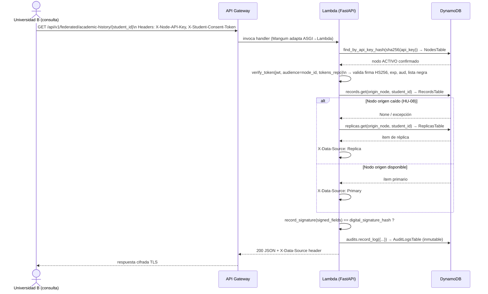
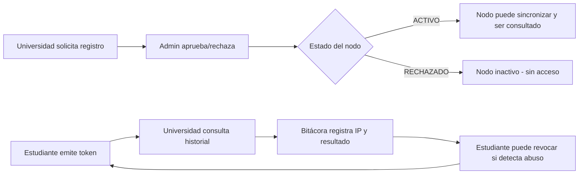

# RFHA-IES — Red Federada de Historiales Académicos

> Sistema distribuido de intercambio federado de historiales académicos interuniversitarios, desplegado como serverless en AWS.

Sistema distribuido y descentralizado que conecta a las universidades en una red interoperable. Un funcionario de una universidad puede consultar, en segundos, el historial académico de un estudiante de **otra** universidad, **siempre que el estudiante lo autorice** con un token de consentimiento digital. Los datos permanecen en el nodo de origen de cada institución.

## Pruébalo ahora (en AWS)

| | Dirección |
|---|---|
| **Demo del middleware** (consulta de un historial con permiso del estudiante) | https://qotg90dhje.execute-api.us-east-2.amazonaws.com |
| **App final: menú de inicio** (explica el proyecto y lleva a cada módulo) | https://ypybm0azfg.execute-api.us-east-2.amazonaws.com |
| App final: registro de universidad (HU-01) | https://ypybm0azfg.execute-api.us-east-2.amazonaws.com/registro-nodo |
| App final: administración (HU-02) | https://ypybm0azfg.execute-api.us-east-2.amazonaws.com/admin |
| App final: panel del nodo (HU-03) | https://ypybm0azfg.execute-api.us-east-2.amazonaws.com/panel-nodo |
| App final: portal del estudiante (HU-04 y HU-05) | https://ypybm0azfg.execute-api.us-east-2.amazonaws.com/portal-estudiante |
| App final: consulta federada (HU-06 a HU-08) | https://ypybm0azfg.execute-api.us-east-2.amazonaws.com/consulta |
| App final: bitácora de auditoría inmutable (HU-09) | https://ypybm0azfg.execute-api.us-east-2.amazonaws.com/auditoria |
| App final: reportes ejecutivos PDF | https://ypybm0azfg.execute-api.us-east-2.amazonaws.com/reportes |

- La primera visita puede tardar unos segundos (arranque en frío de AWS Lambda); después responde en menos de un segundo.
- Todos los datos son **ficticios**. La demo está en modo demostración (botones que simulan al estudiante) y se apagará después de la exposición.
- Para entrar a `/admin` hace falta la clave de administrador, que **no** está en este repositorio; el equipo la tiene.
- Cómo usar la demo: `docs/DEMO.md`. Cómo usar la app final, y cómo se conecta el código con AWS: `docs/APP_FINAL.md`.

## Contenido

1. [Ficha del proyecto](#1-ficha-del-proyecto)
2. [Resumen y problema que resuelve](#2-resumen-y-problema-que-resuelve)
3. [Alcance y actores](#3-alcance-y-actores)
4. [Requerimientos funcionales](#4-requerimientos-funcionales)
5. [Requerimientos no funcionales](#5-requerimientos-no-funcionales)
6. [Historias de usuario](#6-historias-de-usuario)
7. [Arquitectura, stack y modelo de datos](#7-arquitectura-stack-y-modelo-de-datos)
8. [Mapeo con Sistemas Distribuidos y Teoría General de Sistemas](#8-mapeo-con-sistemas-distribuidos-y-teoría-general-de-sistemas)
9. [Lo que se ha hecho (estado del proyecto)](#9-lo-que-se-ha-hecho-estado-del-proyecto)
10. [Cómo ejecutarlo desde la terminal de VS Code](#10-cómo-ejecutarlo-desde-la-terminal-de-vs-code)
11. [Pruebas, CI y CD](#11-pruebas-ci-y-cd)
12. [Estructura del repositorio](#12-estructura-del-repositorio)
13. [Documentación](#13-documentación)
14. [Cronograma y riesgos](#14-cronograma-y-riesgos)
15. [Flujo de trabajo en Git](#15-flujo-de-trabajo-en-git)

---

## Tabla de módulos

| | |
|---|---|
| **Proyecto** | Red Federada de Historiales Académicos de Instituciones de Educación Superior (RFHA-IES) |
| **Asignaturas** | Sistemas Distribuidos (165-301) y Teoría General de Sistemas (TGS) |
| **Docentes** | Ismael Antonio Ardila Sánchez · Miguel Ángel Leguizamón Páez |
| **Institución** | Universidad Distrital Francisco José de Caldas, Facultad Tecnológica |
| **Programa** | Ingeniería en Telemática (Grupo 1) |
| **Autores** | Santiago Alfonso Prieto · Brayan Acosta Parrado · Malfaida Nicol Salazar Cruz · Cristian Darío Prieto Avella · Felipe Andrés Rojas González |
| **Versión del levantamiento** | 2.0.0, noviembre de 2026 (con la adenda de frontend, 2.1) |
---

## 1. Arquitectura general

```mermaid
flowchart TD
    subgraph Nodos["Nodos IES (universidades)"]
        N1[Universidad A\nPanel del nodo]
        N2[Universidad B\nPanel del nodo]
    end

    subgraph Middleware["Middleware RFHA-IES\n(AWS Lambda + API Gateway)"]
        GW[API Gateway\nus-east-2]
        LM[AWS Lambda\nFastAPI + Mangum]
        DB[(DynamoDB\n5 tablas)]
    end

    subgraph Actores["Actores externos"]
        STU[Estudiante\nPortal web]
        ADM[Administrador\nPanel /admin]
    end

    N1 -->|POST /api/v1/node/sync-records\nX-Node-API-Key| GW
    N2 -->|GET /api/v1/federated/academic-history/{id}\nX-Student-Consent-Token| GW
    STU -->|POST /api/v1/students/token\nCredenciales + nodo destino| GW
    ADM -->|PATCH /api/v1/admin/nodes/{id}/approve\nX-Admin-Key| GW

    GW --> LM
    LM --> DB
```

### Flujo completo de una petición



---

## 2. Fundamentos teóricos aplicados al código

### 2.1 ¿Qué es el Middleware y por qué RFHA-IES lo es?

Un **middleware** es una capa de software que actúa como intermediario entre sistemas heterogéneos: recibe mensajes, los valida, transforma o enruta, y los entrega al destino correcto — sin que los extremos se conozcan directamente.

RFHA-IES cumple exactamente este rol:

| Función de middleware | Dónde ocurre en el código |
|-----------------------|---------------------------|
| **Interceptación** de cada petición | `src/app/security.py` → `require_node()` y `require_admin()` validan la identidad antes de que el router procese nada |
| **Transformación** de datos | `src/app/routers/federated.py` → `_plain()` convierte `Decimal` de DynamoDB a tipos JSON; `_summary()` agrega GPA y créditos |
| **Enrutamiento federado** | `federated.py` → decide entre `records` (primario) y `replicas` (réplica) según el estado del nodo origen |
| **Verificación de integridad** | `security.py` → `record_signature()` recalcula SHA-256 del JSON canónico y compara con `digital_signature_hash` |
| **Bitácora transversal** | `federated.py` → `_log()` escribe en `AuditLogsTable` en cada rama del flujo (éxito, denegado, error) |

### 2.2 Sistema distribuido vs. centralizado

RFHA-IES es un **sistema distribuido federado**, no un monolito, por las siguientes evidencias en el código:

| Propiedad SD | Evidencia en el código |
|---|---|
| **Nodos autónomos con identidad propia** | Cada universidad recibe una API Key única (`security.py → new_api_key()`) cuyo hash SHA-256 se guarda en `NodesTable`. El nodo **nunca** puede escribir datos de otro: `sync.py` L.40 → `"node_id": node["node_id"]` viene de la API Key autenticada, no del body. |
| **Particionamiento de datos** | `repositories.py → record_key()` L.152: `f"{node_id}#{student_id}"` — cada registro está segmentado por nodo. Un nodo no puede acceder a registros ajenos. |
| **Comunicación por red con protocolo** | Todo intercambio es HTTP REST con cabeceras de autenticación (`X-Node-API-Key`, `X-Student-Consent-Token`, `X-Admin-Key`). |
| **Ausencia de estado local compartido** | Lambda es stateless: cada invocación es independiente. El estado está exclusivamente en DynamoDB. |
| **Tolerancia a particiones (CAP)** | `federated.py` L.100-114: si el nodo origen falla, se activa failover automático a `ReplicasTable` (modelo AP). |
| **Service Registry** | `nodes.py → GET /api/v1/nodes/active`: devuelve los nodos disponibles — equivalente a Eureka/Consul. |
| **Autorización delegada** | El estudiante emite un JWT con `aud` = ID del nodo destino (`tokens.py`). Un token para Universidad A no sirve para Universidad B (`verify_token` lanza `InvalidAudienceError`). |

### 2.3 Teorema CAP

RFHA-IES es un sistema **AP** (Available + Partition-tolerant):

- **Disponibilidad:** ante fallo del nodo primario, la réplica responde (L.111-114 `federated.py`).
- **Tolerancia a particiones:** el middleware sigue operando aunque un nodo IES esté caído.
- **Consistencia eventual:** la réplica puede estar ligeramente detrás del primario; es la última versión sincronizada (`sync.py` L.57-58: `records.upsert()` → `replicas.upsert()` en el mismo request).

---

## 3. Infraestructura AWS — Mapeo código↔nube

| Servicio AWS | Rol | Configuración | Archivo relevante |
|---|---|---|---|
| **AWS Lambda** | Ejecuta la app FastAPI (serverless) | Runtime Python 3.12, timeout configurable en SAM template | `src/app/main.py` L.58 → `handler = Mangum(app, lifespan="off")` |
| **API Gateway (HTTP API)** | Punto de entrada único; enruta al Lambda | Integración proxy (`/{proxy+}`) | `template.yaml` (generado por `scripts/deploy_aws.py`) |
| **DynamoDB** | Persistencia NoSQL distribuida | 5 tablas, capacidad on-demand, AES-256 en reposo | `src/app/repositories.py` → clases `Dynamo*Repository` |
| **S3** | Almacenamiento del paquete Lambda antes del deploy | Bucket temporal durante `sam package` | `scripts/deploy_aws.py` |
| **CloudFormation / SAM** | IaC: define Lambda + API GW + permisos IAM | Stack `rfha-app` en `us-east-2` | `scripts/deploy_aws.py` |
| **IAM** | Rol de ejecución del Lambda con permisos DynamoDB | Generado automáticamente por SAM | `template.yaml` |

### ¿Por qué DynamoDB y no RDS/PostgreSQL?

| Criterio | DynamoDB | RDS |
|---|---|---|
| Escalado | Automático (on-demand), sin gestión de servidores | Requiere provisionar instancias |
| Latencia baja | Acceso por clave de partición en < 10 ms | Depende del tamaño de la query |
| TTL nativo | Elimina tokens vencidos automáticamente (`ttl` = exp del JWT) | Requiere job periódico |
| Modelo de acceso | Por clave (`node_id#student_id`), sin JOINs | Relacional, óptimo para JOINs |
| Sin estado de conexión | Perfecto para Lambda (no mantiene conexión persistente) | Connection pooling necesario |

El esquema de acceso del proyecto (siempre por `node_id` + `student_id`) es exactamente el caso de uso ideal de DynamoDB.

---

## 4. Persistencia y base de datos

### Tablas DynamoDB

| Tabla | Clave de partición | Propósito | Clase repositorio |
|---|---|---|---|
| `NodesTable` | `node_id` (IES-XXXXXXXX) | Nodos institucionales y hash de API Key | `DynamoNodeRepository` |
| `RecordsTable` | `record_key` (`node_id#student_id`) | Historiales académicos (primario) | `DynamoRecordRepository` |
| `ReplicasTable` | `record_key` | Copia de réplica para failover (HU-08) | `DynamoRecordRepository` (misma clase, tabla distinta) |
| `TokensTable` | `jti` (UUID hex) | Tokens activos del estudiante + lista negra | `DynamoTokenRepository` |
| `AuditLogsTable` | `log_id` (AUDIT-XXXXXXXXXXXX) | Bitácora inmutable (solo PutItem) | `DynamoAuditRepository` |

### Patrón de acceso clave

```python
# repositories.py L.152
def record_key(node_id: str, student_id: str) -> str:
    return f"{node_id}#{student_id}"
```

Esto garantiza que el Scan de DynamoDB por `document_number` (`find_by_document`) siempre opera dentro del espacio de claves de un nodo, y que el `upsert` por `record_key` sea idempotente (carga repetida = actualización).

### Neguentropía mediante TTL

```python
# repositories.py L.235 (DynamoTokenRepository)
# El atributo `ttl` (= exp del token) hace que DynamoDB borre el registro al vencer.
```

El atributo `ttl` = Unix timestamp de expiración del JWT. DynamoDB lo elimina automáticamente dentro de las 48 h posteriores al vencimiento, manteniendo la tabla limpia sin ningún job de limpieza — esto es **neguentropía aplicada** (el sistema expulsa "ruido" de forma autónoma).

---

## 5. Seguridad: cifrado y mecanismos de protección

### Capas de cifrado

| Capa | Mecanismo | Código |
|---|---|---|
| **En tránsito** | TLS 1.2+ forzado por API Gateway (AWS gestiona el certificado) | Transparente en infraestructura |
| **API Key del nodo** | SHA-256 (nunca se guarda en texto plano) | `security.py → hash_api_key()` L.23-24 |
| **Contraseña del estudiante** | PBKDF2-HMAC-SHA256, 100.000 iteraciones, sal de 16 bytes aleatoria | `security.py → hash_password()` L.29-32 |
| **Firma del historial** | SHA-256 del JSON canónico (sort_keys, sin espacios) | `security.py → record_signature()` L.55-57 |
| **Token de consentimiento** | JWT HS256 con `jti`, `aud`, `exp` y lista negra en DynamoDB | `tokens.py → issue_token()` / `verify_token()` |
| **En reposo (DynamoDB)** | AES-256 gestionado por AWS KMS (activado por defecto) | Configuración de infraestructura AWS |
| **Timing-safe comparisons** | `hmac.compare_digest()` para Admin Key y contraseñas | `security.py` L.44-47, L.65 |

### CSP (Content Security Policy)

```python
# main.py L.12-18
PAGE_HEADERS = {
    "Content-Security-Policy": (
        "default-src 'self'; img-src 'self'; style-src 'self'; script-src 'self'; "
        "base-uri 'none'; form-action 'self'; frame-ancestors 'none'"
    ),
    ...
}
```

Todos los scripts son externos (`type="module"`) para cumplir con `script-src 'self'`. No hay inline scripts ni inline styles.

---

## 6. Alta disponibilidad y tolerancia a fallos

### ¿Por qué el sistema no se cae?

| Mecanismo | Detalle |
|---|---|
| **Escalado automático de Lambda** | AWS instancia múltiples ejecuciones concurrentes en milisegundos ante picos de carga. No hay servidor que administrar. SLA: 99.95%. |
| **Failover a réplica (HU-08)** | `federated.py` L.100-114: si `records.get()` retorna `None` o lanza excepción, se consulta `ReplicasTable` automáticamente. La cabecera `X-Data-Source: Replica` lo evidencia. |
| **Simulación de caída** | La cabecera `X-Simulate-Down: true` (o la variable `SIMULATE_NODE_DOWN` en `.env`) fuerza el failover sin necesidad de apagar nada. |
| **Idempotencia del upsert** | Si una sincronización falla a mitad, se puede re-ejecutar sin duplicar datos: `put_item` sobreescribe por `record_key`. |
| **Tokens con expiración** | TTL de 24 h evita acumulación de tokens activos. La lista negra permite revocación inmediata. |
| **Bitácora inmutable** | `AuditLogsTable` solo recibe `PutItem` (nunca `UpdateItem` ni `DeleteItem`). Cualquier operación queda trazada con IP, resultado y fuente de datos. |

---

## 7. Ejecución local

```bash
# 1. Crear entorno y arrancar
python scripts/run_demo.py --app --port 8001

# 2. Tests completos
.venv/Scripts/pytest -q

# 3. Deploy a AWS
python scripts/deploy_aws.py app --profile rfha --region us-east-2
```

### Variables de entorno (`.env`)

| Variable | Descripción | Default |
|---|---|---|
| `REPOSITORY_BACKEND` | `memory` (local) o `dynamodb` (AWS) | `memory` |
| `ADMIN_KEY` | Clave del administrador general | — |
| `JWT_SECRET` | Secreto de firma de tokens | valor de desarrollo |
| `SIMULATE_NODE_DOWN` | `node_id` de nodo a simular caído | — |
| `NODES_TABLE` | Nombre de la tabla DynamoDB | `NodesTable` |
| `RECORDS_TABLE` | — | `RecordsTable` |
| `REPLICAS_TABLE` | — | `ReplicasTable` |
| `TOKENS_TABLE` | — | `TokensTable` |
| `AUDIT_TABLE` | — | `AuditLogsTable` |

---

## 8. Historias de usuario implementadas

| HU | Descripción | Router / archivo principal |
|----|-------------|---------------------------|
| HU-01 | Registro de universidad como nodo | `routers/nodes.py → POST /api/v1/nodes/register` |
| HU-02 | Aprobación de nodo por administrador | `routers/admin.py → PATCH /api/v1/admin/nodes/{id}/approve` |
| HU-03 | Sincronización de historiales | `routers/sync.py → POST /api/v1/node/sync-records` |
| HU-04 | Emisión de token de consentimiento | `routers/students.py → POST /api/v1/students/token` |
| HU-05 | Revocación de token | `routers/students.py → DELETE /api/v1/students/token/{jti}` |
| HU-06 | Consulta federada con token | `routers/federated.py → GET /api/v1/federated/academic-history/{id}` |
| HU-07 | Bloqueo por token inválido / revocado | mismo endpoint, control L.86-94 |
| HU-08 | Tolerancia a fallos + conmutación a réplica | mismo endpoint, control L.100-114 |
| HU-09 | Bitácora inmutable de auditoría | `routers/audit.py` + `_log()` en `federated.py` |
| HU-10 | Interfaz web completa | `main.py PAGES` + `static/` |

---

## 9. Bucles de retroalimentación (TGS)



Los tres loops de feedback del sistema:
1. **Aprobación:** Solicitud → Revisión admin → Estado nodo → Capacidad de operación.
2. **Consentimiento:** Emisión de token → Consulta → Auditoría → Revocación si necesario.
3. **Integridad:** Sincronización firma SHA-256 → Consulta verifica firma → Error 500 si no coincide → Nodo debe re-sincronizar.

---

## 10. Estructura del repositorio

## 14. Cronograma y riesgos

### Hitos (noviembre de 2026)

| Hito | Entregable | Semana | Estado |
|---|---|---|---|
| **1. Requerimientos y middleware** | Exposición de Web Services y documento de requerimientos. | 1 | **Hecho:** demo, guías y documentación. |
| **2. Despliegue core en AWS** | API Gateway, Lambda y tablas DynamoDB en el Free Tier. | 2 | En curso: demo lista para desplegar; falta el despliegue y las tablas. |
| **3. Seguridad y tokens** | Validador JWT del `student_auth_token`. | 3 | Parcial: la demo valida el JWT; falta HU-04 y HU-05. |
| **4. Modelado TGS y pruebas** | Diagramas causal y de Forrester; pruebas de carga. | 3 | Pendiente. |
| **5. Sustentación final** | Informe en PDF (ICONTEC) y sustentación de 20 minutos. | 4 | Pendiente. |

### Riesgos y mitigación

| Riesgo | Mitigación |
|---|---|
| Superar la cuota gratuita de AWS. | Alerta de presupuesto de USD 0,01, plan *Free* de la cuenta, límite de peticiones por segundo y logs de 7 días. |
| Arranque en frío de Lambda. | Runtime liviano de Python 3.11 y una consulta de calentamiento antes de exponer. |
| Desconexión entre los entregables de TGS y de Sistemas Distribuidos. | Tabla de trazabilidad entre historias, requerimientos y código (`docs/historias/` y este README). |
| El Free Tier cambió para cuentas nuevas (plan de créditos de hasta 6 meses). | Documentado en `docs/BRECHAS.md`; se usa el plan *Free* y se borra todo con `sam delete` al terminar. |

---

## 15. Flujo de trabajo en Git

- **Rama de trabajo:** `dev`. Cada historia se sube a `dev` y el CI de GitHub corre las pruebas.
- **Integración:** pull request de `dev` a `main` abierto por el equipo.
- **Etiqueta `demo-martes`:** versión de la demo para la exposición.
- **Mensajes de commit:** Conventional Commits (por ejemplo `feat(hu-02): aprobar nodo y emitir api key`).
- **Seguridad:** nunca se suben `.env`, claves ni credenciales de AWS.
- **Bitácora:** todo desarrollo se registra en `docs/BITACORA.md` antes de cada commit.

---
