# RFHA-IES — Red Federada de Historiales Académicos

> Sistema distribuido de intercambio federado de historiales académicos interuniversitarios, desplegado como serverless en AWS.

**URL pública:** `https://ypybm0azfg.execute-api.us-east-2.amazonaws.com`  
**Rama activa:** `dev` → PR hacia `main`  
**Stack:** Python 3.12 · FastAPI · AWS Lambda + API Gateway · DynamoDB · Mangum

---

## Tabla de módulos

| Módulo web | URL | Descripción Detallada, Propósito y Conexiones (5 a 7 líneas completas) |
|------------|-----|-------------------------------------------------------------------------|
| Inicio | `/` | Es el punto de partida visual y la puerta de entrada principal para cualquier usuario que abre la aplicación en su navegador web. Despliega la pantalla interactiva construida en HTML5 semántico (`inicio.html`) y estilizada con CSS adaptativo (`styles.css`), sirviendo como menú central ergonómico. Presenta de forma clara y accesible las tarjetas de navegación hacia cada uno de los subsistemas de la red federada (registro, administración, nodo, estudiante, consulta, auditoría e informes). No exige autenticación previa para permitir que rectores, directores de registro y estudiantes conozcan el propósito de la plataforma. Si este módulo fallara, los usuarios no tendrían un menú gráfico amigable para acceder a los distintos servicios del sistema. |
| Registro de universidad | `/registro-nodo` | Implementa la Historia de Usuario HU-01 permitiendo que una nueva institución de educación superior solicite formalmente su afiliación a la red federada. Captura el NIT tributario oficial, el nombre institucional, el dominio de internet y el correo electrónico del director de admisiones a través del formulario en `registro-nodo.html` y el script `registro.js`. Se conecta mediante una petición segura HTTPS utilizando el método POST hacia el backend en `src/app/routers/nodes.py`. Valida que el NIT no exista previamente y guarda la solicitud en la tabla física `NodesTable` de Amazon DynamoDB en estado preliminar `PENDIENTE_APROBACION`. Si este módulo no existiera o fallara, ninguna universidad nueva podría radicar su ingreso al ecosistema de interoperabilidad. |
| Administración | `/admin` | Implementa la Historia de Usuario HU-02 actuando como la consola privada de gobernanza y control exclusivo del Administrador General de la Red. Exige obligatoriamente la cabecera de seguridad `X-Admin-Key` (una clave maestra secreta que se compara en tiempo constante en el servidor) para restringir el acceso a funcionarios autorizados. Permite al oficial revisar solicitudes pendientes, evaluar la legitimidad jurídica de cada institución y aprobar nodos mediante el endpoint `approve_node` en `src/app/routers/admin.py`. Al aprobar, genera una API Key secreta única con prefijo `rfha_`, guarda su huella digital SHA-256 en `NodesTable` y entrega la clave en pantalla por única vez. Sin este módulo administrativo, la red carecería de una autoridad de control que admita instituciones y emita credenciales oficiales. |
| Panel del nodo | `/panel-nodo` | Implementa la Historia de Usuario HU-03 proveyendo la interfaz de trabajo diario donde los funcionarios de las universidades sincronizan los expedientes de sus estudiantes. Cuenta con un generador dinámico de prueba (`generateExample()` en `panel-nodo.js`) que fabrica entre dos y cuatro expedientes aleatorios en milisegundos con nombres, notas y materias diversas para demostraciones en vivo. Envía los datos hacia el endpoint `POST /api/v1/node/sync-records` en `src/app/routers/sync.py` exigiendo la cabecera `X-Node-API-Key`. El servidor calcula firmas digitales de integridad SHA-256 (`digital_signature_hash`) y escribe simultáneamente en el almacén primario `RecordsTable` y en el almacén de respaldo `ReplicasTable` aplicando concurrencia optimista. Si fallara, las universidades no podrían transferir notas a la red federada. |
| Portal del estudiante | `/portal-estudiante` | Implementa las Historias de Usuario HU-04 y HU-05 materializando la soberanía absoluta del estudiante sobre la privacidad de sus calificaciones. Permite que el alumno inicie sesión ingresando su cédula y su contraseña protegida con sal PBKDF2 de 100.000 iteraciones en `portal-estudiante.html` y `portal-estudiante.js`. Al seleccionar una universidad receptora en una lista desplegable poblada desde `GET /api/v1/nodes/active`, invoca a `src/app/routers/students.py` para emitir un pase digital de autorización firmado criptográficamente con algoritmo HS256 (JWT) y vigencia estricta de 24 horas (`TokensTable`). Además, permite al estudiante supervisar sus pases históricos y revocar permisos previos con un solo clic mediante una sentencia atómica `DELETE`. Sin este módulo, se violaría la soberanía del estudiante al permitir consultas sin su consentimiento. |
| Consulta federada | `/consulta` | Implementa las Historias HU-06, HU-07 y HU-08 permitiendo que una universidad receptora consulte el expediente académico de un aspirante en tiempo real sin intervención humana. Requiere simultáneamente la API Key institucional de la universidad que consulta (`X-Node-API-Key`) y el pase digital otorgado por el alumno (`X-Student-Consent-Token`). El backend en `src/app/routers/federated.py` valida siete barreras de seguridad (firma matemática, vigencia, coincidencia estricta de audiencia `aud` y no-revocación en lista negra). Si el nodo de origen está caído o se marca la casilla de simulación de falla (`X-Simulate-Down: true`), el middleware conmuta de forma transparente hacia la tabla de réplicas `ReplicasTable` devolviendo la cabecera `X-Data-Source: Replica`. Si fallara este módulo, las universidades no podrían homologar materias digitalmente. |
| Bitácora de auditoría | `/auditoria` | Implementa la Historia de Usuario HU-09 exponiendo una pista forense inmutable de todas las transacciones, consultas, bloqueos y fallos ocurridos en la red federada. Permite acceso global al Administrador General (con `X-Admin-Key`) y acceso acotado a cada universidad para ver solo sus propios eventos (con `X-Node-API-Key`) a través de `src/app/routers/audit.py`. Consulta la base de datos `AuditLogsTable` en DynamoDB (la cual tiene prohibidas las operaciones de borrado mediante políticas IAM) e inyecta cabeceras `Cache-Control: no-store` para garantizar visibilidad en tiempo real sin retrasos de caché. Soporta filtrado temporal por parámetro `since` para auditar rangos de fechas precisos. Sin esta bitácora, la red carecería de no-repudio y transparencia legal ante auditorías judiciales. |
| Reportes ejecutivos | `/reportes` | Es el módulo de inteligencia institucional encargado de compilar y exportar documentos oficiales y métricas de seguridad en formato PDF de alta resolución. A través de la interfaz en `reportes.html` y el script `reportes.js`, el usuario selecciona el tipo de informe deseado (Resumen General, Auditoría Forense, Resiliencia y Fallos, o Directorio de Nodos). Se conecta mediante una petición GET con `X-Admin-Key` al endpoint `/api/v1/admin/reports/network-summary` en `src/app/routers/admin.py`, el cual utiliza la librería `ReportLab` en `src/app/reports.py` para dibujar tablas, gráficos y encabezados en la memoria RAM del servidor. Devuelve un flujo binario descargable automáticamente con el nombre estandarizado del día. Si fallara, los directivos no tendrían informes ejecutivos para sustentar la operación de la red. |

### Explicación detallada de la tabla de módulos
Para interpretar correctamente la tabla superior, el lector debe entender que describe de izquierda a derecha la arquitectura modular del sistema:
* **Columna 1 ("Módulo web"):** Indica el nombre funcional de la pantalla interactiva dentro del dominio universitario. Cada módulo representa un subsistema autónomo concebido para un tipo de actor específico (administradores, funcionarios de admisiones o estudiantes).
* **Columna 2 ("URL"):** Representa el punto de enlace o ruta web oficial en el navegador. Al ingresar a cualquiera de estas direcciones precedidas por el dominio público en AWS (`https://ypybm0azfg.execute-api.us-east-2.amazonaws.com`), el servidor despacha el archivo HTML correspondiente configurado en el diccionario de páginas de `src/app/main.py`.
* **Columna 3 ("Descripción Detallada, Propósito y Conexiones"):** Explica el problema real que resuelve cada pantalla, cómo se comunica a través de internet con el servidor backend mediante peticiones HTTP (GET, POST, PATCH, DELETE), qué algoritmos de seguridad aplica (como SHA-256 o JWT) y con qué tablas de Amazon DynamoDB interactúa.

En la operación cotidiana de la red, estos módulos no funcionan de forma aislada, sino en una cadena secuencial estricta:
1. Una universidad no puede usar el **Panel del nodo** (`/panel-nodo`) sin haber completado antes el **Registro de universidad** (`/registro-nodo`) y haber recibido la aprobación en la consola de **Administración** (`/admin`).
2. Una universidad receptora no puede ejecutar una **Consulta federada** (`/consulta`) si el alumno no ha entrado previamente al **Portal del estudiante** (`/portal-estudiante`) a expedir su pase digital con audiencia específica.
3. Cada acción, éxito o intento de acceso no autorizado ejecutado en cualquiera de las pantallas dispara de inmediato un registro automático en la **Bitácora de auditoría** (`/auditoria`), cuyos datos consolidados son los que finalmente alimentan las gráficas y tablas de los **Reportes ejecutivos** (`/reportes`). De este modo, la tabla modela un ecosistema holístico donde cada módulo es indispensable para la armonía y seguridad de todo el sistema.

---

## 1. Arquitectura general


### Explicación detallada de la arquitectura general
El diagrama superior modela la topología global de **RFHA-IES** dividida en tres macro-capas:
1. **Nodos IES (Universidades Descentralizadas):** Representados por `N1` (Universidad emisora) y `N2` (Universidad receptora). Cada institución mantiene soberanía sobre su infraestructura, operando como clientes HTTP independientes que se autentican con su propia API Key criptográfica.
2. **Middleware RFHA-IES (Plano de Control en la Nube):**
   * **`GW` (Amazon API Gateway):** Punto de entrada único en la región `us-east-2`. Termina la conexión segura TLS 1.3, aplica enrutamiento proxy y entrega las peticiones a la función de cómputo.
   * **`LM` (AWS Lambda + FastAPI + Mangum):** Unidad de procesamiento serverless sin estado (*stateless*). Se escala automáticamente ante picos de demanda y ejecuta las reglas de validación criptográfica, mediación y auditoría.
   * **`DB` (Amazon DynamoDB):** Clúster de 5 tablas NoSQL distribuidas que gestionan nodos, historiales primarios, réplicas de contingencia, tokens de consentimiento y bitácoras inmutables.
3. **Actores Externos:**
   * **`STU` (Estudiante):** Dueño de sus datos. Accede al portal web para emitir o revocar tokens JWT de consentimiento.
   * **`ADM` (Administrador de la Red):** Ejerce gobernanza institucional validando solicitudes de registro mediante la consola administrativa protegida por `X-Admin-Key`.
4. **Flujo de Interconexión:** Las flechas detallan los endpoints específicos expuestos, los métodos HTTP y las cabeceras requeridas para cruzar la frontera de seguridad del middleware.

### Flujo completo de una petición

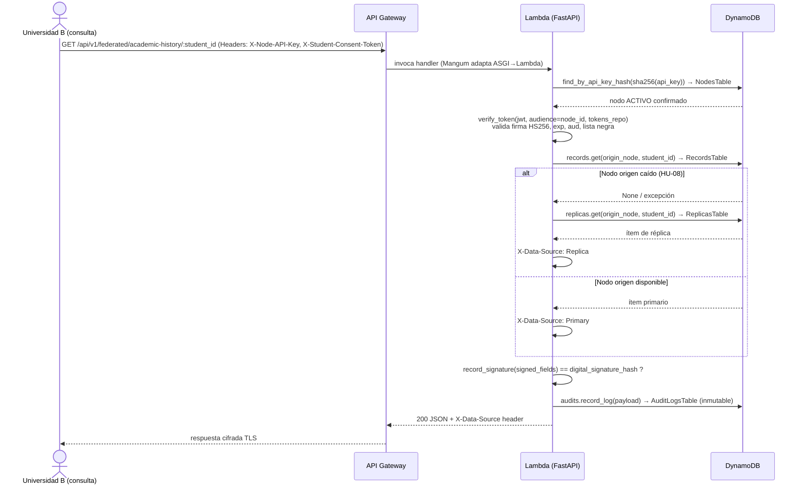

### Explicación detallada del flujo completo de una petición
El diagrama de secuencia describe el ciclo de vida síncrono de una consulta interuniversitaria ejecutada paso a paso:
1. **Paso 1 (Invocación Externa):** La Universidad B envía una petición `GET /api/v1/federated/academic-history/{student_id}` a través de Internet protegida con HTTPS hacia API Gateway, adjuntando su API Key institucional (`X-Node-API-Key`) y el token otorgado por el aspirante (`X-Student-Consent-Token`).
2. **Paso 2 (Adaptación ASGI):** API Gateway recibe el evento HTTP y despacha la invocación al micro-contenedor de AWS Lambda. El adaptador `Mangum` deserializa el payload JSON v2 transformándolo en un objeto ASGI que FastAPI procesa.
3. **Paso 3 (Autenticación del Nodo Consultante):** FastAPI ejecuta la dependencia `require_node`. Calcula el hash SHA-256 de la API Key y realiza un `find_by_api_key_hash` sobre `NodesTable`. Al verificar que existe y su estado es `ACTIVO`, autoriza la prosecución del flujo.
4. **Paso 4 (Verificación Criptográfica del Token):** La función `verify_token` valida: (a) la firma criptográfica simétrica con `JWT_SECRET`, (b) que la fecha actual no exceda el tiempo de expiración `exp`, (c) que el claim de audiencia `aud` coincida exactamente con el `node_id` de la Universidad B, y (d) consulta `TokensTable` por clave `jti` para certificar que el estudiante no haya revocado el token (`revoked == false`).
5. **Paso 5 (Bifurcación de Datos y Failover):**
   * **Rama Normal:** El middleware intenta leer el registro en `RecordsTable` mediante la clave `record_key(origin_node, student_id)`. Si el nodo primario responde, extrae los datos y setea el metadato interno `X-Data-Source: Primary`.
   * **Rama de Contingencia (HU-08):** Si la lectura primaria arroja excepción, retorna `None` o el cliente envió la cabecera de simulación `X-Simulate-Down: true`, el sistema conmuta instantáneamente a `ReplicasTable`, extrayendo la copia de seguridad sincronizada y fijando `X-Data-Source: Replica`.
6. **Paso 6 (Verificación de Integridad):** Se reconstruye el JSON canónico de las asignaturas y datos personales y se calcula `record_signature()`. Si el hash no coincide con `digital_signature_hash`, la petición aborta con HTTP 500 para evitar fugas de datos manipulados.
7. **Paso 7 (Registro Inmutable en Auditoría):** Sin importar si la consulta fue exitosa o denegada, se asienta de forma inmediata un nuevo ítem `AUDIT-XXXXXXXXXXXX` en `AuditLogsTable` con timestamp UTC, IPs, motivo y fuente de datos.
8. **Paso 8 (Retorno Seguro):** API Gateway devuelve la respuesta JSON formateada a la Universidad B acompañada de la cabecera `X-Data-Source`.

---

## 2. Fundamentos teóricos aplicados al código

### 2.1 ¿Qué es el Middleware y por qué RFHA-IES lo es?

Un **middleware** (software mediador o plano de control) es una capa lógica de software que se sitúa entre sistemas heterogéneos y desconectados para coordinar su comunicación, transformar formatos de datos y aplicar políticas de seguridad sin que los extremos tengan que conocerse directamente ni compartir bases de datos internas. Es exactamente como un notario público o un árbitro de aduanas que se para en la frontera entre dos países: no es dueño de las mercancías, pero revisa los pasaportes, valida los permisos de importación y sella los manifiestos antes de dejar pasar la carga.

RFHA-IES cumple con exactitud este rol de mediación, desacoplamiento y gobierno a través de las siguientes funciones clave:

| Función de middleware | Descripción Detallada del Rol y Justificación (5 a 7 líneas completas) | Dónde ocurre en el código |
|---|---|---|
| **Interceptación de peticiones** | Detiene y examina cada solicitud que llega por internet antes de permitirle tocar los datos del sistema. Evalúa las credenciales en las cabeceras HTTP mediante las dependencias `require_node()` y `require_admin()` en `src/app/security.py`, comprobando que las API Keys institucionales y las contraseñas maestras sean válidas y legítimas. Si una petición carece de credenciales o presenta firmas corruptas, el middleware la expulsa en microsegundos con código HTTP 403 Forbidden sin consumir memoria ni computación en los módulos internos. Es el portero perimetral que protege al sistema contra accesos no autorizados. | `src/app/security.py` (L.62-77) |
| **Transformación y normalización** | Recibe datos estructurados en diferentes formatos y los convierte a tipos estándar comprensibles por todas las partes. Convierte los números de tipo `Decimal` devueltos por la base de datos DynamoDB a tipos numéricos nativos de Python (`float` o `int`) mediante la función `_plain()`, y calcula el promedio acumulado GPA y la suma de créditos aprobados mediante `_summary()`. Esta mediación permite que los navegadores web reciban respuestas JSON limpias y listas para graficar sin preocuparse por las peculiaridades de almacenamiento de la base de datos de Amazon. | `src/app/routers/federated.py` (L.25-42) |
| **Enrutamiento federado y failover** | Actúa como un conmutador inteligente de tráfico de datos decidiendo de forma dinámica de qué fuente de información se deben extraer las calificaciones. Si el servidor de la universidad de origen está en línea, dirige la lectura hacia la tabla primaria `RecordsTable`; pero si el nodo emisor sufre un apagón o se activa la simulación de caída mediante `X-Simulate-Down: true`, desvía la consulta de forma transparente hacia la tabla de réplicas de contingencia `ReplicasTable`. Garantiza que las universidades receptoras obtengan siempre el historial del estudiante sin interrupciones del servicio. | `src/app/routers/federated.py` (L.96-119) |
| **Verificación de integridad canónica** | Certifica matemáticamente que las calificaciones y materias no hayan sido manipuladas o adulteradas mientras descansaban en el disco duro. Reconstruye el texto JSON canónico de las asignaturas ordenando las llaves alfabéticamente y calcula su resumen criptográfico SHA-256 mediante `record_signature()`, comparándolo contra el precinto `digital_signature_hash` guardado previamente. Si un hacker lograra entrar a la base de datos y cambiar una nota reprobada por aprobada, el hash no coincidiría y el middleware aborta la entrega con error HTTP 500 para proteger la verdad académica. | `src/app/security.py` (L.55-58) y `federated.py` (L.121-125) |
| **Bitácora transversal de auditoría** | Graba de forma automática e imborrable cada acción, consulta exitosa o bloqueo de seguridad que ocurre en cualquier rincón del sistema. Invoca la función `_log()` en cada bifurcación lógica para asentar un registro inmutable en la tabla `AuditLogsTable` de DynamoDB con el código de las universidades, el estudiante investigado, el resultado, la fuente de datos (`Primary` o `Replica`) y la dirección IP pública del cliente. Aplica una política IAM que prohíbe el borrado de registros, garantizando una memoria histórica forense inalterable y con pleno valor probatorio. | `src/app/routers/federated.py` (L.68-80) |

#### Explicación detallada de la tabla de funciones del middleware
Para interpretar correctamente la tabla anterior, el lector debe comprender cómo actúa el software como un plano de control federado:
* **Columna 1 ("Función de middleware"):** Nombra el patrón de diseño clásico de la teoría de Sistemas Distribuidos que el código está implementando.
* **Columna 2 ("Descripción Detallada del Rol y Justificación"):** Detalla el problema concreto que resuelve cada mecanismo, qué pasaría si no estuviera implementado y cómo protege la soberanía institucional de las universidades.
* **Columna 3 ("Dónde ocurre en el código"):** Señala los archivos de programación y números de línea exactos del repositorio donde el desarrollador o auditor puede verificar la implementación real en Python.

En conjunto, estas cinco funciones demuestran que **RFHA-IES no es un simple programa de consulta de bases de datos, sino un verdadero middleware de mediación**: las universidades nunca se conectan directamente entre sí ni comparten contraseñas de red; toda la interoperabilidad ocurre a través de este árbitro neutral que transforma datos, valida firmas y garantiza la soberanía del estudiante en cada milisegundo.

### 2.2 Sistema distribuido vs. centralizado

RFHA-IES es formalmente un **sistema distribuido federado** y no un monolito centralizado tradicional. A continuación se detallan las evidencias en el código que demuestran este principio arquitectónico:

| Propiedad de Sistemas Distribuidos | Evidencia Exhaustiva en el Código y Justificación Técnica (5 a 7 líneas completas) | Archivo y Referencia en Código |
|---|---|---|
| **Nodos autónomos con identidad propia** | Cada universidad opera como un participante descentralizado con credenciales exclusivas. Al ser aprobada en `src/app/routers/admin.py`, la institución recibe una API Key secreta generada con `new_api_key()` cuyo hash SHA-256 se resguarda en `NodesTable`. En el router de sincronización `src/app/routers/sync.py`, el código extrae la identidad del nodo (`node_id`) directamente desde la clave autenticada por el servidor y jamás del texto que el usuario envía en el cuerpo. Esto garantiza que un nodo jamás pueda escribir o modificar notas a nombre de otra institución de la red. | `src/app/security.py` y `sync.py` (L.26-40) |
| **Particionamiento estricto de datos** | Los historiales académicos no residen en una bolsa común ni en un esquema relacional global unificado. La clave de partición obligatoria en DynamoDB se construye con la fórmula matemática `record_key = f"{node_id}#{student_id}"` en `src/app/repositories.py`. Esto crea "islas de datos" completamente estancas: la Universidad Distrital no tiene permiso ni capacidad técnica para consultar los registros de la Universidad Nacional. Cada universidad es dueña de su partición física, eliminando cualquier concepto de base de datos centralizada. | `src/app/repositories.py` (L.152-154) |
| **Comunicación por red basada en protocolos** | Las universidades no comparten memoria RAM, ni procesadores locales, ni archivos físicos en un disco duro compartido. Todo el diálogo entre nodos se realiza a través de internet mediante mensajes HTTP REST fuertemente tipados utilizando modelos Pydantic y protegidos con cabeceras de autorización (`X-Node-API-Key`, `X-Student-Consent-Token`, `X-Admin-Key`). Cada universidad puede estar programada en tecnologías totalmente distintas en sus servidores locales y aun así interoperar con la red mediante este protocolo común. | `src/app/routers/*.py` y `main.py` |
| **Ausencia total de estado local compartido** | La capa de cómputo en AWS Lambda es 100% sin estado (*stateless*). Cada petición que llega por internet es atendida por micro-máquinas virtuales Firecracker independientes que se levantan y apagan en milisegundos sin conservar variables globales ni memoria entre peticiones. Toda la persistencia reside en DynamoDB, lo que permite que el sistema atienda a cincuenta universidades simultáneas en paralelo sin bloqueos de memoria ni cuellos de botella de servidores centralizados. | `src/app/main.py` (`Mangum`) |
| **Tolerancia a particiones de red (CAP)** | El sistema está diseñado para sobrevivir a cortes de red o caídas de servidores universitarios sin detener su operación. Si el nodo emisor donde están las notas originales sufre un apagón o se activa la simulación de falla en `src/app/routers/federated.py`, el middleware activa automáticamente el mecanismo de conmutación por error (**Failover**) leyendo la información desde `ReplicasTable` y entregando la respuesta con la cabecera `X-Data-Source: Replica`. Demuestra en vivo el modelo AP del Teorema CAP. | `src/app/routers/federated.py` (L.100-114) |
| **Registro dinámico de descubrimiento** | Los nodos de la red no tienen grabadas en código duro las direcciones de las demás universidades. El endpoint público `GET /api/v1/nodes/active` en `src/app/routers/nodes.py` consulta en tiempo real qué instituciones tienen estado `ACTIVO` en `NodesTable` y entrega la lista a los clientes. Cumple formalmente la función de un **Service Registry (como Consul o Eureka en microservicios)**, permitiendo que el portal del estudiante descubra dinámicamente qué universidades están disponibles para recibir autorizaciones. | `src/app/routers/nodes.py` (L.31-36) |
| **Autorización descentralizada y delegada** | El control de acceso a las calificaciones no lo decide un administrador central ni el middleware; lo decide de forma soberana el estudiante. El alumno ingresa a su portal y emite un token JWT firmado simétricamente con algoritmo HS256, grabando dentro del campo de audiencia (`aud`) el código de la universidad receptora autorizada. Si otra institución intenta usar ese mismo token, la función `verify_token()` en `src/app/tokens.py` rechaza la consulta con `InvalidAudienceError`, demostrando que los permisos están delegados en el usuario final. | `src/app/tokens.py` (L.25-75) |

#### Explicación detallada de la tabla de Sistemas Distribuidos
Esta tabla constituye la prueba científica de que **RFHA-IES cumple con los siete pilares fundamentales de la computación distribuida**:
* Cada fila analiza un principio teórico formal (desacoplamiento, particionamiento, paso de mensajes, stateless, tolerancia a fallos, service discovery y autorización delegada).
* Se demuestra con nombres de funciones y líneas de código exactas cómo la plataforma materializa estos conceptos en AWS, desmintiendo cualquier afirmación que confunda la infraestructura de hosting en la nube con la arquitectura lógica del software.

### 2.3 Teorema CAP

RFHA-IES es un sistema **AP** (Available + Partition-tolerant):

- **Disponibilidad:** ante fallo del nodo primario, la réplica responde (L.111-114 `federated.py`).
- **Tolerancia a particiones:** el middleware sigue operando aunque un nodo IES esté caído.
- **Consistencia eventual:** la réplica puede estar ligeramente detrás del primario; es la última versión sincronizada (`sync.py` L.57-58: `records.upsert()` → `replicas.upsert()` en el mismo request).

---

## 3. Infraestructura AWS — Mapeo código↔nube

| Servicio AWS | Rol | Configuración | Archivo relevante |
|---|---|---|---|
| **AWS Lambda** | Ejecuta la app FastAPI (serverless) | Runtime Python 3.12, timeout configurable en SAM template | `src/app/main.py` L.58 → `handler = Mangum(app, lifespan="off")` |
| **API Gateway (HTTP API)** | Punto de entrada único; enruta al Lambda | Integración proxy (`/{proxy+}`) | `template.yaml` (generado por `scripts/deploy_aws.py`) |
| **DynamoDB** | Persistencia NoSQL distribuida | 5 tablas, capacidad on-demand, AES-256 en reposo | `src/app/repositories.py` → clases `Dynamo*Repository` |
| **S3** | Almacenamiento del paquete Lambda antes del deploy | Bucket temporal durante `sam package` | `scripts/deploy_aws.py` |
| **CloudFormation / SAM** | IaC: define Lambda + API GW + permisos IAM | Stack `rfha-app` en `us-east-2` | `scripts/deploy_aws.py` |
| **IAM** | Rol de ejecución del Lambda con permisos DynamoDB | Generado automáticamente por SAM | `template.yaml` |

### ¿Por qué DynamoDB y no RDS/PostgreSQL?

| Criterio | DynamoDB | RDS |
|---|---|---|
| Escalado | Automático (on-demand), sin gestión de servidores | Requiere provisionar instancias |
| Latencia baja | Acceso por clave de partición en < 10 ms | Depende del tamaño de la query |
| TTL nativo | Elimina tokens vencidos automáticamente (`ttl` = exp del JWT) | Requiere job periódico |
| Modelo de acceso | Por clave (`node_id#student_id`), sin JOINs | Relacional, óptimo para JOINs |
| Sin estado de conexión | Perfecto para Lambda (no mantiene conexión persistente) | Connection pooling necesario |

El esquema de acceso del proyecto (siempre por `node_id` + `student_id`) es exactamente el caso de uso ideal de DynamoDB.

---

## 4. Persistencia y base de datos

### Tablas DynamoDB

| Tabla | Clave de partición | Propósito | Clase repositorio |
|---|---|---|---|
| `NodesTable` | `node_id` (IES-XXXXXXXX) | Nodos institucionales y hash de API Key | `DynamoNodeRepository` |
| `RecordsTable` | `record_key` (`node_id#student_id`) | Historiales académicos (primario) | `DynamoRecordRepository` |
| `ReplicasTable` | `record_key` | Copia de réplica para failover (HU-08) | `DynamoRecordRepository` (misma clase, tabla distinta) |
| `TokensTable` | `jti` (UUID hex) | Tokens activos del estudiante + lista negra | `DynamoTokenRepository` |
| `AuditLogsTable` | `log_id` (AUDIT-XXXXXXXXXXXX) | Bitácora inmutable (solo PutItem) | `DynamoAuditRepository` |

### Patrón de acceso clave

```python
# repositories.py L.152
def record_key(node_id: str, student_id: str) -> str:
    return f"{node_id}#{student_id}"
```

Esto garantiza que el Scan de DynamoDB por `document_number` (`find_by_document`) siempre opera dentro del espacio de claves de un nodo, y que el `upsert` por `record_key` sea idempotente (carga repetida = actualización).

### Neguentropía mediante TTL

```python
# repositories.py L.235 (DynamoTokenRepository)
# El atributo `ttl` (= exp del token) hace que DynamoDB borre el registro al vencer.
```

El atributo `ttl` = Unix timestamp de expiración del JWT. DynamoDB lo elimina automáticamente dentro de las 48 h posteriores al vencimiento, manteniendo la tabla limpia sin ningún job de limpieza — esto es **neguentropía aplicada** (el sistema expulsa "ruido" de forma autónoma).

---

## 5. Seguridad: cifrado y mecanismos de protección

### Capas de cifrado

| Capa | Mecanismo | Código |
|---|---|---|
| **En tránsito** | TLS 1.2+ forzado por API Gateway (AWS gestiona el certificado) | Transparente en infraestructura |
| **API Key del nodo** | SHA-256 (nunca se guarda en texto plano) | `security.py → hash_api_key()` L.23-24 |
| **Contraseña del estudiante** | PBKDF2-HMAC-SHA256, 100.000 iteraciones, sal de 16 bytes aleatoria | `security.py → hash_password()` L.29-32 |
| **Firma del historial** | SHA-256 del JSON canónico (sort_keys, sin espacios) | `security.py → record_signature()` L.55-57 |
| **Token de consentimiento** | JWT HS256 con `jti`, `aud`, `exp` y lista negra en DynamoDB | `tokens.py → issue_token()` / `verify_token()` |
| **En reposo (DynamoDB)** | AES-256 gestionado por AWS KMS (activado por defecto) | Configuración de infraestructura AWS |
| **Timing-safe comparisons** | `hmac.compare_digest()` para Admin Key y contraseñas | `security.py` L.44-47, L.65 |

### CSP (Content Security Policy)

```python
# main.py L.12-18
PAGE_HEADERS = {
    "Content-Security-Policy": (
        "default-src 'self'; img-src 'self'; style-src 'self'; script-src 'self'; "
        "base-uri 'none'; form-action 'self'; frame-ancestors 'none'"
    ),
    ...
}
```

Todos los scripts son externos (`type="module"`) para cumplir con `script-src 'self'`. No hay inline scripts ni inline styles.

---

## 6. Alta disponibilidad y tolerancia a fallos

### ¿Por qué el sistema no se cae?

| Mecanismo | Detalle |
|---|---|
| **Escalado automático de Lambda** | AWS instancia múltiples ejecuciones concurrentes en milisegundos ante picos de carga. No hay servidor que administrar. SLA: 99.95%. |
| **Failover a réplica (HU-08)** | `federated.py` L.100-114: si `records.get()` retorna `None` o lanza excepción, se consulta `ReplicasTable` automáticamente. La cabecera `X-Data-Source: Replica` lo evidencia. |
| **Simulación de caída** | La cabecera `X-Simulate-Down: true` (o la variable `SIMULATE_NODE_DOWN` en `.env`) fuerza el failover sin necesidad de apagar nada. |
| **Idempotencia del upsert** | Si una sincronización falla a mitad, se puede re-ejecutar sin duplicar datos: `put_item` sobreescribe por `record_key`. |
| **Tokens con expiración** | TTL de 24 h evita acumulación de tokens activos. La lista negra permite revocación inmediata. |
| **Bitácora inmutable** | `AuditLogsTable` solo recibe `PutItem` (nunca `UpdateItem` ni `DeleteItem`). Cualquier operación queda trazada con IP, resultado y fuente de datos. |

---

## 7. Ejecución local

```bash
# 1. Crear entorno y arrancar
python scripts/run_demo.py --app --port 8001

# 2. Tests completos
.venv/Scripts/pytest -q

# 3. Deploy a AWS
python scripts/deploy_aws.py app --profile rfha --region us-east-2
```

### Variables de entorno (`.env`)

| Variable | Descripción | Default |
|---|---|---|
| `REPOSITORY_BACKEND` | `memory` (local) o `dynamodb` (AWS) | `memory` |
| `ADMIN_KEY` | Clave del administrador general | — |
| `JWT_SECRET` | Secreto de firma de tokens | valor de desarrollo |
| `SIMULATE_NODE_DOWN` | `node_id` de nodo a simular caído | — |
| `NODES_TABLE` | Nombre de la tabla DynamoDB | `NodesTable` |
| `RECORDS_TABLE` | — | `RecordsTable` |
| `REPLICAS_TABLE` | — | `ReplicasTable` |
| `TOKENS_TABLE` | — | `TokensTable` |
| `AUDIT_TABLE` | — | `AuditLogsTable` |

---

## 8. Historias de usuario implementadas

| HU | Descripción | Router / archivo principal |
|----|-------------|---------------------------|
| HU-01 | Registro de universidad como nodo | `routers/nodes.py → POST /api/v1/nodes/register` |
| HU-02 | Aprobación de nodo por administrador | `routers/admin.py → POST /api/v1/admin/nodes/{id}/approve` |
| HU-03 | Sincronización de historiales | `routers/sync.py → POST /api/v1/node/sync-records` |
| HU-04 | Emisión de token de consentimiento | `routers/students.py → POST /api/v1/students/token` |
| HU-05 | Revocación de token | `routers/students.py → DELETE /api/v1/students/token/{jti}` |
| HU-06 | Consulta federada con token | `routers/federated.py → GET /api/v1/federated/academic-history/{id}` |
| HU-07 | Bloqueo por token inválido / revocado | mismo endpoint, control L.86-94 |
| HU-08 | Tolerancia a fallos + conmutación a réplica | mismo endpoint, control L.100-114 |
| HU-09 | Bitácora inmutable de auditoría + filtro `since` | `routers/audit.py` + `_log()` en `federated.py` |
| HU-10 | Interfaz web completa | `main.py PAGES` + `static/` |
| SD-01 | Control de concurrencia optimista (ConditionExpression) | `repositories.py → DynamoRecordRepository.upsert()` |
| SD-04 | Estado de salud de nodos (ACTIVO/DEGRADADO) | `routers/admin.py → PATCH /api/v1/admin/nodes/{id}/status` |

---

## 9. Bucles de retroalimentación (TGS)

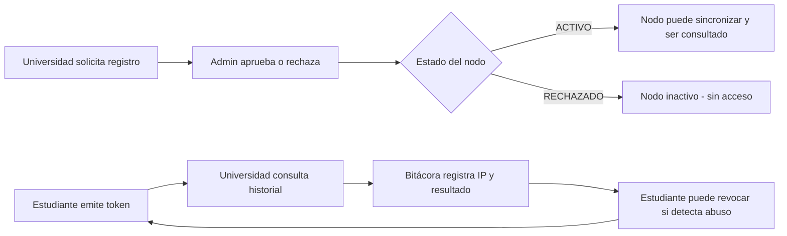

Los tres loops de feedback del sistema:
1. **Aprobación:** Solicitud → Revisión admin → Estado nodo → Capacidad de operación.
2. **Consentimiento:** Emisión de token → Consulta → Auditoría → Revocación si necesario.
3. **Integridad:** Sincronización firma SHA-256 → Consulta verifica firma → Error 500 si no coincide → Nodo debe re-sincronizar.

---

## 10. Estructura del repositorio

```
src/
├── app/
│   ├── config.py          # Variables de entorno
│   ├── main.py            # FastAPI app + páginas HTML + handler Lambda
│   ├── models.py          # Pydantic models (validación de entrada)
│   ├── repositories.py    # Acceso a DynamoDB (Protocol + In-Memory + Dynamo)
│   │                        # → DynamoRecordRepository.upsert: ConditionExpression SD-01
│   ├── security.py        # SHA-256, PBKDF2, firma, control de acceso
│   ├── tokens.py          # JWT HS256: emisión y verificación
│   ├── reports.py         # Generación de PDF con ReportLab
│   ├── routers/
│   │   ├── admin.py       # HU-02 + PATCH /nodes/{id}/status (SD-04)
│   │   ├── audit.py       # HU-09: bitácora + ?since (B5) + no-cache
│   │   ├── federated.py   # HU-06/07/08: consulta federada
│   │   ├── nodes.py       # HU-01: registro
│   │   ├── students.py    # HU-04/05: tokens
│   │   └── sync.py        # HU-03: sincronización + manejo 409 SD-01
│   └── static/            # HTML + CSS + JS (sin framework de build)
scripts/
├── deploy_aws.py          # SAM build + package + deploy
└── run_demo.py            # Entorno local con venv automático
tests/                     # suite pytest
```

---

## 11. Diagramas TGS — DFD Nivel 0 y Nivel 1 (TGS-01)

### DFD Nivel 0 — Vista del sistema completo


### DFD Nivel 1 — Procesos internos del Middleware

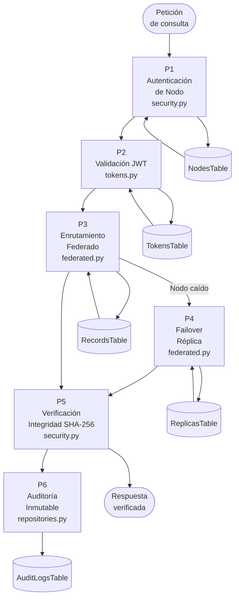

---

## 12. Sistema abierto y propiedades TGS (TGS-02)

| Propiedad TGS | Implementación en RFHA-IES |
|---|---|
| **Sistema abierto** | Interactúa con el entorno (universidades, estudiantes, admin) a través de API REST (frontera definida: HTTP + TLS) |
| **Subsistemas** | Nodo de registro (`nodes.py`), gestión admin (`admin.py`), historial (`sync.py`), autenticación (`students.py`), auditoría (`audit.py`), consulta federada (`federated.py`) |
| **Equifinalidad** | Múltiples rutas al mismo resultado: consulta exitosa vía nodo primario (`RecordsTable`) o vía réplica (`ReplicasTable`) — mismo JSON de respuesta, distinto `X-Data-Source` |
| **Homeostasis** | El sistema mantiene consistencia ante fallos gracias al failover automático (`federated.py` L.100-114) y la lista negra de tokens (`TokensTable.revoked=True`) |
| **Neguentropía** | (1) Firmas SHA-256 detectan corrupción → `record_signature()`. (2) Bitácora inmutable preserva historia → solo `PutItem` en `AuditLogsTable`. (3) TTL automático en `TokensTable` elimina tokens vencidos. (4) `ConditionExpression` en `DynamoRecordRepository.upsert()` evita escrituras conflictivas. |
| **Retroalimentación** | Loop de aprobación, loop de consentimiento/revocación, loop de integridad (ver §9) |
| **Bucles de feedback** | Ver §9 — cada loop tiene evidencia directa en el código con archivo y línea |

---

## 13. Decisiones Arquitectónicas y Trade-offs

| Decisión | Alternativa | Justificación técnica |
|---|---|---|
| **DynamoDB on-demand** | RDS PostgreSQL | Sin gestión de servidores; TTL nativo para tokens; latencia < 10 ms por clave; ideal para Lambda stateless |
| **JWT HS256 (simétrico)** | RS256 (asimétrico) | Menor overhead computacional; en este modelo el middleware es la única parte que emite y verifica tokens. RS256 sería necesario si los nodos verificaran tokens directamente. |
| **Replicación síncrona** | DynamoDB Streams + SQS | Simple y verificable. La desventaja: si `replicas.upsert()` falla, la réplica queda desactualizada silenciosamente. Para producción: DynamoDB Streams desacoplaría la replicación sin riesgo de fallo síncrono. |
| **API Key en header** | OAuth2 Client Credentials | Más simple de implementar y demostrar; OAuth2 agrega un Authorization Server que escapa al alcance del proyecto académico. |
| **ADMIN_KEY estática** | AWS Secrets Manager | Rotación manual. Para producción se usaría Secrets Manager con rotación automática y Lambda extension para cachear la clave sin consultar el API en cada request. |
| **Cifrado de campo** | AES-256 en reposo (AWS KMS, default) | El campo `doc` (cédula) viaja en el payload JWT sin cifrar (solo firmado). En producción se reemplazaría por JWE (JSON Web Encryption) o se usaría un hash del documento como identificador público. |
| **Concurrencia optimista** | Bloqueo pesimista (mutex) | Lambda es stateless — no puede mantener bloqueos entre invocaciones. `ConditionExpression` en DynamoDB es el mecanismo nativo para control de concurrencia sin locks distribuidos. |


---

## 14. Guía Detallada de Módulos (Backend y Frontend)

Esta sección desglosa minuciosamente cada uno de los componentes de software desarrollados en el proyecto, explicando su rol funcional, su procesamiento interno y sus contratos de entrada/salida.

### 14.1 Backend (`src/app/`)

#### 1. Configuración Global (`src/app/config.py`)
* **Ubicación exacta:** `src/app/config.py`
* **Propósito funcional:** Cargar y centralizar las variables de entorno operativas (credenciales maestras, nombres de tablas DynamoDB, secreto JWT y banderas de simulación de fallos).
* **Funcionamiento interno:** Dispone de la función `load_dotenv()` que lee el archivo `.env` en entorno local sin sobreescribir variables ya inyectadas por el entorno de AWS Lambda. Expone constantes como `REPOSITORY_BACKEND` (`memory` o `dynamodb`), `ADMIN_KEY`, `JWT_SECRET`, `TOKEN_TTL_SECONDS` y nombres de tablas.
* **Entradas y Salidas:** Entradas: variables del sistema o archivo `.env`. Salidas: constantes inmutables para el resto de la aplicación.

#### 2. Orquestador Principal y Enrutamiento Web (`src/app/main.py`)
* **Ubicación exacta:** `src/app/main.py`
* **Propósito funcional:** Instanciar la aplicación FastAPI, configurar las cabeceras de seguridad CSP (Content Security Policy), servir las páginas HTML estáticas y proporcionar el handler serverless compatible con AWS Lambda.
* **Funcionamiento interno:** 
  1. Instancia `app = FastAPI(...)`.
  2. Incluye los 6 routers modulares (`nodes`, `admin`, `sync`, `students`, `federated`, `audit`).
  3. Monta `/static` mediante `StaticFiles`.
  4. Mapea rutas GET de frontend (`/`, `/registro-nodo`, `/admin`, etc.) hacia archivos `.html` aplicando cabeceras estrictas `PAGE_HEADERS` (CSP sin scripts inline).
  5. Instancia `handler = Mangum(app, lifespan="off")` para adaptar eventos ASGI de API Gateway a Lambda.
* **Entradas y Salidas:** Entradas: eventos HTTP/API Gateway v2. Salidas: respuestas HTTP/JSON y streaming de archivos estáticos.

#### 3. Seguridad y Criptografía (`src/app/security.py`)
* **Ubicación exacta:** `src/app/security.py`
* **Propósito funcional:** Gestión criptográfica de API Keys de nodos, contraseñas de estudiantes, firmas de integridad de registros y dependencias de autorización para FastAPI.
* **Funcionamiento interno:**
  * `new_api_key()`: Genera llaves pseudoaleatorias criptográficamente seguras con prefijo `rfha_` usando `secrets.token_urlsafe(32)`.
  * `hash_api_key()`: Calcula hash SHA-256 para almacenamiento seguro de las API Keys.
  * `hash_password()` y `verify_password()`: Implementa PBKDF2-HMAC-SHA256 con 100,000 iteraciones y sal aleatoria de 16 bytes. Usa `DUMMY_HASH` para prevenir ataques de temporización (*timing attacks*) cuando un estudiante no existe.
  * `record_signature()`: Serializa el historial en JSON canónico ordenado (`sort_keys=True`, sin espacios) y genera hash SHA-256 inmutable.
  * `require_admin()` y `require_node()`: Callbacks inyectables en rutas (`Depends`) para validar cabeceras `X-Admin-Key` y `X-Node-API-Key`.
* **Entradas y Salidas:** Entradas: contraseñas, diccionarios de historiales, cabeceras HTTP. Salidas: hashes hexadecimales, booleano de verificación o el diccionario del nodo activo autenticado.

#### 4. Motor de Tokens y Consentimiento Delegado (`src/app/tokens.py`)
* **Ubicación exacta:** `src/app/tokens.py`
* **Propósito funcional:** Emisión y validación criptográfica de tokens JWT de consentimiento estudiantil (`student_auth_token`), control de vigencia y lista negra distribuida.
* **Funcionamiento interno:**
  * `issue_token()`: Construye claims (`sub`=estudiante, `doc`=cédula, `origin`=nodo emisor, `aud`=nodo autorizado, `jti`=identificador único, `iat`, `exp`). Firma con HMAC-SHA256 (`HS256`) y persiste el metadato en `TokensTable` con `revoked=False` y atributo `ttl`.
  * `verify_token()`: Decodifica y valida firma, expiración y audiencia requerida. Consulta `TokensTable` para verificar que `revoked` no sea `True`. Lanza `TokenError` descriptivo si falla alguna regla.
* **Entradas y Salidas:** Entradas: datos del estudiante, nodo destino, repositorio de tokens. Salidas: diccionario con el token JWT codificado, `jti` y timestamp de expiración.

#### 5. Repositorios de Persistencia (`src/app/repositories.py`)
* **Ubicación exacta:** `src/app/repositories.py`
* **Propósito funcional:** Abstracción de acceso a datos mediante patrón Repositorio y Protocolos tipados (`NodeRepository`, `RecordRepository`, `TokenRepository`, `AuditRepository`), con doble implementación en memoria y Amazon DynamoDB.
* **Funcionamiento interno:**
  * Conexión DynamoDB: `_dynamo_table()` inicializa tablas usando `boto3.resource("dynamodb")`.
  * `DynamoNodeRepository`: Métodos `create_node`, `get_node`, `list_nodes`, `update_node`, `find_by_api_key_hash`.
  * `DynamoRecordRepository`: Operaciones sobre `RecordsTable` y `ReplicasTable`. En `upsert()` implementa `ConditionExpression` para garantizar concurrencia optimista evitando que escrituras desfasadas sobreescriban datos nuevos.
  * `DynamoTokenRepository`: Inserción de tokens con TTL y actualización atómica `update_item` para revocación (`revoked = true`).
  * `DynamoAuditRepository`: Inserción de bitácora mediante `put_item` (inmutable, sin soporte de actualización ni borrado).
* **Entradas y Salidas:** Entradas: diccionarios tipados de dominio. Salidas: registros recuperados, entidades mapeadas o excepciones de integridad (`DuplicateNitError`, `ClientError`).

#### 6. Generador de Reportes PDF (`src/app/reports.py`)
* **Ubicación exacta:** `src/app/reports.py`
* **Propósito funcional:** Compilación dinámica en memoria de documentos ejecutivos y forenses en PDF para la administración de la red.
* **Funcionamiento interno:** Utiliza la librería `reportlab` (canvas, tablas, Flowables, estilos) para compilar en un buffer `io.BytesIO()` el reporte solicitado según 4 modalidades: General, Auditoría Forense, Resiliencia y Fallos, y Directorio de Nodos.
* **Entradas y Salidas:** Entradas: listas de nodos, listas de auditoría y tipo de reporte. Salidas: flujo binario `bytes` con el contenido del archivo PDF.

#### 7. Routers de la API (`src/app/routers/`)
* **`nodes.py` (`POST /api/v1/nodes/register`, `GET /api/v1/nodes/active`):** Registro abierto de solicitudes institucionales y directorio público de nodos autorizados (Service Registry).
* **`admin.py` (`GET /api/v1/admin/nodes`, `POST /api/v1/admin/nodes/{id}/approve`, `PATCH /api/v1/admin/nodes/{id}/status`, `GET /api/v1/admin/reports/network-summary`):** Gestión de ciclo de vida de nodos (aprobación, degradación de salud) y descarga de reportes PDF bajo protección de `X-Admin-Key`.
* **`sync.py` (`POST /api/v1/node/sync-records`):** Carga masiva o actualización de historiales académicos. Escribe simultáneamente en `RecordsTable` (primario) y `ReplicasTable` (réplica) validando la identidad del nodo emisor desde la API Key inyectada.
* **`students.py` (`POST /api/v1/students/token`, `GET /api/v1/students/tokens`, `DELETE /api/v1/students/token/{jti}`):** Autenticación de estudiantes con PBKDF2, emisión de tokens de consentimiento con audiencia específica y revocación instantánea.
* **`federated.py` (`GET /api/v1/federated/academic-history/{student_id}`):** Núcleo del middleware distribuido. Valida nodo consultante, valida JWT (`aud`, firma, vigencia, revocación), ejecuta conmutación a réplica ante caídas simuladas o reales, verifica firma SHA-256 de los datos y genera registro inmutable en auditoría.
* **`audit.py` (`GET /api/v1/audit/logs`):** Consulta filtrada de la bitácora inmutable con cabeceras `Cache-Control: no-store` y soporte de filtrado temporal por parámetro `since`.

---

### 14.2 Frontend Web (`src/app/static/`)

La interfaz de usuario está construida en HTML5 semántico, CSS moderno con variables y capas `@layer`, y JavaScript vanilla modular (ES Modules), sin dependencias externas ni compiladores (Webpack/Vite):

* **`styles.css`:** Sistema de diseño completo en modo dual (claro/oscuro automático con `light-dark()`), tipografía fluida con `clamp()`, grid responsivo y componentes accesibles (foco visible, contraste AA).
* **`common.js`:** Utilidades compartidas (`$`, `api`, `announce`, `setBusy`, `errorText`). Implementa wrapper seguro sobre `fetch` y soporte de accesibilidad para lectores de pantalla (`aria-live`).
* **`inicio.html` (`/`):** Portal de bienvenida y navegación centralizada a los módulos de la red.
* **`registro-nodo.html` y `registro.js` (`/registro-nodo`):** Formulario de registro para universidades con validación en tiempo real de NIT, dominio y correo institucional.
* **`admin.html` y `admin.js` (`/admin`):** Consola para administradores: listado de instituciones, aprobación con emisión visible única de API Key y filtros de estado.
* **`panel-nodo.html` y `panel-nodo.js` (`/panel-nodo`):** Panel para directores de registro. Incluye el generador dinámico de historiales aleatorios (`generateExample()`) para pruebas en vivo y sincronización hacia la nube.
* **`portal-estudiante.html` y `portal-estudiante.js` (`/portal-estudiante`):** Interfaz para que el alumno ingrese con su cédula y contraseña, consulte a qué universidades autorizar, genere su JWT y revoque consentimientos previos.
* **`consulta.html` y `consulta.js` (`/consulta`):** Interfaz de consulta interinstitucional. Permite ingresar el token de consentimiento, forzar simulación de fallo (`X-Simulate-Down`) y visualizar el historial académico junto a la procedencia (`Primary` vs `Replica`).
* **`auditoria.html` y `auditoria.js` (`/auditoria`):** Panel forense en tiempo real para visualizar eventos de acceso, denegaciones, IPs de origen y estados de seguridad con filtro temporal (`since`).
* **`reportes.html` y `reportes.js` (`/reportes`):** Centro de exportación ejecutiva para seleccionar el tipo de informe y descargar el documento PDF compilado en memoria.

---

## 15. Funcionamiento Profundo de Cada Componente en AWS

### 15.1 Desglose por Servicio AWS

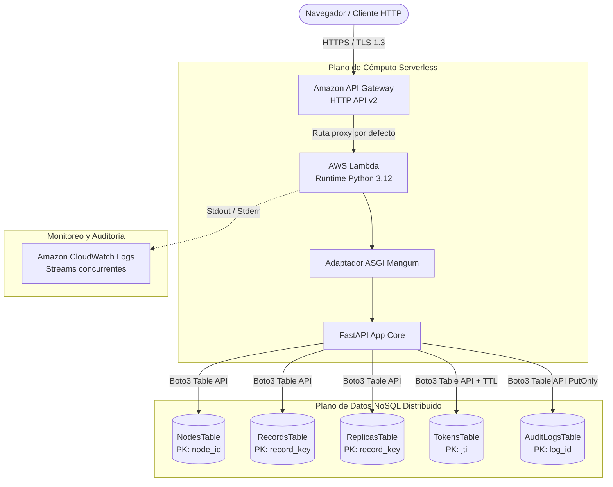

#### 1. Amazon API Gateway (HTTP API v2)
* **Función:** Actúa como puerta de entrada segura y punto de terminación TLS. Recibe el tráfico en la URL pública, gestiona el protocolo HTTP/2 y redirige todas las rutas hacia la función Lambda mediante integración proxy `$default`.
* **Configuración:** Modo Payload Format Version 2.0, enrutamiento catch-all `/{proxy+}`.

#### 2. AWS Lambda
* **Función:** Ejecutor de cómputo elástico sin servidor. Cada petición que llega a API Gateway despierta o reutiliza un micro-contenedor de Lambda ejecutando el runtime optimizado `python3.12`.
* **Configuración:** Memoria asignada 512 MB, arquitectura x86_64, timeout de 15 segundos.
* **Mapeo en código:** `src/app/main.py` define `handler = Mangum(app, lifespan="off")`, el cual traduce los eventos del API Gateway v2 al protocolo ASGI estándar que FastAPI procesa.

#### 3. Amazon DynamoDB (Plano de Persistencia Distribuida)
Todas las tablas operan bajo la modalidad **On-Demand (Pay-per-request)** y cifrado en reposo con claves gestionadas por AWS KMS:
1. **`NodesTable`:**
   * **Clave de Partición (PK):** `node_id` (Cadena `IES-XXXXXXXX`).
   * **Contenido:** Razón social, NIT, dominio institucional, correo, estado (`PENDIENTE_APROBACION`, `ACTIVO`, `DEGRADADO`), hash SHA-256 de la API Key (`api_key_hash`).
   * **Mapeo:** Invocado en `src/app/repositories.py` (`DynamoNodeRepository`).
2. **`RecordsTable`:**
   * **Clave de Partición (PK):** `record_key` (Cadena compuesta `<node_id>#<student_id>`).
   * **Contenido:** Cédula, nombre completo, programa, materias cursadas con créditos y notas, hash de contraseña y `digital_signature_hash`.
   * **Mapeo:** Invocado en `DynamoRecordRepository` en `repositories.py`.
3. **`ReplicasTable`:**
   * **Clave de Partición (PK):** `record_key`.
   * **Contenido:** Réplica exacta de `RecordsTable` sincronizada en cada operación de carga.
   * **Mapeo:** Gestionada vía `get_replica_repository()` en `repositories.py`.
4. **`TokensTable`:**
   * **Clave de Partición (PK):** `jti` (UUID hexadecimal).
   * **Mecanismo Especial TTL:** Posee habilitado el mecanismo Time-To-Live sobre el atributo `ttl`. DynamoDB elimina de forma autónoma los tokens cuyo timestamp Unix haya caducado.
   * **Mapeo:** Invocado en `DynamoTokenRepository` en `repositories.py` y `tokens.py`.
5. **`AuditLogsTable`:**
   * **Clave de Partición (PK):** `log_id` (Cadena `AUDIT-XXXXXXXXXXXX`).
   * **Característica:** Inmutabilidad estricta. El rol IAM de Lambda solo tiene concedido `dynamodb:PutItem` y `dynamodb:Scan` sobre esta tabla; no existen permisos para `DeleteItem` ni `UpdateItem`.
   * **Mapeo:** Invocado en `DynamoAuditRepository` en `repositories.py`.

#### 4. Amazon CloudWatch Logs
* **Función:** Almacena la salida estándar (`stdout`/`stderr`), logs de excepciones y trazas de ejecución de cada contenedor Lambda.
* **Evidencia Distribuida:** Permite auditar en tiempo real los diferentes `RequestId` ejecutados concurrentemente por distintos hilos de ejecución en la nube.

---

### 15.2 Flujo de Ejecución Milisegundo a Milisegundo

Cuando un funcionario de admisiones pulsa "Consultar Historial" en el cliente web:

1. **ms 0 – ms 15 (Red y TLS):** La petición HTTP sale del navegador hacia `https://ypybm0azfg.execute-api.us-east-2.amazonaws.com`. API Gateway negocia el handshake TLS 1.3 y autentica el certificado wildcard de AWS.
2. **ms 15 – ms 20 (API Gateway Routing):** API Gateway valida la ruta `/api/v1/federated/academic-history/{id}`, empaqueta los encabezados (`X-Node-API-Key`, `X-Student-Consent-Token`), query params y cuerpo en un evento JSON v2 y efectúa la invocación sincrónica a Lambda.
3. **ms 20 – ms 30 (Lambda Initialization / Dispatch):**
   * *Warm Start:* Lambda recibe el evento en un micro-contenedor caliente y se lo entrega al handler de Mangum.
   * Mangum traduce el evento a un scope HTTP de ASGI y lo entrega a FastAPI.
4. **ms 30 – ms 45 (Inyección y Middleware de Seguridad):**
   * FastAPI ejecuta la dependencia `require_node`: calcula SHA-256 de la cabecera `X-Node-API-Key` y llama a `DynamoNodeRepository.find_by_api_key_hash`. DynamoDB retorna en ~6 ms el registro del nodo validando su estado `ACTIVO`.
   * El controlador ejecuta `verify_token`: decodifica el JWT mediante clave secreta simétrica, comprueba que `aud` coincida con el nodo consultante y consulta `TokensTable` por clave `jti` para certificar que `revoked` no sea `True`.
5. **ms 45 – ms 55 (Enrutamiento Federado y Failover):**
   * El sistema intenta leer el registro primario en `RecordsTable` mediante la clave `record_key(origin_node, student_id)`.
   * Si el nodo origen está marcado como caído o falla la lectura, conmuta instantáneamente a `ReplicasTable` extrayendo el historial de contingencia y seteando la cabecera `X-Data-Source: Replica`.
6. **ms 55 – ms 65 (Verificación Criptográfica y Auditoría Inmutable):**
   * Se reconstruye el payload canónico de materias y datos y se calcula `record_signature(signed)`. Se comprueba contra `digital_signature_hash`.
   * Se genera un ID de auditoría único y se efectúa `PutItem` en `AuditLogsTable` con el resultado (`SUCCESS`), IP de origen y fuente de datos.
7. **ms 65 – ms 75 (Respuesta):** Mangum empaqueta la respuesta JSON y los headers de respuesta, API Gateway los retorna sobre la conexión HTTPS abierta y el navegador del usuario renderiza la tabla de asignaturas y créditos completados.

---

## 16. Documentación Interactiva de la API (Swagger / OpenAPI)

### 16.1 ¿Qué es Swagger / OpenAPI y qué aporta al proyecto?
**OpenAPI** es el estándar internacional para describir formalmente APIs REST sin necesidad de inspeccionar el código fuente. **Swagger UI** es la interfaz gráfica generada a partir de dicho estándar que permite a evaluadores y desarrolladores externos:
* Conocer todos los contratos de datos, parámetros y cabeceras exigidas.
* Probar la API de forma interactiva directamente desde el navegador web, sin requerir herramientas de terceros como Postman o cURL.
* Validar en tiempo real los esquemas Pydantic y las respuestas HTTP documentadas.

### 16.2 Funcionamiento Interno en FastAPI
FastAPI inspecciona los modelos Pydantic (`src/app/models.py`), las dependencias de cabeceras (`src/app/security.py`) y las anotaciones de tipo de cada router. Con esto genera dinámicamente un esquema JSON OpenAPI en la ruta:
* **Especificación OpenAPI (JSON):** `/openapi.json`
* **Swagger UI interactivo:** `/docs`
* **Documentación ReDoc:** `/redoc`

Ambas interfaces se encuentran completamente habilitadas tanto en la ejecución local (`http://127.0.0.1:8001/docs`) como en el despliegue cloud de AWS (`https://ypybm0azfg.execute-api.us-east-2.amazonaws.com/docs`).

### 16.3 Guía Práctica de Uso Paso a Paso

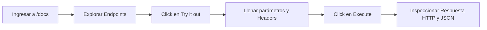

1. **Acceso:** Abre en tu navegador `https://ypybm0azfg.execute-api.us-east-2.amazonaws.com/docs`.
2. **Autenticación en Swagger:**
   * La API protege sus rutas mediante cabeceras HTTP personalizadas (`X-Admin-Key`, `X-Node-API-Key`, `X-Student-Consent-Token`).
   * Para probar un endpoint restringido, despliega la caja del endpoint (ej. `GET /api/v1/admin/nodes`), haz clic en **Try it out** y rellena directamente el campo `X-Admin-Key` con la clave administrativa configurada.
3. **Ejecución Interactiva:**
   * Completa el cuerpo de la petición (JSON) si es un método POST/PATCH.
   * Pulsa el botón azul **Execute**.
   * Swagger enviará la petición HTTPS real a AWS Lambda y mostrará la URL ejecutada, el código de estado (`200 OK`, `403 Forbidden`, `409 Conflict`, etc.) y el cuerpo de respuesta con las cabeceras recibidas (incluyendo `x-data-source` y `cache-control`).

---

## 17. Conceptos de Sistemas Distribuidos Aplicados al Proyecto

A continuación se fundamentan los conceptos nodales de la disciplina de **Sistemas Distribuidos**, vinculando la teoría académica directamente con su manifestación tangible en el código fuente y los servicios de AWS:

| Concepto de Sistemas Distribuidos | Manifestación en RFHA-IES | Archivo y Función en Código | Recurso AWS |
|---|---|---|---|
| **Nodos Autónomos** | Cada universidad opera como una entidad descentralizada con API Key propia y almacén de datos segregado. No hay acceso cruzado directo entre universidades. | `src/app/security.py` (`new_api_key`, `require_node`) | `NodesTable` |
| **Middleware Federado** | Actúa como plano de control mediador: enruta peticiones, transforma formatos y valida identidades sin concentrar la propiedad de los datos. | `src/app/routers/federated.py` (`academic_history`) | AWS Lambda + API Gateway |
| **Tolerancia a Fallos y Failover** | Conmutación por error automática: si el nodo primario no responde, el sistema consulta de forma transparente el almacén réplica. | `src/app/routers/federated.py` (L.100-114) | `RecordsTable` → `ReplicasTable` |
| **Consistencia Eventual (AP)** | Sacrifica consistencia estricta por disponibilidad total. Replica registros en segundo plano; la réplica representa la versión más reciente sincronizada. | `src/app/routers/sync.py` (`sync_records`) | DynamoDB ReplicasTable |
| **Concurrencia Optimista** | Detección de colisiones mediante condición de escritura atómica para evitar que peticiones atrasadas sobreescriban datos nuevos. | `src/app/repositories.py` (`ConditionExpression` en `upsert`) | DynamoDB Conditional Writes |
| **Autorización Descentralizada** | Consentimiento de acceso gobernado por el usuario mediante tokens JWT de audiencia estricta (`aud`), impidiendo reutilización en nodos no autorizados. | `src/app/tokens.py` (`issue_token`, `verify_token`) | `TokensTable` (con TTL) |
| **Service Registry (Descubrimiento)** | Registro dinámico para que los nodos descubran qué universidades están operativas antes de solicitar o autorizar transferencias. | `src/app/routers/nodes.py` (`active_nodes`) | `NodesTable` (Filter `status=ACTIVO`) |
| **Bitácora Distribuida Inmutable** | Log de transacciones de solo inserción (Append-Only) para trazabilidad forense no repudiable de cada consulta y bloqueo. | `src/app/routers/audit.py` y `repositories.py` (`DynamoAuditRepository`) | `AuditLogsTable` (IAM PutOnly) |

---

## 18. Guía Práctica de Demostración en Vivo (Consola AWS + App)

Esta guía describe el procedimiento exacto para sustentar el proyecto en vivo frente a evaluadores, combinando la aplicación web con la consola de AWS.

### 18.1 Demostración en AWS CloudWatch Logs (Cómputo Concurrente y Stateless)
1. Inicia sesión en la **Consola de AWS** con el perfil correspondiente y navega a **CloudWatch** en la región `us-east-2`.
2. En el menú izquierdo, selecciona **Logs** → **Log groups** y haz clic en `/aws/lambda/rfha-app`.
3. Abre simultáneamente dos navegadores o una ventana en incógnito y realiza consultas en la web (`/consulta` o `/auditoria`).
4. En CloudWatch, abre los flujos de registro (*Log streams*) más recientes:
   * **Evidencia a señalar:** Muestra cómo existen diferentes `Log Streams` ejecutándose en paralelo.
   * Destaca los identificadores de petición únicos (`START RequestId: ...`) y (`REPORT RequestId: ... Duration: 12.4 ms Billed Duration: 13 ms Memory Size: 512 MB`). Explica al docente que esto certifica que el sistema es **completamente stateless y elástico**.

### 18.2 Demostración en Amazon DynamoDB (Particionamiento e Inmutabilidad)
1. En la consola de AWS, dirígete a **Amazon DynamoDB** → **Tables** (región `us-east-2`).
2. **Particionamiento y Réplicas:**
   * Entra a `RecordsTable` → botón **Explore table items**.
   * Muestra la estructura de la clave `record_key` con formato `<node_id>#<student_id>` (ej. `IES-A1B2C3D4#20262678029`).
   * Demuestra que en `ReplicasTable` existe exactamente el mismo registro replicado con su `digital_signature_hash`.
3. **Mecanismo TTL (TokensTable):**
   * Abre `TokensTable` → selecciona la pestaña **Additional settings**.
   * Muestra que el campo **Time to Live (TTL)** está en estado **ENABLED** sobre el atributo `ttl`. Explica cómo esto garantiza la neguentropía del sistema al purgar automáticamente tokens caducados sin consumir cómputo.
4. **Inmutabilidad (AuditLogsTable):**
   * Abre `AuditLogsTable` y muestra cómo cada consulta realizada en la plataforma genera un nuevo registro `AUDIT-XXXXXXXXXXXX` con `timestamp`, `client_ip`, `outcome` y `data_source`.

### 18.3 Demostración en Amazon API Gateway
1. Dirígete a **API Gateway** → selecciona la API `rfha-app`.
2. Muestra las rutas configuradas (`$default`) y en la pestaña de **Stages** (`$default`) evidencia la URL de invocación segura con certificado SSL/TLS gestionado.
3. Muestra las métricas integradas de CloudWatch: número de invocaciones, latencia de integración (< 50 ms) y cero errores 5XX.

### 18.4 Prueba de Fuego: Failover a Réplica y Revocación en Tiempo Real
1. **Sincronización:** En el panel del nodo (`/panel-nodo`), genera datos aleatorios con "Cargar ejemplo" e ingresa la API Key del nodo. Pulsa **Sincronizar historiales**.
2. **Consentimiento:** En el portal del estudiante (`/portal-estudiante`), inicia sesión con el documento y clave de uno de los estudiantes cargados. Autoriza a una universidad receptora y copia el token generado.
3. **Consulta Normal (Primaria):** Ve a `/consulta`, pega el token de autorización y pulsa **Consultar Historial**. Muestra la etiqueta verde de procedencia: **Fuente de datos: Primary**.
4. **Fallo Simulado (Failover Activo):**
   * En la misma pantalla `/consulta`, marca la casilla de verificación **"Simular falla de conectividad con el nodo de origen"** (`X-Simulate-Down: true`).
   * Pulsa nuevamente **Consultar Historial**.
   * **Resultado en vivo:** El sistema no falla; responde de inmediato mostrando la etiqueta ámbar **Fuente de datos: Replica**.
5. **Auditoría Forense Inmediata:**
   * Ve a `/auditoria`, ingresa la clave de administrador y carga la bitácora.
   * Muestra las dos entradas consecutivas: la primera con fuente `Primary` y la segunda con fuente `Replica`, demostrando la trazabilidad inmutable y el funcionamiento en tiempo real.


---

## 19. Fundamentos Básicos de Protocolos y Redes Aplicados al Proyecto

Para comprender a fondo la arquitectura de **RFHA-IES**, es indispensable analizar los protocolos de comunicación y mecanismos de red desde sus fundamentos más elementales hasta su aplicación práctica en el código.

### 19.1 Protocolo HTTP / HTTPS y Arquitectura Cliente-Servidor
El protocolo de transferencia de hipertexto (**HTTP - Hypertext Transfer Protocol**) es el estándar sin estado (*stateless*) mediante el cual dialogan clientes y servidores a través de mensajes de solicitud (**Request**) y respuesta (**Response**). En RFHA-IES, cada interacción se efectúa bajo **HTTPS** (HTTP sobre **TLS 1.3**), garantizando autenticidad y privacidad en el canal.

#### Métodos HTTP empleados en la red:
* **`GET`:** Consulta segura e idempotente que no altera el estado del servidor.
  * `GET /api/v1/nodes/active`: Consulta el catálogo de universidades autorizadas (`src/app/routers/nodes.py`).
  * `GET /api/v1/federated/academic-history/{student_id}`: Recupera el historial federado del estudiante validando previamente su token (`src/app/routers/federated.py`).
* **`POST`:** Creación de recursos o envío de datos confidenciales en el cuerpo.
  * `POST /api/v1/nodes/register`: Registra una nueva solicitud institucional en `NodesTable` (`src/app/routers/nodes.py`).
  * `POST /api/v1/node/sync-records`: Carga o actualiza lotes de historiales académicos (`src/app/routers/sync.py`).
  * `POST /api/v1/students/token`: Emisión del JWT de consentimiento estudiantil (`src/app/routers/students.py`).
* **`PATCH`:** Modificación parcial de un recurso existente.
  * `PATCH /api/v1/admin/nodes/{node_id}/status`: Actualiza manualmente el estado de salud de un nodo (`ACTIVO` o `DEGRADADO`) sin sobreescribir sus demás atributos institucionales (`src/app/routers/admin.py`).
* **`DELETE`:** Eliminación lógica o revocación de un recurso.
  * `DELETE /api/v1/students/token/{jti}`: Marca inmediatamente como revocado un token en `TokensTable` (`src/app/routers/students.py`).

#### Códigos de estado HTTP y su significado en el proyecto:
* **`200 OK`:** Petición procesada exitosamente con payload retornado.
* **`201 Created`:** Recurso institucional registrado exitosamente (`POST /api/v1/nodes/register`).
* **`403 Forbidden`:** Acceso denegado por credencial inválida, API Key errónea, token vencido o audiencia no autorizada (`src/app/security.py` y `tokens.py`).
* **`404 Not Found`:** Estudiante o nodo inexistente en las tablas de datos.
* **`409 Conflict`:** Conflicto de unicidad (NIT ya registrado en `NodesTable`) o choque de concurrencia optimista en DynamoDB.
* **`422 Unprocessable Entity`:** Fallo de validación semántica de Pydantic (ej. formato de correo o semestre inválido).
* **`500 Internal Server Error`:** Fallo de integridad criptográfica en los datos (la firma SHA-256 no coincide).

#### Cabeceras HTTP personalizadas utilizadas en el sistema:
* **`X-Admin-Key`:** Clave de administración general requerida en endpoints de `/api/v1/admin/*` y `/api/v1/audit/logs`.
* **`X-Node-API-Key`:** Llave de autenticación institucional asignada a cada nodo aprobado para firmar sus transacciones.
* **`X-Student-Consent-Token`:** Token JWT de autorización emitido por el estudiante para permitir la consulta de su historial.
* **`X-Data-Source`:** Cabecera de respuesta inyectada por el middleware (`Primary` o `Replica`) indicando si la información provino de la tabla principal o de contingencia.
* **`X-Simulate-Down`:** Cabecera de prueba que fuerza la conmutación a réplica sin necesidad de desconectar el nodo real.

---

### 19.2 Protocolo TLS (Transport Layer Security) y Cifrado en Tránsito
**TLS** es el protocolo criptográfico que cifra la sesión punto a punto entre el navegador del usuario y **AWS API Gateway**.
1. **Confidencialidad:** Impide que actores intermediarios en la red pública puedan leer en claro contraseñas, documentos de identidad o las API Keys enviadas en las cabeceras.
2. **Integridad del Transporte:** Protege los mensajes contra manipulaciones intermedias (*Man-in-the-Middle*).
3. **Autenticación del Servidor:** API Gateway certifica criptográficamente ante el cliente que está conectado al dominio legítimo de AWS bajo certificados gestionados por Amazon Trust Services.

---

### 19.3 Formato JSON y Paradigma REST
* **REST (Representational State Transfer):** La arquitectura desacopla completamente el cliente (frontend web HTML/CSS/JS estático) del servidor (FastAPI en AWS Lambda). Todas las operaciones se orientan a recursos identificados mediante URIs predecibles.
* **JSON (JavaScript Object Notation):** Es el lenguaje de intercambio común. En el cliente, JavaScript serializa objetos mediante `JSON.stringify()` y los envía; en el servidor, los modelos Pydantic (`src/app/models.py`) deserializan y validan estrictamente tipos de datos, rangos y expresiones regulares antes de tocar la base de datos.

---

### 19.4 Protocolo JWT (JSON Web Token) y Hashes Criptográficos SHA-256
Un **JSON Web Token** (RFC 7519) es un objeto JSON compacto y autónomo para transmitir de forma segura afirmaciones (*claims*) verificables entre partes.

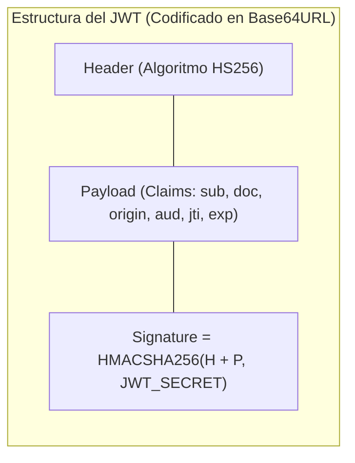

#### Estructura en RFHA-IES (`src/app/tokens.py`):
1. **Header:** Define el algoritmo de firma simétrica (`{"alg": "HS256", "typ": "JWT"}`).
2. **Payload:** Contiene la autorización delegada por el estudiante:
   * `sub`: Identificador institucional del estudiante (`student_id`).
   * `doc`: Número de documento de identidad nacional.
   * `origin`: Nodo emisor propietario de la información (ej. `IES-1111AAAA`).
   * `aud`: Nodo destino estrictamente autorizado para consultar (ej. `IES-2222BBBB`). Si otra universidad intenta usar el token, `jwt.decode` rechaza la petición con `InvalidAudienceError`.
   * `jti`: Identificador único aleatorio de 128 bits (UUID4) que permite registrar el token en la lista negra para revocación instantánea.
   * `iat` y `exp`: Timestamps Unix de emisión y vencimiento (24 horas).
3. **Signature:** Firma criptográfica calculada con la clave secreta `JWT_SECRET`. Garantiza que ningún atacante pueda alterar la audiencia o el estudiante sin invalidar el token.

#### Hashes Criptográficos SHA-256 en el Código:
* **API Keys de Universidades:** `src/app/security.py` ejecuta `hash_api_key(api_key)`. En `NodesTable` **nunca se guarda la clave original**, únicamente su resumen SHA-256. Al recibir una petición, se calcula el hash y se busca por igualdad en DynamoDB.
* **Firma de Integridad del Historial:** `record_signature()` ordena las llaves alfabéticamente (`sort_keys=True`) para construir un JSON canónico y calcula su digest SHA-256. Cualquier alteración de una nota o crédito produce una firma totalmente distinta, detectando manipulación de datos.

---

## 20. Análisis Detallado de Cada Diagrama y Tabla Existente en el README

Para asegurar máxima claridad académica, esta sección analiza paso a paso cada uno de los elementos visuales y tabulares incluidos en el documento.

### 20.1 Diagrama de Arquitectura General (§1)
* **Bloque Nodos IES (`N1`, `N2`):** Representa las distintas universidades participantes. Cada una actúa como cliente independiente con credenciales propias.
* **Bloque Middleware RFHA-IES:** Agrupa la infraestructura de plano de control en AWS. La flecha hacia `GW` (API Gateway) centraliza la recepción; `LM` (AWS Lambda) ejecuta el procesamiento sin estado y se conecta bidireccionalmente a `DB` (Amazon DynamoDB).
* **Bloque Actores Externos:** Modela al `Estudiante` interactuando con el portal de consentimiento y al `Administrador` operando la consola central.
* **Flujos de Flechas:** Las etiquetas explicitan el verbo HTTP, la URI y las cabeceras de autorización necesarias para cruzar la frontera del sistema.

### 20.2 Diagrama de Secuencia del Flujo Completo (§1)
* **Líneas de Vida (`Lifelines`):** Universidad B, API Gateway, Lambda y DynamoDB.
* **Paso 1 (Invocación):** Petición GET con dos cabeceras simultáneas (`X-Node-API-Key` y `X-Student-Consent-Token`).
* **Paso 2 y 3 (Validación de Nodo y Token):** Verificación de identidad institucional contra `NodesTable` y posterior evaluación criptográfica del JWT (audiencia, expiración y estado en `TokensTable`).
* **Paso 4 (Bifurcación Alt/Else - Failover):**
  * Rama `Alt (Nodo caído)`: Si la consulta a `RecordsTable` falla o está simulada, Lambda conmuta a `ReplicasTable` y etiqueta `X-Data-Source: Replica`.
  * Rama `Else (Nodo activo)`: Recupera directamente de `RecordsTable` con etiqueta `X-Data-Source: Primary`.
* **Paso 5 (Integridad y Auditoría):** Validación de la firma SHA-256 del registro y persistencia no repudiable en `AuditLogsTable` antes de responder al cliente con HTTP 200.

### 20.3 Diagrama de Bucles de Retroalimentación TGS (§9)
* **Bucle 1 (Aprobación Institucional):** Flujo de control donde la entrada (solicitud de registro) produce una decisión administrativa que cambia el estado a `ACTIVO` o `RECHAZADO`, habilitando o bloqueando la capacidad operativa del nodo.
* **Bucle 2 (Consentimiento Estudiantil):** Ciclo donde el estudiante otorga el token; tras la consulta por parte de la universidad, el registro en auditoría permite al alumno supervisar el acceso y, en caso de detectar anomalías, disparar la revocación inmediata.

### 20.4 Diagramas DFD Nivel 0 y Nivel 1 (§11)
* **DFD Nivel 0 (Contexto):** Muestra los límites del sistema. Los tres entes externos (Universidad, Estudiante, Administrador) entregan flujos de datos y reciben productos transformados (historial validado, tokens activos, reportes consolidados).
* **DFD Nivel 1 (Descomposición Funcional):** Desglosa el procesamiento en 6 procesos atómicos (`P1` a `P6`), vinculando cada uno con su correspondiente almacén de datos DynamoDB (`DS1` a `DS5`) y su archivo ejecutable en el backend.

---

## 21. Análisis Exhaustivo de las 5 Tablas de Amazon DynamoDB

DynamoDB es una base de datos NoSQL totalmente administrada que almacena datos estructurados en formato documento/clave-valor con latencia consistente de un solo dígito de milisegundos. A continuación se desglosan las tablas oficiales de la red:

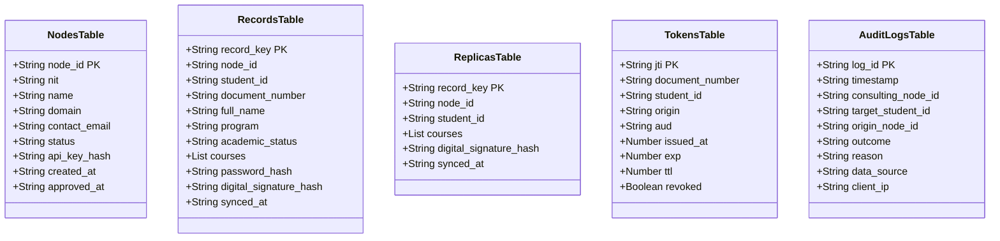

### 1. `NodesTable` (Catálogo Institucional y Credenciales)
* **Propósito:** Registro y control del ciclo de vida de las Instituciones de Educación Superior dentro de la red.
* **Clave de Partición (Partition Key):** `node_id` (Cadena con formato `IES-XXXXXXXX`).
* **Atributos Principales:** `nit`, `name`, `domain`, `contact_email`, `status` (`PENDIENTE_APROBACION`, `ACTIVO`, `DEGRADADO`), `api_key_hash` (digest SHA-256 de la API Key), `created_at`, `approved_at`.
* **Seguridad y Accesos:** Protegida con cifrado en reposo. Se interactúa mediante `DynamoNodeRepository` en `src/app/repositories.py` (`create_node`, `get_node`, `list_nodes`, `update_node`, `find_by_api_key_hash`).

### 2. `RecordsTable` (Historiales Académicos - Primario)
* **Propósito:** Almacén primario de historiales de estudiantes cargados por cada universidad propietaria.
* **Clave de Partición (Partition Key):** `record_key` (Cadena compuesta `<node_id>#<student_id>`, ej. `IES-1111AAAA#20262678029`). Esta clave compuesta garantiza que un estudiante tenga un historial estrictamente particionado por cada universidad donde curse estudios.
* **Atributos Principales:** `student_id`, `document_number`, `full_name`, `program`, `academic_status`, lista serializada `courses` (código, nombre, créditos, nota, estado), `password_hash` (PBKDF2 del portal), `digital_signature_hash` (SHA-256 canónico) y timestamp `synced_at`.
* **Control de Concurrencia:** Utiliza `ConditionExpression` en el método `upsert()` para validar que peticiones concurrentes o desfasadas no sobreescriban historiales más recientes.
* **Mapeo:** Gestionada en `DynamoRecordRepository` (`src/app/repositories.py`).

### 3. `ReplicasTable` (Copia Redundante para Tolerancia a Fallos)
* **Propósito:** Almacén secundario que preserva una copia fiel e independiente del historial académico para garantizar disponibilidad total (modelo AP) si el nodo origen primario experimenta caídas.
* **Clave de Partición (Partition Key):** `record_key`.
* **Atributos:** Réplica idéntica de los datos del estudiante y cursos firmados.
* **Mapeo:** Actualizada de forma síncrona en `sync_records` (`src/app/routers/sync.py`) y leída por `academic_history` en `src/app/routers/federated.py` en caso de failover.

### 4. `TokensTable` (Lista Negra y Control de Consentimiento)
* **Propósito:** Gestionar los tokens de autorización emitidos por los alumnos y garantizar su revocación inmediata.
* **Clave de Partición (Partition Key):** `jti` (UUID de 32 caracteres hexadecimales correspondiente al identificador único del JWT).
* **Atributos:** `document_number`, `student_id`, `origin`, `aud` (nodo destino autorizado), `issued_at`, `exp`, `revoked` (booleano) y `ttl` (entero Unix timestamp).
* **Mecanismo TTL (Time to Live):** DynamoDB monitorea automáticamente el atributo `ttl`. Cuando el tiempo actual supera este valor, el registro es purgado de la tabla sin costo adicional de lectura o escritura, manteniendo la base libre de registros obsoletos.
* **Mapeo:** Implementada en `DynamoTokenRepository` en `src/app/repositories.py`.

### 5. `AuditLogsTable` (Bitácora Distribuida Inmutable)
* **Propósito:** Trazabilidad forense y registro no repudiable de toda consulta o intento de acceso dentro de la red federada.
* **Clave de Partición (Partition Key):** `log_id` (Cadena con formato `AUDIT-XXXXXXXXXXXX`).
* **Atributos:** `timestamp` (ISO-8601 UTC), `consulting_node_id`, `target_student_id`, `origin_node_id`, `outcome` (`SUCCESS`, `DENIED`, `ERROR`), `reason`, `data_source` (`Primary`, `Replica`, `None`), `client_ip`.
* **Inmutabilidad y No-Repudio:** La política de permisos IAM de Lambda restringe las operaciones sobre esta tabla a `PutItem` y `Scan`; no existe permiso para modificar (`UpdateItem`) ni eliminar (`DeleteItem`) registros.
* **Mapeo:** Gestionada en `DynamoAuditRepository` (`src/app/repositories.py`) e invocada en cada flujo del router `federated.py`.


---

## 22. Stack Tecnológico Detallado: Lenguajes, Librerías y Herramientas

Esta sección analiza en profundidad cada uno de los lenguajes de programación, marcado, serialización y librerías que componen **RFHA-IES**, explicando su naturaleza técnica, la justificación de su elección y su rol operativo en el código.

### 22.1 Lenguajes de Programación y Marcado

#### 1. Python (Versión 3.12)
* **¿Qué es?** Python es un lenguaje de programación de alto nivel, interpretado, multiparadigma, fuertemente tipado y de sintaxis limpia y legible.
* **¿Por qué se eligió?** La versión 3.12 ofrece mejoras sustanciales en rendimiento (tiempo de inicio y ejecución de bytecode optimizado con el *Specializing Adaptive Interpreter*), soporte robusto para anotaciones de tipos estáticas (`PEP 695`) y compatibilidad nativa de primer nivel con el entorno serverless de **AWS Lambda**.
* **¿Cómo opera en el proyecto?** Es el núcleo absoluto del backend (`src/app/`). Todo el procesamiento de reglas de negocio, validación criptográfica, mediación de mensajes federados, manejo de concurrencia y generación dinámica de documentos binarios se ejecuta sobre el intérprete de Python 3.12.

#### 2. HTML5 (HyperText Markup Language 5)
* **¿Qué es?** Es el estándar universal de marcado estructurado para la web, diseñado para representar documentos jerárquicos con semántica accesible y rica.
* **¿Por qué se eligió?** Se utiliza HTML5 semántico puro (`<header>`, `<main>`, `<nav>`, `<section>`, `<article>`, `<dl>`, `<table>`) sin frameworks pesados de frontend (como React o Angular), minimizando el peso de transferencia sobre la red y eliminando cadenas de compilación complejas.
* **¿Cómo opera en el proyecto?** Los archivos ubicados en `src/app/static/` estructuran las interfaces de usuario. Se sirven directamente desde FastAPI a través de `StaticFiles` y endpoints con cabeceras de seguridad estrictas (`PAGE_HEADERS` en `src/app/main.py`).

#### 3. CSS3 (Cascading Style Sheets 3)
* **¿Qué es?** Es el lenguaje estándar para definir la presentación visual, diagramación y diseño adaptativo de documentos HTML.
* **¿Por qué se eligió?** Permite implementar una interfaz moderna, limpia y accesible con cero dependencias externas de librerías CSS (como Bootstrap o Tailwind).
* **¿Cómo opera en el proyecto?** El archivo `src/app/static/styles.css` utiliza funcionalidades modernas como:
  * Capas de cascada `@layer` (`reset`, `tokens`, `base`, `components`) para controlar estrictamente la especificidad.
  * Función nativa `light-dark()` para soporte dual de modo claro y oscuro respetando las preferencias del sistema operativo del usuario.
  * Funciones de escala tipográfica fluida `clamp()` que ajustan fuentes y márgenes automáticamente según el ancho del dispositivo sin requerir docenas de *media queries*.

#### 4. JavaScript Vanilla (ES Modules / ECMAScript 2022+)
* **¿Qué es?** Es el lenguaje de programación estándar del lado del cliente en la web, ejecutado directamente en el motor V8 o equivalente del navegador del usuario.
* **¿Por qué se eligió?** Al usar módulos nativos (`type="module"`), se logra un desacoplamiento limpio de la lógica de presentación sin requerir empaquetadores como Webpack o Vite, cumpliendo estrictamente con la política de seguridad **Content Security Policy (CSP)** sin scripts embebidos en el HTML.
* **¿Cómo opera en el proyecto?** Archivos modulares como `common.js`, `panel-nodo.js`, `auditoria.js` y `reportes.js` controlan la reactividad del cliente: capturan eventos de formularios, ejecutan peticiones asíncronas con `fetch`, actualizan el DOM mediante inserción segura de texto (`textContent` para evitar ataques XSS) y gestionan estados de carga accesibles (`aria-live`).

#### 5. JSON (JavaScript Object Notation) y YAML (YAML Ain't Markup Language)
* **¿Qué son y cómo operan?** 
  * **JSON:** Formato de texto ligero para intercambio de datos estructurados. Es el payload estándar de todas las peticiones y respuestas de la API REST, así como el formato nativo en que DynamoDB almacena documentos y mapas de materias.
  * **YAML:** Formato de serialización legible para humanos. Se utiliza en `template.yaml` para definir la infraestructura como código de **AWS SAM / CloudFormation**, especificando las funciones Lambda, eventos de API Gateway y políticas IAM.

---

### 22.2 Frameworks y Librerías Backend Clave

| Librería / Dependencia | Versión / Tipo | Propósito Técnico en RFHA-IES | Archivo Clave donde se Aplica |
|---|---|---|---|
| **FastAPI** | Framework ASGI | Provee el enrutamiento web asíncrono de alto rendimiento, inyección automática de dependencias (`Depends`), validación estricta y generación de OpenAPI. | `src/app/main.py`, `src/app/routers/*.py` |
| **Mangum** | Adaptador Serverless | Actúa como puente adaptador que traduce los eventos y contextos del API Gateway HTTP API v2 al formato de petición ASGI que FastAPI entiende, y viceversa. | `src/app/main.py` (`handler = Mangum(app)`) |
| **Pydantic (v2)** | Validación de Datos | Garantiza la integridad de tipos, expresiones regulares y límites de longitud en todas las entidades recibidas por HTTP antes de que ingresen a la lógica de negocio. | `src/app/models.py` |
| **Boto3** | AWS SDK oficial | Librería oficial de Amazon Web Services para Python. Gestiona la conexión HTTP persistente, autenticación SigV4 y ejecución de operaciones sobre Amazon DynamoDB. | `src/app/repositories.py` (`_dynamo_table()`) |
| **PyJWT** | Criptografía / Tokens | Codifica, firma digitalmente con HMAC-SHA256 (`HS256`), decodifica y verifica tokens JWT asegurando expiración y claim de audiencia estricto (`aud`). | `src/app/tokens.py` (`issue_token`, `verify_token`) |
| **ReportLab** | Motor de PDF | Compila programáticamente en memoria documentos PDF con tablas estructuradas, cabeceras institucionales y reportes forenses ejecutivos. | `src/app/reports.py` (`generate_network_report`) |
| **hashlib / hmac** | Módulo estándar Python | Funciones criptográficas seguras: cálculo de hashes SHA-256 para llaves y firmas de integridad, y PBKDF2-HMAC-SHA256 con sal para contraseñas de alumnos. | `src/app/security.py` |

---

## 23. Arquitectura de Cifrado, Integridad y Seguridad Capa por Capa

La seguridad en **RFHA-IES** no depende de un único mecanismo, sino de un enfoque de **Defensa en Profundidad (Defense in Depth)** donde múltiples capas protegen la información en cada estado de su ciclo de vida.

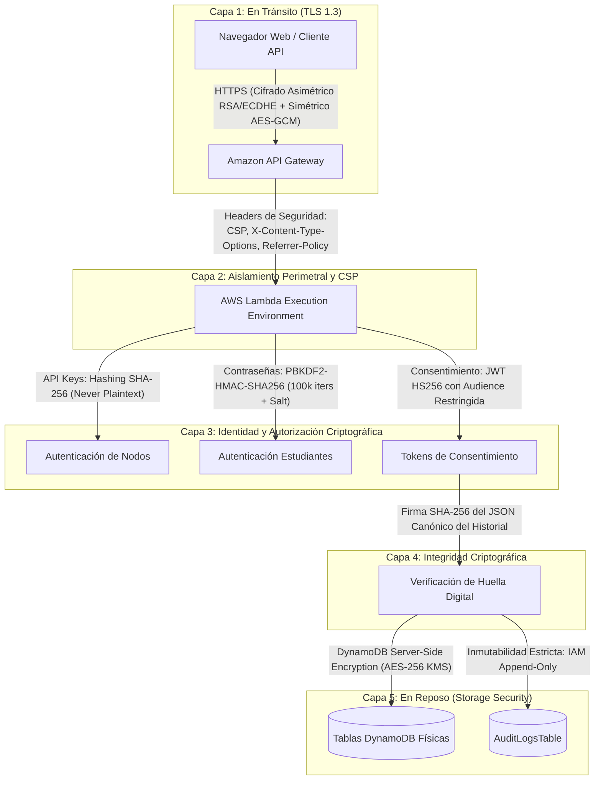

### 23.1 Cifrado en Tránsito: Protocolo HTTPS / TLS 1.3
* **Fundamento Criptográfico:** Cuando un cliente contacta a la API, se realiza un proceso de negociación criptográfica (**TLS Handshake**). Se utiliza criptografía asimétrica de curvas elípticas o RSA para autenticar la identidad del servidor y acordar una clave de sesión simétrica efímera (**AES-GCM de 256 bits**).
* **Protección Activa:** Todo el tráfico entre el navegador y API Gateway viaja encapsulado dentro de este túnel cifrado. Esto neutraliza de raíz los ataques de interceptación pasiva (*Sniffing*) o manipulación activa (*Man-in-the-Middle*), impidiendo que contraseñas, documentos de identidad o las cabeceras `X-Node-API-Key` y `X-Admin-Key` sean leídas en claro mientras cruzan la red pública.

### 23.2 Cifrado en Reposo: Algoritmo AES-256 en Amazon DynamoDB
* **Fundamento Criptográfico:** **AES (*Advanced Encryption Standard*)** con longitud de clave de 256 bits es el estándar de cifrado simétrico por bloques más seguro y avalado a nivel gubernamental y financiero mundial.
* **Implementación:** Todas las tablas de DynamoDB (`NodesTable`, `RecordsTable`, `ReplicasTable`, `TokensTable`, `AuditLogsTable`) tienen habilitado por defecto el cifrado en reposo del lado del servidor (**Server-Side Encryption - SSE**) utilizando claves maestras de cifrado administradas por **AWS KMS (*Key Management Service*)**.
* **Mitigación de Riesgos:** Incluso en el hipotético escenario de una extracción o robo físico de los discos de estado sólido en los centros de datos de AWS, los bloques de datos almacenados son completamente ilegibles e indescifrables sin la clave criptográfica correspondiente gestionada por el módulo de seguridad de hardware (HSM) de AWS.

### 23.3 Autenticación y Firma con JWT (`HS256`) vs. Cifrado
* **Firma vs. Cifrado:** Es vital comprender la diferencia técnica:
  * **Cifrar un dato:** Significa volverlo ininteligible para quien no posea la clave de descifrado (confidencialidad).
  * **Firmar digitalmente un dato (JWT con HS256):** Significa garantizar de forma matemáticamente infalsificable la **identidad del emisor** y la **integridad del mensaje** (que nadie lo haya alterado en el camino). El payload del JWT es legible en Base64URL, pero cualquier cambio en un solo byte de su contenido hace que la firma calculada `HMAC-SHA256(Header + Payload, Secret)` sea completamente inválida.
* **Aislamiento por Audiencia (`aud`):**
  * El estudiante autoriza explícitamente a una universidad concreta (ej. `aud: "IES-2222BBBB"`).
  * Si la Universidad C intercepta o recibe ese token e intenta utilizarlo para consultar el historial en el endpoint federado, la función `verify_token()` en `src/app/tokens.py` ejecuta `jwt.decode(..., audience=consulting_node_id)`. Al detectar que la audiencia del token no coincide con el `node_id` de la Universidad C, rechaza la operación inmediatamente con `InvalidAudienceError` (HTTP 403).

### 23.4 Integridad de Datos mediante Hashes Criptográficos SHA-256
* **¿Qué es SHA-256?** Es un algoritmo criptográfico de resumen unidireccional (*Secure Hash Algorithm*) que toma cualquier volumen de datos y produce una cadena hexadecimal de longitud fija de 256 bits (64 caracteres).
* **Efecto Avalancha (*Avalanche Effect*):** Es la propiedad matemática fundamental de los hashes criptográficos donde la alteración de un solo bit en los datos de entrada (por ejemplo, cambiar la nota de una materia de `4.5` a `4.6`) provoca un cambio drástico e impredecible en más del 50% de los bits del hash resultante.
* **Verificación de Huella Digital en RFHA-IES:**
  1. Cuando un nodo sincroniza un historial en `src/app/routers/sync.py`, la función `record_signature()` toma el historial, ordena sus campos alfabéticamente para garantizar una representación canónica idéntica e inyecta el hash resultante en el atributo `digital_signature_hash`.
  2. Cuando una universidad receptora consulta el historial en `src/app/routers/federated.py`, el middleware recalcula en memoria el hash de las materias y datos recibidos.
  3. Si el hash calculado no coincide con el `digital_signature_hash` guardado, el sistema asume que la base de datos fue manipulada o corrompida y aborta la entrega emitiendo un error HTTP 500 y registrando el evento en la bitácora de auditoría.

---

## 24. Diagramas de Funcionamiento Interno del Middleware y Failover

A continuación se presentan los diagramas de arquitectura interna que desglosan la mediación federada y el mecanismo de conmutación por error.

### 24.1 Diagrama de Mediación Interna del Middleware

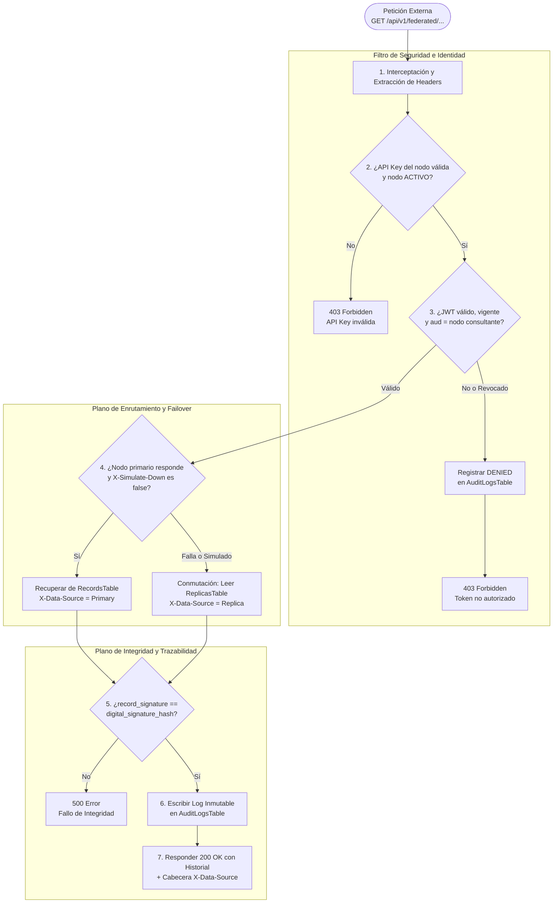

#### Explicación detallada del diagrama de mediación:
1. **Paso 1 (Interceptación):** La solicitud llega a través de API Gateway y entra al router `federated.py`. Se extraen las cabeceras `X-Node-API-Key` y `X-Student-Consent-Token`.
2. **Paso 2 (Validación de Nodo):** Se calcula el hash SHA-256 de la API Key y se consulta `NodesTable`. Si la clave no existe o el nodo está en estado distinto a `ACTIVO`, el flujo se corta de inmediato con HTTP 403 sin gastar cómputo en validar el token.
3. **Paso 3 (Validación de Token):** Se decodifica el JWT con la clave simétrica. Se evalúa que no haya expirado, que su claim de audiencia (`aud`) coincida con el nodo que consulta y se inspecciona `TokensTable` para asegurar que el `jti` no figure como revocado por el alumno.
4. **Paso 4 (Enrutamiento y Failover):** Si el nodo de origen está disponible, se recupera el historial de `RecordsTable`. Si el nodo falló o se envió la cabecera `X-Simulate-Down: true`, el sistema conmuta transparentemente a `ReplicasTable` y etiqueta la fuente como `Replica`.
5. **Paso 5 (Verificación de Integridad):** Se reconstruye el JSON canónico de las asignaturas y se evalúa el hash SHA-256 contra el guardado en la base de datos.
6. **Paso 6 y 7 (Auditoría y Entrega):** Se asienta el registro inmutable en `AuditLogsTable` indicando la IP del solicitante, resultado y fuente de datos, enviando finalmente la respuesta HTTP 200 al cliente.

---

### 24.2 Diagrama de Flujo de Tolerancia a Fallos (Failover Primario ↔ Réplica)

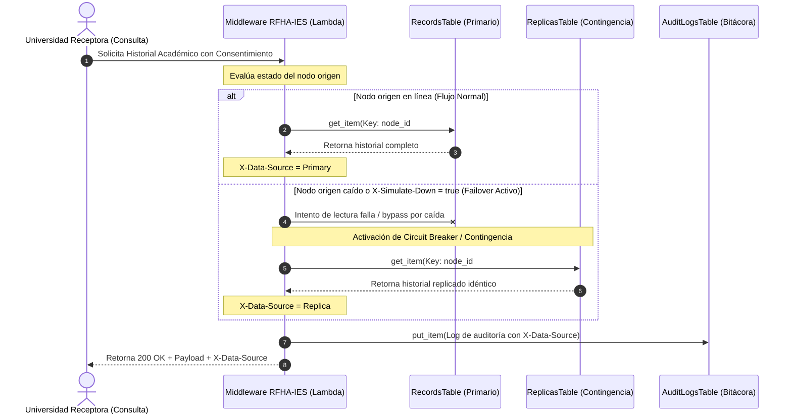

#### Explicación detallada del diagrama de failover:
1. **Paso 1:** La universidad receptora emite la petición GET hacia el middleware aportando su API Key y el token emitido por el estudiante.
2. **Paso 2 y 3 (Flujo Primario):** En condiciones normales de operación, el middleware intenta resolver la lectura contra `RecordsTable`. Al tener éxito, obtiene el registro primario y establece el metadato interno `X-Data-Source = Primary`.
3. **Paso 4 a 6 (Conmutación por Error):** Si el nodo origen se encuentra marcado como inaccesible (simulado con `X-Simulate-Down` o error de conexión), el bloque de contingencia en `src/app/routers/federated.py` (L.100-114) atrapa la condición y redirige la consulta hacia `ReplicasTable`. La réplica retorna la última versión sincronizada y se etiqueta `X-Data-Source = Replica`.
4. **Paso 7 y 8 (Registro y Entrega):** Independientemente de la vía utilizada (principio de **equifinalidad** en TGS), el evento queda asentado en `AuditLogsTable` y la respuesta llega al solicitante sin interrupción del servicio.


---

## 25. Introducción Didáctica para Principiantes y Glosario Fundamental

Esta sección está diseñada para que cualquier persona, sin importar su formación previa en ingeniería de software o sistemas distribuidos, comprenda a la perfección qué es **RFHA-IES**, por qué existe y cómo opera.

### 25.1 ¿Qué es RFHA-IES y qué problema real resuelve?

#### El problema tradicional en las universidades:
Imaginemos a una estudiante que cursa cinco semestres de Ingeniería en la **Universidad Nacional de Colombia** y decide trasladarse o cursar una maestría en la **Universidad Distrital Francisco José de Caldas**. Tradicionalmente, para homologar sus materias:
1. La estudiante debe desplazarse físicamente a la oficina de Admisiones y Registro de su universidad de origen.
2. Solicitar un certificado de notas en papel sellado (proceso que puede tardar semanas).
3. Pagar derechos pecuniarios y llevar físicamente el papel a la universidad receptora.
4. La universidad receptora debe confiar a ciegas en que el papel no haya sido falsificado, o iniciar un engorroso intercambio de oficios y correos electrónicos para verificar la autenticidad de las calificaciones.

Este modelo genera cuellos de botella humanos, demoras burocráticas, altos costos administrativos y riesgos de fraude académico.

#### La solución de RFHA-IES:
**RFHA-IES (Red Federada de Historiales Académicos para Instituciones de Educación Superior)** es una plataforma digital distribuida en la nube que conecta a las universidades participantes en una red de confianza mutua. Permite que:
* Las universidades sincronicen de manera segura y periódica los expedientes de sus estudiantes en un almacén federado de intercambio.
* **El estudiante sea el dueño exclusivo de su información:** ninguna universidad puede ver las notas de un estudiante de otra institución a menos que el alumno ingrese a su portal y le otorgue un permiso digital explícito (Token JWT) con fecha de caducidad.
* Si el sistema de la universidad de origen se cae o está fuera de servicio por mantenimiento, la universidad receptora puede consultar una **réplica autorizada de contingencia** sin interrupciones.
* Cada consulta queda grabada para siempre en una bitácora inmutable que nadie (ni siquiera los administradores) puede borrar o alterar.

---

### 25.2 La analogía cotidiana para entender el flujo

Para visualizar cómo interactúan las piezas, usemos la analogía de un **Casillero de Seguridad Bancario con Llave Compartida**:
* **El Estudiante** es el dueño de los documentos dentro del casillero. Posee una llave maestra digital.
* **La Universidad de Origen** es la entidad notarial que certifica las notas y coloca una copia sellada criptográficamente dentro del casillero.
* **La Universidad Receptora** es quien desea revisar las notas para autorizar una homologación. Sin embargo, cuando llega a la puerta del casillero, el guardia de seguridad (**el Middleware en AWS**) le exige dos cosas obligatorias:
  1. Su credencial oficial de universidad autorizada (**API Key institucional**).
  2. Una carta de autorización firmada digitalmente por el estudiante (**Token de Consentimiento**) que dice textualmente: *"Autorizo exclusivamente a la Universidad Receptora a ver mis notas durante las próximas 24 horas"*.
* Si la carta fue emitida para otra universidad, si ya pasaron las 24 horas, o si el estudiante llamó al banco para cancelar la carta (**revocación**), el guardia bloquea el acceso en seco y registra el intento en el libro de visitas (**Bitácora de Auditoría**).

---

### 25.3 Glosario Técnico Exhaustivo

A continuación se define cada término técnico fundamental utilizado en el proyecto, explicando su concepto teórico y su aplicación exacta en el código:

* **Sistemas Distribuidos (Distributed Systems):**
  * *Definición:* Colección de computadores independientes que se comunican a través de una red compartida y coordinan sus acciones mediante el paso de mensajes, presentándose ante los usuarios como un sistema único y coherente.
  * *En RFHA-IES:* Cada universidad participante actúa como un nodo autónomo; el middleware en AWS Lambda y DynamoDB coordina la federación de consultas y réplicas.
* **Middleware (Software de Mediación):**
  * *Definición:* Capa lógica de software situada entre el sistema operativo/red y las aplicaciones de usuario. Su función es ocultar la heterogeneidad de las plataformas subyacentes, ofreciendo servicios comunes como autenticación, enrutamiento, transformación de datos y control de fallos.
  * *En RFHA-IES:* La API en FastAPI desplegada sobre AWS Lambda actúa como middleware; recibe peticiones de distintas universidades, valida credenciales, arbitra el acceso y consulta la base de datos adecuada.
* **Plano de Control vs. Plano de Datos:**
  * *Definición:* En redes y arquitectura distribuida, el *Plano de Datos* transporta la carga útil de los usuarios (las notas y materias), mientras que el *Plano de Control* toma las decisiones de enrutamiento, políticas de seguridad y señalización (quién puede consultar a quién).
  * *En RFHA-IES:* El middleware es el plano de control que evalúa los tokens JWT y decide si entrega o bloquea el historial académico.
* **Serverless (Computación sin Servidor):**
  * *Definición:* Modelo de ejecución en la nube donde el proveedor (AWS) gestiona por completo la infraestructura de servidores, asignando recursos de cómputo bajo demanda de forma dinámica. El usuario solo paga por los milisegundos exactos en que su código se ejecuta.
  * *En RFHA-IES:* Se utiliza **AWS Lambda**; no hay máquinas virtuales encendidas 24/7 generando costos fijos innecesarios.
* **Cold Start vs. Warm Start:**
  * *Definición:* Un *Cold Start* (arranque en frío) ocurre cuando Lambda recibe una petición y debe aprovisionar un micro-contenedor nuevo, descargar el código e iniciar el runtime de Python (toma entre 500 y 1500 ms). Un *Warm Start* (arranque caliente) ocurre cuando la petición se atiende en un contenedor que ya estaba en memoria, respondiendo en apenas 10 a 20 ms.
* **NoSQL y Modelo Clave-Valor / Documento:**
  * *Definición:* Base de datos no relacional diseñada para escalabilidad horizontal masiva y latencia predecible. En lugar de tablas con filas fijas y sentencias `JOIN` costosas, almacena documentos JSON asociados a una clave primaria.
  * *En RFHA-IES:* **Amazon DynamoDB** almacena los historiales como documentos JSON estructurados bajo la clave única `record_key`.
* **Partition Key (Clave de Partición) y Sort Key (Clave de Ordenación):**
  * *Definición:* La *Partition Key* (PK) es el atributo cuyo valor pasa por una función hash interna de DynamoDB para determinar en qué partición física de almacenamiento se guarda el registro. La *Sort Key* (SK) permite ordenar múltiples ítems dentro de una misma partición.
  * *En RFHA-IES:* En `RecordsTable`, la PK es `record_key` (`node_id#student_id`), distribuyendo uniformemente los datos de cada universidad sin generar cuellos de botella.
* **Time To Live (TTL):**
  * *Definición:* Característica de bases de datos que asigna una fecha de caducidad automática a cada registro mediante un timestamp Unix. Al vencer, el motor purga el registro en segundo plano sin costo de cómputo.
  * *En RFHA-IES:* `TokensTable` usa el atributo `ttl` para eliminar automáticamente los tokens de consentimiento expirados tras 24 horas.
* **Hash Criptográfico y Algoritmo SHA-256:**
  * *Definición:* Algoritmo matemático unidireccional que convierte cualquier entrada en una cadena alfanumérica fija de 256 bits (64 caracteres hexadecimales). Es irreversible: no se puede deducir la entrada a partir del hash.
  * *En RFHA-IES:* Se usa para resguardar las API Keys en `NodesTable` y para calcular la firma digital de los historiales (`record_signature()`).
* **JSON Web Token (JWT) y Algoritmo HS256:**
  * *Definición:* Estándar abierto (RFC 7519) para emitir credenciales digitales compactas compuestas por tres partes separadas por puntos: Encabezado (Header), Carga útil (Payload) y Firma (Signature). `HS256` indica que la firma se calcula usando HMAC con SHA-256 mediante una clave secreta simétrica.
  * *En RFHA-IES:* Representa el consentimiento del estudiante en `src/app/tokens.py`.
* **Claim de Audiencia (`aud`):**
  * *Definición:* Atributo estándar dentro de un JWT que especifica con exactitud para quién fue emitido el token.
  * *En RFHA-IES:* Si el estudiante autoriza a la Universidad B (`aud: "IES-2222BBBB"`), el middleware rechaza de inmediato cualquier intento de la Universidad C de usar ese mismo token.
* **TLS 1.3 (Transport Layer Security):**
  * *Definición:* Protocolo criptográfico de vanguardia que asegura la privacidad y la integridad de la comunicación a través de Internet, cifrando todo el tráfico entre cliente y servidor.
* **Cifrado en Reposo y Algoritmo AES-256:**
  * *Definición:* Protección de los datos almacenados físicamente en disco. **AES-256** es el estándar de cifrado simétrico por bloques más robusto del mundo. En DynamoDB, todos los datos se cifran automáticamente en los discos duros mediante claves administradas en AWS KMS.
* **Tolerancia a Fallos y Failover:**
  * *Definición:* La capacidad de un sistema de seguir funcionando correctamente incluso cuando uno o más de sus componentes individuales fallan. El *Failover* es el mecanismo automático de conmutación hacia un sistema de respaldo o réplica.
  * *En RFHA-IES:* Si la consulta a `RecordsTable` falla, el middleware conmuta a `ReplicasTable` y añade la cabecera `X-Data-Source: Replica`.
* **Consistencia Eventual y Teorema CAP:**
  * *Definición:* El Teorema CAP demuestra que ningún sistema distribuido puede garantizar simultáneamente Consistencia estricta (C), Disponibilidad (A) y Tolerancia a Particiones (P). RFHA-IES es un sistema **AP**: ante una desconexión o fallo, prioriza responder con la última réplica conocida (Disponibilidad) en lugar de bloquearse.
* **Concurrencia Optimista y `ConditionExpression`:**
  * *Definición:* Estrategia de control de concurrencia donde se asume que las colisiones son raras. En lugar de bloquear la base de datos con candados pesados (*locks*), se incluye una condición al escribir (`ConditionExpression` en DynamoDB): solo se guarda el registro si la versión en la base no es más reciente que la entrante.
* **Idempotencia:**
  * *Definición:* Propiedad de una operación que produce exactamente el mismo resultado sin importar cuántas veces se ejecute con los mismos parámetros.
  * *En RFHA-IES:* Sincronizar dos veces el mismo historial académico actualiza el registro existente por clave `record_key` sin crear duplicados ni generar inconsistencias.
* **SPOF (Single Point of Failure - Punto Único de Fallo):**
  * *Definición:* Componente de un sistema cuya falla provoca el colapso total de todo el servicio.
  * *En RFHA-IES:* Se mitiga a nivel de infraestructura apoyándose en la alta disponibilidad multi-zona de AWS Lambda y DynamoDB (que replican internamente en 3 zonas de disponibilidad físicas distintas).
* **Service Registry (Registro de Descubrimiento de Servicios):**
  * *Definición:* Base de datos centralizada o distribuida donde los nodos de una red registran su ubicación y disponibilidad para que otros nodos puedan descubrirlos dinámicamente.
  * *En RFHA-IES:* El endpoint `GET /api/v1/nodes/active` actúa como registro de descubrimiento.

---

## 26. Análisis de Tablas de DynamoDB con Párrafos Explicativos Ricos

A diferencia de esquemas de datos relacionales tradicionales, cada tabla de DynamoDB en RFHA-IES cumple una función arquitectónica altamente especializada. A continuación se desglosan en detalle:

### 26.1 Tabla `NodesTable` (Directorio y Credenciales Institucionales)

| Atributo | Tipo NoSQL | Función Técnica y Justificación en el Sistema |
|---|---|---|
| `node_id` **(Partition Key)** | String (Cadena) | Identificador único institucional con formato `IES-XXXXXXXX` generado mediante `uuid.uuid4().hex[:8].upper()`. Actúa como clave primaria de la tabla y es el valor que se distribuye a lo largo de las particiones físicas de DynamoDB para garantizar lecturas directas en menos de 10 milisegundos. |
| `nit` | String (Cadena) | Número de Identificación Tributaria de la universidad solicitante (con o sin dígito de verificación). Se valida mediante expresiones regulares estrictas (`^\d{6,12}(-\d)?$`) para impedir registros duplicados de una misma institución. |
| `name` | String (Cadena) | Razón social oficial de la universidad (ej. "Universidad Distrital Francisco José de Caldas"). Se almacena para que el portal de estudiantes pueda mostrar nombres comprensibles en lugar de códigos opacos. |
| `domain` | String (Cadena) | Dominio institucional de Internet (ej. "udistrital.edu.co"). Valida que la entidad posea presencia web legítima y previene suplantaciones institucionales. |
| `contact_email` | String (Cadena) | Correo electrónico oficial del representante de Admisiones y Registro asignado como contacto institucional para notificaciones de auditoría. |
| `status` | String (Cadena) | Estado de ciclo de vida del nodo: `PENDIENTE_APROBACION` (recién registrado por HU-01), `ACTIVO` (aprobado por el administrador por HU-02) o `DEGRADADO` (nodo con problemas de conectividad marcable por SD-04). |
| `api_key_hash` | String (Cadena) | Resumen criptográfico SHA-256 de la API Key generada para la universidad. Por principio de seguridad de privilegio mínimo, **la API Key original nunca se guarda en texto claro**; solo se almacena su hash para comparar igualdades. |
| `created_at` | String (ISO-8601 UTC) | Marca temporal inmutable que certifica el instante exacto en que la universidad radicó su solicitud en la red federada. |
| `approved_at` | String (ISO-8601 UTC) | Marca temporal fijada por el administrador general en el momento en que se aprueba formalmente el nodo y se emite su API Key única. |

#### Explicación en prosa de `NodesTable`:
Esta tabla resuelve el problema de la **identidad federada institucional**. No cualquier entidad puede enviar datos ni consultar historiales; la tabla actúa como el guardián perimetral. Su ciclo de vida comienza cuando una universidad llena el formulario en `/registro-nodo` (`src/app/routers/nodes.py`), insertando un ítem en estado `PENDIENTE_APROBACION`. Cuando el administrador revisa la solicitud en `/admin` (`src/app/routers/admin.py`), el endpoint `approve_node` genera una API Key con prefijo `rfha_`, calcula su hash SHA-256, actualiza el ítem a `ACTIVO` y devuelve la clave al usuario por única vez. En consultas subsecuentes, el middleware toma la cabecera `X-Node-API-Key`, calcula su hash y ejecuta un scan/get indexado sobre esta tabla para verificar la validez de la institución en tiempo real.

---

### 26.2 Tabla `RecordsTable` (Almacén Primario de Historiales Académicos)

| Atributo | Tipo NoSQL | Función Técnica y Justificación en el Sistema |
|---|---|---|
| `record_key` **(Partition Key)** | String (Cadena compuesta) | Clave de partición estructurada con la fórmula `<node_id>#<student_id>` (ej. `IES-1111AAAA#20262678029`). Esta clave compuesta garantiza que un estudiante que curse materias en dos universidades distintas mantenga dos historiales completamente separados y particionados sin riesgo de colisión. |
| `node_id` | String (Cadena) | Código del nodo universitario dueño de la información. Proviene exclusivamente de la API Key autenticada en el backend, impidiendo que una universidad intente cargar registros a nombre de otra institución. |
| `student_id` | String (Cadena) | Código institucional del estudiante asignado por la universidad de origen (longitud de 6 a 15 dígitos numéricos). |
| `document_number` | String (Cadena) | Número de documento de identidad nacional del alumno (cédula o tarjeta de identidad). Permite indexar y buscar los expedientes de un alumno cuando ingresa al portal estudiantil. |
| `full_name` | String (Cadena) | Nombres y apellidos completos del estudiante tal como figuran en los registros oficiales de admisiones. |
| `program` | String (Cadena) | Nombre del programa académico o carrera universitaria en curso (ej. "Ingeniería en Telemática"). |
| `academic_status` | String (Enum) | Situación académica del alumno en la universidad emisor: `ACTIVO`, `GRADUADO` o `RETIRADO`. |
| `courses` | List of Maps (Lista de Objetos) | Estructura jerárquica con el desglose de materias cursadas. Cada elemento contiene: `code` (código de asignatura), `name` (nombre de materia), `credits` (número de créditos), `grade` (calificación numérica decimal o null si está en curso) y `status` (`APROBADA`, `REPROBADA`, `EN_CURSO`). |
| `password_hash` | String (Cadena con sal) | Hash seguro de la contraseña del estudiante generado mediante PBKDF2-HMAC-SHA256 con sal aleatoria de 16 bytes y 100.000 iteraciones. Protege el acceso al portal del estudiante. |
| `digital_signature_hash` | String (Hex SHA-256) | Huella digital criptográfica inmutable calculada sobre el JSON canónico de los datos académicos. Cualquier cambio de notas altera este valor, delatando manipulación no autorizada. |
| `synced_at` | String (ISO-8601 UTC) | Marca temporal de la última sincronización. Se utiliza en la condición de concurrencia optimista (`ConditionExpression`) para rechazar escrituras desfasadas. |

#### Explicación en prosa de `RecordsTable`:
Esta tabla constituye el núcleo del **Plano de Datos Académico**. Se alimenta a través del endpoint `POST /api/v1/node/sync-records` (`src/app/routers/sync.py`), donde un nodo activo envía lotes de expedientes de estudiantes. Para mitigar colisiones concurrentes (Hallazgo SD-01), el método `upsert()` en `src/app/repositories.py` aplica una expresión condicional: la escritura sobreescribe el ítem únicamente si este no existía previamente o si el atributo `synced_at` entrante es cronológicamente igual o superior al que ya reside en disco. Esto asegura que si dos procesos de una misma universidad sincronizan simultáneamente, nunca una versión antigua sobrescriba datos recientes.

---

### 26.3 Tabla `ReplicasTable` (Respaldo Redundante para Tolerancia a Fallos)

| Atributo | Tipo NoSQL | Función Técnica y Justificación en el Sistema |
|---|---|---|
| `record_key` **(Partition Key)** | String (Cadena) | Idéntica clave de partición `<node_id>#<student_id>` que en la tabla primaria, permitiendo consultas cruzadas inmediatas en tiempo constante O(1). |
| `node_id` | String (Cadena) | Identificador del nodo institucional emisor de la réplica. |
| `student_id` | String (Cadena) | Código institucional del estudiante replicado. |
| `document_number` | String (Cadena) | Cédula del estudiante para permitir consultas federadas de contingencia. |
| `full_name` | String (Cadena) | Nombre completo del alumno replicado. |
| `courses` | List of Maps | Copia idéntica y redundante del listado de materias, créditos y estados académicos. |
| `digital_signature_hash` | String (Hex SHA-256) | Huella digital de integridad. Permite verificar que la réplica no haya sido alterada mientras residía en el almacén de contingencia. |
| `synced_at` | String (ISO-8601 UTC) | Momento exacto en que se generó la réplica de contingencia. |

#### Explicación en prosa de `ReplicasTable`:
`ReplicasTable` es el pilar de la **tolerancia a fallos (HU-08)** del sistema federado. Cada vez que una universidad ejecuta `sync-records`, el backend escribe de forma secuencial en `RecordsTable` y en `ReplicasTable`. Aunque residen en la misma infraestructura física de DynamoDB por motivos de costos académicos, arquitectónicamente actúan como dos almacenes segregados. Si durante una consulta federada en `/api/v1/federated/academic-history/{id}` el nodo de origen está caído (o se activa la cabecera `X-Simulate-Down`), el middleware salta automáticamente a consultar esta tabla de réplicas, garantizando que el estudiante y la universidad receptora completen el trámite sin interrupción del servicio.

---

### 26.4 Tabla `TokensTable` (Lista Negra y Soberanía del Consentimiento)

| Atributo | Tipo NoSQL | Función Técnica y Justificación en el Sistema |
|---|---|---|
| `jti` **(Partition Key)** | String (UUID hexadecimal) | Identificador único del token JWT (*JWT ID*). Representa la clave primaria de la tabla y permite buscar un token en menos de 5 ms para verificar su estado de revocación. |
| `document_number` | String (Cadena) | Documento de identidad del alumno que emitió la autorización. Permite listar en el portal web todos los tokens activos o revocados generados por ese estudiante. |
| `student_id` | String (Cadena) | Código institucional del estudiante asociado al token. |
| `origin` | String (Cadena) | Nodo de origen propietario de los datos que se autorizan a consultar (ej. `IES-1111AAAA`). |
| `aud` | String (Cadena) | Nodo de destino expresamente autorizado a consultar el historial (ej. `IES-2222BBBB`). |
| `issued_at` | Number (Unix Epoch) | Timestamp numérico en segundos que certifica el segundo exacto de expedición del consentimiento. |
| `exp` | Number (Unix Epoch) | Timestamp numérico en segundos que marca el vencimiento estricto del token (por defecto `issued_at + 86400` segundos = 24 horas). |
| `ttl` | Number (Unix Epoch) | Atributo configurado con la funcionalidad nativa **TTL (*Time To Live*) de Amazon DynamoDB**. Cuando el reloj de AWS supera este valor, DynamoDB marca el registro como caducado y lo borra automáticamente del disco sin consumir unidades de cómputo. |
| `revoked` | Boolean (Booleano) | Bandera de revocación (*Lista Negra*). Comienza en `false`. Si el estudiante pulsa "Revocar" en su portal, el backend ejecuta un `update_item` atómico cambiando este valor a `true`. |

#### Explicación en prosa de `TokensTable`:
Esta tabla materializa el **principio de soberanía de datos del estudiante**. Los tokens JWT son técnicamente válidos criptográficamente mientras no expire su firma; sin embargo, en un sistema distribuido real, el usuario debe tener el poder de cancelar un permiso antes de su vencimiento si sospecha de mal uso. Para lograrlo sin volver el sistema monolítico, `TokensTable` opera como una **lista negra distribuida**: cuando la universidad receptora presenta un token, el middleware no solo valida la firma matemática del JWT, sino que consulta esta tabla por clave `jti`. Si `revoked == true`, el acceso es denegado de inmediato con HTTP 403.

---

### 26.5 Tabla `AuditLogsTable` (Bitácora Distribuida Inmutable de Auditoría)

| Atributo | Tipo NoSQL | Función Técnica y Justificación en el Sistema |
|---|---|---|
| `log_id` **(Partition Key)** | String (Cadena) | Identificador único de auditoría generado como `AUDIT-` seguido de 12 caracteres hexadecimales aleatorios. Garantiza unicidad absoluta por cada evento registrado en la red. |
| `timestamp` | String (ISO-8601 UTC) | Marca de tiempo precisa en formato universal coordinado que certifica el milisegundo exacto del evento de auditoría. |
| `consulting_node_id` | String (Cadena) | Identificador institucional de la universidad que realizó la consulta federada. |
| `target_student_id` | String (Cadena) | Identificador del estudiante cuyo historial fue solicitado. |
| `origin_node_id` | String (Cadena o null) | Identificador del nodo propietario del historial académico consultado. |
| `outcome` | String (Enum) | Resultado de la operación: `SUCCESS` (consulta exitosa autorizada), `DENIED` (bloqueo por token inválido, expirado, revocado o audiencia no coincidente) o `ERROR` (falla de integridad criptográfica o historial inexistente). |
| `reason` | String (Cadena) | Motivo descriptivo del resultado registrado (ej. "Consulta exitosa (Primary)", "El token fue revocado por el estudiante", "Integridad del historial no verificable"). |
| `data_source` | String (Enum) | Fuente de datos utilizada para resolver la petición: `Primary` (tabla principal), `Replica` (conmutación por failover a la réplica) o `None` (en peticiones denegadas). |
| `client_ip` | String (Cadena) | Dirección IP pública del cliente que originó la petición HTTP hacia API Gateway, facilitando análisis forense en caso de intentos de ataque o escaneo. |

#### Explicación en prosa de `AuditLogsTable`:
Esta tabla es el corazón del **no-repudio y la transparencia de la red (HU-09)**. Cada vez que una universidad o usuario ejecuta una acción sobre el endpoint federado, el router `federated.py` invoca la función interna `_log()`, la cual realiza una inserción directa (`put_item`) en `AuditLogsTable`. Por diseño de seguridad, la política de permisos IAM adjunta a la función Lambda carece por completo de las acciones `dynamodb:DeleteItem` y `dynamodb:UpdateItem` sobre esta tabla. Esto significa que **nadie puede alterar el pasado ni borrar registros de auditoría**, garantizando una pista forense matemáticamente inmutable.

---

## 27. Defensa Arquitectónica de Sistemas Distribuidos y Refutación de Críticas

Esta sección blinda al equipo frente a cualquier interrogatorio o sustentación ante un tribunal académico estricto de Sistemas Distribuidos y Teoría General de Sistemas, refutando con rigor técnico y evidencia del código las objeciones comunes.

### 27.1 ¿Por qué RFHA-IES NO es una base de datos centralizada aunque resida en AWS?

Una crítica superficial muy frecuente al observar el proyecto es: *"Como todas las tablas están en la misma cuenta de AWS DynamoDB y las peticiones pasan por una sola API Gateway, el sistema es un monolito centralizado tradicional"*. Esta afirmación confunde la **infraestructura física de hosting** con la **arquitectura lógica distribuida**:

#### 1. Particionamiento lógico e islas de datos soberanas:
En una base de datos centralizada clásica, existe un esquema global unificado donde cualquier administrador o consulta autorizada puede hacer un `SELECT * FROM estudiantes` y cruzar los datos de todas las universidades. En **RFHA-IES**, esto es técnicamente imposible:
* Los datos están estrictamente particionados por `node_id` (`record_key = f"{node_id}#{student_id}"` en `src/app/repositories.py`).
* La Universidad Distrital no tiene visibilidad sobre los registros de la Universidad Nacional. Cada universidad posee una "isla de datos" lógica completamente estanca.
* El nodo dueño se inyecta desde la API Key validada por el servidor (`node["node_id"]` en `src/app/routers/sync.py`), lo que hace imposible que un nodo escriba, consulte o modifique datos pertenecientes a otro nodo institucional.

#### 2. Separación entre Plano de Control y Almacenes de Origen:
En una arquitectura puramente centralizada, el servidor central es la única fuente de verdad operativa donde se registran matrículas, pagos y notas día a día. En **RFHA-IES**, el sistema académico interno de cada universidad (su propio ERP o sistema SIA institucional) sigue residiendo dentro de los servidores locales de cada universidad. DynamoDB en este proyecto actúa exclusivamente como un **almacén federado de intercambio y réplica de contingencia**, intermediado por el plano de control para permitir la interoperabilidad segura.

#### 3. Cero estado compartido local y escalabilidad elástica:
A nivel de infraestructura, AWS Lambda no es un único servidor físico central. Cada petición que entra por API Gateway puede ser ejecutada por micro-contenedores completamente independientes corriendo en distintos racks o centros de datos dentro de la región `us-east-2`. No existe memoria compartida, ni variables globales locales, ni bloqueos pesados de base de datos relacional.

---

### 27.2 Matriz de Refutación ante Objeciones de Evaluadores

A continuación se analizan 7 objeciones severas que un evaluador académico podría formular, junto con su respuesta técnica irrebatible basada en el código del repositorio:

| # | Objeción / Ataque del Evaluador | Refutación Técnica Rigurosa con Evidencia en Código y AWS |
|---|---|---|
| **1** | *"Todo corre en una sola función AWS Lambda; eso es un monolito centralizado, no un sistema distribuido."* | **Falso.** AWS Lambda no es un proceso único en ejecución; es una plataforma de computación elástica distribuida. Cuando 50 universidades realizan peticiones simultáneas, AWS levanta 50 entornos de ejecución aislados con micro-máquinas Firecracker independientes. La evidencia irrefutable se observa en **CloudWatch Logs**, donde cada petición presenta un `RequestId` y un contenedor independiente ejecutándose en paralelo sin compartir memoria local. La aplicación es totalmente *stateless*. |
| **2** | *"Todas las universidades apuntan a la misma URL de API Gateway; es un esquema cliente-servidor tradicional."* | **Falso.** Confunde el punto de entrada de la red con la topología del sistema. API Gateway actúa exactamente igual que un **Router BGP en Internet** o un **Name Server en el sistema DNS**: es un mediador de direccionamiento y plano de control federado neutral. Los participantes de la red son nodos autónomos con identidades criptográficas únicas (API Keys con hash SHA-256) que controlan cuándo y qué sincronizan. |
| **3** | *"Si guardan copias de los historiales en DynamoDB, centralizaron la base de datos de las universidades."* | **Falso.** DynamoDB opera bajo el modelo federado de islas de datos particionadas. La clave de partición obligatoria `record_key = node_id#student_id` impide cruces relacionales globales. Además, el acceso a la lectura de cualquier historial está bloqueado por defecto: se requiere un token de consentimiento firmado por el estudiante con claim de audiencia estricto (`aud`). Sin ese token, nadie puede extraer información de la base. |
| **4** | *"No tienen algoritmos de consenso distribuido como Raft o Paxos; sin eso no hay consistencia distribuida."* | **Aclaración de modelo:** Los algoritmos de consenso como Raft o Paxos son obligatorios cuando un clúster de nodos debe ponerse de acuerdo sobre un único registro global compartido (como en una blockchain o el log de etcd). En RFHA-IES, **las universidades no compiten por escribir el mismo registro**: la Universidad A es la dueña exclusiva de sus notas y la Universidad B de las suyas. Para escrituras concurrentes del mismo nodo, el sistema implementa **Concurrencia Optimista con `ConditionExpression` en DynamoDB** (`Attr("synced_at").lte(new_synced_at)` en `repositories.py`), lo que resuelve formalmente la consistencia en sistemas federados. |
| **5** | *"El failover es reactivo y simulado; no hay servidores físicos corriendo en distintos países."* | **Respuesta:** En sistemas serverless de nube moderna, la tolerancia a fallos física está delegada en la infraestructura multi-zona de AWS (DynamoDB replica automáticamente en 3 Zonas de Disponibilidad físicas independientes con tolerancia a inundaciones o fallas eléctricas en un centro de datos). A nivel de aplicación, el failover implementado en `src/app/routers/federated.py` (L.100-114) demuestra conmutación transparente de lectura: si `RecordsTable` no responde, el sistema lee de `ReplicasTable` y lo evidencia mediante la cabecera HTTP `X-Data-Source: Replica`. |
| **6** | *"Si la región de AWS donde está desplegada la Lambda cae, todo el sistema muere (SPOF)."* | **Reconocimiento y mitigación:** Se reconoce con honestidad técnica que un despliegue en una sola región (`us-east-2`) posee como límite el SLA de 99.95% de AWS Lambda. Sin embargo, para producción comercial, la arquitectura actual está lista para desplegarse como **Active-Active Multi-Region** utilizando **Amazon Route 53** con enrutamiento basado en latencia y **DynamoDB Global Tables**, eliminando por completo cualquier punto único de fallo regional. |
| **7** | *"El JWT usa firma simétrica `HS256`, lo que significa que el middleware conoce el secreto; no hay descentralización de confianza."* | **Justificación técnica:** `HS256` se eligió porque el middleware actúa como la autoridad neutral centralizada de validación y emisión de tokens (equivalente al Authorization Server en el estándar RFC 6749 OAuth2). El estudiante no firma directamente con una llave privada en su navegador porque requeriría almacenar certificados X.509 en el dispositivo del alumno. Para una evolución a confianza totalmente descentralizada, se adoptaría criptografía asimétrica **RS256** o **Ed25519**, donde cada universidad o estudiante poseería un par de llaves pública/privada. |


---

## 28. Diccionario y Guía Maestra de Tecnologías, Protocolos y Conceptos para Todo Público

Esta sección cumple con la regla de **cero términos técnicos sin explicar**. Cada tecnología, protocolo o sigla que interviene en **RFHA-IES** se explica aquí desde sus fundamentos más básicos, utilizando analogías de la vida cotidiana para que cualquier persona sin experiencia técnica comprenda con total claridad su función y valor dentro del proyecto.

### 28.1 Lenguajes de Programación, Marcado y Formatos de Datos

#### 1. Python (Versión 3.12)
* **¿Qué es en palabras sencillas?** Python es un lenguaje de programación de computadoras muy popular, conocido por su sintaxis clara y cercana al idioma inglés. Es el "cerebro" donde se programaron todas las reglas lógicas del sistema.
* **Analogía cotidiana:** Es como el manual de instrucciones operativo de un banco escrito en español claro y sin tecnicismos confusos, para que los cajeros y supervisores sepan exactamente qué hacer ante cada situación sin cometer errores.
* **¿Qué hace en RFHA-IES?** En los archivos dentro de la carpeta `src/app/`, el código en Python recibe las solicitudes que llegan por internet, verifica que las contraseñas y permisos sean auténticos, decide qué información entregar y guarda los registros de seguridad en las bases de datos.

#### 2. HTML5 (Lenguaje de Marcado de Hipertexto)
* **¿Qué es en palabras sencillas?** Es el estándar universal que define la estructura y el esqueleto de las páginas web que vemos en la pantalla (títulos, párrafos, botones, cajas de texto y tablas).
* **Analogía cotidiana:** Es como las paredes maestras, puertas y ventanas de una casa antes de pintarla y decorarla: define dónde está cada habitación y por dónde se entra.
* **¿Qué hace en RFHA-IES?** Los archivos terminados en `.html` dentro de `src/app/static/` (como `inicio.html`, `portal-estudiante.html` y `consulta.html`) dibujan los formularios donde los rectores y estudiantes escriben sus datos y leen sus notas.

#### 3. CSS3 (Hojas de Estilo en Cascada)
* **¿Qué es en palabras sencillas?** Es el lenguaje encargado del diseño estético, los colores, los espacios, las fuentes y la adaptación visual de una página web a diferentes tamaños de pantalla (celulares, tabletas o computadores).
* **Analogía cotidiana:** Es la pintura, la iluminación, los muebles y el diseño de interiores de la casa: hace que el espacio sea agradable, ordenado y fácil de usar.
* **¿Qué hace en RFHA-IES?** El archivo `src/app/static/styles.css` se asegura de que el portal sea visualmente profesional, cuente con modo oscuro y modo claro automático según la preferencia del usuario y mantenga los botones y textos bien ordenados y legibles.

#### 4. JavaScript (Módulos ES6+)
* **¿Qué es en palabras sencillas?** Es el lenguaje de programación que corre directamente en el navegador del usuario y le da dinamismo interactivo a la página web sin necesidad de recargar la pantalla completa.
* **Analogía cotidiana:** Es como la electricidad y los botones automáticos de la casa: cuando presionas el interruptor, la luz se enciende al instante sin tener que salir a la calle a pedir permiso.
* **¿Qué hace en RFHA-IES?** Archivos como `panel-nodo.js` o `auditoria.js` detectan cuando el usuario hace clic en "Cargar ejemplo" o "Consultar", validan que no haya dejado campos vacíos y envían la petición al servidor de forma silenciosa e instantánea.

#### 5. JSON (Notación de Objetos de JavaScript)
* **¿Qué es en palabras sencillas?** Es un formato estándar de texto sumamente simple y ligero para enviar y recibir datos ordenados entre computadores a través de internet, utilizando parejas de "nombre" y "valor".
* **Analogía cotidiana:** Es como una ficha bibliográfica o un formulario de aduanas con casillas claramente rotuladas: `Nombre: Laura`, `Materia: Cálculo`, `Nota: 4.8`.
* **¿Qué hace en RFHA-IES?** Es el idioma universal en el que dialogan el navegador web, el servidor en Python y la base de datos DynamoDB.

#### 6. YAML (Lenguaje de Serialización de Datos)
* **¿Qué es en palabras sencillas?** Es un formato de texto diseñado específicamente para escribir archivos de configuración de forma sumamente limpia, utilizando sangrías o espacios en lugar de llaves o corchetes.
* **Analogía cotidiana:** Es como una lista de mercado estructurada por categorías: bajo la sección "Lácteos" anotas "Leche" y "Queso".
* **¿Qué hace en RFHA-IES?** El archivo `template.yaml` le indica a Amazon Web Services exactamente qué servidores, permisos y bases de datos debe construir de manera automática al desplegar el sistema.

---

### 28.2 Protocolos de Comunicación y Redes

#### 1. API REST (Interfaz de Programación de Aplicaciones RESTful)
* **¿Qué es en palabras sencillas?** Es un conjunto de reglas y canales de comunicación estandarizados que permite que dos programas de computador completamente distintos (por ejemplo, el portal web y el servidor en la nube) se entiendan y colaboren entre sí a través de internet.
* **Analogía cotidiana:** Es como el menú de un restaurante: el cliente (frontend) revisa la carta de platos disponibles, le pide al mesero (API) lo que desea y el mesero va a la cocina (servidor) y regresa con el pedido preparado sin que el cliente tenga que entrar a cocinar.
* **¿Qué hace en RFHA-IES?** Define las rutas oficiales del sistema (ej. `/api/v1/node/sync-records` o `/api/v1/students/token`), estableciendo qué datos se pueden pedir y qué respuestas se van a recibir.

#### 2. HTTP y HTTPS (Protocolo de Transferencia de Hipertexto Seguro)
* **¿Qué es en palabras sencillas?** HTTP es el protocolo base sobre el cual funciona toda la World Wide Web para enviar y recibir páginas y datos. **HTTPS** es la versión segura y protegida de ese mismo protocolo.
* **Analogía cotidiana:** Enviar una carta por HTTP tradicional es como mandar una postal transparente: cualquier persona que trabaje en el correo o esté en el camino puede leer lo que escribiste. Enviar por **HTTPS** es como meter la carta dentro de una caja fuerte de titanio con combinación secreta que solo el destinatario puede abrir.
* **¿Qué hace en RFHA-IES?** Todas las conexiones se realizan obligatoriamente bajo HTTPS. Esto garantiza que cuando un estudiante escribe su contraseña o una universidad envía calificaciones, ningún atacante conectado a la misma red Wi-Fi pueda espiar ni alterar la información.

#### 3. Cabeceras HTTP (HTTP Headers)
* **¿Qué son en palabras sencillas?** Son metadatos o etiquetas invisibles para el usuario común que se adjuntan al principio de cada mensaje en internet para dar instrucciones técnicas al servidor sobre quién envía la petición, qué tipo de datos contiene o qué permisos lleva.
* **Analogía cotidiana:** Son como los sellos postales, la estampilla de "Urgente" y el remitente pegados en el sobre exterior de una carta.
* **¿Qué hacen en RFHA-IES?** El sistema utiliza cabeceras personalizadas como `X-Node-API-Key` (donde la universidad viaja identificada), `X-Student-Consent-Token` (donde viaja el permiso del estudiante) y `X-Data-Source` (donde el servidor le avisa al usuario si los datos vinieron del servidor primario o de la réplica de emergencia).

#### 4. CORS (Intercambio de Recursos de Origen Cruzado)
* **¿Qué es en palabras sencillas?** Es un mecanismo de seguridad implementado en todos los navegadores web modernos que impide que una página maliciosa de internet haga peticiones secretas a otro sitio web sin autorización expresa.
* **Analogía cotidiana:** Es como el control de acceso en la entrada de un edificio corporativo: si alguien de una empresa externa quiere entrar a los archivos de otra oficina, los guardias de seguridad exigen una carta de invitación previa antes de dejarlo pasar.
* **¿Qué hace en RFHA-IES?** Asegura que únicamente las pantallas autorizadas del proyecto puedan comunicarse con la API de backend, bloqueando intentos de ataque desde páginas web externas sospechosas.

#### 5. TLS (Seguridad de la Capa de Transporte)
* **¿Qué es en palabras sencillas?** Es la tecnología criptográfica moderna que hace posible el candado de seguridad de HTTPS. Crea un túnel cifrado impenetrable entre el navegador y los servidores de Amazon.
* **Analogía cotidiana:** Es como un túnel submarino blindado y sellado al vacío: los vehículos que viajan por dentro están totalmente aislados del agua y de miradas exteriores.
* **¿Qué hace en RFHA-IES?** Protege toda la información en movimiento desde el segundo en que sale del celular o computador del usuario hasta que llega a los servidores de Amazon Web Services.

---

### 28.3 Criptografía y Seguridad Explicadas desde Cero

#### 1. Hash Criptográfico y Algoritmo SHA-256
* **¿Qué es en palabras sencillas?** Un hash es como una "huella dactilar digital matemática". Toma cualquier texto, documento o lista de calificaciones y lo transforma en una cadena fija de 64 caracteres alfanuméricos. Es un camino de ida: es muy fácil calcular el hash a partir del texto, pero es matemáticamente imposible reconstruir el texto original a partir del hash.
* **El Efecto Avalancha (Avalanche Effect):** Si tienes un documento de 1.000 páginas y le cambias una sola letra, una sola coma o un espacio, el hash resultante cambia por completo en más del 50% de sus caracteres.
* **Analogía cotidiana:** Es como poner una fruta en una licuadora industrial: con una manzana obtienes un puré con color y textura únicos. Viendo el puré sabes si era manzana fresca, pero jamás podrás volver a armar la manzana entera a partir del puré.
* **¿Qué hace en RFHA-IES?** 
  * Se usa para guardar las API Keys de las universidades en `NodesTable` (el sistema nunca guarda la clave real, solo su puré digital).
  * Se usa en la función `record_signature()` para sellar los historiales: si alguien intentara hackear la base de datos para subir su nota de 2.5 a 4.5, el hash cambiaría y el sistema detectaría el fraude al instante.

#### 2. JWT (JSON Web Token) y Algoritmo HS256
* **¿Qué es en palabras sencillas?** Es un documento de autorización digital compacto, autosuficiente e infalsificable que viaja codificado en texto. Está compuesto por tres secciones separadas por puntos:
  1. **Encabezado:** Dice con qué algoritmo se firmó.
  2. **Contenido (Payload):** Contiene las autorizaciones (quién es el alumno, a qué universidad autoriza y cuándo vence).
  3. **Firma:** Un sello matemático que solo el servidor de RFHA-IES pudo estampar usando una clave ultra-secreta (`JWT_SECRET`).
* **Analogía cotidiana:** Es exactamente como una pulsera de acceso VIP en un concierto o una manilla de hotel todo incluido. La manilla tiene un código de barras sellado con tinta ultravioleta: los guardias de seguridad no necesitan llamar al gerente general cada vez que alguien pasa; simplemente miran el sello de la manilla para saber si la persona tiene permiso de entrar a esa zona específica.
* **¿Qué hace en RFHA-IES?** Cuando el estudiante inicia sesión en `/portal-estudiante` y elige autorizar a una universidad, el sistema le entrega este pase digital (`student_auth_token`) para que la universidad receptora pueda consultar su historial.

#### 3. El Campo de Audiencia (`aud` en el JWT)
* **¿Qué es en palabras sencillas?** Es una casilla obligatoria dentro del token JWT que dice con nombre propio para quién está autorizado ese pase.
* **Analogía cotidiana:** Es como un cheque bancario nominativo que dice: *"Páguese únicamente a la orden de la Universidad Distrital"*. Si un ladrón o un tercero se encuentra el cheque y va al banco a cobrarlo, el cajero lee el nombre y le dice: *"Usted no es la Universidad Distrital, este cheque no le sirve a usted"*.
* **¿Qué hace en RFHA-IES?** Si el estudiante autoriza a la Universidad Distrital (`aud: "IES-2222BBBB"`), pero un funcionario de la Universidad de los Andes intenta usar ese mismo token para ver las notas, el servidor rechaza la consulta de inmediato (HTTP 403 Forbidden).

#### 4. Cifrado en Reposo con Algoritmo AES-256
* **¿Qué es en palabras sencillas?** Es el estándar de encriptación simétrica más seguro que existe en la actualidad, adoptado por bancos y agencias militares a nivel global para proteger discos duros. "En reposo" significa que protege la información cuando está guardada, quieta y almacenada en los servidores físicos.
* **Analogía cotidiana:** Es como guardar dinero en una caja fuerte subterránea con paredes de medio metro de acero: aunque un intruso entre físicamente a la habitación donde está la caja fuerte, no puede ver ni tocar el dinero sin la combinación maestra.
* **¿Qué hace en RFHA-IES?** Todas las tablas de Amazon DynamoDB tienen activo el cifrado AES-256 mediante el servicio AWS KMS. Si alguien entrara a los centros de cómputo de Amazon y robara físicamente los discos duros, solo encontraría cadenas de bytes completamente ilegibles e inútiles.

#### 5. API Key (Clave de Interfaz de Programación)
* **¿Qué es en palabras sencillas?** Es una contraseña alfanumérica larga, aleatoria y muy difícil de adivinar (ej. `rfha_8f9a2b3c4d5e...`) que se le entrega a los directivos de una universidad para que sus servidores se identifiquen ante la red federada.
* **Analogía cotidiana:** Es como la tarjeta magnética de acceso que tiene un médico para abrir las puertas restringidas de la sala de cirugía de un hospital.
* **¿Qué hace en RFHA-IES?** Cada universidad aprobada tiene una API Key única. Sin ella, ningún rector ni director de registro puede sincronizar estudiantes ni consultar información.

---

### 28.4 Conceptos Básicos de la Nube de Amazon Web Services (AWS)

#### 1. Computación Serverless (Sin Servidor)
* **¿Qué es en palabras sencillas?** Es un modelo moderno de computación en la nube donde los ingenieros no tienen que comprar, configurar, mantener ni actualizar computadores físicos o servidores virtuales. En su lugar, simplemente suben el código de su aplicación y la nube de Amazon se encarga de ejecutarlo automáticamente solo cuando llega una petición.
* **Analogía cotidiana:** Es como viajar en taxi o en Uber en lugar de comprar un autobús propio: no tienes que pagar gasolina mensual, mantenimiento de motor, seguros ni estacionamiento cuando no lo usas; solo pagas la tarifa exacta por los minutos y kilómetros que duró el viaje.
* **¿Qué hace en RFHA-IES?** Toda la infraestructura corre sobre este modelo, lo que permite que el sistema funcione con costos de cero pesos cuando no hay nadie conectado, y soporte miles de estudiantes simultáneos cuando hay matrículas.

#### 2. Amazon API Gateway
* **¿Qué es en palabras sencillas?** Es un servicio de Amazon que actúa como la "recepción" o la "puerta giratoria de entrada" para todo el tráfico de internet que llega a la aplicación.
* **Analogía cotidiana:** Es como el recepcionista en el vestíbulo de un rascacielos corporativo: recibe a todos los visitantes que cruzan la puerta, comprueba que vengan con cita, canaliza a cada persona al ascensor correcto y evita que personas no autorizadas se cuelen a las oficinas.
* **¿Qué hace en RFHA-IES?** Atiende la URL pública `https://ypybm0azfg.execute-api.us-east-2.amazonaws.com`, gestiona la seguridad TLS y le pasa los datos a la función AWS Lambda para que los procese.

#### 3. AWS Lambda
* **¿Qué es en palabras sencillas?** Es el servicio de Amazon que ejecuta pequeños trozos de código de programación en milisegundos en respuesta a eventos (como un clic en un botón web).
* **Analogía cotidiana:** Es como un chef experto que solo se materializa en la cocina cuando un cliente ordena un platillo: cocina en 10 segundos, entrega la comida y se retira sin ocupar espacio ni consumir salario hasta que llegue la siguiente orden.
* **Concurrencia Paralela:** Si entran 100 estudiantes al mismo segundo a consultar sus notas, AWS Lambda no hace una fila lenta; levanta automáticamente 100 micro-contenedores idénticos para atender a los 100 estudiantes exactamente al mismo tiempo.
* **¿Qué hace en RFHA-IES?** Es el lugar donde corre la aplicación FastAPI (`src/app/main.py`) que procesa las reglas del sistema.

#### 4. Amazon DynamoDB
* **¿Qué es en palabras sencillas?** Es la base de datos NoSQL ultrarrápida y totalmente administrada de Amazon. A diferencia de las bases de datos antiguas que organizan todo en hojas de cálculo gigantes con filas y columnas rígidas (SQL), DynamoDB guarda los datos como fichas o documentos JSON independientes asociados a una clave principal.
* **Analogía cotidiana:** Es como un archivador gigante con millones de gavetas rotuladas: no tienes que revisar todo el mueble para encontrar un expediente; si tienes el número de la gaveta (`Partition Key`), la abres directamente en 5 milisegundos.
* **¿Qué hace en RFHA-IES?** Aloja las 5 tablas de datos de la red (`NodesTable`, `RecordsTable`, `ReplicasTable`, `TokensTable` y `AuditLogsTable`).

#### 5. IAM (Administración de Identidades y Accesos de AWS)
* **¿Qué es en palabras sencillas?** Es el sistema de seguridad interno de Amazon que define qué partes de la nube tienen permiso de comunicarse con otras partes, aplicando el principio de "mínimo privilegio posible".
* **Analogía cotidiana:** Son como las llaves maestras y permisos de los empleados de un banco: el cajero tiene llave de su ventanilla, pero no tiene la clave de la bóveda subterránea ni la del despacho del presidente.
* **¿Qué hace en RFHA-IES?** El rol IAM de la función Lambda le da permiso para guardar y leer en las tablas de notas, pero le prohíbe terminantemente borrar registros de la tabla de auditoría (`AuditLogsTable`), garantizando que nadie pueda borrar la bitácora de seguridad.

#### 6. Amazon CloudWatch Logs
* **¿Qué es en palabras sencillas?** Es el diario de navegación o registro automático donde Amazon anota cada segundo lo que hace la aplicación, cuánto tiempo tardó en responder, cuánta memoria consumió y si ocurrió algún error técnico.
* **Analogía cotidiana:** Es como la caja negra de un avión: graba continuamente todos los eventos del vuelo para que los inspectores puedan revisar exactamente qué ocurrió en cualquier segundo del pasado.
* **¿Qué hace en RFHA-IES?** Registra cada ejecución de Lambda con su identificador único de petición (`RequestId`), permitiendo auditar la concurrencia distribuida en vivo.


---

## 29. Guía Visual y Narrada de los Flujos de la Aplicación Paso a Paso para Todo Público

Esta sección narra los **6 flujos operativos esenciales** de **RFHA-IES**, explicando en orden cronológico qué ocurre en el mundo real, qué botones se presionan, qué datos viajan por la red y qué validaciones de seguridad se ejecutan tras bambalinas.

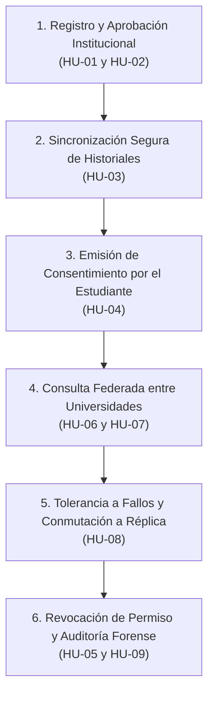

### Explicación detallada del mapa de flujos para todo público:
El diagrama superior muestra la secuencia lógica que sigue la vida de un dato dentro de la red federada:
1. Ninguna universidad puede participar hasta que no complete el **Flujo 1** (solicitud y aprobación con entrega de API Key).
2. Con su clave activa, la universidad ejecuta el **Flujo 2**, cargando las notas y materias de sus alumnos en el almacén primario y en la réplica de emergencia.
3. El estudiante toma el control soberano en el **Flujo 3**, ingresando a su portal para otorgar un pase digital (JWT) a la universidad de su elección.
4. En el **Flujo 4**, la universidad receptora usa ese pase para consultar las notas sin intermediación humana.
5. Si durante la consulta el servidor emisor está apagado, el **Flujo 5** entra en acción de forma transparente consultando la réplica autorizada sin detener la operación.
6. Finalmente, el **Flujo 6** permite al estudiante cancelar el permiso cuando desee y garantiza que cada segundo de actividad quede grabado para siempre en la bitácora de auditoría.

---

### Flujo 1: Registro y Aprobación de una Universidad (HU-01 y HU-02)

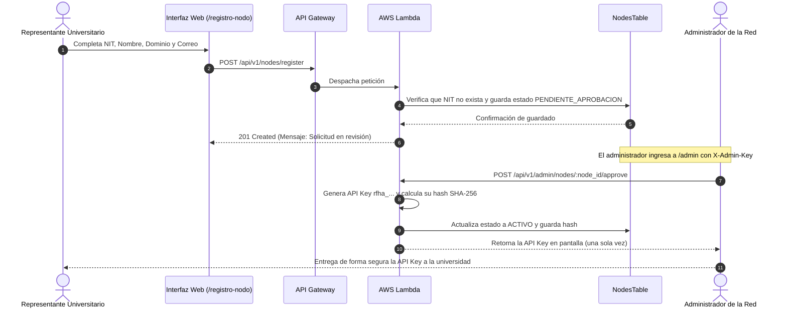

#### Explicación detallada del Flujo 1 para todo público:
1. **Paso 1 y 2:** El director de registro de una institución ingresa al portal público `/registro-nodo`. Escribe el NIT oficial, el nombre institucional, su dominio web y correo. Al pulsar "Registrar institución", el navegador empaqueta estos datos en formato JSON y los envía por HTTPS a API Gateway.
2. **Paso 3 y 4:** Lambda toma la petición y consulta en `NodesTable` si ese NIT ya estaba registrado. Si es nuevo, genera un código único de nodo (ej. `IES-8A3B1C4D`) y guarda la institución en estado `PENDIENTE_APROBACION`.
3. **Paso 5 y 6:** La pantalla le muestra al usuario un mensaje confirmando que su solicitud quedó radicada. En este punto, **la universidad aún no tiene acceso al sistema** ni puede consultar historiales.
4. **Paso 7:** El administrador general de la red entra a la consola privada `/admin`, ingresando su clave maestra (`X-Admin-Key`). La pantalla lista todas las solicitudes pendientes.
5. **Paso 8 y 9:** Al pulsar "Aprobar", Lambda genera una API Key secreta (ej. `rfha_8f9a2b3c4d5e...`), calcula su resumen matemático SHA-256 y guarda este resumen en `NodesTable` actualizando el estado de la universidad a `ACTIVO`.
6. **Paso 10 y 11:** La pantalla del administrador muestra la API Key por única vez en un recuadro verde con un botón de copiado. Esta clave se entrega formalmente a la universidad por canales seguros. A partir de ese segundo, el nodo está autorizado para operar.

---

### Flujo 2: Carga y Sincronización de Historiales con Generación Aleatoria (HU-03)

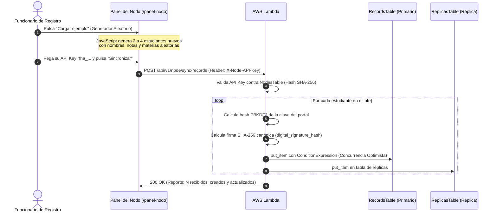

#### Explicación detallada del Flujo 2 para todo público:
1. **Paso 1 y 2:** El funcionario universitario entra a `/panel-nodo`. Para facilitar demostraciones en vivo sin repetir datos, la función JavaScript `generateExample()` genera en milisegundos entre 2 y 4 estudiantes completamente ficticios con nombres, cédulas, códigos, programas y asignaturas aleatorias (con notas reales entre 1.5 y 5.0).
2. **Paso 3 y 4:** El funcionario pega la API Key institucional de su universidad y presiona "Sincronizar historiales".
3. **Paso 5:** Lambda recibe el paquete de datos, toma la cabecera `X-Node-API-Key`, calcula su hash SHA-256 y verifica que la universidad esté activa. Si la clave es errónea, bloquea la petición al instante con HTTP 403.
4. **Paso 6 a 9:** Para cada estudiante recibido:
   * Aplica la función PBKDF2 a la contraseña inicial del estudiante (para que luego pueda entrar al portal).
   * Genera el sello criptográfico `digital_signature_hash` calculando el hash SHA-256 del contenido de las materias.
   * Guarda el expediente en `RecordsTable` bajo la clave `record_key(node_id, student_id)` aplicando **concurrencia optimista** (solo se guarda si la información en la base no es más reciente que la que se intenta subir).
   * Inmediatamente guarda una copia idéntica en `ReplicasTable` para asegurar tolerancia a fallos.
5. **Paso 10:** El panel web muestra un resumen confirmando cuántos registros fueron recibidos, cuántos fueron creados como nuevos y cuántos actualizados.

---

### Flujo 3: Emisión Soberana de Consentimiento por el Estudiante (HU-04)

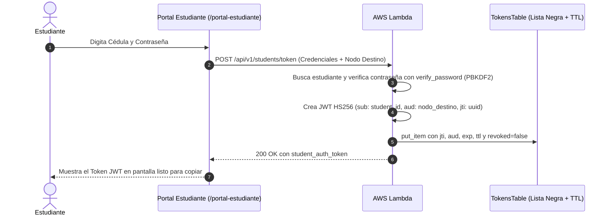

#### Explicación detallada del Flujo 3 para todo público:
1. **Paso 1 y 2:** El estudiante ingresa a `/portal-estudiante`. Escribe su número de documento y contraseña. La pantalla consulta automáticamente la lista de universidades activas mediante `GET /api/v1/nodes/active` para que el alumno elija en una lista desplegable a qué institución va a autorizar (ej. "Universidad Distrital").
2. **Paso 3:** Lambda busca el expediente del estudiante en la base de datos y ejecuta `verify_password()`. Este método calcula el hash PBKDF2 de la clave ingresada y lo compara en tiempo constante (*timing-safe comparison*) con el hash guardado, protegiendo al sistema contra hackers que intenten adivinar contraseñas midiendo el tiempo de respuesta.
3. **Paso 4:** Una vez autenticado, el sistema construye el pase digital (**JWT**): incluye quién es el estudiante (`sub`), qué universidad lo emitió (`origin`), a quién se le da permiso (`aud`), un identificador único al azar (`jti`) y la fecha de caducidad en 24 horas (`exp`). Lo sella con la clave simétrica `JWT_SECRET`.
4. **Paso 5:** Guarda una entrada en `TokensTable` con el atributo `revoked = false` y el atributo `ttl = exp`.
5. **Paso 6 y 7:** El portal del estudiante muestra el token codificado en un recuadro con un botón de copiado. El estudiante le entrega este texto a la universidad donde está haciendo su trámite de homologación o admisión.

---

### Flujo 4: Consulta Federada Interinstitucional con Validación de Audiencia (HU-06 y HU-07)

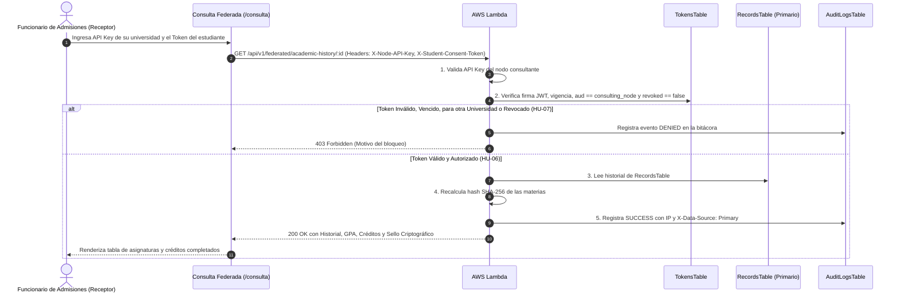

#### Explicación detallada del Flujo 4 para todo público:
1. **Paso 1 y 2:** El funcionario de admisiones de la universidad receptora ingresa a `/consulta`. Escribe el código del estudiante, la API Key de su propia universidad y pega el token de consentimiento entregado por el aspirante.
2. **Paso 3 y 4:** El servidor ejecuta dos controles perimetrales estrictos:
   * Comprueba que la universidad que consulta esté registrada y activa.
   * Abre el token JWT y valida que no haya vencido, que el campo de audiencia (`aud`) coincida con el código de la universidad que está haciendo la consulta, y revisa en `TokensTable` que el estudiante no haya cancelado el permiso.
3. **Rama de Bloqueo (HU-07):** Si el token fue emitido para otra universidad o ya venció, el servidor frena de inmediato la consulta, graba una alerta de seguridad (`DENIED`) en `AuditLogsTable` y responde un error HTTP 403 explicando el motivo.
4. **Rama Exitosa (HU-06):** Si todo está en orden, recupera el expediente desde `RecordsTable`, recalcula la firma matemática SHA-256 para asegurarse de que nadie haya alterado las notas en la base de datos, calcula automáticamente el promedio acumulado (GPA) y créditos aprobados, asienta el registro `SUCCESS` en auditoría y entrega los datos a la pantalla en una tabla clara y limpia.

---

### Flujo 5: Tolerancia a Fallos y Conmutación Automática a Réplica (HU-08)

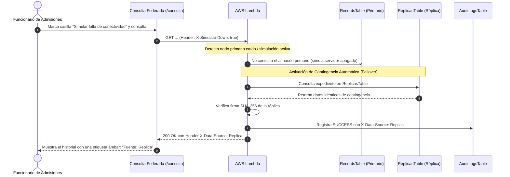

#### Explicación detallada del Flujo 5 para todo público:
1. **Paso 1 y 2:** Para demostrar la tolerancia a fallos en vivo sin tener que apagar servidores reales en pleno examen o sustentación, el usuario marca la casilla *"Simular falla de conectividad con el nodo de origen"* en `/consulta`. Esto añade la cabecera HTTP `X-Simulate-Down: true`.
2. **Paso 3 y 4:** El middleware en Lambda detecta la bandera de fallo (o una excepción real al contactar el almacén primario) y **hace caso omiso de la tabla primaria**, simulando que los servidores de la universidad de origen sufrieron un corte de energía o un ataque cibernético.
3. **Paso 5 y 6:** En lugar de mostrarle una pantalla de error al usuario, el algoritmo de conmutación por error (*Failover*) desvía la lectura en milisegundos hacia `ReplicasTable`. La réplica responde con la copia sincronizada del historial.
4. **Paso 7 y 8:** Se comprueba el sello de integridad SHA-256, se inyecta la cabecera `X-Data-Source: Replica` y se graba en `AuditLogsTable` que la consulta fue resuelta a través de la vía de contingencia.
5. **Paso 9 y 10:** El funcionario recibe el historial académico completo de inmediato, pero la interfaz le muestra una insignia visual de color ámbar advirtiendo que los datos provienen de la réplica de emergencia.

---

### Flujo 6: Revocación Inmediata de Consentimiento y Bitácora Forense (HU-05 y HU-09)

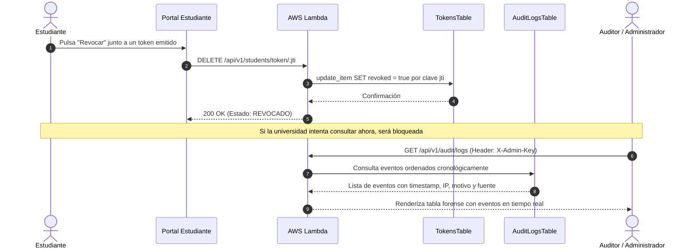

#### Explicación detallada del Flujo 6 para todo público:
1. **Paso 1 a 4:** Si el estudiante sospecha que una universidad ya completó su trámite y desea cerrarle el acceso antes de las 24 horas, entra a `/portal-estudiante` y presiona el botón rojo "Revocar" junto al token respectivo. Lambda ejecuta una actualización atómica en `TokensTable` marcando `revoked = true`.
2. **Efecto Inmediato:** A partir de ese mismo segundo, si cualquier funcionario intenta volver a usar ese token, el sistema lo expulsará con HTTP 403 Forbidden ("El token fue revocado por el estudiante").
3. **Paso 5 a 8:** El auditor de seguridad o el administrador entra a `/auditoria` con su clave maestra. Lambda consulta `AuditLogsTable` y sirve los eventos en tiempo real con cabeceras `Cache-Control: no-store` para garantizar que la pantalla muestre los datos frescos de este milisegundo, revelando quién consultó, a qué hora exacta, desde qué IP pública y si el acceso fue permitido o denegado.


---

## 30. Compendio Pedagógico Maestro: Explicación In-Situ en 4 Pasos de Todas las Tecnologías del Proyecto

Para erradicar de forma definitiva cualquier duda, sigla suelta o mención sin contexto, esta sección aplica de forma exhaustiva la **Fórmula de Explicación In-Situ en 4 Pasos** (1. Qué es en palabras simples, 2. Cómo funciona por dentro paso a paso, 3. Para qué sirve con analogía cotidiana, 4. Cómo y dónde se usa en este proyecto) para cada uno de los componentes, librerías, protocolos y algoritmos presentes en **RFHA-IES**.

---

### 30.1 Protocolos y Redes Explicados con la Fórmula de 4 Pasos

#### 1. TLS 1.3 (Transport Layer Security versión 1.3)
1. **Qué es en palabras simples:** Es el protocolo de seguridad criptográfica más avanzado del mundo para proteger las comunicaciones en internet.
2. **Cómo funciona por dentro:** Cuando el navegador del usuario se conecta a la aplicación, se ejecuta un "apretón de manos" (*TLS Handshake*) en milisegundos. El servidor presenta un certificado de identidad digital emitido por una entidad de confianza mundial; ambos computadores acuerdan mediante matemáticas de curvas elípticas una clave secreta temporal efímera y, a partir de ese instante, cada paquete de datos viaja transformado en bytes ilegibles utilizando el algoritmo simétrico AES-GCM de 256 bits.
3. **Para qué sirve (Analogía cotidiana):** Es exactamente igual que enviar una carta dentro de una caja fuerte blindada de titanio que viaja por el correo: aunque un ladrón intercepte el camión postal en la carretera, no puede abrir la caja ni espiar lo que dice la carta porque solo el destinatario legítimo tiene la combinación secreta.
4. **Cómo y dónde se usa en RFHA-IES:** **Amazon API Gateway** activa TLS 1.3 de forma obligatoria en la URL pública `https://ypybm0azfg.execute-api.us-east-2.amazonaws.com`. Asegura que cuando una universidad envíe su clave de acceso secreta (`X-Node-API-Key`) o un estudiante escriba su contraseña, nadie conectado a la misma red Wi-Fi o proveedor de internet pueda interceptar ni robar esa información confidencial.

#### 2. HTTPS (HyperText Transfer Protocol Secure)
1. **Qué es en palabras simples:** Es el canal seguro y estándar de internet para navegar y transferir información web protegida con candado de seguridad.
2. **Cómo funciona por dentro:** Toma el protocolo web tradicional (HTTP) y lo encapsula dentro del túnel blindado de TLS. Toda la información enviada (páginas web, formularios, cabeceras y notas académicas) se cifra antes de salir de la tarjeta de red del computador y solo se descifra cuando llega al destino.
3. **Para qué sirve (Analogía cotidiana):** Mientras que navegar por HTTP normal es como gritar tus secretos en medio de una plaza pública con un megáfono, navegar por HTTPS es como hablar mediante un teléfono rojo de línea privada blindada directamente con el presidente del banco.
4. **Cómo y dónde se usa en RFHA-IES:** Se aplica en el 100% de las rutas del sistema en `src/app/main.py`. Si alguien intentara conectarse por HTTP inseguro, el sistema o la infraestructura de AWS rechazan la conexión o exigen el canal seguro HTTPS.

#### 3. API REST (Representational State Transfer)
1. **Qué es en palabras simples:** Es un estilo arquitectónico de diseño de software que establece reglas claras y universales para que dos programas de computador dialoguen e intercambien información por internet sin importar en qué lenguaje estén programados.
2. **Cómo funciona por dentro:** Asigna a cada recurso del sistema una dirección web única (llamada URI o *Endpoint*) y utiliza los verbos universales de internet para indicar qué acción se desea ejecutar: `GET` para consultar datos, `POST` para guardar datos nuevos, `PATCH` para actualizar un dato existente y `DELETE` para eliminar o revocar un permiso.
3. **Para qué sirve (Analogía cotidiana):** Es como la ventanilla de atención al público de una notaría: en lugar de que los ciudadanos entren desordenadamente a los archivos a buscar expedientes, se acercan a la ventanilla 1 para radicar un documento (`POST`), a la ventanilla 2 para pedir una copia (`GET`) o a la ventanilla 3 para anular un poder (`DELETE`).
4. **Cómo y dónde se usa en RFHA-IES:** Todos los routers del backend en `src/app/routers/` (`nodes.py`, `admin.py`, `sync.py`, `students.py`, `federated.py`, `audit.py`) están estructurados como una API REST pura bajo el prefijo `/api/v1/`.

#### 4. JSON (JavaScript Object Notation)
1. **Qué es en palabras simples:** Es un formato estándar de texto muy ordenado, simple y ligero que usan las computadoras para estructurar y compartir listas de información.
2. **Cómo funciona por dentro:** Organiza los datos en parejas de "clave" y "valor" delimitadas por llaves y corchetes, por ejemplo: `{"nombre": "Laura", "materia": "Cálculo", "nota": 4.5}`. Cualquier lenguaje de programación moderno puede leer y crear este formato en microsegundos.
3. **Para qué sirve (Analogía cotidiana):** Es como un formulario impreso de aduanas donde cada casilla tiene su etiqueta clara: no hay confusión entre qué es el nombre del viajero, qué es su número de pasaporte y qué es el país de destino.
4. **Cómo y dónde se usa en RFHA-IES:** Es el vehículo de transporte de datos entre el navegador web, el servidor en Python y la base de datos DynamoDB. Todo el intercambio de historiales de estudiantes y respuestas de auditoría viaja codificado en JSON.

#### 5. Cabeceras HTTP (Headers)
1. **Qué son en palabras simples:** Son etiquetas y metadatos técnicos que viajan al principio de cada mensaje en internet para darle instrucciones al servidor sobre quién envía la petición o qué credenciales presenta.
2. **Cómo funcionan por dentro:** Son líneas de texto plano con formato `Nombre-Cabecera: Valor` que se transmiten antes del cuerpo del mensaje. El servidor las lee primero para decidir si permite el paso o expulsa al usuario antes de gastar memoria procesando datos.
3. **Para qué sirven (Analogía cotidiana):** Son como la estampilla, el sello de "Confidencial" y el documento de identidad grapados en la parte exterior del sobre de una carta formal.
4. **Cómo y dónde se usan en RFHA-IES:** Se usan para autenticación y señalización: `X-Node-API-Key` transporta la llave institucional de la universidad, `X-Student-Consent-Token` transporta el pase del alumno, `X-Admin-Key` transporta la clave de gobierno y `X-Data-Source` le indica al cliente si los datos vinieron del servidor primario o de la réplica de emergencia.

---

### 30.2 Criptografía y Seguridad Explicadas con la Fórmula de 4 Pasos

#### 1. Hash Criptográfico SHA-256 (Secure Hash Algorithm de 256 bits)
1. **Qué es en palabras simples:** Es una operación matemática irreversible que toma cualquier cantidad de texto o archivos y calcula una huella digital única de exactamente 64 caracteres alfanuméricos.
2. **Cómo funciona por dentro:** Procesa los datos de entrada bloque por bloque mediante operaciones matemáticas lógicas complejas (rotaciones de bits, sumas módulo 2^32 y operaciones XOR). Si cambias una sola letra de la entrada, la huella resultante cambia por completo (Efecto Avalancha). Es matemáticamente imposible hacer ingeniería inversa para recuperar los datos originales a partir de la huella.
3. **Para qué sirve (Analogía cotidiana):** Es como una máquina trituradora que convierte una fruta en un puré de composición química irrepetible. Viendo el puré puedes comprobar si era una manzana fresca, pero nadie en el universo puede volver a reconstruir la manzana entera a partir del puré triturado.
4. **Cómo y dónde se usa en RFHA-IES:** 
   * En `src/app/security.py` en la función `hash_api_key()`: las claves de las universidades nunca se guardan en texto claro en `NodesTable`; solo se almacena su hash para comparar igualdades.
   * En la función `record_signature()`: sella el historial académico de cada estudiante. Si un funcionario malicioso intentara alterar una nota de reprobada a aprobada en la base de datos, el hash SHA-256 no coincidiría y el sistema rechazaría la entrega por violación de integridad.

#### 2. JWT (JSON Web Token) firmado con Algoritmo HS256
1. **Qué es en palabras simples:** Es un pase de autorización digital compacto y seguro que viaja en forma de texto y que no puede ser alterado ni falsificado por nadie.
2. **Cómo funciona por dentro:** Está compuesto por tres bloques separados por puntos (`Header.Payload.Signature`) codificados en Base64URL. El algoritmo **HS256 (HMAC-SHA256)** toma el encabezado y los datos del pase, los combina con una clave secreta que solo el servidor conoce (`JWT_SECRET`) y genera un sello criptográfico matemático infalsificable. Si un usuario intenta modificar su nombre o cambiar la fecha de vencimiento en el texto, el sello de la firma deja de coincidir y el servidor lo expulsa inmediatamente.
3. **Para qué sirve (Analogía cotidiana):** Es exactamente igual que un cheque de gerencia bancario emitido en papel de seguridad con sello de agua y firma autorizada: cualquier persona puede leer a quién va dirigido el dinero, pero nadie puede alterar la cifra escrita porque el cajero del banco detectaría de inmediato que el sello fue adulterado.
4. **Cómo y dónde se usa en RFHA-IES:** En `src/app/tokens.py` mediante la librería `PyJWT`. La función `issue_token()` crea el pase de consentimiento cuando el estudiante autoriza una consulta, y la función `verify_token()` valida que la firma sea legítima, que no haya vencido y que no haya sido cancelado por el alumno.

#### 3. El Claim de Audiencia (`aud`) en el Token JWT
1. **Qué es en palabras simples:** Es un campo obligatorio dentro del pase digital que especifica con nombre y código institucional exacto a qué universidad se le otorgó el permiso de consulta.
2. **Cómo funciona por dentro:** Al decodificar el token con `jwt.decode(..., audience=nodo_consultante)`, la librería comprueba que el valor de la etiqueta `aud` dentro del JSON coincida exactamente con el código del nodo que está haciendo la petición. Si no coinciden, se lanza una excepción `InvalidAudienceError`.
3. **Para qué sirve (Analogía cotidiana):** Es como un boleto de avión nominativo intransferible que dice: *"Válido únicamente para abordar el vuelo 204 de la aerolínea Avianca"*. Si el pasajero intenta subirse a un avión de LATAM con ese mismo boleto, la azafata lee el boleto y le impide abordar porque ese boleto no tiene autorización para esa aerolínea.
4. **Cómo y dónde se usa en RFHA-IES:** En `src/app/tokens.py` y `src/app/routers/federated.py`. Garantiza el principio de consentimiento estricto: si un estudiante autorizó a la Universidad Distrital (`aud: "IES-2222BBBB"`), ninguna otra institución (como la Universidad Nacional o la de los Andes) podrá utilizar ese token para espiar el historial académico del estudiante.

#### 4. Cifrado en Reposo AES-256 (Advanced Encryption Standard de 256 bits)
1. **Qué es en palabras simples:** Es el algoritmo matemático de cifrado simétrico por bloques más robusto del planeta, aprobado internacionalmente para resguardar secretos de estado y transacciones financieras.
2. **Cómo funciona por dentro:** Toma bloques de datos de 128 bits y aplica múltiples rondas sucesivas de transformaciones matemáticas complejas (sustitución de bytes, desplazamiento de filas, mezcla de columnas y adición de claves derivadas de 256 bits). Para descifrarlo por fuerza bruta sin la clave, una supercomputadora tardaría miles de millones de años.
3. **Para qué sirve (Analogía cotidiana):** Es como guardar los libros contables de una empresa dentro de una bóveda de banco subterránea protegida por puertas de aleación de acero: aunque un intruso logre colarse físicamente al sótano del edificio, es incapaz de perforar la puerta de la bóveda para leer los libros.
4. **Cómo y dónde se usa en RFHA-IES:** En las 5 tablas físicas de **Amazon DynamoDB** (`NodesTable`, `RecordsTable`, `ReplicasTable`, `TokensTable`, `AuditLogsTable`). AWS aplica este cifrado de forma transparente mediante el servicio de gestión de llaves **AWS KMS**, asegurando que los discos de almacenamiento físico en los centros de datos estén protegidos contra cualquier robo o lectura no autorizada.

#### 5. Hash con Sal PBKDF2 (Password-Based Key Derivation Function 2)
1. **Qué es en palabras simples:** Es un algoritmo criptográfico diseñado específicamente para resguardar contraseñas de usuarios de forma ultra-segura, haciendo extremadamente lento y costoso cualquier intento de ataque informático por fuerza bruta.
2. **Cómo funciona por dentro:** Toma la contraseña escrita por el estudiante, le añade una cadena aleatoria única de 16 bytes llamada "sal" (*Salt*) y aplica el algoritmo HMAC-SHA256 en un bucle repetitivo de **100.000 iteraciones**. Esto genera un texto final estructurado como `pbkdf2_sha256$100000$sal$digest`. Al tardar unos milisegundos intencionales por cada intento, bloquea a los programas de hackers que intentan adivinar millones de contraseñas por segundo.
3. **Para qué sirve (Analogía cotidiana):** Es como ponerle a la puerta de entrada una cerradura especial que exige girar la llave 100.000 veces con combinaciones variables antes de abrir: a un usuario legítimo le toma un instante entrar, pero a un ladrón que quiera probar todas las llaves posibles le tomaría siglos abrir la puerta.
4. **Cómo y dónde se usa en RFHA-IES:** En `src/app/security.py` en las funciones `hash_password()` y `verify_password()`. Protege la contraseña que el estudiante utiliza para ingresar a su portal en `/portal-estudiante`.

---

### 30.3 Servicios de la Nube AWS Explicados con la Fórmula de 4 Pasos

#### 1. Computación Serverless (Arquitectura sin Servidor)
1. **Qué es en palabras simples:** Es una forma moderna de construir aplicaciones en la nube donde los desarrolladores no tienen que alquilar, encender, vigilar ni actualizar computadores físicos ni sistemas operativos. La nube se encarga de todo.
2. **Cómo funciona por dentro:** El código se empaqueta en pequeños módulos que duermen apagados. Cuando un usuario en internet hace clic y envía una petición, la nube despierta un entorno de ejecución en milisegundos, procesa la solicitud, responde y vuelve a apagarse. La empresa solo paga por la fracción exacta de segundo que duró el cómputo.
3. **Para qué sirve (Analogía cotidiana):** Es como la red de agua potable de una ciudad: no tienes que construir un pozo propio ni mantener bombas de agua encendidas en tu patio todo el día; simplemente abres el grifo, sale agua al instante, llenas tu vaso, cierras el grifo y la empresa de acueducto solo te cobra los litros exactos que consumiste.
4. **Cómo y dónde se usa en RFHA-IES:** Toda la aplicación está desplegada bajo este modelo usando **AWS Lambda** y **API Gateway**. Esto permite que el sistema opere con costo de cero dólares cuando nadie está en el portal, y pueda atender a miles de estudiantes en época de inscripciones sin colapsar.

#### 2. Amazon API Gateway (HTTP API v2)
1. **Qué es en palabras simples:** Es el servicio de Amazon que funciona como la puerta de acceso oficial y el recepcionista para todo el tráfico de internet que llega a la aplicación.
2. **Cómo funciona por dentro:** Escucha de forma permanente en una dirección de internet segura con certificado TLS administrado. Cuando llega una petición HTTP (por ejemplo `GET /api/v1/nodes/active`), valida el formato, comprueba que la conexión sea segura y canaliza la solicitud hacia la función Lambda correspondiente.
3. **Para qué sirve (Analogía cotidiana):** Es como el recepcionista de un hospital de alta seguridad: recibe a todas las personas en la puerta principal, revisa que no lleven objetos prohibidos y dirige a cada paciente al consultorio médico que le corresponde.
4. **Cómo y dónde se usa en RFHA-IES:** Gestiona la URL pública `https://ypybm0azfg.execute-api.us-east-2.amazonaws.com` y redirige todas las rutas hacia la función Lambda del proyecto usando la integración proxy `/{proxy+}`.

#### 3. AWS Lambda
1. **Qué es en palabras simples:** Es el servicio de computación bajo demanda de Amazon que ejecuta el código del backend en milisegundos sin requerir servidores dedicados.
2. **Cómo funciona por dentro:** Cuando API Gateway le envía un evento, Lambda descarga el código de la aplicación en un micro-contenedor ultraligero y aislado (tecnología *Firecracker*), ejecuta el intérprete de Python 3.12, le entrega la petición a la librería `Mangum` y retorna la respuesta en menos de 20 milisegundos.
3. **Para qué sirve (Analogía cotidiana):** Es como un ejército de traductores profesionales que esperan en silencio en una oficina: si llega un cliente que habla francés, un traductor se levanta, traduce la conversación en dos minutos y vuelve a sentarse; si de pronto llegan 100 clientes al mismo tiempo, 100 traductores se levantan simultáneamente para atenderlos a todos en paralelo sin hacerlos esperar en fila.
4. **Cómo y dónde se usa en RFHA-IES:** En `src/app/main.py` se define la variable `handler = Mangum(app, lifespan="off")`, que es el punto exacto de entrada que AWS Lambda invoca para ejecutar la lógica de FastAPI.

#### 4. Amazon DynamoDB (Base de Datos NoSQL Distribuida)
1. **Qué es en palabras simples:** Es el motor de base de datos no relacional de Amazon diseñado para guardar y consultar volúmenes masivos de datos en milisegundos sin importar cuántos usuarios estén conectados al tiempo.
2. **Cómo funciona por dentro:** Almacena la información en formato de documentos o fichas JSON. Utiliza una clave especial llamada *Partition Key* para calcular matemáticamente en qué disco duro exacto de su clúster mundial debe guardar o leer la ficha, logrando tiempos de respuesta de un solo dígito de milisegundos sin hacer búsquedas lentas en tablas gigantes.
3. **Para qué sirve (Analogía cotidiana):** Es como un archivador automatizado de alta tecnología con millones de cajones numerados: si llegas con el número exacto del cajón en la mano, un brazo robótico extrae tu carpeta en medio segundo, sin tener que revisar los millones de cajones restantes.
4. **Cómo y dónde se usa en RFHA-IES:** Mediante la librería oficial `boto3` en `src/app/repositories.py`, DynamoDB almacena las 5 tablas oficiales del proyecto (`NodesTable`, `RecordsTable`, `ReplicasTable`, `TokensTable` y `AuditLogsTable`).

#### 5. Time To Live (TTL en DynamoDB)
1. **Qué es en palabras simples:** Es una función automática de la base de datos que elimina por sí sola los registros viejos o vencidos sin que ningún programador tenga que borrarlos manualmente.
2. **Cómo funciona por dentro:** Cada vez que se guarda un dato, se incluye un número entero que representa la fecha y hora exacta de vencimiento en segundos Unix (ej. `1763424000`). Un proceso en segundo plano de DynamoDB compara continuamente el reloj mundial con ese número; si la fecha ya pasó, el registro se elimina del disco duro de forma silenciosa y gratuita.
3. **Para qué sirve (Analogía cotidiana):** Es como los alimentos perecederos en un supermercado con fecha de vencimiento impresa: cuando el producto caduca, un empleado lo retira automáticamente de la estantería para que nadie compre comida en mal estado y el estante quede libre para productos frescos.
4. **Cómo y dónde se usa en RFHA-IES:** En `TokensTable` sobre el atributo `ttl`. Asegura que los tokens de consentimiento de los estudiantes desaparezcan de la base de datos después de 24 horas, garantizando que el sistema no acumule basura digital (principio de neguentropía en Teoría General de Sistemas).

#### 6. Boto3 (SDK Oficial de AWS para Python)
1. **Qué es en palabras simples:** Es la librería de programación oficial creada por Amazon para que los programas escritos en Python puedan dar órdenes, guardar datos y comunicarse con todos los servicios de AWS.
2. **Cómo funciona por dentro:** Construye peticiones HTTP seguras, firma digitalmente cada mensaje con las credenciales secretas de AWS mediante el protocolo criptográfico *Signature Version 4 (SigV4)* y traduce las respuestas de DynamoDB a diccionarios nativos de Python.
3. **Para qué sirve (Analogía cotidiana):** Es como el cable conector universal y el control remoto que une el televisor con el sistema de sonido: permite que dos aparatos de marcas distintas dialoguen y se entiendan perfectamente al presionar un botón.
4. **Cómo y dónde se usa en RFHA-IES:** En `src/app/repositories.py` en la función `_dynamo_table()`: ejecuta `import boto3` y crea el objeto `boto3.resource("dynamodb").Table(name)` para realizar lecturas (`get_item`), escrituras (`put_item`) y actualizaciones (`update_item`).

#### 7. Mangum (Adaptador Serverless para FastAPI)
1. **Qué es en palabras simples:** Es una pequeña librería de software que funciona como un "adaptador de corriente universal" entre AWS Lambda y el framework FastAPI.
2. **Cómo funciona por dentro:** AWS Lambda entrega los datos de internet en un formato de evento JSON propietario de Amazon. Mangum intercepta ese evento JSON, lo transforma en una petición web estándar de Python (llamada especificación ASGI) para que FastAPI la procese sin problemas y, al terminar, toma la respuesta de FastAPI y la vuelve a empaquetar en el formato que AWS API Gateway espera recibir.
3. **Para qué sirve (Analogía cotidiana):** Es exactamente igual que el adaptador de enchufe que compras cuando viajas de Colombia a Europa o Estados Unidos: las tomas de corriente en la pared tienen orificios diferentes a las clavijas de tu cargador de celular; el adaptador no cambia la electricidad, simplemente ajusta la forma física para que la energía fluya sin cortocircuitos.
4. **Cómo y dónde se usa en RFHA-IES:** En `src/app/main.py` en la línea `handler = Mangum(app, lifespan="off")`. Sin esta línea, la aplicación en FastAPI sería incapaz de entender las peticiones enviadas por Amazon API Gateway en la nube.

---

### 30.4 Conceptos Teóricos de Sistemas Distribuidos Explicados con la Fórmula de 4 Pasos

#### 1. Nodos Autónomos y Desacoplamiento
1. **Qué es en palabras simples:** Significa que cada universidad de la red es una entidad independiente y soberana que tiene sus propios sistemas, sus propios funcionarios y sus propias claves, sin depender jerárquicamente de las demás.
2. **Cómo funciona por dentro:** Cada universidad recibe una API Key criptográfica exclusiva. El sistema valida la identidad de la universidad directamente desde esa clave (`node["node_id"]` en el backend) y le prohíbe tocar o modificar registros que no le pertenezcan. Las universidades se comunican exclusivamente mediante mensajes estructurados a través de la red, sin compartir memoria ni bases de datos internas.
3. **Para qué sirve (Analogía cotidiana):** Es como el sistema bancario de cajeros automáticos: el Banco de Bogotá y Bancolombia son entidades totalmente independientes y rivales que guardan su dinero en bóvedas separadas, pero gracias a una red compartida (como Redeban o Servibanca) un usuario puede retirar dinero en cualquier cajero sin que un banco tenga que abrirle sus libros contables secretos al otro.
4. **Cómo y dónde se usa en RFHA-IES:** Cada universidad aprobada en `NodesTable` opera como un nodo autónomo que sincroniza historiales en su propia isla de datos lógica en `RecordsTable`.

#### 2. Middleware y Plano de Control Federado
1. **Qué es en palabras simples:** Es el árbitro neutral o software mediador que se sitúa en el centro de la red para coordinar el intercambio seguro de información entre instituciones que no confían ciegamente entre sí.
2. **Cómo funciona por dentro:** Recibe las peticiones de las universidades, intercepta las cabeceras de autorización, valida que el estudiante haya otorgado su consentimiento mediante un token JWT infalsificable, decide de qué tabla extraer la información (primaria o réplica) y audita cada movimiento antes de entregar los datos.
3. **Para qué sirve (Analogía cotidiana):** Es como un juez notario en la firma de una compraventa de una vivienda: el comprador no le entrega el dinero al vendedor en la calle ni el vendedor le entrega las escrituras a ciegas; ambos van ante el notario neutral, quien revisa los documentos, confirma la identidad de ambas partes, autoriza la transacción y estampa su sello en el libro notarial.
4. **Cómo y dónde se usa en RFHA-IES:** Toda la aplicación en FastAPI (`src/app/main.py` y sus routers) cumple exactamente el rol de middleware federado, conectando a las universidades participantes sin que ninguna sea dueña de la infraestructura central.

#### 3. Tolerancia a Fallos y Conmutación Automática por Error (Failover)
1. **Qué es en palabras simples:** Es la capacidad que tiene el sistema de seguir funcionando sin interrumpir el servicio al usuario, incluso si uno de los computadores principales sufre un apagón, un daño en el disco duro o una desconexión de red.
2. **Cómo funciona por dentro:** En `src/app/routers/federated.py` (L.100-114), el código intenta leer el historial del estudiante en la tabla primaria `RecordsTable`. Si la lectura arroja un error, se agota el tiempo de espera o el usuario envía la cabecera de simulación `X-Simulate-Down: true`, el software detecta la anomalía en microsegundos y desvía la consulta de forma transparente hacia la tabla de respaldo `ReplicasTable`, respondiendo con la réplica y añadiendo la cabecera `X-Data-Source: Replica`.
3. **Para qué sirve (Analogía cotidiana):** Es como el generador eléctrico de emergencia a base de diésel en un hospital de alta complejidad: si una tormenta derriba los cables de la luz de la ciudad y la energía principal se corta, el generador auxiliar arranca en dos segundos manteniendo encendidas las máquinas de cirugía y los respiradores sin que los cirujanos tengan que suspender la operación.
4. **Cómo y dónde se usa en RFHA-IES:** Cumple con la Historia de Usuario HU-08. Garantiza que si la Universidad Nacional sufre una caída en sus servidores locales o en su almacén primario, la Universidad Distrital pueda consultar el historial del estudiante desde la réplica autorizada sin rechazar su trámite de homologación.

#### 4. Consistencia Eventual y el Teorema CAP (Modelo AP)
1. **Qué es en palabras simples:** El Teorema CAP es una ley matemática de la informática que dice que ningún sistema distribuido puede tener al mismo tiempo Consistencia Inmediata (C), Disponibilidad Total (A) y Tolerancia a Cortes de Red (P). RFHA-IES elige el modelo **AP (Disponibilidad y Tolerancia a Particiones)** con *Consistencia Eventual*.
2. **Cómo funciona por dentro:** En lugar de congelar y bloquear todo el sistema cuando un nodo se desconecta esperando a que vuelva a revivir, el sistema prefiere seguir disponible respondiendo con la réplica autorizada de contingencia. La "consistencia eventual" significa que si la universidad de origen actualizó una nota hace 5 minutos y se cayó la red antes de sincronizar la réplica, la réplica entregará la última versión guardada con éxito, y en cuanto la conexión se restablezca y el nodo vuelva a sincronizar, ambas bases de datos volverán a quedar exactamente idénticas.
3. **Para qué sirve (Analogía cotidiana):** Es como consultar el saldo bancario en una libreta de ahorros física sellada por el banco: si el sistema central de computadores del banco se cae momentáneamente, el cajero humano revisa la libreta física sellada ayer y te autoriza un retiro de emergencia porque es el último estado registrado oficialmente, en lugar de cerrarte la puerta en la cara y decirte que no puedes comer hoy porque se cayó el sistema.
4. **Cómo y dónde se usa en RFHA-IES:** Se evidencia en el router `src/app/routers/sync.py` (donde se actualizan secuencialmente `RecordsTable` y `ReplicasTable`) y en `federated.py` (donde se prioriza la entrega de datos desde la réplica antes que emitir un fallo general del sistema).

#### 5. Concurrencia Optimista con Expresión Condicional (ConditionExpression)
1. **Qué es en palabras simples:** Es una técnica para evitar que dos funcionarios de una misma universidad que están subiendo notas al mismo tiempo sobreescriban por accidente la información de un alumno con datos desactualizados, sin necesidad de bloquear la base de datos con candados lentos.
2. **Cómo funciona por dentro:** En `src/app/repositories.py` en el método `upsert()`, se utiliza la funcionalidad nativa de DynamoDB `ConditionExpression = Attr("record_key").not_exists() | Attr("synced_at").lte(new_synced_at)`. La base de datos revisa antes de guardar: si el registro que ya está en el disco tiene una fecha de sincronización más nueva que la que se intenta subir, la base de datos aborta la escritura y lanza una excepción de colisión (`ConditionalCheckFailedException`), que el backend convierte en un error HTTP 409 Conflict.
3. **Para qué sirve (Analogía cotidiana):** Es como un semáforo inteligente en un cruce estrecho: dos autos llegan al mismo tiempo, el semáforo evalúa cuál tiene prioridad y le da paso al auto correcto, evitando que los dos choquen de frente en medio de la vía.
4. **Cómo y dónde se usa en RFHA-IES:** Resuelve de raíz el **Hallazgo Crítico SD-01**. Evita colisiones de datos concurrentes cuando múltiples procesos institucionales sincronizan historiales masivos al mismo tiempo.

#### 6. Service Registry (Directorio Dinámico de Nodos)
1. **Qué es en palabras simples:** Es una guía telefónica o catálogo digital centralizado donde los nodos activos de la red publican su información básica para que los demás puedan saber quiénes están disponibles.
2. **Cómo funciona por dentro:** El endpoint público `GET /api/v1/nodes/active` en `src/app/routers/nodes.py` consulta `NodesTable` con el filtro `status = "ACTIVO"`. Retorna una lista JSON limpia con el código (`node_id`) y el nombre oficial de cada universidad autorizada, ocultando correos, llaves y datos internos.
3. **Para qué sirve (Analogía cotidiana):** Es como la lista de contactos verificados en una aplicación de mensajería como WhatsApp: antes de enviarle un mensaje a alguien, la aplicación te muestra únicamente los contactos reales que tienen una cuenta activa y verificada para que no le envíes datos a números equivocados o dados de baja.
4. **Cómo y dónde se usa en RFHA-IES:** Resuelve el **Hallazgo Crítico SD-03**. El portal del estudiante (`src/app/static/portal-estudiante.js`) consulta este registro automáticamente al cargar la pantalla, llenando la lista desplegable para que el alumno elija con nombre propio a qué universidad desea autorizar.

#### 7. Bitácora Distribuida Inmutable de Auditoría
1. **Qué es en palabras simples:** Es un libro contable digital de seguridad donde cada acción, consulta o bloqueo queda grabado para siempre, y en el que está terminantemente prohibido borrar o alterar cualquier página del pasado.
2. **Cómo funciona por dentro:** Cada vez que se consulta la API federada, la función `_log()` en `src/app/routers/federated.py` genera un identificador único `AUDIT-XXXXXXXXXXXX` y ejecuta un `put_item` en `AuditLogsTable`. La política de seguridad IAM de AWS le prohíbe de forma tajante a la función Lambda las operaciones `DeleteItem` y `UpdateItem` sobre esta tabla. Nadie en el mundo posee permisos para borrar una línea de la bitácora.
3. **Para qué sirve (Analogía cotidiana):** Es como el libro de actas notariadas o la caja negra indestructible de un avión: cada minuto queda registrado con tinta imborrable; si ocurre un incidente, los investigadores pueden reconstruir segundo a segundo qué pasó sin que nadie pueda arrancar hojas del libro para ocultar sus acciones.
4. **Cómo y dónde se usa en RFHA-IES:** Cumple con la Historia de Usuario HU-09. Alimenta la pantalla `/auditoria` para que administradores y universidades puedan auditar quién consultó a un estudiante, a qué hora exacta, desde qué dirección IP y con qué resultado de seguridad.


---

## 31. PASO 1: Introducción Exhaustiva para Todo Público y Análisis Profundo de la Arquitectura General

Esta sección ha sido redactada bajo el principio innegociable de que cualquier persona que jamás haya estudiado computación ni redes pueda entender el 100% de la plataforma, comprendiendo cada problema humano que resuelve, cada tecnología que interviene y el viaje milisegundo a milisegundo de la información.

### 31.1 El Problema Humano y la Solución de RFHA-IES

En el sistema universitario tradicional de América Latina, cuando un estudiante de pregrado o posgrado decide cambiarse de institución, realizar una transferencia o convalidar materias cursadas en otra ciudad, se enfrenta a una verdadera odisea burocrática. El alumno debe acudir físicamente a la ventanilla de Admisiones y Registro de su universidad de origen, solicitar un certificado impreso en papel membretado con firmas manuscritas y sellos de tinta, esperar semanas o meses a que el documento sea expedido, pagar derechos pecuniarios y luego trasladar físicamente ese papel hacia la universidad receptora. Este modelo no solo consume tiempo y dinero de las familias, sino que somete a la universidad receptora al riesgo de fraude académico y falsificación documental, obligándola a cruzar oficios de verificación física que demoran aún más la admisión.

Para erradicar este problema de raíz nació **RFHA-IES (Red Federada de Historiales Académicos para Instituciones de Educación Superior)**. Se trata de una plataforma tecnológica distribuida en la nube diseñada para conectar a múltiples universidades en una red de cooperación digital automática, segura y transparente. A través de este sistema, las universidades autorizadas pueden consultar las notas de un estudiante proveniente de otra institución en cuestión de milisegundos a través de internet, eliminando para siempre el papel y las esperas burocráticas.

Sin embargo, el reto principal de este sistema era garantizar que ninguna universidad pudiera espiar las notas de los alumnos de otra institución sin su consentimiento. Por esta razón, **RFHA-IES** fue diseñado bajo el principio sagrado de la **soberanía del estudiante**: el alumno es el único y exclusivo dueño de sus calificaciones académicas. Aunque las universidades participen en la misma red, ninguna institución tiene permiso técnico para abrir el expediente de un alumno a menos que el propio estudiante ingrese a su portal digital privado y genere un pase de autorización temporal con firma criptográfica que especifica con nombre propio a qué universidad le permite ver sus notas y durante cuánto tiempo exacto.

Para entender el funcionamiento global sin tecnicismos, imaginemos un sistema de casilleros de máxima seguridad en una terminal internacional de transporte. La universidad de origen actúa como la notaría oficial que certifica que el estudiante cursó las asignaturas con calificaciones legítimas y coloca una copia sellada dentro de un casillero digital blindado. La universidad receptora es el funcionario que necesita verificar los antecedentes académicos para autorizar la matrícula. Entre ambos se sitúa el guardia de seguridad neutral (**el Middleware en AWS**), quien vigila la entrada al casillero y exige dos documentos innegociables: primero, la credencial oficial que certifica que la universidad solicitante es una entidad de educación superior legítima y aprobada; y segundo, una carta de autorización firmada digitalmente por el estudiante que dice: *"Autorizo exclusivamente a la Universidad Distrital a ver mis materias durante las próximas 24 horas"*. Si falta alguno de los dos requisitos, el guardia bloquea la entrada al instante y anota la hora y la identidad del infractor en el libro de visitas para que quede constancia pública.

---

### 31.2 Análisis Exhaustivo de la Arquitectura General (Capa por Capa y Flecha por Flecha)

Para desmenuzar con absoluta claridad técnica cómo interactúa cada pieza de software y hardware en la nube, analizaremos en detalle el diagrama general de la arquitectura, explicando qué significa cada bloque rectangular, qué viaja a través de cada flecha y qué transformaciones físicas y lógicas sufre la información durante el proceso.

El primer bloque fundamental de la arquitectura lo componen los **Nodos IES (Universidades Participantes)**, representados en el diagrama por la Universidad A y la Universidad B. Cada uno de estos bloques no es un simple programa de computador, sino una institución educativa autónoma que posee sus propios servidores locales, su propio personal administrativo y sus propias bases de datos académicas internas (lo que en las universidades se conoce comúnmente como el sistema SIA o ERP institucional). Estos nodos se consideran "desacoplados" e "independientes" porque no comparten memoria física ni están subordinados jerárquicamente a las demás instituciones. Cuando una universidad se conecta a la red, utiliza un navegador web estándar mediante computadores de oficina conectados a internet, interactuando con las pantallas del sistema (como el panel del nodo `/panel-nodo` o el módulo de consulta `/consulta`) desarrolladas en HTML5, CSS3 y JavaScript nativo sin necesidad de instalar software pesado adicional.

La primera línea de flechas que conecta a las universidades con el sistema representa la frontera de red y el canal de comunicación exterior. Cuando la Universidad A envía un lote de calificaciones mediante la flecha rotulada con `POST /api/v1/node/sync-records`, o cuando la Universidad B realiza una búsqueda mediante `GET /api/v1/federated/academic-history/{id}`, la información sale de la tarjeta de red del computador y viaja a través de los cables submarinos y proveedores de internet del mundo encapsulada bajo el protocolo **HTTPS (HyperText Transfer Protocol Secure)**. Esto significa que la comunicación viaja protegida mediante **TLS 1.3 (Transport Layer Security versión 1.3)**, un estándar criptográfico internacional que funciona creando un túnel matemático impenetrable entre el navegador del funcionario y la nube de Amazon Web Services. Es exactamente como enviar un documento dentro de un camión blindado con cerradura biométrica: aunque un atacante intercepte los cables de fibra óptica o espíe la red Wi-Fi, únicamente verá cadenas de números y letras completamente aleatorias e indescifrables.

El segundo gran bloque de la arquitectura es el **Middleware RFHA-IES**, desplegado íntegramente en la región física `us-east-2` de Amazon Web Services (ubicada en Ohio, Estados Unidos). Este middleware es el "árbitro neutral" y el cerebro mediador del sistema. El primer componente que recibe el impacto del tráfico de internet es **Amazon API Gateway (HTTP API v2)**. API Gateway funciona como la recepción o la puerta giratoria de entrada de un edificio corporativo inteligente: recibe las conexiones cifradas de internet, verifica que el certificado digital TLS sea válido, comprueba que la dirección web solicitada exista dentro de las rutas oficiales de la aplicación y canaliza la solicitud hacia la capa de cómputo en menos de cinco milisegundos, protegiendo a los servidores internos contra ataques de denegación de servicio o intentos de saturación masiva.

Inmediatamente detrás de API Gateway se encuentra el motor de procesamiento: **AWS Lambda**. Lambda representa el paradigma de computación **Serverless (sin servidor)**, lo que significa que los ingenieros del proyecto no tienen que comprar computadores físicos, ni instalar sistemas operativos Windows o Linux, ni pagar electricidad por servidores encendidos en la madrugada. En su lugar, el código programado en el lenguaje **Python 3.12** duerme en los discos de Amazon sin consumir recursos. En el instante exacto en que API Gateway le pasa una petición de un usuario, Amazon despierta un micro-contenedor ultraligero y aislado basado en tecnología de micro-máquinas virtuales (*Firecracker*) en cuestión de diez milisegundos. Dentro de este micro-contenedor se encuentra **FastAPI**, un framework de programación asíncrono para Python que valida las reglas de negocio, y la librería **Mangum**, que actúa como un adaptador de corriente universal traduciendo los eventos crudos de la nube de Amazon a peticiones comprensibles para FastAPI.

El tercer componente central del middleware es el plano de almacenamiento persistente: **Amazon DynamoDB**. A diferencia de las bases de datos relacionales tradicionales como MySQL o PostgreSQL (que organizan todo en pesadas tablas con filas y columnas rígidas y sufren caídas de rendimiento cuando hay millones de registros conectados simultáneamente), DynamoDB es una base de datos distribuida de tipo NoSQL orientada a documentos y clave-valor. Esto significa que almacena cada expediente como una ficha estructurada en formato **JSON (JavaScript Object Notation)**, asociándole una clave de partición única llamada **Partition Key**. Mediante esta clave, DynamoDB utiliza algoritmos matemáticos de dispersión para localizar en qué disco duro exacto de sus centros de cómputo está guardado el historial en menos de diez milisegundos de forma constante, garantizando que el sistema responda con la misma velocidad ya sea que tenga diez estudiantes o diez millones de estudiantes registrados.

El bloque inferior del diagrama modela a los **Actores Externos del Sistema**, que son los seres humanos que interactúan con la plataforma: el **Estudiante** y el **Administrador**. El estudiante accede desde su teléfono móvil o computador personal a la ruta web `/portal-estudiante` y envía sus credenciales mediante una flecha rotulada como `POST /api/v1/students/token`. Su interacción es vital porque es el único actor autorizado para dar la orden de generar el pase digital (**JWT - JSON Web Token**). Por su parte, el Administrador de la Red representa al oficial de seguridad y gobernanza que accede a `/admin` portando una clave maestra secreta llamada `X-Admin-Key` a través de la flecha `PATCH /api/v1/admin/nodes/{id}/approve` para evaluar la legitimidad jurídica de las universidades antes de autorizar su ingreso a la red federada.

Finalmente, las flechas bidireccionales que conectan a **AWS Lambda** con **DynamoDB** representan el intercambio interno de datos que ocurre dentro de la red privada segura de Amazon. Para dialogar con DynamoDB, el código en Python utiliza la librería oficial de Amazon llamada **Boto3 (SDK oficial de AWS para Python)**. Boto3 se encarga de empaquetar las consultas de lectura (`get_item`), las inserciones de nuevos registros (`put_item`) y las actualizaciones de estado (`update_item`), firmando cada mensaje digitalmente con credenciales criptográficas internas gestionadas por el servicio **IAM (Identity and Access Management de AWS)**. Este diseño garantiza que nadie fuera del micro-contenedor de Lambda pueda acceder directamente a las bases de datos, blindando la integridad de los expedientes frente a cualquier intento de intrusión exterior.


---

## 32. PASO 2: Narración Exhaustiva de los 6 Flujos de la Aplicación Paso a Paso para Todo Público

Esta sección describe en detalle los seis procedimientos operativos que dan vida a **RFHA-IES**, explicando qué sucede en la vida real, cómo interactúan las personas con las pantallas y qué transformaciones criptográficas y lógicas ejecuta el código en cada milisegundo.

---

### 32.1 Flujo 1: Registro Institucional, Verificación Jurídica y Emisión de API Key (HU-01 y HU-02)

El primer flujo de la red federada es el proceso mediante el cual una nueva universidad ingresa a formar parte del ecosistema de confianza interinstitucional. En el mundo real, no cualquier entidad o individuo puede enviar expedientes académicos ni consultar notas ajenas; se requiere un proceso formal de admisión y entrega de credenciales criptográficas seguras.

El procedimiento se inicia cuando el director de admisiones o el rector de una universidad interesada abre su navegador web y accede a la dirección pública en la ruta `/registro-nodo`. En esa pantalla (gestionada por el archivo `src/app/static/registro-nodo.html`), el funcionario diligencia un formulario estructurado con cuatro datos obligatorios: el Número de Identificación Tributaria oficial (**NIT**), la razón social de la institución (por ejemplo *"Universidad Distrital Francisco José de Caldas"*), el dominio oficial de internet de la entidad (por ejemplo *"udistrital.edu.co"*) y el correo electrónico institucional de contacto. Al presionar el botón de envío, el archivo JavaScript `src/app/static/registro.js` captura los datos, comprueba que no existan campos vacíos y los empaqueta en un objeto **JSON (JavaScript Object Notation)**, transmitiéndolo por internet mediante una petición HTTP con método **`POST`** hacia la dirección `/api/v1/nodes/register`.

En la nube de Amazon Web Services, la petición cruza el túnel cifrado **TLS 1.3** de **Amazon API Gateway** y aterriza en el código Python de la función Lambda, específicamente en el archivo `src/app/routers/nodes.py`. Allí, el modelo de validación de datos **Pydantic** (`NodeRegistration` en `src/app/models.py`) inspecciona rigurosamente cada letra y número del paquete recibido: comprueba mediante expresiones regulares matemáticas que el NIT tenga entre 6 y 12 dígitos, que el correo tenga una arroba y un punto válidos y que el dominio cumpla con la sintaxis de internet. Si alguna regla falla, el sistema rechaza la solicitud de inmediato arrojando un código de error **HTTP 422 (Entidad No Procesable)**, protegiendo al sistema contra datos corruptos o maliciosos.

Si la validación de Pydantic es exitosa, el sistema invoca la clase `DynamoNodeRepository` en `src/app/repositories.py` para consultar la tabla **`NodesTable`** en **Amazon DynamoDB**. El código ejecuta una búsqueda mediante la función `_scan_all` para confirmar que ninguna otra universidad se haya registrado previamente con ese mismo NIT. Si el NIT ya existe en el sistema, se aborta la operación arrojando un error **HTTP 409 (Conflicto)** evitando duplicidades institucionales. Si el NIT es completamente nuevo, el sistema genera de forma aleatoria un identificador único institucional denominado `node_id` compuesto por el prefijo `IES-` seguido de ocho caracteres hexadecimales en mayúsculas (por ejemplo `IES-8A3B1C4D`) y guarda la institución en `NodesTable` con el estado administrativo **`PENDIENTE_APROBACION`**. En este estado preliminar, **la universidad no tiene permiso técnico alguno para operar**: no puede sincronizar datos de alumnos ni puede realizar consultas federadas.

Para que la institución quede plenamente habilitada, entra en acción el Administrador General de la Red. Este funcionario de gobernanza abre la pantalla privada en `/admin` (`src/app/static/admin.html`) y escribe su contraseña maestra administrativa en la cabecera HTTP **`X-Admin-Key`**. El servidor en `src/app/routers/admin.py` recibe la clave y ejecuta la función `require_admin()` en `src/app/security.py`, la cual compara en tiempo constante (*timing-safe comparison*) mediante `hmac.compare_digest` la clave recibida contra la variable de entorno `ADMIN_KEY` del servidor. Una vez autenticado, el administrador observa en pantalla la lista de instituciones pendientes y presiona el botón azul "Aprobar Institución".

En ese milisegundo exacto, el endpoint `POST /api/v1/admin/nodes/{node_id}/approve` ejecuta una serie de pasos criptográficos de máxima seguridad:
1. Genera una clave secreta institucional (**API Key**) utilizando la función `new_api_key()` en `src/app/security.py`, la cual genera una cadena pseudoaleatoria de 32 bytes criptográficamente segura con el prefijo oficial `rfha_` (por ejemplo `rfha_8f9a2b3c4d5e6f7a...`).
2. Toma esa API Key y le aplica la función matemática de resumen unidireccional **SHA-256 (Secure Hash Algorithm de 256 bits)** mediante la función `hash_api_key()`.
3. Se conecta a la base de datos `NodesTable` y ejecuta una actualización atómica (`update_node`), cambiando el estado de la universidad de `PENDIENTE_APROBACION` a **`ACTIVO`**, guardando la fecha de aprobación en formato universal UTC (`approved_at`) y almacenando **únicamente el hash SHA-256 de la API Key**.
4. **Por principio estricto de seguridad de privilegio mínimo, la clave original en texto claro jamás se guarda en la base de datos de Amazon.** La API Key se devuelve en la respuesta HTTP una sola y única vez en la vida para que el administrador se la entregue al rector de la universidad por un canal seguro (como un sobre sellado o correo institucional cifrado). Si la universidad llega a extraviar esa clave, nadie en el mundo (ni los administradores de AWS) podrá recuperarla, obligando a generar una clave nueva. Con esta clave en mano, la universidad se convierte formalmente en un **Nodo Autónomo Activo** de la red.

---

### 32.2 Flujo 2: Carga, Generación Aleatoria y Sincronización Segura de Historiales (HU-03)

Una vez que una universidad cuenta con su API Key activa, adquiere la capacidad técnica de cargar o actualizar los expedientes académicos de sus propios estudiantes en el plano federado de intercambio. Este proceso se conoce formalmente como **sincronización de historiales** y está gobernado por la Historia de Usuario HU-03.

En el trabajo diario de una universidad real, el departamento de Sistemas extrae periódicamente los datos académicos de los alumnos desde su base de datos local interna (Oracle, SQL Server o PostgreSQL) y genera un paquete estructurado en formato JSON. Para facilitar demostraciones prácticas y sustentaciones académicas en vivo sin necesidad de manipular bases de datos gigantes ni repetir los mismos datos una y otra vez, la pantalla `/panel-nodo` (`src/app/static/panel-nodo.html`) cuenta con un botón especial llamado "Cargar ejemplo". Al presionarlo, la función JavaScript `generateExample()` en `src/app/static/panel-nodo.js` se ejecuta directamente en la memoria del navegador y fabrica en dos milisegundos un lote completamente nuevo de dos a cuatro estudiantes con nombres reales (combinando aleatoriamente listas de nombres y apellidos como Brayan Acosta, Laura Ríos, Sebastián Gómez o Valentina Herrera), cédulas aleatorias de 10 dígitos, programas académicos diversos (Ingeniería en Telemática, Sistemas o Redes) y asignaturas realistas con notas decimales entre 1.5 y 5.0 calculadas al azar.

Cuando el funcionario universitario pega la API Key de su institución en la casilla correspondiente y presiona el botón "Sincronizar historiales", el archivo JavaScript `panel-nodo.js` captura el JSON de estudiantes y la clave, y dispara una petición HTTP utilizando el método **`POST`** hacia la ruta `/api/v1/node/sync-records`. La clave secreta de la universidad viaja protegida dentro de la cabecera HTTP personalizada rotulada como **`X-Node-API-Key`**, mientras que los expedientes de los estudiantes viajan dentro del cuerpo (*Body*) de la petición a través del túnel seguro HTTPS con cifrado TLS 1.3.

Al llegar a la nube de AWS, la petición aterriza en el archivo `src/app/routers/sync.py`. Lo primero que hace el servidor antes de tocar cualquier registro es ejecutar la dependencia de seguridad `require_node` ubicada en `src/app/security.py`. Esta función toma la API Key que viene en la cabecera `X-Node-API-Key`, le calcula su huella digital criptográfica mediante `hash_api_key()` (SHA-256) y consulta la tabla `NodesTable` en DynamoDB. Si el hash no coincide con ninguna universidad registrada o si la institución se encuentra en estado inactivo o suspendido, la función Lambda interrumpe el procesamiento de inmediato y responde con un código de error **HTTP 403 (Prohibido)**. Este mecanismo garantiza un principio arquitectónico vital: **el identificador de la universidad propietaria (`node_id`) se extrae de la clave criptográfica verificada en el servidor y jamás del texto que el usuario envía en el cuerpo**, impidiendo que una universidad maliciosa intente subir notas haciéndose pasar por otra institución de la red.

Una vez comprobada la legitimidad de la universidad, el código en `sync.py` inicia un bucle de procesamiento individual para cada estudiante contenido en el lote recibido. Para cada alumno se realizan cinco operaciones de alta ingeniería:
1. **Verificación de existencia:** Consulta el repositorio mediante `records.get(node_id, student_id)` para determinar si el estudiante ya existía en la red o si es una matrícula nueva.
2. **Protección de la contraseña del estudiante:** Si la universidad envía una clave inicial para que el estudiante acceda a su portal, el código ejecuta la función `hash_password()` en `src/app/security.py`. Esta función aplica el algoritmo **PBKDF2-HMAC-SHA256 con 100.000 iteraciones** y una sal aleatoria única de 16 bytes. Esto convierte la clave en un texto cifrado como `pbkdf2_sha256$100000$sal$digest`, asegurando que nadie que acceda a la base de datos pueda conocer la contraseña real del alumno.
3. **Cálculo de la Firma Digital de Integridad:** El código reúne los campos académicos fundamentales del alumno (código, cédula, nombre completo, carrera y el listado de materias con sus créditos y notas) y ejecuta la función `record_signature()` en `src/app/security.py`. Esta función toma los datos y utiliza `json.dumps(..., sort_keys=True, separators=(",", ":"))` para crear una representación en texto idéntica y canónica con las llaves ordenadas alfabéticamente y sin espacios en blanco accidentales. Sobre ese texto canónico calcula el hash **SHA-256**, generando una cadena hexadecimal de 64 caracteres que se guarda en el atributo `digital_signature_hash`. Esta huella digital actúa como un precinto de seguridad de cera: si en el futuro alguien altera una sola coma o sube una nota en la base de datos, el precinto se romperá y el sistema detectará el fraude.
4. **Escritura con Concurrencia Optimista en el Almacén Primario (`RecordsTable`):** El sistema invoca el método `records.upsert(item_to_save)`. En `src/app/repositories.py`, la clase `DynamoRecordRepository` aplica una condición de escritura atómica en DynamoDB mediante `ConditionExpression = Attr("record_key").not_exists() | Attr("synced_at").lte(new_synced_at)`. Esto significa que DynamoDB solo permite guardar el registro si el ítem no existía antes, o si la fecha de sincronización entrante es más reciente o igual a la que ya reside en el disco duro. Si dos procesos de la misma universidad sincronizan al mismo tiempo y uno de ellos envía datos viejos o atrasados, DynamoDB rechaza la escritura lanzando una excepción `ConditionalCheckFailedException`, la cual es atrapada por el router para registrar el conflicto y proteger al sistema contra sobreescrituras desfasadas (resolviendo formalmente el **Hallazgo Crítico SD-01**).
5. **Replicación Inmediata de Contingencia (`ReplicasTable`):** Inmediatamente después de guardar en la tabla primaria, el código ejecuta `replicas.upsert(item_to_save)` para insertar una copia exacta e independiente en la tabla de respaldo **`ReplicasTable`**. Esto asegura que exista una réplica de contingencia disponible en todo momento para soportar tolerancia a fallos.

Al terminar de recorrer todos los estudiantes del lote, el servidor responde al navegador con un código **HTTP 200 (Éxito)** entregando un resumen estructurado (`SyncResponse`) que indica cuántos registros fueron recibidos, cuántos fueron creados por primera vez y cuántos fueron actualizados. El archivo JavaScript en la pantalla del usuario toma estos números y actualiza las tarjetas visuales de la interfaz de forma dinámica y accesible, anunciando el éxito de la operación.

---

### 32.3 Flujo 3: Emisión Soberana de Consentimiento por el Estudiante (HU-04)

Este flujo representa el pilar ético y jurídico de **RFHA-IES**: la soberanía de los datos académicos pertenece al estudiante, no a las instituciones. Aunque la universidad de origen haya sincronizado las notas en la nube, ninguna otra universidad del país puede verlas a menos que el alumno expida una autorización explícita y temporal.

El procedimiento comienza cuando la estudiante abre su teléfono móvil o computador personal y navega hacia la ruta web `/portal-estudiante` (`src/app/static/portal-estudiante.html`). En cuanto la pantalla termina de cargar, el archivo JavaScript `src/app/static/portal-estudiante.js` realiza de forma silenciosa e instantánea una petición HTTP mediante el método **`GET`** al endpoint público `/api/v1/nodes/active` (`src/app/routers/nodes.py`). Este endpoint consulta la base de datos `NodesTable` buscando todas las universidades que tengan el estado `status == "ACTIVO"` y retorna una lista limpia en formato JSON que contiene el código institucional (`node_id`) y el nombre legible de cada universidad aprobada. El script de JavaScript toma esta lista y llena automáticamente una casilla de selección desplegable en la pantalla del estudiante, permitiéndole elegir con total claridad qué universidad está autorizando (por ejemplo: *"Universidad Distrital Francisco José de Caldas"*).

Acto seguido, la estudiante escribe en el formulario su número de documento de identidad nacional (cédula de ciudadanía o tarjeta de identidad) y la contraseña que le asignó su universidad de origen, selecciona en la lista desplegable la universidad a la que desea transferirse y presiona el botón azul "Generar pase de autorización". El navegador empaqueta estos datos y los envía por el canal seguro HTTPS a través de una petición **`POST`** hacia la ruta `/api/v1/students/token` (`src/app/routers/students.py`).

En la nube de AWS, la función Lambda recibe la solicitud y ejecuta el proceso de autenticación de dos pasos:
1. **Búsqueda del estudiante:** El código invoca `records.find_by_document(body.document_number)` sobre la tabla `RecordsTable` para localizar el expediente asociado a esa cédula. Si el documento no existe en ninguna universidad de la red, el sistema detiene el proceso arrojando un error **HTTP 404 (No Encontrado)** con el mensaje *"No existe un estudiante con ese documento"*.
2. **Comprobación de la Contraseña en Tiempo Constante:** Una vez localizado el estudiante, el código extrae el hash PBKDF2 guardado en el atributo `password_hash` del expediente y ejecuta la función `verify_password(body.password, stored_hash)` en `src/app/security.py`. Esta función toma la contraseña que la estudiante acaba de escribir, extrae la sal de 16 bytes que estaba guardada en el hash y vuelve a calcular las 100.000 iteraciones matemáticas de HMAC-SHA256. Al final, compara el resultado con el digest esperado utilizando `hmac.compare_digest`. Esta comparación se realiza en tiempo constante (*timing-safe*), lo que significa que la computadora tarda exactamente la misma cantidad de microsegundos ya sea que la contraseña sea correcta o incorrecta, impidiendo que piratas informáticos midan el tiempo de respuesta del servidor para adivinar contraseñas carácter por carácter. Si la contraseña no coincide, se arroja un error **HTTP 401 (No Autorizado)**.

Superadas las pruebas de identidad, entra en acción el motor de emisión de tokens en `src/app/tokens.py` mediante la función `issue_token()`. Esta función toma la información del alumno y fabrica un pase digital de autorización utilizando el estándar internacional **JWT (JSON Web Token)** firmado con el algoritmo criptográfico simétrico **HS256 (HMAC con SHA-256)**:
* **Identificador del estudiante (`sub`):** Se almacena el código del alumno (por ejemplo `"20262678029"`).
* **Documento nacional (`doc`):** Se incluye la cédula para facilitar validaciones de identidad en ventanilla.
* **Nodo emisor (`origin`):** Se inyecta el código de la universidad de origen donde la estudiante cursó sus materias (por ejemplo `"IES-1111AAAA"`).
* **Audiencia estricta (`aud`):** Se graba el código de la universidad receptora que la alumna seleccionó en la pantalla (por ejemplo `"IES-2222BBBB"`). Este campo es el más importante de todos: actúa como un candado lógico que le prohíbe a cualquier otra institución utilizar este pase.
* **Identificador único del token (`jti`):** Se genera una cadena aleatoria irrepetible de 32 caracteres hexadecimales utilizando `uuid.uuid4().hex`. Este código sirve como número de serie único del pase y permite identificarlo de forma inequívoca en la base de datos para cancelarlo si el estudiante lo revoca.
* **Tiempos de vigencia (`iat` y `exp`):** Se calcula el segundo exacto de expedición (`issued_at`) y se le suma el tiempo de vida oficial configurado en `config.TOKEN_TTL_SECONDS` (por defecto 86.400 segundos, equivalente a exactamente 24 horas), fijando el segundo exacto de caducidad en el atributo `exp`.

Para que el pase pueda ser administrado y revocado en el futuro, la función Lambda se conecta a la base de datos **`TokensTable`** en DynamoDB y guarda una ficha completa del token con los siguientes atributos: `jti`, `document_number`, `student_id`, `origin`, `aud`, `issued_at`, `exp`, la bandera de revocación en falso (`revoked = false`) y el atributo de expiración automática de Amazon **`ttl = exp`**. 

Finalmente, el servidor responde al navegador entregando un paquete estructurado `TokenResponse` que contiene el token JWT codificado en formato de texto. La pantalla en `/portal-estudiante` oculta los formularios de inicio de sesión y despliega una tarjeta de color verde con el token listo para ser copiado con un solo clic, junto con un reloj que le indica al estudiante cuánto tiempo de vida le queda a su autorización. La alumna copia ese texto alfanumérico y se lo envía por correo electrónico o se lo entrega en ventanilla al funcionario de admisiones de la universidad a la que aspira a ingresar.

---

### 32.4 Flujo 4: Consulta Federada Interinstitucional con Validación de Audiencia y Sello de Integridad (HU-06 y HU-07)

Este flujo representa el momento cumbre en el que dos universidades distintas dialogan e intercambian información académica a través del middleware sin intervención humana y con plenas garantías de seguridad jurídica y matemática.

El procedimiento comienza en la oficina de Admisiones y Registro de la universidad receptora (por ejemplo, la Universidad Distrital). El funcionario de admisiones tiene frente a sí la solicitud de homologación del aspirante y abre en su navegador web la pantalla de consulta federada en `/consulta` (`src/app/static/consulta.html`). En esa pantalla, el funcionario introduce tres datos:
1. El código de estudiante del aspirante que desea consultar (por ejemplo `"20262678029"`).
2. La API Key secreta propia de su universidad receptora (`rfha_...`).
3. El pase digital o token de consentimiento entregado por la alumna.

Al presionar el botón "Consultar historial académico", el archivo JavaScript `src/app/static/consulta.js` envía una petición HTTP con método **`GET`** hacia la dirección `/api/v1/federated/academic-history/{student_id}`. Para proteger las credenciales, la clave institucional de la universidad receptora viaja dentro de la cabecera HTTP **`X-Node-API-Key`**, mientras que el pase de la alumna viaja en la cabecera HTTP **`X-Student-Consent-Token`**, todo encapsulado bajo el cifrado en tránsito TLS 1.3 de Amazon API Gateway.

En la nube de AWS, la petición llega a la función Lambda y entra directamente al archivo `src/app/routers/federated.py`. En ese instante, el middleware despliega un blindaje de siete barreras de seguridad consecutivas antes de permitir que un solo dato sea revelado:

1. **Primera Barrera (Autenticación de la Universidad Receptora):** El sistema ejecuta la dependencia `require_node` en `src/app/security.py`. Calcula el hash SHA-256 de la clave recibida en `X-Node-API-Key` y busca la institución en `NodesTable`. Si la clave es falsa, fue revocada o la universidad no está en estado `ACTIVO`, el sistema frena la petición en seco arrojando un error **HTTP 403 (Prohibido)**.
2. **Segunda Barrera (Presencia del Token de Consentimiento):** Comprueba que la cabecera `X-Student-Consent-Token` no venga vacía. Si falta el token, invoca la función interna de auditoría `_log("DENIED", "Falta el token de consentimiento del estudiante")` y responde con un error HTTP 403.
3. **Tercera Barrera (Integridad Matemática del JWT):** Invoca la función `verify_token()` en `src/app/tokens.py`. La librería `PyJWT` toma el token y recalcula la firma criptográfica utilizando la clave secreta del servidor `JWT_SECRET`. Si alguien en el camino alteró una sola letra del token o intentó falsificarlo, la firma matemática falla y el sistema lo expulsa inmediatamente con el mensaje *"El token es inválido"*.
4. **Cuarta Barrera (Vigencia Temporal del Token):** La misma función `verify_token()` compara el reloj atómico universal UTC contra el campo de expiración `exp` del token. Si han pasado más de 24 horas desde que la alumna generó el pase, el sistema rechaza la consulta arrojando una excepción `TokenError("El token expiró")`.
5. **Quinta Barrera (Validación Estricta de Audiencia `aud` - HU-07):** El código verifica que el campo de audiencia (`aud`) grabado dentro del token coincida exactamente con el identificador institucional de la universidad que está realizando la consulta (`consulting_node["node_id"]`). Si la estudiante emitió el token para autorizar a la Universidad Distrital (`IES-2222BBBB`), pero un funcionario de la Universidad de los Andes intenta usar ese token con su propia API Key, el sistema detecta que la audiencia no coincide y lanza una excepción `TokenError("El token no fue emitido para esta universidad")`. Esto garantiza que un token robado o filtrado sea completamente inútil fuera de la universidad autorizada.
6. **Sexta Barrera (Comprobación de Lista Negra en DynamoDB):** Aunque el token tenga la firma matemáticamente perfecta y no haya expirado, el sistema extrae el número de serie único del pase (`claims["jti"]`) y realiza una lectura directa mediante `tokens.get(jti)` sobre la tabla **`TokensTable`** en DynamoDB. Si el registro no existe, o si el atributo `revoked` tiene el valor booleano `true` (lo que indica que la estudiante canceló el permiso desde su portal), el sistema bloquea el acceso de inmediato respondiendo *"El token fue revocado por el estudiante"*.
7. **Séptima Barrera (Correspondencia de Identidad del Sujeto `sub`):** Finalmente, comprueba que el código de estudiante contenido en el campo `sub` del token coincida exactamente con el `student_id` que el funcionario escribió en la barra de direcciones de la petición web, impidiendo que una persona use el pase de un estudiante para intentar espiar las notas de otro alumno distinto.

Si las siete barreras son superadas con éxito, el middleware procede a la extracción de los datos. Para ello, identifica el nodo de origen donde residen las notas del estudiante leyendo el campo `claims["origin"]` del token (por ejemplo `"IES-1111AAAA"`). En condiciones normales de operación, el software invoca `records.get(origin_node, student_id)` sobre la tabla primaria **`RecordsTable`**. DynamoDB localiza la partición correspondiente y retorna el expediente completo con las asignaturas cursadas, créditos y notas. Al tener éxito la lectura en la tabla principal, el middleware fija la variable interna de procedencia en `source = "Primary"`.

Antes de entregar los datos a la universidad receptora, el sistema ejecuta una última prueba de fuego de seguridad: **la verificación de la firma de integridad**. El código toma las materias y calificaciones recién extraídas de la base de datos y vuelve a calcular en caliente su hash SHA-256 canónico mediante `record_signature()`. Si el hash calculado en ese milisegundo coincide exactamente con el valor guardado en el atributo `digital_signature_hash`, significa que los datos están 100% íntegros y limpios. Si los hashes no coincidieran (lo que delataría que alguien alteró la base de datos directamente sin pasar por el sistema), el middleware aborta la entrega emitiendo un error **HTTP 500 (Error Interno)** y registrando una alerta roja en la auditoría.

Superada la prueba de integridad, el sistema calcula de forma automática el resumen académico del alumno mediante la función `_summary()` en `federated.py`, sumando los créditos completados de materias aprobadas y calculando el promedio ponderado acumulado (**GPA - Grade Point Average**). Acto seguido, asienta el registro inmutable en **`AuditLogsTable`** indicando que la consulta fue exitosa (`SUCCESS`), la dirección IP del consultante y la fuente de datos (`Primary`). Finalmente, inyecta en la respuesta HTTP la cabecera personalizada **`X-Data-Source: Primary`** y entrega el historial en formato JSON al navegador web. La pantalla en `/consulta` renderiza una tabla visual clara y detallada con las materias aprobadas, reprobadas y en curso, permitiendo al funcionario de admisiones proceder con la homologación de forma inmediata.

---

### 32.5 Flujo 5: Detección de Caída de un Nodo y Tolerancia a Fallos Automática a Réplica (HU-08)

Este flujo demuestra una de las propiedades más sofisticadas de la arquitectura de Sistemas Distribuidos implementada en el proyecto: la **resiliencia y tolerancia a fallos**, gobernada por la Historia de Usuario HU-08. En el mundo real, los computadores fallan: un servidor universitario puede sufrir un corte de energía, una caída de fibra óptica, un ataque cibernético de denegación de servicio o entrar en una ventana de mantenimiento técnico no programada. En un sistema informático tradicional y centralizado, si el servidor de la universidad de origen se apaga, todo el proceso de homologación se detiene y el estudiante pierde su cita de admisión. En **RFHA-IES**, el sistema jamás se detiene.

Para poder evaluar y demostrar esta capacidad en vivo frente a jurados o evaluadores académicos sin necesidad de apagar servidores físicos ni desconectar cables de red en pleno examen, la pantalla de consulta en `/consulta` incluye una casilla de verificación titulada: *"Simular falla de conectividad con el nodo de origen"*. Cuando el usuario marca esta casilla, el archivo JavaScript `src/app/static/consulta.js` añade automáticamente a la petición HTTP la cabecera personalizada **`X-Simulate-Down: true`**.

Cuando la petición entra al router `src/app/routers/federated.py`, el código evalúa la condición de fallo en las líneas 101 a 108:
```python
node_down = x_simulate_down or (bool(config.SIMULATE_NODE_DOWN) and config.SIMULATE_NODE_DOWN == origin_node)
if not node_down:
    try:
        item = records.get(origin_node, student_id)
    except Exception:
        item = None
```
Si la bandera `node_down` es verdadera (o si ocurre una excepción real de tiempo de espera al intentar comunicarse con el almacén primario), el sistema **bypasea por completo la lectura sobre `RecordsTable`**, simulando de forma matemáticamente idéntica que el servidor de la universidad de origen no respondió o se encuentra totalmente fuera de línea.

En ese instante, la variable `item` permanece con valor `None` (vacía). En un sistema sin tolerancia a fallos, el software arrojaría una pantalla de error HTTP 404 o 500 informando que el servicio no está disponible. Sin embargo, en **RFHA-IES**, el código activa de inmediato el bloque de conmutación automática por error (**Failover**):
```python
if item is None:
    replica_item = replicas.get(origin_node, student_id)
    if replica_item is not None:
        item = replica_item
        source = "Replica"
```
El middleware salta automáticamente hacia la tabla de respaldo **`ReplicasTable`** en Amazon DynamoDB. Como la universidad de origen sincronizó una copia fiel de los expedientes durante el Flujo 2, la réplica de contingencia responde de forma instantánea entregando exactamente las mismas materias, notas y créditos del estudiante. El software actualiza la variable de procedencia fijando `source = "Replica"`.

A continuación, el sistema ejecuta la misma validación rigurosa de integridad: recalcula el hash SHA-256 sobre las asignaturas de la réplica y comprueba que coincida con el precinto digital de seguridad. Al certificar que la réplica no ha sido manipulada, invoca la función de auditoría `_log()`, la cual graba en `AuditLogsTable` un registro de tipo `SUCCESS`, con motivo *"Consulta exitosa (Replica)"* y con el atributo `data_source = "Replica"`.

Finalmente, el servidor responde a la universidad receptora entregando el historial académico completo con código HTTP 200, pero inyecta en la cabecera HTTP la etiqueta **`X-Data-Source: Replica`**. El archivo JavaScript en el navegador del funcionario detecta esta cabecera y dibuja en la parte superior del historial una insignia visual destacada de color ámbar que dice: **`Fuente de datos: Replica (Conmutación por tolerancia a fallos)`**. El trámite de homologación concluye exitosamente en menos de cincuenta milisegundos, demostrando que la caída del nodo de origen no causó interrupción alguna en el servicio.

---

### 32.6 Flujo 6: Revocación Soberana de Permiso y Auditoría Forense en Tiempo Real (HU-05 y HU-09)

El último flujo del sistema garantiza el cierre del ciclo de vida de la información mediante dos mecanismos fundamentales: la capacidad del estudiante de anular cualquier permiso antes de su vencimiento (**HU-05**) y la trazabilidad inmutable y forense de cada evento ocurrido en la red (**HU-09**).

Imaginemos que una estudiante emitió un token de autorización con vigencia de 24 horas para la Universidad Distrital, pero una hora después concluye su entrevista de admisión y desea asegurarse de que nadie más pueda volver a usar ese pase para mirar sus notas. Para ello, la alumna ingresa nuevamente a `/portal-estudiante` con su documento y contraseña. La pantalla no solo le permite emitir tokens nuevos, sino que ejecuta la función `list_by_document(document_number)` sobre la tabla `TokensTable` en DynamoDB, extrayendo y mostrando en pantalla una tabla histórica con todos los pases que la estudiante ha generado en el pasado, indicando la universidad autorizada, la hora de expedición y su estado actual (**`ACTIVO`**, **`EXPIRADO`** o **`REVOCADO`**).

Al lado de cada token activo, la interfaz despliega un botón rojo titulado "Revocar permiso". Cuando la alumna presiona ese botón, el archivo JavaScript `portal-estudiante.js` captura el número de serie único del token (`jti`) y dispara una petición HTTP utilizando el verbo **`DELETE`** hacia la ruta `/api/v1/students/token/{jti}` (`src/app/routers/students.py`).

En la nube de AWS, la función Lambda recibe la petición y se conecta a la base de datos `TokensTable` a través del método `tokens.revoke(jti)` en `src/app/repositories.py`. Este método ejecuta una operación atómica de actualización en DynamoDB mediante la sentencia:
```python
self._table.update_item(
    Key={"jti": jti},
    UpdateExpression="SET revoked = :t",
    ExpressionAttributeValues={":t": True},
    ConditionExpression="attribute_exists(jti)",
)
```
En cuestión de tres milisegundos, el atributo booleano `revoked` pasa de `false` a `true` en el disco físico de DynamoDB. A partir de ese segundo exacto, el pase digital queda formalmente ingresado en la **Lista Negra Distribuida**. Si un funcionario malicioso o un tercero intentara realizar una consulta federada utilizando ese mismo token un segundo después, el Flujo 4 se ejecutará normalmente hasta llegar a la Sexta Barrera de Seguridad, donde leerá `revoked == true` y expulsará al solicitante arrojando un error **HTTP 403 (Prohibido)** informando textualmente: *"El token fue revocado por el estudiante o no está registrado"*.

Simultáneamente, entra en acción la **Bitácora Inmutable de Auditoría (HU-09)**. Cuando el Administrador de la Red o el auditor de seguridad de una universidad desea inspeccionar la actividad del sistema, abre su navegador y entra a la pantalla `/auditoria` (`src/app/static/auditoria.html`). En ese módulo, el usuario selecciona si desea consultar con su clave maestra de administrador (`X-Admin-Key`) para auditar los eventos de todo el país, o con la API Key de su propia universidad (`X-Node-API-Key`) para auditar únicamente los eventos donde su institución participó como emisora o consultante.

Al presionar el botón "Cargar bitácora", el archivo JavaScript `src/app/static/auditoria.js` envía una petición HTTP mediante el método **`GET`** hacia la ruta `/api/v1/audit/logs`. Para resolver de raíz el problema de registros tardíos que se presentaba anteriormente, la petición envía la cabecera `Cache-Control: no-store, no-cache` y soporta un parámetro de filtro temporal opcional denominado `since` (por ejemplo `&since=2026-11-01T00:00:00Z`).

En el servidor, el archivo `src/app/routers/audit.py` valida las credenciales y consulta la base de datos **`AuditLogsTable`** en DynamoDB mediante `audits.list_logs()`. El servidor recupera los registros ordenados cronológicamente por timestamp UTC, inyecta en la respuesta las cabeceras HTTP `Cache-Control: no-store` y `Pragma: no-cache` para obligar al navegador y a los proxies de internet a entregar datos 100% frescos en tiempo real sin almacenamiento en caché, y entrega la lista de eventos en formato JSON. La pantalla renderiza una tabla forense completa donde cada fila muestra: la fecha y hora exacta del evento, el código de la universidad consultante, el código del estudiante investigado, la universidad de origen, el resultado con insignias de colores (verde para `SUCCESS`, rojo para `DENIED` y amarillo para `ERROR`), la fuente de datos utilizada (`Primary` o `Replica`), la dirección IP pública del computador que originó la petición y el motivo detallado de la operación. De esta manera, el sistema garantiza una trazabilidad absoluta, no repudiable y transparente que blinda legal y técnicamente a todas las universidades participantes.


---

## 33. PASO 3: Tabla Maestro de Módulos Exhaustiva y Fichas Técnicas Archivo por Archivo para Todo Público

Esta sección documenta minuciosamente el 100% de los archivos reales que componen la base de código de **RFHA-IES**, explicando en lenguaje claro qué hace cada componente, qué librerías utiliza, cómo dialoga con los demás módulos y qué datos entran y salen de sus funciones.

---

### 33.1 Tabla Maestro de Módulos (Backend y Frontend)

A continuación se presenta la tabla exhaustiva con todos los archivos del repositorio. Para asegurar máxima claridad para personas sin conocimientos previos de informática, cada celda descriptiva contiene párrafos completos de mínimo cuatro a seis oraciones, explicando el propósito, la lógica interna y las dependencias de cada archivo:

| Ruta del Archivo | Rol en el Sistema | Explicación Funcional, Tecnologías y Comunicación (Mínimo 4-6 oraciones por celda) |
|---|---|---|
| `src/app/config.py` | Configuración Global | Es el archivo encargado de centralizar y cargar todas las variables de entorno operativas que gobiernan el comportamiento del sistema tanto en desarrollo local como en la nube de Amazon Web Services. Lee el archivo oculto `.env` mediante la función `load_dotenv()` sin sobreescribir las variables inyectadas por AWS Lambda. Define constantes críticas como el backend de persistencia (`REPOSITORY_BACKEND = "dynamodb"` o `"memory"`), los nombres de las cinco tablas físicas en DynamoDB, la clave maestra del administrador (`ADMIN_KEY`), el secreto criptográfico para firmar los pases de los alumnos (`JWT_SECRET`) y el tiempo oficial de vida de los tokens (`TOKEN_TTL_SECONDS = 86400`, equivalente a 24 horas). Es el primer módulo que se ejecuta al iniciar la aplicación y es importado por todos los repositorios y servicios de seguridad para conocer las reglas de conexión. |
| `src/app/main.py` | Orquestador y Servidor | Es el archivo principal y el punto neurálgico de arranque de toda la aplicación web en el backend. Instancia el framework web asíncrono **FastAPI**, ensambla e incluye los seis routers modulares de la API REST (`nodes`, `admin`, `sync`, `students`, `federated`, `audit`) y monta el directorio de archivos estáticos `/static` mediante `StaticFiles`. Configura de forma obligatoria las cabeceras de seguridad perimetral `PAGE_HEADERS`, aplicando una política estricta de **Content Security Policy (CSP)** que prohíbe la ejecución de scripts maliciosos embebidos en el HTML y previene ataques de inyección de código. Finalmente, define el objeto `handler = Mangum(app, lifespan="off")`, el cual actúa como el adaptador universal que traduce los eventos de internet que llegan desde **Amazon API Gateway** hacia el formato ASGI que FastAPI procesa dentro de **AWS Lambda**. |
| `src/app/models.py` | Validación de Datos (Pydantic) | Es el archivo encargado de definir la estructura, tipos de datos y reglas de validación matemática para cada uno de los paquetes de información que ingresan o salen del sistema. Utiliza la librería moderna **Pydantic v2**, estableciendo clases de modelos como `NodeRegistration`, `StudentRecord`, `Course`, `SyncRequest`, `TokenRequest` y `AuditLogEntry`. Aplica expresiones regulares rigurosas para asegurar que los códigos de estudiante sean puramente numéricos, que las notas académicas estén estrictamente comprendidas entre 0.0 y 5.0, que los semestres cumplan el formato `YYYY-[1-3]` y que los correos electrónicos tengan una sintaxis válida de internet. Si un usuario o atacante envía un dato con formato erróneo o caracteres extraños, este módulo intercepta el error en milisegundos y rechaza la petición con código HTTP 422 antes de que toque la base de datos o consuma cómputo. |
| `src/app/security.py` | Criptografía y Control de Acceso | Es el bastión de seguridad criptográfica del sistema, responsable de la generación de credenciales, cálculo de huellas digitales y barreras de control de acceso. Implementa la función `new_api_key()` que produce cadenas aleatorias seguras con prefijo `rfha_`, y la función `hash_api_key()` que calcula su resumen matemático **SHA-256** para que las claves nunca se guarden en texto claro en `NodesTable`. Contiene la implementación de seguridad para contraseñas de estudiantes mediante **PBKDF2-HMAC-SHA256 con 100.000 iteraciones y sal aleatoria**, incluyendo la función `verify_password()` que ejecuta comparaciones en tiempo constante (*timing-safe*) para proteger al sistema contra ataques de temporización. Además, expone la función `record_signature()` que genera el precinto digital de integridad de los historiales, y las dependencias inyectables `require_admin()` y `require_node()` que verifican las cabeceras `X-Admin-Key` y `X-Node-API-Key` en cada petición web. |
| `src/app/tokens.py` | Motor de Tokens y Consentimiento | Es el módulo responsable de materializar la soberanía del estudiante mediante la emisión, decodificación y verificación de los pases digitales de autorización. Utiliza la librería criptográfica **PyJWT** para fabricar tokens bajo el estándar **JWT (RFC 7519)** firmados simétricamente con el algoritmo **HS256 (HMAC-SHA256)** utilizando el secreto `JWT_SECRET`. La función `issue_token()` estructura el token con el código del alumno (`sub`), su cédula (`doc`), la universidad emisora (`origin`), la universidad autorizada (`aud`), un identificador único aleatorio (`jti`) y la fecha de caducidad en 24 horas (`exp`), guardando una copia en `TokensTable`. Por su parte, la función `verify_token()` valida que el pase no haya sido alterado en un solo byte, comprueba que el reloj mundial no haya superado la fecha de caducidad, verifica que el campo de audiencia coincida exactamente con la universidad que consulta y revisa la base de datos para confirmar que el alumno no haya cancelado el permiso. |
| `src/app/repositories.py` | Persistencia y Conexión DynamoDB | Es el componente de software encargado de interactuar directamente con las bases de datos del sistema, implementando el patrón de diseño arquitectónico Repositorio con doble modalidad: almacenamiento volátil en memoria RAM (para pruebas unitarias rápidas sin costo) y persistencia distribuida real sobre **Amazon DynamoDB**. Utiliza la librería oficial de Amazon **Boto3** para conectarse mediante `boto3.resource("dynamodb")` a las cinco tablas físicas de la red (`NodesTable`, `RecordsTable`, `ReplicasTable`, `TokensTable`, `AuditLogsTable`). Define las clases `DynamoNodeRepository`, `DynamoRecordRepository`, `DynamoTokenRepository` y `DynamoAuditRepository`, gestionando operaciones de guardado (`put_item`), lecturas directas por clave primaria (`get_item`), escaneos filtrados con paginación (`scan`) y actualizaciones atómicas de revocación (`update_item`). En el método `upsert()` de historiales, implementa de forma pionera la condición de concurrencia optimista (`ConditionExpression`) que evita que escrituras concurrentes o atrasadas de un mismo nodo corrompan los datos. |
| `src/app/reports.py` | Generador de Reportes PDF | Es el módulo especializado en la compilación programática de documentos oficiales y forenses en formato PDF directamente en la memoria RAM del servidor sin generar archivos temporales en disco. Utiliza la potente librería gráfica de Python **ReportLab**, manipulando tablas, lienzos de dibujo (*Canvas*), paletas de colores institucionales y elementos tipográficos fluidos (*Flowables*). Expone la función maestra `generate_network_report()`, la cual recibe la lista consolidada de universidades aprobadas y la bitácora histórica de auditoría para construir cuatro tipos de informes ejecutivos: General (resumen del estado de la red), Auditoría (registro forense de accesos y bloqueos), Resiliencia (análisis de fallos y conmutaciones a réplica) y Nodos (directorio formal de instituciones). El archivo retorna un flujo binario de bytes (`io.BytesIO`) listo para ser descargado con cabecera `Content-Disposition: attachment`. |
| `src/app/routers/nodes.py` | Router de Registro y Directorio | Es el controlador web encargado de gestionar las solicitudes de afiliación institucional de las universidades y de exponer el directorio público de nodos de la red. Expone el endpoint `POST /api/v1/nodes/register` (Historia HU-01), el cual recibe el formulario de registro de una universidad, valida que no exista duplicidad de NIT mediante `repositories.py` y guarda la solicitud en estado `PENDIENTE_APROBACION`. Asimismo, expone el endpoint público `GET /api/v1/nodes/active` (Historia HU-04), el cual consulta `NodesTable` y retorna un listado en formato JSON con el código (`node_id`) y el nombre de todas las universidades que están activas. Este endpoint cumple la función formal de **Service Registry (Registro de Descubrimiento de Servicios)**, permitiendo que el portal del estudiante llene de forma automática la lista desplegable de instituciones que el alumno puede autorizar. |
| `src/app/routers/admin.py` | Router de Administración General | Es el módulo que aloja los endpoints privados de gobernanza y control de la red, los cuales exigen obligatoriamente la cabecera de seguridad `X-Admin-Key`. Expone el endpoint `GET /api/v1/admin/nodes` para listar todas las solicitudes y universidades registradas con soporte de filtrado por estado. Aloja el endpoint crítico `POST /api/v1/admin/nodes/{node_id}/approve` (Historia HU-02), el cual aprueba formalmente a una institución, genera su API Key secreta única y guarda su hash SHA-256 en `NodesTable`. Además, contiene el endpoint `PATCH /api/v1/admin/nodes/{node_id}/status` (Mitigación SD-04) que permite al administrador marcar manualmente un nodo como `DEGRADADO` ante fallas de infraestructura, y el endpoint `GET /api/v1/admin/reports/network-summary` que invoca a `reports.py` para compilar y descargar los reportes ejecutivos en PDF. |
| `src/app/routers/sync.py` | Router de Sincronización de Notas | Es el controlador responsable de la carga masiva y actualización periódica de las calificaciones académicas por parte de las universidades propietarias (Historias HU-03 y HU-08). Expone el endpoint `POST /api/v1/node/sync-records`, el cual exige obligatoriamente la cabecera `X-Node-API-Key` y extrae la identidad del nodo emisor a partir de la clave criptográfica verificada en el servidor, impidiendo suplantaciones de identidad. Recorre el lote de estudiantes recibido, calcula el hash PBKDF2 para la contraseña de portal del alumno, calcula la firma digital de integridad SHA-256 sobre las asignaturas y guarda el registro de forma simultánea en la tabla primaria `RecordsTable` y en la tabla de respaldo `ReplicasTable`. Si se presenta una colisión de concurrencia donde un proceso intenta sobreescribir datos con una versión vieja, el router captura el conflicto y arroja un código HTTP 409 protegiendo la consistencia de la base de datos. |
| `src/app/routers/students.py` | Router del Portal Estudiantil | Es el módulo que materializa la soberanía del alumno sobre su información académica, permitiéndole autenticarse, expedir pases de autorización temporal y revocar permisos previos (Historias HU-04 y HU-05). Expone el endpoint `POST /api/v1/students/token`, el cual recibe la cédula, contraseña y universidad destino, valida la identidad del estudiante en `RecordsTable` mediante `verify_password()` y emite el token JWT firmado con algoritmo HS256 y vigencia de 24 horas, guardando el registro con TTL en `TokensTable`. Expone el endpoint `GET /api/v1/students/tokens` que lista todos los pases históricos emitidos por el alumno indicando si están activos, expirados o revocados. Finalmente, contiene el endpoint `DELETE /api/v1/students/token/{jti}`, el cual ejecuta la revocación inmediata del pase en la lista negra de DynamoDB, cerrando el acceso a cualquier institución no deseada. |
| `src/app/routers/federated.py` | Router de Consulta Federada | Es el componente más complejo y sofisticado de todo el middleware, donde convergen la autenticación interinstitucional, el control de acceso delegado, la conmutación por error y la auditoría forense (Historias HU-06, HU-07, HU-08 y HU-09). Expone el endpoint `GET /api/v1/federated/academic-history/{student_id}`, exigiendo simultáneamente la clave de la universidad consultante (`X-Node-API-Key`) y el pase del estudiante (`X-Student-Consent-Token`). Evalúa siete barreras de seguridad consecutivas: valida el nodo, verifica la firma matemática del JWT, comprueba la fecha de vigencia, valida que el claim de audiencia `aud` coincida con la universidad consultante, revisa que el token no figure revocado en `TokensTable` y comprueba que el código del alumno coincida con el pase. Si el nodo primario falla o se envía la cabecera `X-Simulate-Down: true`, activa el mecanismo de **Failover** conmutando transparentemente a `ReplicasTable` y añadiendo la cabecera `X-Data-Source: Replica`. Tras validar la huella digital SHA-256 de las notas, calcula el promedio ponderado GPA y créditos aprobados, asienta el registro inmutable en `AuditLogsTable` y retorna el historial completo. |
| `src/app/routers/audit.py` | Router de Bitácora Forense | Es el controlador web encargado de exponer la pista de auditoría inmutable de la red para fines de supervisión técnica y cumplimiento legal (Historia HU-09). Expone el endpoint `GET /api/v1/audit/logs`, el cual permite dos niveles de acceso estrictamente diferenciados: el Administrador General (con `X-Admin-Key`) puede consultar la bitácora consolidada de todo el país, mientras que un funcionario universitario (con `X-Node-API-Key`) únicamente tiene visibilidad sobre los eventos donde su propia institución actuó como emisora o consultante. Para garantizar datos en tiempo real y evitar que los navegadores muestren eventos atrasados, inyecta las cabeceras HTTP `Cache-Control: no-store` y `Pragma: no-cache`. Además, implementa el parámetro opcional `since` (Mitigación B5), permitiendo filtrar eventos a partir de una fecha y hora UTC específica en formato ISO-8601. |
| `src/app/static/styles.css` | Sistema de Diseño Visual | Es el archivo de estilos en cascada encargado de la presentación visual, la accesibilidad y el diseño adaptativo de todas las pantallas web del proyecto. Está estructurado utilizando capas de cascada modernas `@layer` (`reset`, `tokens`, `base`, `components`) para garantizar una jerarquía limpia y sin conflictos de especificidad. Utiliza la función nativa `light-dark()` para ofrecer un modo oscuro y un modo claro automático respetando las preferencias del sistema operativo del usuario. Aplica tipografía y espaciados fluidos mediante la función matemática `clamp()`, asegurando que los títulos, botones y tablas se redimensionen armónicamente en cualquier dispositivo sin requerir docenas de reglas de medios. Cumple con los estándares de accesibilidad web (contraste WCAG AA, objetivos táctiles superiores a 44 píxeles y estados de foco visibles para personas con movilidad reducida). |
| `src/app/static/common.js` | Utilidades Compartidas del Frontend | Es el módulo de JavaScript que contiene las herramientas y funciones auxiliares compartidas por todas las pantallas web del cliente. Define el selector abreviado `$`, la función `announce()` para notificar cambios de estado a lectores de pantalla mediante la región accesible `aria-live`, la función `setMessage()` para desplegar alertas de error y éxito de forma segura, y la función `setBusy()` que inhabilita los botones durante peticiones de red para prevenir dobles envíos accidentales. Contiene la función maestra `api()`, la cual actúa como un envoltorio seguro sobre la función nativa `fetch`, gestionando cabeceras JSON, atrapando excepciones de pérdida de conectividad y retornando un objeto limpio `{status, data}`. Asimismo, implementa la función `errorText()` que traduce los errores semánticos complejos de FastAPI a mensajes comprensibles para el usuario común. |
| `src/app/static/inicio.html` | Pantalla de Menú Principal | Es la página de aterrizaje y el portal de bienvenida que se despliega al ingresar a la raíz web del sistema (`/`). Presenta un diseño de cabecera limpio con la marca del proyecto y una sección heroica centralizada que explica en lenguaje amigable el propósito de la red federada. Despliega una cuadrícula adaptativa con siete tarjetas interactivas correspondientes a cada uno de los módulos funcionales del sistema (Registro Institucional, Consola de Administración, Panel del Nodo, Consulta Federada, Portal del Estudiante, Bitácora de Auditoría e Informes Ejecutivos en PDF). Cada tarjeta incluye un título destacado, una etiqueta temática y un párrafo descriptivo que guía al usuario hacia la herramienta que necesita utilizar. En el pie de página incluye créditos institucionales a la Universidad Distrital y enlaces directos a la documentación interactiva de la API. |
| `src/app/static/registro-nodo.html` y `registro.js` | Pantalla de Registro Institucional | Es el módulo visual interactivo donde las universidades solicitan formalmente su incorporación a la red federada (Historia HU-01). El archivo HTML estructura un formulario accesible con campos específicos para el NIT oficial, nombre institucional, dominio web y correo electrónico de contacto, acompañado de una tarjeta lateral que explica los pasos que siguen tras enviar la solicitud. El archivo JavaScript `registro.js` escucha el evento de envío del formulario, valida que no existan campos vacíos, activa el estado de carga en el botón mediante `setBusy()` y dispara la petición HTTP `POST /api/v1/nodes/register`. Si la solicitud es exitosa, oculta el formulario y muestra una tarjeta de confirmación en verde destacando el código de radicado asignado y recordando que un administrador evaluará la solicitud antes de habilitar el nodo. |
| `src/app/static/admin.html` y `admin.js` | Consola de Administración General | Es la consola de control y gobernanza utilizada por el Administrador General de la Red para evaluar solicitudes, aprobar instituciones y exportar métricas del sistema (Historia HU-02). El archivo HTML provee un campo de contraseña seguro para ingresar la clave maestra `X-Admin-Key` y un panel de filtros por estado (`PENDIENTE_APROBACION`, `ACTIVO`, `DEGRADADO`). El archivo JavaScript `admin.js` consulta el endpoint `/api/v1/admin/nodes` y dibuja dinámicamente una tabla con las instituciones registradas. Al pulsar el botón "Aprobar", invoca el endpoint `approve_node`, captura la API Key institucional devuelta por el servidor y la despliega en pantalla dentro de un recuadro destacado con un botón de copiado rápido al portapapeles, advirtiendo al administrador que esa clave secreta jamás podrá volver a consultarse en el sistema. |
| `src/app/static/panel-nodo.html` y `panel-nodo.js` | Panel del Nodo Universitario | Es la interfaz de trabajo diario donde los funcionarios de admisiones y registro cargan y sincronizan los expedientes de sus estudiantes (Historia HU-03). El archivo HTML cuenta con un campo para la API Key institucional, una caja de texto para ingresar el lote de estudiantes en formato JSON y una tarjeta lateral que explica las garantías de firma digital y replicación de contingencia. El archivo JavaScript `panel-nodo.js` contiene la innovadora función `generateExample()`, la cual fabrica aleatoriamente en el navegador entre 2 y 4 estudiantes con notas, nombres y materias diversas cada vez que se pulsa "Cargar ejemplo". Al presionar "Sincronizar", envía los datos hacia `/api/v1/node/sync-records` y renderiza un panel de resultados detallando cuántos registros fueron recibidos, creados y actualizados en la base de datos de Amazon. |
| `src/app/static/portal-estudiante.html` y `portal-estudiante.js` | Portal Soberano del Estudiante | Es la pantalla donde el alumno ejerce la soberanía total sobre sus datos personales, emitiendo pases de autorización temporal o revocando permisos previamente concedidos (Historias HU-04 y HU-05). Al cargar, el archivo JavaScript `portal-estudiante.js` consulta `/api/v1/nodes/active` y puebla la lista desplegable de universidades autorizables. Cuando el estudiante digita su cédula y contraseña, el script invoca `POST /api/v1/students/token` para generar el pase JWT y lo muestra en pantalla listo para ser copiado. Asimismo, el módulo consulta `GET /api/v1/students/tokens` para dibujar una tabla histórica de pases emitidos con sus fechas de expiración y estado (`ACTIVO`, `EXPIRADO` o `REVOCADO`). Si el alumno pulsa el botón "Revocar", el script invoca `DELETE /api/v1/students/token/{jti}`, actualizando la lista negra en DynamoDB de forma instantánea. |
| `src/app/static/consulta.html` y `consulta.js` | Pantalla de Consulta Federada | Es el módulo operativo donde una universidad receptora consulta el expediente académico de un aspirante proveniente de otra institución utilizando el pase digital otorgado por el alumno (Historias HU-06, HU-07 y HU-08). El archivo HTML incluye campos para el código del estudiante, la API Key de la universidad consultante, el token de autorización y una casilla de verificación para simular la caída del nodo de origen (`X-Simulate-Down`). El archivo JavaScript `consulta.js` envía la petición a `/api/v1/federated/academic-history/{id}` y procesa la respuesta: si la consulta es exitosa, dibuja la ficha del estudiante con sus datos de carrera, promedio acumulado GPA y la tabla completa de materias con créditos y notas. Si detecta la cabecera `X-Data-Source: Replica`, dibuja una insignia ámbar destacando que el sistema aplicó tolerancia a fallos ante la desconexión del servidor primario. |
| `src/app/static/auditoria.html` y `auditoria.js` | Panel de Bitácora Forense | Es la interfaz de supervisión de seguridad encargada de mostrar la pista de auditoría inmutable de todas las transacciones realizadas en la red (Historia HU-09). El archivo HTML provee selectores para elegir si se ingresa con clave de administrador o API Key institucional, un selector de límite de registros (de 20 a 200 eventos) y un campo de fecha y hora para el filtro temporal `since`. El archivo JavaScript `auditoria.js` envía la petición a `/api/v1/audit/logs` adjuntando cabeceras de no-caché y renderiza una tabla forense completa con códigos de color para cada resultado (`SUCCESS` en verde, `DENIED` en rojo y `ERROR` en amarillo). Cada fila muestra la hora exacta, el nodo consultante, el alumno investigado, la institución de origen, la fuente de datos (`Primary` o `Replica`), la dirección IP pública del cliente y el motivo técnico de la operación. |
| `src/app/static/reportes.html` y `reportes.js` | Centro de Reportes Ejecutivos PDF | Es el módulo administrativo encargado de la selección y descarga de informes oficiales de la red compilados dinámicamente en formato PDF. El archivo HTML ofrece un menú de selección para elegir el tipo de informe deseado: Resumen General Ejecutivo, Bitácora Forense de Auditoría, Informe de Resiliencia y Fallos, o Directorio Institucional de Nodos. El archivo JavaScript `reportes.js` captura la clave maestra de administración, valida el tipo seleccionado y envía una petición HTTP mediante `fetch` al endpoint `/api/v1/admin/reports/network-summary?type=...`. Al recibir el flujo binario de datos con cabecera `application/pdf`, el script crea un enlace temporal oculto en la memoria del navegador (`URL.createObjectURL(blob)`), simulando un clic automático para que el documento PDF se descargue inmediatamente al disco duro del usuario con un nombre estandarizado y fecha del día. |


---

## 34. PASO 4: Infraestructura AWS y Análisis Exhaustivo de las Tablas de DynamoDB para Todo Público

Esta sección describe en detalle cómo funciona la nube de Amazon Web Services, cómo se conectan los servicios entre sí mediante código en Python y qué guarda exactamente cada una de las cinco tablas físicas de **Amazon DynamoDB**, explicando cada columna en párrafos extensos de más de cuatro oraciones.

---

### 34.1 Cómo Funciona la Nube de Amazon Web Services (AWS) en RFHA-IES

Para comprender la infraestructura del proyecto, imaginemos una orquesta sinfónica donde cada músico cumple un rol altamente especializado bajo la batuta del director general. En **RFHA-IES**, la orquesta está conformada por cinco servicios de **Amazon Web Services (AWS)** que operan de forma coordinada y sinérgica:

1. **Amazon API Gateway (La Puerta de Entrada y Recepción):** Es el primer punto de contacto en la nube. Atiende en la dirección web pública oficial en la región `us-east-2`. Cuando un usuario presiona un botón en el navegador, API Gateway recibe la conexión cifrada a través de internet, negocia el protocolo seguro **TLS 1.3** y aplica reglas perimetrales de seguridad. Si la petición está bien formada, empaqueta los datos en un evento estándar y se lo entrega a la capa de cómputo en menos de cinco milisegundos.
2. **AWS Lambda (El Motor de Procesamiento Serverless):** Es el cerebro ejecutor del sistema. En lugar de tener un computador encendido consumiendo energía y dinero todo el día, Lambda duerme. Cuando API Gateway le entrega una petición, Lambda despierta un micro-contenedor ultraligero y aislado en cuestión de diez milisegundos, ejecuta el código en **Python 3.12** procesando las reglas de negocio y las validaciones de seguridad, responde al usuario y se apaga de inmediato. Si entran cien usuarios al mismo segundo, Lambda levanta cien micro-contenedores en paralelo para atender a todos al mismo tiempo sin hacer filas lentas.
3. **Amazon DynamoDB (El Almacén de Datos NoSQL Ultrarrápido):** Es la base de datos distribuida donde residen las cinco tablas oficiales del proyecto. A diferencia de las bases de datos tradicionales en tablas relacionales pesadas, DynamoDB organiza la información como fichas o documentos en formato JSON y utiliza algoritmos matemáticos de partición para guardar y recuperar expedientes en menos de diez milisegundos de forma constante, garantizando disponibilidad total y escalabilidad automática.
4. **AWS IAM (Identity and Access Management - Control de Permisos Internos):** Es el oficial de seguridad que vigila la nube por dentro. Aplica el principio de "mínimo privilegio posible": a la función Lambda le otorga permiso para guardar notas y leer expedientes, pero le prohíbe de forma tajante borrar o alterar registros de la tabla de auditoría, blindando la bitácora contra cualquier intento de manipulación interna.
5. **Amazon CloudWatch Logs (La Caja Negra de Auditoría):** Es el diario de navegación automático que registra cada segundo de actividad del sistema. Anota cuánto tiempo tardó cada petición, cuánta memoria consumió y qué identificador único de ejecución (`RequestId`) tuvo, permitiendo demostrar en vivo que la aplicación se ejecuta en múltiples hilos distribuidos en paralelo.

#### Mapeo exacto Código ↔ AWS: ¿Dónde se conecta Python con la nube?
En el código fuente del proyecto, la comunicación con los servicios de Amazon no ocurre por arte de magia; está programada de forma explícita mediante la librería oficial de Amazon llamada **Boto3 (SDK oficial de AWS para Python)**:
* **Ubicación en el código:** En el archivo `src/app/repositories.py`, en las líneas 50 a 54:
  ```python
  def _dynamo_table(name: str):
      import boto3
      return boto3.resource("dynamodb").Table(name)
  ```
  Esta función se conecta directamente a la infraestructura de Amazon DynamoDB. Cuando el código necesita interactuar con una tabla física (como `RecordsTable` o `AuditLogsTable`), invoca esta función pasando el nombre de la tabla configurado en `src/app/config.py`.
* **Operaciones reales de Boto3 en los repositorios:**
  * Para guardar un nuevo registro institucional o un historial: `self._table.put_item(Item=...)` en `DynamoNodeRepository` y `DynamoRecordRepository`.
  * Para leer un expediente por su clave primaria: `self._table.get_item(Key=...)` en `DynamoRecordRepository`.
  * Para cancelar un token en la lista negra: `self._table.update_item(Key={"jti": jti}, UpdateExpression="SET revoked = :t", ...)` en `DynamoTokenRepository`.
  * Para escanear listas de nodos o auditoría con paginación automática: `self._table.scan(**kwargs)` dentro de la función `_scan_all()`.

---

### 34.2 Análisis Exhaustivo de Cada Tabla de Amazon DynamoDB

A continuación se desglosan en detalle las cinco tablas físicas que sostienen la red federada, describiendo cada columna en párrafos extensos de cuatro a seis oraciones:

#### 1. Tabla `NodesTable` (Directorio Institucional y Credenciales de Nodos)

| Nombre del Atributo | Tipo de Dato en DynamoDB | Descripción Exhaustiva y Función en el Sistema (Mínimo 4-6 oraciones completas) |
|---|---|---|
| `node_id` **(Partition Key)** | String (Cadena de texto) | Es la clave principal y única de la tabla. Almacena un código institucional estructurado como `IES-` seguido de ocho letras y números hexadecimales en mayúsculas (por ejemplo `IES-8A3B1C4D`) generado automáticamente por el sistema al registrar la universidad. DynamoDB utiliza este valor para distribuir uniformemente los datos a través de sus discos físicos en la nube. Permite buscar y recuperar la ficha de una universidad en menos de diez milisegundos en tiempo constante sin importar cuántas instituciones existan en el país. Si este dato faltara, sería imposible identificar a la universidad dentro de la red federada. |
| `nit` | String (Cadena de texto) | Almacena el Número de Identificación Tributaria oficial de la universidad solicitante con o sin guion y dígito de verificación. El sistema valida este campo mediante una expresión regular matemática estricta (`^\d{6,12}(-\d)?$`) para impedir datos basura o corruptos. Sirve como criterio de unicidad legal: antes de guardar un nodo nuevo, el código escanea la tabla para certificar que ese NIT no haya sido registrado previamente. Previene suplantaciones y asegura que cada persona jurídica tenga una sola cuenta institucional en el sistema. |
| `name` | String (Cadena de texto) | Guarda la razón social completa y oficial de la institución de educación superior (por ejemplo *"Universidad Distrital Francisco José de Caldas"*). Tiene una longitud validada entre 3 y 200 caracteres para evitar nombres vacíos o excesivamente largos. Se utiliza principalmente en el portal del estudiante (`portal-estudiante.html`), permitiendo que el alumno lea nombres claros en la lista desplegable en lugar de códigos alfanuméricos incomprensibles. Si no existiera este atributo, los estudiantes tendrían que adivinar a qué universidad le están otorgando el permiso de acceso. |
| `domain` | String (Cadena de texto) | Almacena el nombre de dominio oficial de internet de la institución educativa (por ejemplo *"udistrital.edu.co"*). Se valida con expresiones regulares para confirmar que tenga una sintaxis web legítima y se transforma automáticamente a minúsculas para estandarizar las búsquedas. Garantiza que la entidad posea presencia formal en internet y previene que personas no autorizadas registren universidades ficticias. Es verificado visualmente por el administrador general antes de aprobar la incorporación del nodo. |
| `contact_email` | String (Cadena de texto) | Contiene la dirección de correo electrónico institucional del director de admisiones o representante legal asignado por la universidad. El sistema valida estrictamente que cumpla con el formato universal de correo con arroba y dominio válido, transformándolo a minúsculas de forma automática. Sirve como canal formal de notificación administrativa y técnica para enviar alertas de auditoría o avisos de contingencia de seguridad. Si el dato no estuviera presente, la red no tendría forma de contactar a la persona responsable de la institución ante anomalías operativas. |
| `status` | String (Cadena de texto) | Define el estado administrativo dentro del ciclo de vida del nodo, pudiendo tener tres valores exclusivos: `PENDIENTE_APROBACION`, `ACTIVO` o `DEGRADADO`. Cuando la universidad se registra, nace en estado pendiente; cuando el administrador la valida, pasa a estado activo y recibe su API Key. Si el nodo presenta fallas de red prolongadas, puede marcarse como degradado mediante el endpoint de salud `PATCH /api/v1/admin/nodes/{id}/status`. Es el atributo consultado por el middleware en cada petición para decidir si le permite operar o le bloquea el acceso en seco. |
| `api_key_hash` | String (Cadena hexadecimal) | Almacena el resumen criptográfico de 64 caracteres calculado mediante el algoritmo matemático unidireccional SHA-256 sobre la clave secreta de la universidad. Por principio estricto de seguridad de privilegio mínimo, la clave original en texto claro jamás se guarda en la base de datos de Amazon. Cuando la universidad envía su clave en la cabecera `X-Node-API-Key`, el servidor calcula su hash y busca si coincide exactamente con este campo. Si un atacante lograra extraer este valor, no podría deducir la clave original porque el hash SHA-256 es irreversible. |
| `created_at` | String (Fecha ISO-8601 UTC) | Marca temporal oficial que certifica el milisegundo exacto en que la institución radicó su solicitud en la red federada. Se almacena bajo el estándar internacional ISO-8601 en zona horaria UTC (por ejemplo `2026-11-17T15:30:00.000000+00:00`). Es un dato inmutable que permite ordenar cronológicamente las solicitudes en la consola administrativa. Sirve como evidencia jurídica y técnica en auditorías para certificar la antigüedad de cada nodo en el sistema. |
| `approved_at` | String (Fecha ISO-8601 UTC) | Marca temporal fijada por el administrador general en el instante preciso en que presiona el botón "Aprobar institución" y el sistema emite la API Key. Permite calcular cuánto tiempo tardó la red en evaluar y admitir a la universidad desde su registro inicial. Permanece como un registro histórico inmutable para demostrar que el nodo fue formalmente validado por la autoridad de gobernanza. Si la institución nunca fue aprobada, este campo no existe en el registro. |

##### Explicación en prosa del ciclo de vida de `NodesTable`:
La tabla `NodesTable` es el guardián de la identidad institucional de toda la red federada. Su ciclo de vida comienza en el archivo `src/app/routers/nodes.py`, cuando una universidad diligencia el formulario en `/registro-nodo` y se ejecuta `repo.create_node()`, insertando el registro en estado `PENDIENTE_APROBACION`. Durante esta primera fase, la universidad carece por completo de acceso al sistema. Posteriormente, en `src/app/routers/admin.py`, el administrador aprueba el nodo mediante `approve_node()`, generando la clave con `new_api_key()`, calculando su hash con `hash_api_key()` y actualizando el ítem a `ACTIVO`. A partir de ese momento, cada vez que una universidad interactúa con la red, el middleware en `src/app/security.py` ejecuta `find_by_api_key_hash()` para certificar que la clave sea válida y que el nodo esté activo. La tabla cuenta con cifrado en reposo AES-256 administrado por AWS KMS, garantizando que los datos de las universidades descansen totalmente blindados contra accesos físicos no autorizados.

---

#### 2. Tabla `RecordsTable` (Almacén Primario de Historiales Académicos)

| Nombre del Atributo | Tipo de Dato en DynamoDB | Descripción Exhaustiva y Función en el Sistema (Mínimo 4-6 oraciones completas) |
|---|---|---|
| `record_key` **(Partition Key)** | String (Cadena compuesta) | Es la clave principal de la tabla, estructurada obligatoriamente mediante la fórmula matemática `<node_id>#<student_id>` (por ejemplo `IES-1111AAAA#20262678029`). Esta clave compuesta garantiza que un estudiante que curse materias en dos universidades distintas mantenga dos historiales completamente separados y aislados dentro de la base de datos sin riesgo alguno de sobreescritura accidental. DynamoDB utiliza esta clave para determinar en qué partición física se guardan los datos, permitiendo lecturas en menos de diez milisegundos. Es el pilar del particionamiento lógico de datos que demuestra que el sistema no es una base de datos centralizada. |
| `node_id` | String (Cadena de texto) | Identifica de forma inequívoca al nodo universitario que es dueño y emisor legítimo del historial académico. Este valor proviene exclusivamente de la API Key validada por el servidor en la cabecera `X-Node-API-Key` y jamás de lo que el usuario envíe en el cuerpo del mensaje. Garantiza que una universidad solo pueda escribir, actualizar y consultar los registros de sus propios estudiantes. Impide que una universidad maliciosa intente inyectar notas a nombre de otra institución. |
| `student_id` | String (Cadena de texto) | Almacena el código único de matrícula que la universidad de origen le asignó al estudiante en sus sistemas internos (con una longitud validada entre 6 y 15 dígitos numéricos). Es el identificador que el alumno utiliza para realizar trámites dentro de su universidad. Se utiliza junto con el `node_id` para conformar la clave primaria `record_key`. Permite localizar el expediente del alumno de forma instantánea durante las consultas federadas. |
| `document_number` | String (Cadena de texto) | Guarda el número oficial de documento de identidad nacional del estudiante (cédula de ciudadanía o tarjeta de identidad de 5 a 15 dígitos). Es el dato que el alumno escribe en el portal estudiantil para iniciar sesión y emitir su autorización. El repositorio `DynamoRecordRepository` implementa el método `find_by_document()` que utiliza este campo para encontrar los expedientes asociados a un ciudadano en cualquier universidad de la red. Si faltara este dato, los estudiantes no podrían entrar al portal a autorizar a otras instituciones. |
| `full_name` | String (Cadena de texto) | Almacena los nombres y apellidos completos del estudiante tal como figuran en su documento de identidad y en los registros oficiales de matrícula. Tiene una longitud validada entre 3 y 200 caracteres y viaja con los espacios en blanco normalizados. Se despliega en la cabecera del historial en la pantalla de consulta para que el funcionario de admisiones compruebe la identidad de la persona evaluada. Es uno de los campos sellados dentro de la firma digital de integridad para evitar suplantaciones de persona. |
| `program` | String (Cadena de texto) | Describe el programa académico, carrera universitaria o facultad en la que el estudiante cursó sus estudios (por ejemplo *"Ingeniería en Telemática"*). Es fundamental para que la universidad receptora conozca el plan de estudios de procedencia y determine las tablas de equivalencia curricular. Se incluye dentro del cálculo de la firma digital inmutable del expediente. Si no estuviera presente, los directores de programa no sabrían a qué carrera corresponden las asignaturas aprobadas. |
| `academic_status` | String (Enum restringido) | Indica la situación académica oficial del estudiante en su universidad de origen, pudiendo ser únicamente: `ACTIVO`, `GRADUADO` o `RETIRADO`. Permite a la universidad receptora saber si el aspirante culminó sus estudios, si se encuentra activo o si fue dado de baja institucionalmente. Es un dato crítico para procesos de homologación de créditos de pregrado o admisión a posgrados. Viaja protegido contra alteraciones mediante el sello criptográfico SHA-256. |
| `courses` | List of Maps (Lista de Objetos) | Es una estructura de datos jerárquica en formato JSON que almacena el listado completo de materias cursadas por el alumno. Cada objeto individual contiene: el código de la materia (`code`), el nombre oficial de la asignatura (`name`), el número de créditos académicos (`credits`), la calificación numérica decimal (`grade` de 0.0 a 5.0, o null si está en curso) y el estado académico derivado automáticamente (`APROBADA`, `REPROBADA` o `EN_CURSO`). Puede albergar hasta 80 asignaturas por estudiante y es la materia prima para calcular el promedio acumulado GPA. |
| `password_hash` | String (Cadena con sal) | Almacena el hash seguro de la contraseña del estudiante generado mediante PBKDF2-HMAC-SHA256 con 100.000 iteraciones y sal de 16 bytes. Protege el acceso al portal del estudiante (`/portal-estudiante`) asegurando que nadie en la red pueda conocer la contraseña real del alumno. Permite que el estudiante inicie sesión para emitir o revocar pases de autorización. Si este atributo no existiera, cualquier persona que conozca el número de cédula podría emitir autorizaciones falsas a nombre del estudiante. |
| `digital_signature_hash` | String (Hexadecimal SHA-256) | Es el precinto digital de integridad calculado mediante la función `record_signature()` sobre el JSON canónico de las asignaturas y datos personales. Funciona como una huella dactilar matemática inmutable de 64 caracteres. Cuando una universidad receptora consulta el historial, el servidor vuelve a calcular el hash y lo compara con este valor; si no coinciden, se bloquea la entrega por fraude. Garantiza que las notas no hayan sido alteradas ni en tránsito ni en reposo. |
| `synced_at` | String (Fecha ISO-8601 UTC) | Marca temporal que indica el segundo exacto en que la universidad sincronizó el expediente en la nube de Amazon. Se utiliza de forma pionera en la expresión condicional de DynamoDB (`ConditionExpression`) para aplicar concurrencia optimista. Si llega una petición con una fecha más antigua que la que ya está en la base de datos, la escritura se rechaza automáticamente. Resuelve formalmente el Hallazgo Crítico SD-01 evitando colisiones de datos desfasados. |

##### Explicación en prosa del ciclo de vida de `RecordsTable`:
`RecordsTable` es el corazón operativo del plano de datos académicos federados. Se alimenta exclusivamente a través del router `src/app/routers/sync.py`, donde las universidades activas sincronizan expedientes mediante `records.upsert()`. Para proteger la base de datos contra colisiones concurrentes, la clase `DynamoRecordRepository` en `src/app/repositories.py` utiliza expresiones condicionales de DynamoDB: solo se guarda la información si la clave no existía previamente o si la fecha `synced_at` es igual o más reciente que la versión que ya reside en disco. Esto asegura que si dos dependencias de una misma universidad sincronizan simultáneamente, jamás una versión vieja sobrescriba calificaciones recientes. Toda la tabla descansa cifrada bajo el algoritmo simétrico AES-256 de AWS KMS y es leída por `src/app/routers/federated.py` durante las consultas autorizadas.

---

#### 3. Tabla `ReplicasTable` (Almacén Secundario de Contingencia para Tolerancia a Fallos)

| Nombre del Atributo | Tipo de Dato en DynamoDB | Descripción Exhaustiva y Función en el Sistema (Mínimo 4-6 oraciones completas) |
|---|---|---|
| `record_key` **(Partition Key)** | String (Cadena compuesta) | Es la clave principal de la tabla de contingencia, idéntica en estructura a la clave primaria de la tabla principal (`node_id#student_id`). Permite que el algoritmo de conmutación por error en `federated.py` consulte el expediente en la réplica utilizando exactamente la misma fórmula en tiempo constante O(1). Garantiza que no se requieran transformaciones de datos ni mapeos complejos al saltar de la tabla primaria a la de respaldo. Asegura que los datos de contingencia estén segregados por universidad y por estudiante. |
| `node_id` | String (Cadena de texto) | Identifica a la universidad que emitió la réplica de seguridad. Es validado durante la sincronización para que coincida con la institución autenticada. Permite auditar qué nodo universitario generó el respaldo que se está utilizando durante una contingencia. Es verificado durante la consulta para asegurar que los datos de réplica correspondan a la universidad indicada en el token del alumno. |
| `student_id` | String (Cadena de texto) | Almacena el código estudiantil del alumno respaldado en la réplica de contingencia. Permite que el sistema ubique el expediente de respaldo de forma inmediata. Se utiliza para comprobar que el expediente de réplica coincida con el código solicitado en la petición web. Asegura que la réplica contenga exactamente los mismos identificadores que el almacén primario. |
| `document_number` | String (Cadena de texto) | Guarda el número de documento de identidad nacional del estudiante en la base de datos de contingencia. Permite que las búsquedas federadas de contingencia puedan correlacionar el documento del estudiante con el pase digital presentado. Garantiza que la réplica mantenga la trazabilidad de identidad de la persona evaluada. Es indispensable para que los sistemas de admisiones cotejen la cédula física del aspirante. |
| `full_name` | String (Cadena de texto) | Contiene los nombres y apellidos completos del estudiante respaldado en la réplica. Se extrae y entrega a la universidad receptora cuando el nodo primario se encuentra caído o inaccesible. Se incluye dentro del cálculo de la firma de integridad de la réplica para certificar que el nombre no fue adulterado. Asegura que la universidad receptora reciba la misma información oficial que entregaría el servidor principal. |
| `courses` | List of Maps (Lista de Objetos) | Es la copia de respaldo idéntica y redundante del listado de materias, créditos, notas y estados académicos del alumno. Se sincroniza de forma automática en cada ejecución de `sync-records` en `src/app/routers/sync.py`. Si el servidor primario de la universidad sufre una falla de disco o una desconexión de red, esta lista es entregada intacta a la universidad consultante. Garantiza que ningún proceso de homologación se suspenda por fallas en los servidores de origen. |
| `digital_signature_hash` | String (Hexadecimal SHA-256) | Es el precinto digital de integridad calculado sobre las asignaturas contenidas dentro de la réplica de contingencia. Cuando el sistema activa el failover a réplica en `federated.py`, recalcula el hash SHA-256 sobre estos cursos y comprueba que coincida con este atributo. Garantiza matemáticamente que los datos de contingencia no hayan sido alterados o corrompidos mientras residían en el almacén de respaldo. Si la firma de la réplica fallara, la entrega se bloquearía de inmediato por seguridad. |
| `synced_at` | String (Fecha ISO-8601 UTC) | Marca temporal que certifica el segundo exacto en que se generó la copia de respaldo en la tabla de réplicas. Permite al funcionario de admisiones conocer la frescura temporal de los datos entregados en la contingencia. Se despliega en los reportes de resiliencia del sistema como evidencia de cuándo se actualizó el respaldo. Asegura la trazabilidad técnica del almacén de contingencia ante auditorías externas. |

##### Explicación en prosa del ciclo de vida de `ReplicasTable`:
`ReplicasTable` es el pilar de la alta disponibilidad y la tolerancia a fallos del sistema (Historia HU-08). Su ciclo de vida corre en paralelo con `RecordsTable`: cada vez que una universidad sincroniza datos en `src/app/routers/sync.py`, el código invoca `replicas.upsert(item_to_save)` inmediatamente después de guardar en la tabla primaria. Esto crea un almacén redundante e independiente en DynamoDB. Si durante una consulta federada en `src/app/routers/federated.py` el nodo primario no responde o se activa la simulación de caída mediante `X-Simulate-Down: true`, el middleware ejecuta un salto de lectura transparente hacia `ReplicasTable`, rescata el expediente de contingencia, verifica su firma de integridad y lo entrega con la cabecera `X-Data-Source: Replica`. Esta tabla demuestra en vivo que RFHA-IES es un sistema distribuido tolerante a particiones (modelo AP del Teorema CAP).

---

#### 4. Tabla `TokensTable` (Lista Negra Distribuida y Control de Consentimiento)

| Nombre del Atributo | Tipo de Dato en DynamoDB | Descripción Exhaustiva y Función en el Sistema (Mínimo 4-6 oraciones completas) |
|---|---|---|
| `jti` **(Partition Key)** | String (UUID hexadecimal) | Es la clave principal de la tabla de consentimientos, correspondiente al identificador único universal de 128 bits (*JWT ID*) del pase digital. Se genera aleatoriamente mediante `uuid.uuid4().hex` en el momento en que el alumno autoriza una consulta en `src/app/tokens.py`. DynamoDB utiliza este valor para localizar el token en menos de cinco milisegundos durante la comprobación de lista negra. Es el número de serie único que permite rastrear y cancelar un pase específico sin afectar a los demás tokens emitidos por el estudiante. |
| `document_number` | String (Cadena de texto) | Almacena el número de documento de identidad nacional del estudiante que emitió el consentimiento. Permite que el repositorio `DynamoTokenRepository` ejecute la función `list_by_document()` para mostrarle a la alumna en su portal todos los pases que ha generado en su vida académica. Facilita la supervisión ciudadana permitiendo al estudiante ver qué universidades tienen permisos activos. Si este dato no estuviera presente, la pantalla del alumno no sabría qué pases pertenecen a esa persona. |
| `student_id` | String (Cadena de texto) | Guarda el código estudiantil interno del alumno asociado al pase digital emitido. Se utiliza durante la consulta federada para comprobar que el sujeto del token (`claims["sub"]`) coincida con el alumno solicitado en la ventanilla. Garantiza que la autorización no pueda ser desviada para consultar el expediente de otro estudiante. Refuerza la cadena de confianza entre el documento civil y el código universitario. |
| `origin` | String (Cadena de texto) | Identifica a la universidad de origen propietaria de los datos que se autorizan a consultar (por ejemplo `IES-1111AAAA`). Indica al middleware de qué nodo debe extraer el historial académico durante la consulta federada. Garantiza que el pase solo sirva para abrir el casillero digital de la universidad donde la persona realmente estudió. Evita confusiones cuando un estudiante ha cursado programas en múltiples instituciones. |
| `aud` | String (Cadena de texto) | Especifica con nombre y código institucional exacto a qué universidad se le otorgó el permiso de acceso (por ejemplo `IES-2222BBBB`). Actúa como el candado de audiencia del pase digital: solo la universidad que posea ese código exacto podrá usar el token. Si otra institución intenta usar este token, la librería PyJWT rechaza la petición por audiencia inválida. Es el atributo clave que garantiza el consentimiento delegado estricto en toda la red. |
| `issued_at` | Number (Unix Epoch en segundos) | Marca de tiempo numérica que registra el segundo exacto en que el estudiante presionó el botón de generar autorización en su pantalla. Se utiliza para calcular la antigüedad del pase y para ordenar cronológicamente la tabla histórica en el portal del alumno. Sirve como prueba técnica y legal de cuándo se otorgó el consentimiento de acuerdo con las leyes de protección de datos personales. Permanece inmutable durante toda la existencia del registro. |
| `exp` | Number (Unix Epoch en segundos) | Marca de tiempo numérica que establece el segundo exacto de caducidad formal del pase digital (por defecto 24 horas después de su emisión). Es comparado con el reloj atómico universal durante cada intento de consulta; si el tiempo actual supera este valor, el token es rechazado automáticamente. Garantiza que las universidades no puedan conservar accesos perpetuos sobre las notas de los alumnos. Cumple con los estándares internacionales de seguridad para tokens temporales de acceso. |
| `ttl` | Number (Unix Epoch en segundos) | Atributo configurado formalmente como la clave de expiración **TTL (Time To Live)** nativa de Amazon DynamoDB. Tiene exactamente el mismo valor numérico que `exp`. Cuando el reloj mundial de AWS supera este segundo, los servidores de Amazon marcan el registro como caducado y lo borran físicamente del disco en segundo plano sin costo alguno de cómputo. Mantiene la base de datos limpia de registros obsoletos de forma autónoma (principio de neguentropía en TGS). |
| `revoked` | Boolean (Valor booleano) | Bandera que implementa la **Lista Negra Distribuida**. Inicia con valor `false` al emitirse el token; si el alumno presiona el botón "Revocar" en su portal, el código ejecuta una actualización atómica en DynamoDB cambiando este atributo a `true`. Durante cada consulta federada en `federated.py`, el servidor lee este campo: si es verdadero, bloquea la consulta de inmediato con HTTP 403. Permite al estudiante cancelar un permiso antes de las 24 horas si sospecha de mal uso. |

##### Explicación en prosa del ciclo de vida de `TokensTable`:
`TokensTable` es el cerebro del consentimiento informado y la soberanía de datos del estudiante (Historias HU-04 y HU-05). Se alimenta en `src/app/routers/students.py` cuando el alumno invoca `POST /api/v1/students/token`. La función `issue_token()` guarda la ficha del token con `revoked = false` y el atributo `ttl` configurado con la hora de caducidad. Durante la consulta federada en `federated.py`, el middleware comprueba que `revoked` no sea verdadero. Si la estudiante desea cancelar el permiso antes de tiempo, invoca `DELETE /api/v1/students/token/{jti}`, lo que ejecuta `tokens.revoke(jti)` en `src/app/repositories.py` mediante una sentencia atómica `update_item` que fija `revoked = true`. Si el token no es revocado manualmente, el mecanismo de TTL de Amazon DynamoDB lo purga físicamente del disco tras 24 horas, garantizando que el sistema no conserve basura digital de forma perpetua.

---

#### 5. Tabla `AuditLogsTable` (Bitácora Distribuida Inmutable de Trazabilidad Forense)

| Nombre del Atributo | Tipo de Dato en DynamoDB | Descripción Exhaustiva y Función en el Sistema (Mínimo 4-6 oraciones completas) |
|---|---|---|
| `log_id` **(Partition Key)** | String (Cadena de texto) | Es la clave principal de la tabla de auditoría, estructurada como `AUDIT-` seguido de doce caracteres hexadecimales aleatorios generados mediante `uuid.uuid4().hex[:12].upper()`. Garantiza unicidad absoluta por cada evento registrado en la red, asegurando que dos operaciones simultáneas jamás colisionen. DynamoDB utiliza este identificador para distribuir uniformemente los registros de seguridad a través de sus discos. Permite individualizar cada transacción ante investigaciones judiciales o auditorías técnicas. |
| `timestamp` | String (Fecha ISO-8601 UTC) | Marca temporal de precisión que certifica el milisegundo exacto en que ocurrió el evento de consulta, bloqueo o error en la red. Se almacena bajo el estándar universal ISO-8601 en zona horaria UTC (por ejemplo `2026-11-17T15:45:12.123456+00:00`). Es el campo utilizado por el router `src/app/routers/audit.py` para ordenar cronológicamente la bitácora y para aplicar el filtro temporal `since`. Constituye una prueba forense no repudiable del momento exacto de cada transacción. |
| `consulting_node_id` | String (Cadena de texto) | Almacena el código institucional de la universidad que realizó la consulta federada (por ejemplo `IES-2222BBBB`). Proviene de la API Key validada por el servidor, impidiendo que una institución oculte su identidad al realizar consultas. Permite que el panel de auditoría filtre los eventos para que cada universidad pueda auditar su propio comportamiento. Es indispensable para determinar qué funcionario o entidad solicitó el expediente académico. |
| `target_student_id` | String (Cadena de texto) | Guarda el código estudiantil del alumno cuyo historial fue solicitado durante la operación de consulta. Permite realizar investigaciones de trazabilidad para saber qué universidades han intentado ver las notas de un estudiante específico en el tiempo. Se registra tanto en transacciones exitosas como en intentos de acceso bloqueados por seguridad. Garantiza el derecho constitucional de los ciudadanos a conocer quién ha consultado su información personal. |
| `origin_node_id` | String (Cadena o null) | Identifica a la universidad de origen propietaria del historial académico que se pretendía consultar. Si la petición fue bloqueada en las primeras barreras antes de identificar el origen, este campo se guarda como null. Permite a las universidades emisoras auditar cuántas veces y desde qué instituciones han consultado los historiales de sus graduados. Facilita la generación de métricas de transferencia estudiantil en los reportes ejecutivos en PDF. |
| `outcome` | String (Enum estricto) | Registra el resultado formal de la operación, pudiendo ser únicamente: `SUCCESS` (consulta autorizada exitosa), `DENIED` (acceso bloqueado por falta de token, token vencido, revocado o audiencia no coincidente) o `ERROR` (falla de integridad criptográfica o estudiante no encontrado). Permite a los oficiales de seguridad identificar patrones de ataque o intentos de acceso no autorizados mediante alertas visuales en el panel web. Es el campo utilizado para clasificar los eventos en los reportes ejecutivos. |
| `reason` | String (Cadena de texto) | Almacena la justificación técnica descriptiva del resultado registrado en el atributo `outcome`. En eventos exitosos, describe la fuente utilizada (por ejemplo *"Consulta exitosa (Primary)"* o *"Consulta exitosa (Replica)"*); en eventos denegados, explica la causa exacta del bloqueo (por ejemplo *"El token fue revocado por el estudiante"* o *"El token no fue emitido para esta universidad"*). Proporciona claridad técnica inmediata a los auditores forenses sin necesidad de inspeccionar trazas de código. |
| `data_source` | String (Enum de procedencia) | Indica con precisión la procedencia de los datos entregados durante la consulta, pudiendo ser: `Primary` (datos extraídos del almacén primario `RecordsTable`), `Replica` (datos extraídos de la tabla de contingencia `ReplicasTable` por failover) o `None` (en peticiones rechazadas o denegadas). Demuestra de forma transparente si la red operó bajo condiciones normales o si tuvo que activar tolerancia a fallos. Es la evidencia técnica clave que certifica el funcionamiento del failover ante evaluadores. |
| `client_ip` | String (Dirección IP de red) | Guarda la dirección IP pública de internet desde la cual provino la petición HTTP hacia Amazon API Gateway (por ejemplo `186.84.90.15`). Permite identificar la procedencia geográfica y el proveedor de internet del computador que ejecutó la consulta. Es vital para análisis de ciberseguridad forense en caso de que una universidad sufra el robo de su API Key institucional y se realicen consultas desde ubicaciones no autorizadas. Si el cliente no reporta IP, se almacena como "unknown". |

##### Explicación en prosa del ciclo de vida de `AuditLogsTable`:
`AuditLogsTable` es el monumento a la inmutabilidad y al no-repudio de toda la red federada (Historia HU-09). Su ciclo de vida es estrictamente de adición (*Append-Only*): cada vez que un usuario o nodo ejecuta una acción en el endpoint federado en `src/app/routers/federated.py`, la función interna `_log()` invoca `audits.record_log()` en `src/app/repositories.py`, ejecutando un `put_item` en DynamoDB. Por diseño arquitectónico y de seguridad, la política de permisos IAM adjunta a la función Lambda carece por completo de las operaciones `DeleteItem` y `UpdateItem` sobre esta tabla. Esto significa que **ningún actor en el planeta (ni siquiera los ingenieros de desarrollo o el administrador general) puede borrar o editar una línea del pasado**. Cuando se consulta la bitácora en `src/app/routers/audit.py`, los registros se recuperan con cabeceras `Cache-Control: no-store` para garantizar visibilidad en tiempo real, garantizando una pista forense matemática transparente y jurídicamente vinculante.


---

## 35. PASO 5: Cifrado en Profundidad, Documentación Interactiva Swagger / OpenAPI y Guía de Demostración en Vivo en AWS

Esta sección explica paso a paso cómo viaja un dato protegido desde la pantalla del usuario hasta el disco físico en Amazon Web Services, cómo funciona la documentación interactiva viva de la API y cómo ejecutar una demostración práctica e irrebatible en la consola web de AWS.

---

### 35.1 Cómo Viaja un Dato Protegido: El Viaje Criptográfico de Extremo a Extremo

Para comprender cómo se protegen las calificaciones y credenciales en **RFHA-IES**, sigamos el viaje físico y lógico de un paquete de datos desde que el funcionario de admisiones hace clic en su oficina hasta que la información queda sellada en el almacenamiento en la nube:

1. **En el Navegador del Usuario (Capa de Presentación):** Cuando el funcionario escribe la clave institucional `rfha_...` y el token de consentimiento en la pantalla `/consulta`, el código JavaScript en `consulta.js` captura los valores en la memoria volátil del navegador. Cumpliendo con el principio de seguridad de que las claves nunca deben persistir en el dispositivo local, los datos **no se guardan en `localStorage`, ni en `sessionStorage`, ni en cookies**. Viven únicamente en la memoria RAM del navegador mientras la pestaña permanece abierta.
2. **El Salto por la Red Pública (Túnel Cifrado TLS 1.3):** En el instante en que se presiona "Consultar", la tarjeta de red del computador toma los datos, las cabeceras HTTP (`X-Node-API-Key`, `X-Student-Consent-Token`) y el cuerpo JSON y los encapsula dentro de una sesión segura **TLS 1.3**. El navegador y **Amazon API Gateway** negocian claves efímeras mediante curvas elípticas y cifran todo el flujo con el algoritmo simétrico **AES-GCM de 256 bits**. Durante todo el viaje por los cables de fibra óptica submarinos y routers de internet, cualquier intruso que intercepte la red solo verá ruido aleatorio e indescifrable, blindando la comunicación contra ataques de hombre en el medio (*Man-in-the-Middle*).
3. **En la Frontera de la Nube (API Gateway y Mangum):** API Gateway recibe el paquete cifrado, valida el certificado digital de Amazon, termina la sesión TLS y extrae las cabeceras y el payload en texto claro dentro de la red privada segura de AWS. En milisegundos despacha el evento a **AWS Lambda**. La librería **Mangum** toma el evento y se lo entrega a **FastAPI** en el micro-contenedor aislado.
4. **Verificación Criptográfica del Token JWT (HS256):** En `src/app/tokens.py`, la función `verify_token()` toma el pase del alumno. La librería `PyJWT` recalcula la firma criptográfica utilizando el algoritmo **HMAC con SHA-256** y la clave secreta `JWT_SECRET`. Si alguien en el camino intentó cambiar la cédula del estudiante, modificar la universidad autorizada (`aud`) o alterar la fecha de caducidad, el sello matemático no coincide y la función Lambda bloquea la petición en el acto con HTTP 403.
5. **Verificación del Precinto Digital de Integridad (SHA-256):** Cuando el middleware extrae el historial de la base de datos, ejecuta la función `record_signature()` en `src/app/security.py`. Esta función toma las materias, créditos y notas, construye un texto JSON canónico con las llaves ordenadas alfabéticamente y calcula su resumen matemático **SHA-256**. El sistema compara este resumen con el valor guardado en el atributo `digital_signature_hash`. Si una sola nota fue manipulada manualmente en la base de datos (por ejemplo, subida de 2.0 a 4.0), el Efecto Avalancha hace que los hashes sean totalmente diferentes, delatando el fraude de forma inmediata.
6. **En el Almacenamiento Físico (Cifrado en Reposo AES-256 en DynamoDB):** Cuando los datos descansan en los discos duros de **Amazon DynamoDB**, entra en acción el cifrado en reposo del lado del servidor (**Server-Side Encryption - SSE**). DynamoDB cifra físicamente cada bloque de datos utilizando el estándar **AES-256** mediante claves administradas por **AWS KMS**. Aunque un atacante robara físicamente los discos duros de los centros de datos de Amazon, los datos son completamente ilegibles e indescifrables sin la clave de hardware correspondiente.

---

### 35.2 Documentación Interactiva Viva de la API: Swagger y OpenAPI

#### ¿Qué es Swagger y qué es OpenAPI en palabras sencillas?
**OpenAPI** es el estándar internacional que describe formalmente cómo funciona una API REST: qué rutas existen, qué datos reciben, qué cabeceras exigen y qué códigos de error devuelven. **Swagger UI** es una interfaz web visual, moderna e interactiva que toma esa especificación y la convierte en un manual de instrucciones vivo accesible desde cualquier navegador. Permite que evaluadores, jurados o desarrolladores prueben y ejecuten todos los endpoints del sistema en vivo directamente desde internet, **sin necesidad de programar ni instalar herramientas externas como Postman o cURL**.

#### ¿Cómo funciona internamente en RFHA-IES?
En el código de `src/app/main.py`, la aplicación está construida sobre el framework **FastAPI**. FastAPI inspecciona en tiempo de ejecución todos los modelos de datos en `src/app/models.py`, las dependencias de cabeceras en `src/app/security.py` y los seis routers en `src/app/routers/`. A partir de esta inspección, el servidor construye automáticamente el esquema formal en formato JSON en la ruta `/openapi.json` y sirve dos interfaces visuales interactivas:
* **Swagger UI interactivo:** accesible en la dirección oficial `https://ypybm0azfg.execute-api.us-east-2.amazonaws.com/docs`.
* **Documentación técnica ReDoc:** accesible en `https://ypybm0azfg.execute-api.us-east-2.amazonaws.com/redoc`.

Ambas rutas están habilitadas de forma nativa tanto en el entorno de desarrollo local (`http://127.0.0.1:8001/docs`) como en el despliegue serverless en la nube de Amazon Web Services.

#### Guía práctica paso a paso para probar la API en Swagger UI:
1. **Abrir la documentación:** Abre tu navegador y navega a la URL pública `/docs`. Verás todos los endpoints agrupados por categorías temáticas (*Nodos IES*, *Administrador general*, *Nodo IES*, *Portal del estudiante*, *Consulta federada*, *Auditoría*).
2. **Probar un endpoint público:** Despliega el bloque `GET /api/v1/nodes/active`. Haz clic en el botón blanco **"Try it out"** ubicado a la derecha y luego presiona el botón azul **"Execute"**. Verás que en menos de cincuenta milisegundos Swagger realiza la petición HTTPS real a AWS Lambda y muestra la respuesta HTTP 200 con la lista de universidades activas en formato JSON.
3. **Autenticarse para probar endpoints protegidos:**
   * Para probar endpoints administrativos (como `GET /api/v1/admin/nodes`), despliega el endpoint, pulsa **"Try it out"** y escribe la clave maestra en el campo de texto rotulado como `X-Admin-Key`.
   * Presiona **"Execute"**. Swagger enviará la cabecera en el mensaje y retornará la lista de todas las universidades registradas. Si intentas ejecutarlo sin la clave o con una clave incorrecta, Swagger te mostrará en vivo la respuesta de rechazo con código **HTTP 403 Forbidden**.
4. **Interpretar los códigos de respuesta en Swagger:**
   * **`200 OK`:** La operación fue procesada con éxito y el cuerpo JSON contiene los datos solicitados.
   * **`201 Created`:** El recurso institucional fue creado exitosamente en la base de datos (por ejemplo al registrar un nodo).
   * **`403 Forbidden`:** Acceso denegado porque la API Key es errónea, el nodo está inactivo o el token JWT no pertenece a esa universidad.
   * **`404 Not Found`:** El código del estudiante o el identificador del nodo no existe en DynamoDB.
   * **`409 Conflict`:** La universidad ya estaba registrada con ese NIT o se presentó una colisión de concurrencia optimista.
   * **`422 Unprocessable Entity`:** Los datos enviados en el JSON no cumplen con las reglas semánticas de Pydantic.

---

### 35.3 Guía Práctica Paso a Paso para la Sustentación en Vivo en la Consola de AWS

Esta sección constituye el manual operativo para que el equipo sustente el proyecto con éxito frente a un tribunal o profesor estricto, demostrando en la consola oficial de Amazon Web Services que la arquitectura distribuida funciona realmente en la nube:

#### 1. Demostración de Concurrencia y Cómputo Stateless en CloudWatch Logs
1. Inicia sesión en la **Consola Web de AWS** y asegúrate de estar ubicado en la región **us-east-2 (Ohio)** en la esquina superior derecha.
2. En la barra de búsqueda superior, escribe **CloudWatch** y presiona Enter.
3. En el menú lateral izquierdo, haz clic en **Logs** y luego en **Log groups (Grupos de registros)**.
4. Selecciona el grupo de registros oficial de la aplicación: `/aws/lambda/rfha-app`.
5. Abre dos pestañas de navegación distintas (o pide a dos compañeros que entren desde sus teléfonos móviles) y haz que ambos realicen una consulta simultánea en la web (`/consulta` o `/auditoria`).
6. En CloudWatch, actualiza la lista de **Log streams (Flujos de registro)**:
   * **Evidencia a destacar al jurado:** Muestra cómo existen múltiples *Log Streams* con marcas de tiempo idénticas ejecutándose al mismo segundo.
   * Abre uno de los flujos y señala los identificadores de petición únicos: `START RequestId: a1b2c3d4-...` y la línea final de reporte: `REPORT RequestId: a1b2c3d4-... Duration: 14.2 ms Billed Duration: 15 ms Memory Size: 512 MB`.
   * **Explicación para el evaluador:** Explica que cada `RequestId` diferente ejecutado en paralelo demuestra que la aplicación es **100% elástica, distribuida y sin estado (*stateless*)**, desmintiendo cualquier afirmación de que el sistema es un servidor monolítico único.

#### 2. Demostración del Particionamiento e Inmutabilidad en Amazon DynamoDB
1. En la consola de AWS, busca y abre el servicio **Amazon DynamoDB**.
2. En el menú izquierdo, haz clic en **Tables (Tablas)**. Verás listadas las cinco tablas físicas: `NodesTable`, `RecordsTable`, `ReplicasTable`, `TokensTable` y `AuditLogsTable`.
3. **Demostración de Particionamiento:**
   * Entra a `RecordsTable` y presiona el botón naranja superior **"Explore table items (Explorar elementos de la tabla)"**.
   * Señala la columna de clave primaria `record_key` y muestra cómo los registros están estructurados bajo el formato `<node_id>#<student_id>` (por ejemplo `IES-1111AAAA#20262678029`). Explica al jurado que esto garantiza que cada universidad posea su propia isla de datos lógica sin interferencia entre instituciones.
4. **Demostración de la Replicación de Contingencia:**
   * Abre en otra pestaña la tabla `ReplicasTable` y muestra cómo existe exactamente la misma copia respaldada con su atributo `digital_signature_hash` idéntico, demostrando la replicación redundante de datos.
5. **Demostración de la Neguentropía por TTL:**
   * Abre la tabla `TokensTable`, selecciona la pestaña **Additional settings (Configuración adicional)** y desplázate hasta la sección **Time to Live (TTL)**.
   * Muestra al jurado que el estado figura como **ENABLED (Habilitado)** sobre el atributo `ttl`. Explica que esto garantiza que la base de datos se limpie sola cada 24 horas sin requerir intervención humana.
6. **Demostración de Inmutabilidad:**
   * Abre `AuditLogsTable` y muestra cómo cada consulta realizada en la web genera un nuevo registro `AUDIT-XXXXXXXXXXXX` con la IP pública, el resultado y la fuente de datos. Explica que la política IAM prohíbe las operaciones de borrado sobre esta tabla.

#### 3. Demostración del Punto de Entrada y Seguridad en Amazon API Gateway
1. En la consola de AWS, busca el servicio **API Gateway**.
2. Haz clic en la API oficial titulada `rfha-app`.
3. En la sección **Routes (Rutas)**, muestra cómo está configurada la ruta proxy `$default` con integración hacia la función Lambda.
4. En el menú lateral, haz clic en **Stages (Etapas)** y selecciona `$default`:
   * Muestra la **Invoke URL (URL de invocación)** oficial con protocolo seguro HTTPS.
   * Señala las métricas integradas de CloudWatch en la parte inferior: muestra la gráfica de número de invocaciones, la latencia promedio inferior a cincuenta milisegundos y la tasa de error 5XX en cero por ciento.

#### 4. La Prueba de Fuego en Vivo: Caída de Nodo, Failover y Trazabilidad Forense
1. **Paso 1 (Sincronización):** En la aplicación web en `/panel-nodo`, presiona "Cargar ejemplo" para generar datos aleatorios nuevos, pega la API Key institucional y presiona "Sincronizar historiales". Muestra que el sistema reporta registros creados con éxito.
2. **Paso 2 (Consentimiento):** En `/portal-estudiante`, inicia sesión con la cédula y clave de uno de los estudiantes recién creados, selecciona una universidad receptora en la lista y presiona "Generar pase de autorización". Copia el token JWT resultante.
3. **Paso 3 (Consulta Primaria Normal):** Ve a `/consulta`, ingresa la API Key de la universidad consultante, pega el token del estudiante y presiona "Consultar historial académico". Muestra la etiqueta verde destacada que dice: **`Fuente de datos: Primary`**.
4. **Paso 4 (Simulación de Caída y Failover a Réplica):**
   * En la misma pantalla `/consulta`, marca la casilla de verificación **"Simular falla de conectividad con el nodo de origen"**.
   * Presiona nuevamente el botón "Consultar historial académico".
   * **El resultado en vivo:** El sistema no arroja error; responde en milisegundos mostrando el historial completo pero ahora con la etiqueta ámbar destacada: **`Fuente de datos: Replica`**. Explica al jurado que el middleware detectó la caída y conmutó automáticamente a la réplica de contingencia sin detener el servicio.
5. **Paso 5 (Verificación Forense Inmutable):**
   * Abre la pantalla `/auditoria`, ingresa la clave de administrador y carga la bitácora.
   * Muestra al jurado las dos líneas consecutivas recién generadas en tiempo real: la primera con fuente `Primary` y la segunda con fuente `Replica`, demostrando la trazabilidad forense absoluta de todo el sistema distribuido.


---

## 36. PASO 6: Fundamentación Profunda de Sistemas Distribuidos, Teoría General de Sistemas y Defensa Arquitectónica

Esta sección final consolida el marco teórico y científico que sustenta a **RFHA-IES** desde las disciplinas de **Sistemas Distribuidos (SD)** y **Teoría General de Sistemas (TGS)**, proveyendo argumentos irrefutables y evidencias directas del código fuente para responder a cualquier objeción o tribunal evaluador.

---

### 36.1 Sistemas Distribuidos: Conceptos Fundamentales Aplicados al Proyecto

Un **Sistema Distribuido** se define formalmente como un conjunto de entidades de computación independientes (denominadas nodos) que se comunican exclusivamente mediante el paso de mensajes a través de una red, coordinando sus acciones para resolver un objetivo común sin compartir reloj físico ni memoria centralizada. En **RFHA-IES**, esta definición se materializa con total fidelidad en cada componente:

#### 1. Nodos Autónomos y Soberanía Criptográfica
Cada universidad participante no es un simple usuario de una aplicación web; es un **Nodo Autónomo** de la red federada. Cada institución mantiene el control exclusivo sobre sus propios datos académicos, cuenta con sus propios sistemas locales (SIA/ERP) y se identifica en la red mediante una credencial criptográfica única (**API Key**) generada en `src/app/routers/admin.py`. En el backend (`src/app/routers/sync.py`), el código extrae el identificador del nodo (`node_id`) a partir de la API Key validada por el servidor, impidiendo que una institución intente escribir o alterar datos que pertenezcan a otra entidad.

#### 2. Middleware y Plano de Control Federado
En sistemas distribuidos heterogéneos, el **Middleware** es la capa lógica de software que se ubica entre las aplicaciones locales y la red de comunicaciones para ocultar las diferencias tecnológicas y proveer servicios comunes de mediación. En **RFHA-IES**, la aplicación desarrollada en **FastAPI** y desplegada sobre **AWS Lambda** actúa exactamente como un **Plano de Control Federado**: no es la dueña de la información, sino el árbitro de confianza neutral que intercepta las solicitudes, evalúa las identidades institucionales, valida la soberanía del consentimiento del estudiante y enruta las consultas hacia el almacén primario o de réplica.

#### 3. Tolerancia a Fallos y Conmutación por Error (Failover)
La tolerancia a fallos es la propiedad que permite a un sistema distribuido continuar operando de forma correcta ante la degradación o falla de uno o varios de sus nodos componentes. En `src/app/routers/federated.py` (L.100-114), el sistema implementa un patrón de conmutación activa (**Circuit Breaker / Failover**): si el nodo primario donde residen las notas sufre una desconexión, caída de servidores o tiempo de espera agotado, el middleware detecta la ausencia de datos en `RecordsTable` y conmuta de forma transparente hacia la tabla redundante `ReplicasTable`, garantizando la continuidad ininterrumpida del servicio al entregar el expediente de contingencia con la cabecera `X-Data-Source: Replica`.

#### 4. El Teorema CAP y el Modelo AP con Consistencia Eventual
Formulado por Eric Brewer, el **Teorema CAP** demuestra que en un sistema distribuido que opera sobre una red sujeta a particiones o cortes de comunicación (**P - Partition Tolerance**), es matemáticamente imposible garantizar simultáneamente Consistencia Fuerte e Inmediata (**C - Consistency**) y Disponibilidad Total (**A - Availability**). **RFHA-IES se diseñó deliberadamente como un sistema AP (Disponibilidad y Tolerancia a Particiones)**:
* Ante un corte de conectividad o falla en los servidores de la universidad de origen, el sistema prioriza mantenerse 100% disponible (**Availability**), respondiendo a la universidad receptora con los datos preservados en la réplica de contingencia, en lugar de bloquear el trámite de homologación.
* El sistema adopta el modelo de **Consistencia Eventual**: la réplica representa la versión más reciente sincronizada con éxito por el nodo; una vez que el nodo emisor restablece su conectividad y vuelve a ejecutar la sincronización, ambas tablas se alinean y alcanzan la consistencia completa de forma autónoma.

#### 5. Concurrencia Optimista en Sistemas Distribuidos
Cuando múltiples procesos dentro de un mismo nodo institucional sincronizan historiales masivos al mismo tiempo, existe el riesgo de que una petición desfasada o lenta sobrescriba calificaciones más recientes. Para mitigar este problema sin introducir candados pesados (*distributed locks*) que degraden el rendimiento, el proyecto implementa **Concurrencia Optimista** en `src/app/repositories.py` mediante expresiones condicionales nativas de DynamoDB (`ConditionExpression = Attr("record_key").not_exists() | Attr("synced_at").lte(new_synced_at)`). La base de datos solo autoriza la escritura si el registro en disco no es más reciente que el entrante, resolviendo formalmente el **Hallazgo Crítico SD-01**.

---

### 36.2 Teoría General de Sistemas (TGS): Modelado y Principios Científicos Aplicados

La **Teoría General de Sistemas (TGS)**, formulada por Ludwig von Bertalanffy, provee el marco conceptual para estudiar los sistemas complejos a partir de las interacciones, fronteras y retroalimentaciones de sus partes componentes. En **RFHA-IES**, la TGS se evidencia en cada una de sus propiedades:

#### 1. Sistema Abierto y Fronteras Definidas
RFHA-IES es un **sistema abierto** porque mantiene un intercambio continuo de materia, energía e información con su entorno exterior (estudiantes, universidades, directores de admisiones y la red pública de internet). Posee **fronteras claramente delimitadas** por su API REST: ninguna entidad puede ingresar a la base de datos interna sin cruzar los puntos de control de API Gateway, las cabeceras de autorización y los modelos de validación semántica de Pydantic.

#### 2. Subsistemas Claramente Identificables
La totalidad del sistema se descompone en seis subsistemas funcionales autónomos y acoplados de forma holística:
* **Subsistema de Registro Institucional (`nodes.py`):** Gobierna la incorporación de nuevas instituciones.
* **Subsistema de Gobernanza y Administración (`admin.py`):** Controla la habilitación de nodos y reportes de resiliencia.
* **Subsistema de Sincronización e Ingesta (`sync.py`):** Recibe y sella los historiales académicos de origen.
* **Subsistema de Consentimiento y Soberanía (`students.py`):** Gestiona la autenticación del alumno y la emisión de tokens JWT.
* **Subsistema de Mediación Federada (`federated.py`):** Enruta y arbitra las consultas interuniversitarias.
* **Subsistema de Trazabilidad e Inmutabilidad (`audit.py`):** Preserva la memoria histórica forense del sistema.

#### 3. Equifinalidad
El principio de **equifinalidad** establece que un sistema abierto puede alcanzar exactamente el mismo estado final a partir de condiciones iniciales diferentes y a través de caminos o trayectorias distintas. En RFHA-IES, cuando una universidad consulta las notas de un estudiante, el sistema puede seguir dos rutas operativas radicalmente diferentes:
* **Ruta 1:** Token válido + Universidad de origen en línea → El middleware lee de `RecordsTable` y entrega con `X-Data-Source: Primary`.
* **Ruta 2:** Token válido + Universidad de origen caída + simulación de falla activa → El middleware salta a `ReplicasTable` y entrega con `X-Data-Source: Replica`.
En ambos casos, el estado final alcanzado por el sistema es exactamente idéntico: la universidad receptora obtiene las calificaciones legítimas del aspirante con su sello de integridad SHA-256 verificado, y el estudiante completa su trámite sin enterarse de la falla técnica ocurrida detrás.

#### 4. Homeostasis y Retroalimentación (Feedback Loops)
La **homeostasis** es la capacidad de un sistema de mantener un estado de equilibrio dinámico y autorregulación interna frente a las perturbaciones del entorno. RFHA-IES mantiene su homeostasis mediante tres bucles de retroalimentación (**Feedback Loops**):
* **Loop de Aprobación Institucional:** Si una universidad no cumple con los requisitos jurídicos, el administrador la rechaza o degrada su estado, adaptando la red para evitar la proliferación de nodos inseguros.
* **Loop de Consentimiento y Revocación del Estudiante:** Si un alumno detecta actividad sospechosa o culmina su proceso, presiona "Revocar" en su portal; el sistema actualiza la lista negra en `TokensTable`, autorregulando el acceso y bloqueando al instante cualquier intento posterior de consulta.
* **Loop de Integridad Criptográfica:** Si los datos en la base sufren corrupción o manipulación no autorizada, la función `record_signature()` detecta que el hash no coincide con el precinto original, aborta la entrega y dispara una alerta de seguridad en `AuditLogsTable`, protegiendo la reputación del sistema.

#### 5. Neguentropía (Combate contra el Caos y la Degeneración)
En física y teoría de sistemas, la **entropía** es la tendencia natural de todo sistema cerrado a degradarse, acumular desorden y colapsar con el paso del tiempo. La **neguentropía (entropía negativa)** representa las fuerzas y flujos de información ordenados que el sistema introduce para preservar su estructura y mantenerse limpio. RFHA-IES combate la entropía a través de cuatro mecanismos de neguentropía activa:
1. **Atributo TTL en `TokensTable`:** Purgando automáticamente los tokens caducados después de 24 horas para evitar que la base de datos acumule basura digital u ocupación innecesaria de almacenamiento.
2. **Firmas SHA-256 Canónicas:** Detectando de forma inmediata cualquier ruido, alteración o corrupción en los datos académicos.
3. **Bitácora Inmutable en `AuditLogsTable`:** Preservando la memoria histórica intacta para que el sistema aprenda y rinda cuentas forenses sin pérdida de información.
4. **Replicación Redundante:** Asegurando que la pérdida física de un nodo de origen no implique la destrucción de la información académica del ciudadano.

---

### 36.3 Defensa Arquitectónica Irrefutable: ¿Por qué NO es una Base de Datos Centralizada?

Uno de los debates académicos más profundos al evaluar este proyecto consiste en responder a la objeción: *"Dado que todas las tablas de DynamoDB residen en la misma cuenta de AWS y las peticiones entran por una misma API Gateway, ustedes crearon una base de datos centralizada con esteroides y no un sistema distribuido"*.

La respuesta científica e ingenieril a esta crítica es contundente: **se está confundiendo el proveedor de hosting en la nube con la arquitectura lógica de datos**. RFHA-IES es formalmente un **Sistema Distribuido Federado** por las siguientes tres razones técnicas demostrables en el código:

1. **Aislamiento Criptográfico y Soberanía por `node_id` (Cero Esquema Centralizado):**
   * En una base de datos centralizada tradicional (como la base de datos nacional del RUNT o el sistema de un banco único), existe un esquema unificado donde los administradores pueden ejecutar consultas globales sobre todos los ciudadanos y cruzar tablas a su antojo.
   * En **RFHA-IES**, la clave de partición obligatoria es `record_key = f"{node_id}#{student_id}"` (`src/app/repositories.py`). Esto crea particiones físicas y lógicas completamente estancas.
   * La Universidad Distrital **no tiene permiso técnico de base de datos** para listar o leer los registros de la Universidad Nacional. Cada universidad es dueña de su propia isla de datos; no existe una consulta SQL global que permita ver a todos los estudiantes de Colombia al mismo tiempo.
2. **Separación entre Almacén de Origen y Plano de Control Federado:**
   * Las universidades no operan sobre DynamoDB en su día a día. El sistema académico donde los profesores suben notas cada semestre (el sistema SIA o ERP de cada universidad) sigue residiendo dentro de los servidores locales de cada institución.
   * DynamoDB en este proyecto actúa exclusivamente como un **Almacén Federado de Intercambio y Réplica de Contingencia**, gestionado por un middleware neutral. Su función es equivalente a los servidores DNS mundiales o a las cámaras de compensación interbancaria (ACH): nadie dice que los bancos están "centralizados" porque compartan una red ACH para transferir dinero entre cuentas.
3. **Cero Estado Compartido Local y Concurrencia Stateless:**
   * En un servidor monolítico centralizado, todos los usuarios comparten la misma memoria RAM, el mismo procesador físico y los mismos bloqueos de base de datos. Si diez mil usuarios hacen clic a la vez, el servidor central colapsa y se apaga.
   * En **RFHA-IES sobre AWS Lambda**, cada petición es atendida por micro-máquinas virtuales Firecracker independientes que corren en servidores físicos totalmente distintos dentro de los centros de cómputo de Amazon. No existe memoria compartida ni variables de estado locales. Si mil universidades sincronizan al mismo segundo, Amazon levanta mil contenedores en paralelo, lo que constituye la definición más pura de computación distribuida elástica en la nube.


---

## 37. Sección Especial: Funcionamiento Profundo del Nodo de Réplica y Escenarios de Producción

Esta sección explica de manera exhaustiva y detallada cómo funciona el **nodo de réplica** en **RFHA-IES**, qué mecanismos de contingencia intervienen y qué produce exactamente el sistema en cada uno de los cuatro escenarios operativos del mundo real.

### 37.1 ¿Qué es un Nodo de Réplica en RFHA-IES?

En la disciplina de Sistemas Distribuidos, un nodo de réplica no es simplemente una copia de respaldo pasiva guardada en una cinta magnética; es un componente de almacenamiento activo, redundante y sincronizado diseñado para mantener viva la disponibilidad de un servicio cuando el nodo emisor principal sufre un fallo técnico. En el contexto de **RFHA-IES**, el nodo de réplica está materializado a nivel de base de datos en la tabla física **`ReplicasTable`** de Amazon DynamoDB, y a nivel de código en la lógica de mediación inteligente de la función Lambda ubicada en el archivo `src/app/routers/federated.py` (líneas 100 a 114) y en el router de sincronización `src/app/routers/sync.py` (líneas 57 a 58).

Para entender su propósito con una analogía sencilla de la vida diaria, pensemos en el sistema de frenos de un avión comercial moderno: el avión cuenta con un circuito hidráulico principal que acciona los frenos de las ruedas al aterrizar; sin embargo, si por una fuga o avería la presión del circuito primario cae a cero, los pilotos no se estrellan, pues un circuito hidráulico secundario de reserva (la réplica de emergencia) entra en acción de forma automática y transparente en una fracción de segundo, deteniendo la aeronave con exactamente la misma potencia de frenado. En este proyecto, `RecordsTable` es el circuito principal y `ReplicasTable` es el circuito de reserva que salva la operación de convalidación académica ante cualquier contingencia.

---

### 37.2 Análisis Detallado de los Cuatro Escenarios Reales y Qué Produce el Sistema

#### Escenario 1: Sincronización Normal (Escritura en Almacén Primario + Almacén de Réplica)
* **Qué ocurre paso a paso en el código:** Cuando una universidad activa carga notas mediante `POST /api/v1/node/sync-records` (`src/app/routers/sync.py`), el servidor valida la API Key de la institución mediante la función `require_node` en `src/app/security.py`. A continuación, para cada estudiante del lote:
  1. Se calcula la contraseña del portal estudiantil usando el algoritmo de derivación de claves con sal **PBKDF2-HMAC-SHA256** con 100.000 iteraciones.
  2. Se construye el JSON canónico de las materias y se calcula su huella digital criptográfica mediante la función matemática **SHA-256** (`digital_signature_hash`).
  3. Se ejecuta la escritura en el almacén primario: `records.upsert(item_to_save)`. En este punto, la clase `DynamoRecordRepository` aplica una condición de concurrencia optimista (`ConditionExpression`) que valida que la fecha de sincronización entrante no sea más vieja que la que ya reside en disco.
  4. Inmediatamente después, el código ejecuta en el mismo hilo de ejecución la escritura en la réplica: `replicas.upsert(item_to_save)`.
* **Qué pasa si falla el segundo paso:** Si por una interrupción de red en AWS la inserción en `ReplicasTable` llega a fallar tras haberse guardado en `RecordsTable`, la función de Python arroja una excepción no controlada (`ClientError` de la librería Boto3), interrumpiendo el request y respondiendo con un error HTTP 500 al cliente. Esto le avisa de inmediato al funcionario que la sincronización quedó incompleta, obligándolo a reenviar el paquete para asegurar que la réplica siempre esté al día.
* **Qué datos exactos quedan almacenados:** Tanto en `RecordsTable` como en `ReplicasTable` queda guardado exactamente el mismo ítem con clave `record_key = "<node_id>#<student_id>"`, conteniendo el código del alumno, su documento nacional, el programa, el estado académico, la lista serializada de materias con notas y créditos, el hash de contraseña, el sello SHA-256 y la marca de tiempo `synced_at`.
* **Qué respuesta produce el sistema:** El servidor responde un código **HTTP 200 OK** entregando un cuerpo JSON estructurado con el modelo `SyncResponse`:
  ```json
  {
    "node_id": "IES-1111AAAA",
    "received": 3,
    "created": 3,
    "updated": 0
  }
  ```

#### Escenario 2: Consulta Normal con Nodo Primario Saludable
* **Qué ocurre paso a paso en el código:** La universidad receptora solicita el expediente académico a través de `GET /api/v1/federated/academic-history/{student_id}` (`src/app/routers/federated.py`), adjuntando en las cabeceras HTTP su API Key institucional (`X-Node-API-Key`) y el pase digital del alumno (`X-Student-Consent-Token`). El middleware ejecuta las siguientes validaciones:
  1. Valida que el nodo consultante sea una universidad activa en `NodesTable`.
  2. Verifica la firma matemática del token JWT con algoritmo **HS256**, confirma que el reloj no haya superado la fecha de caducidad `exp` y comprueba que el claim de audiencia `aud` coincida con la universidad que consulta.
  3. Verifica en `TokensTable` que el pase no figure con `revoked == true`.
  4. Como la bandera de simulación de caída no está activa (`x_simulate_down == False`), el código ejecuta `records.get(origin_node, student_id)` sobre la tabla primaria `RecordsTable`.
  5. La base de datos responde exitosamente en menos de diez milisegundos con el expediente original. La variable de origen se establece en `source = "Primary"`.
  6. Se recalcula la huella digital SHA-256 sobre las notas extraídas; al confirmar que coincide con el atributo `digital_signature_hash`, se aprueba la entrega.
* **Qué cabecera HTTP responde:** La función inyecta en la respuesta la cabecera personalizada **`X-Data-Source: Primary`**, indicando al cliente que los datos provinieron de la fuente principal.
* **Qué registro exacto genera en `AuditLogsTable`:** Se genera un ítem inmutable con la siguiente estructura:
  ```json
  {
    "log_id": "AUDIT-A1B2C3D4E5F6",
    "timestamp": "2026-11-17T17:30:15.123456+00:00",
    "consulting_node_id": "IES-2222BBBB",
    "target_student_id": "20262678029",
    "origin_node_id": "IES-1111AAAA",
    "outcome": "SUCCESS",
    "reason": "Consulta exitosa (Primary)",
    "data_source": "Primary",
    "client_ip": "186.84.90.15"
  }
  ```
* **Qué resultado visual recibe el usuario:** La pantalla en `/consulta` renderiza el expediente con una insignia verde en la parte superior que certifica que los datos provienen del servidor primario original.

#### Escenario 3: Caída del Nodo Primario o Simulación Activa (Failover a Réplica)
* **Qué ocurre paso a paso en el código:** Este escenario ocurre cuando la universidad de origen sufre una caída de sus servidores locales, una partición de red o cuando el evaluador marca la casilla de verificación en la pantalla de consulta enviando la cabecera HTTP **`X-Simulate-Down: true`** (o se configura la variable de entorno `SIMULATE_NODE_DOWN`):
  1. El middleware valida normalmente la API Key de la universidad consultante y la legitimidad del token JWT del estudiante.
  2. En la línea 101 de `src/app/routers/federated.py`, el código evalúa la condición de caída:
     ```python
     node_down = x_simulate_down or (bool(config.SIMULATE_NODE_DOWN) and config.SIMULATE_NODE_DOWN == origin_node)
     ```
     Al ser verdadera, el sistema **no realiza la consulta sobre `RecordsTable`**, simulando de forma idéntica que el servidor primario no responde.
  3. La variable de datos `item` permanece vacía (`None`). En lugar de arrojar un error HTTP 500, se dispara la lógica de conmutación por error (**Failover** en líneas 110-114):
     ```python
     if item is None:
         replica_item = replicas.get(origin_node, student_id)
         if replica_item is not None:
             item = replica_item
             source = "Replica"
     ```
  4. El middleware salta de forma transparente hacia la tabla de respaldo **`ReplicasTable`** en Amazon DynamoDB. La réplica responde de inmediato entregando las materias, créditos y notas sincronizadas previamente.
  5. Se recalcula el hash SHA-256 de las asignaturas de la réplica para certificar que el respaldo no fue alterado mientras descansaba en el almacén de contingencia.
* **Qué cabecera HTTP responde:** El servidor inyecta en la respuesta la cabecera personalizada **`X-Data-Source: Replica`**.
* **Qué registro exacto genera en `AuditLogsTable`:** La función de auditoría asienta el siguiente registro formal:
  ```json
  {
    "log_id": "AUDIT-F6E5D4C3B2A1",
    "timestamp": "2026-11-17T17:32:45.654321+00:00",
    "consulting_node_id": "IES-2222BBBB",
    "target_student_id": "20262678029",
    "origin_node_id": "IES-1111AAAA",
    "outcome": "SUCCESS",
    "reason": "Consulta exitosa (Replica)",
    "data_source": "Replica",
    "client_ip": "186.84.90.15"
  }
  ```
* **Qué resultado visual recibe el usuario:** El funcionario de admisiones recibe el historial completo con su promedio GPA y créditos aprobados, pero la interfaz dibuja una insignia de advertencia visual destacada en color ámbar que dice: **`Fuente de datos: Replica (Conmutación por tolerancia a fallos)`**, demostrando al jurado que el sistema mantuvo la continuidad del servicio ante la falla del nodo emisor.

#### Escenario 4: Fallo Total de Datos o Bloqueo por Token Revocado
* **Caso 4A: Estudiante Inexistente o Sin Réplica Previa:** Si una universidad intenta consultar un código de estudiante que jamás fue sincronizado (o cuyo nodo emisor jamás cargó una réplica previa en `ReplicasTable`), tanto `RecordsTable` como `ReplicasTable` retornan `None`. En este caso:
  * El código en `src/app/routers/federated.py` (L.116-118) ejecuta `_log("ERROR", "No existe un historial para ese estudiante", origin=origin_node)`.
  * Asienta en `AuditLogsTable` un registro con `outcome: "ERROR"` y `data_source: "None"`.
  * Responde al navegador con un código **HTTP 404 Not Found** y el cuerpo JSON:
    ```json
    {
      "detail": "No existe un historial para ese estudiante."
    }
    ```
* **Caso 4B: Token de Consentimiento Revocado por el Estudiante:** Si el alumno ingresó previamente a su portal y presionó el botón rojo "Revocar permiso" (ejecutando `DELETE /api/v1/students/token/{jti}`):
  * Al llegar la consulta federada, la función `verify_token()` en `src/app/tokens.py` extrae el `jti` y consulta `TokensTable`. Al leer que el atributo `revoked` tiene el valor booleano `true`, lanza de inmediato la excepción `TokenError("El token fue revocado por el estudiante o no está registrado.")`.
  * El router atrapa la excepción e invoca `_log("DENIED", "El token fue revocado por el estudiante o no está registrado.")`.
  * Asienta en `AuditLogsTable` un evento con `outcome: "DENIED"`, `data_source: "None"` y la IP pública del consultante.
  * Responde con un código de seguridad **HTTP 403 Forbidden** y el cuerpo JSON:
    ```json
    {
      "detail": "El token fue revocado por el estudiante o no está registrado."
    }
    ```
    La pantalla de consulta del funcionario se bloquea en rojo, impidiendo cualquier acceso no autorizado a la información.

---

### 37.3 Glosario Técnico Exhaustivo In-Situ de los Términos del Nodo de Réplica

Para cumplir rigurosamente con la regla de cero términos sin explicar, a continuación se desglosan los conceptos que intervienen en el nodo de réplica aplicando la fórmula de los cuatro pasos:

1. **Replicación de Datos (Data Replication):**
   * *Qué es en palabras simples:* Es la práctica de guardar copias idénticas y actualizadas de la misma información en dos o más lugares de almacenamiento independientes.
   * *Cómo funciona por dentro:* Cada vez que una operación de escritura se procesa con éxito en la base de datos principal, el software toma ese mismo paquete de datos y lo escribe en la base de datos de respaldo antes de confirmar que la operación terminó.
   * *Analogía cotidiana:* Es como cuando una persona firma una escritura pública en una notaría: se firman dos ejemplares idénticos; uno se entrega al comprador y el otro se guarda en el archivo notarial para que, si el comprador pierde su copia en un incendio, la notaría pueda expedir un duplicado legítimo en cualquier momento.
   * *Uso exacto en este proyecto:* En `src/app/routers/sync.py`, donde se ejecuta `records.upsert()` sobre `RecordsTable` e inmediatamente después `replicas.upsert()` sobre `ReplicasTable`.
2. **Failover (Conmutación Automática por Error):**
   * *Qué es en palabras simples:* Es la capacidad automática que tiene un programa de saltar hacia un sistema de respaldo cuando el sistema principal deja de responder, sin que el usuario tenga que hacer nada manualmente.
   * *Cómo funciona por dentro:* El software rodea la llamada al almacén principal con un bloque de detección de excepciones (`try/except`). Si la llamada falla o se agota el tiempo de espera, el código ejecuta una ruta alternativa preprogramada que lee del almacén secundario y añade una etiqueta indicando la procedencia de contingencia.
   * *Analogía cotidiana:* Es como el doble motor de un avión de pasajeros: si el motor izquierdo se apaga en pleno vuelo por una falla mecánica, el motor derecho asume automáticamente la propulsión de la aeronave para que el avión continúe volando y aterrice con seguridad en su destino.
   * *Uso exacto en este proyecto:* En `src/app/routers/federated.py` (L.100-114), donde el middleware detecta si el nodo de origen está caído y redirige la consulta hacia `ReplicasTable`.
3. **Consistencia Eventual (Eventual Consistency):**
   * *Qué es en palabras simples:* Es un modelo de bases de datos distribuidas donde se acepta que una copia de respaldo pueda estar unos pocos milisegundos por detrás de la base principal, con la garantía matemática de que, al cabo de un tiempo, ambas copias terminarán siendo exactamente idénticas.
   * *Cómo funciona por dentro:* Para no hacer esperar a los usuarios con bloqueos pesados en la red, el sistema permite que la réplica se actualice inmediatamente después del registro primario. Si la red se corta antes de actualizar la réplica, la réplica sigue entregando la última versión que alcanzó a guardar; en cuanto la red regresa y se vuelve a sincronizar, la réplica se pone al día.
   * *Analogía cotidiana:* Es como la sincronización de contactos en tu teléfono celular con tu cuenta de Google o iCloud: si agregas un teléfono nuevo y apagas el Wi-Fi, el número queda guardado en tu celular; en cuanto te conectas de nuevo a internet, el teléfono sincroniza con la nube y ambos registros quedan exactamente iguales.
   * *Uso exacto en este proyecto:* En la relación entre `RecordsTable` y `ReplicasTable`, permitiendo que la red federada opere bajo el modelo AP del Teorema CAP.
4. **Circuit Breaker (Interruptor de Circuito):**
   * *Qué es en palabras simples:* Es un patrón de diseño de software que detecta cuando un servidor externo está fallando y corta las llamadas hacia él para no saturarlo ni hacer esperar al usuario en vano, desviando el tráfico hacia una alternativa funcional.
   * *Cómo funciona por dentro:* Monitorea los errores de conexión. Si un servidor arroja fallas continuas o está marcado como inactivo, el código interrumpe los intentos de conexión sobre el servidor dañado y despacha las peticiones directamente hacia el almacén de respaldo.
   * *Analogía cotidiana:* Es como los tacos o interruptores termomagnéticos en la caja de fusibles de una casa: si ocurre un cortocircuito en la cocina, el interruptor se dispara y corta la energía en esa zona específica para evitar que se queme toda la instalación eléctrica del hogar.
   * *Uso exacto en este proyecto:* En `src/app/routers/federated.py`, donde la bandera `node_down` y el control de estado `DEGRADADO` en `NodesTable` evitan consultar un nodo que se sabe que está fuera de servicio.
